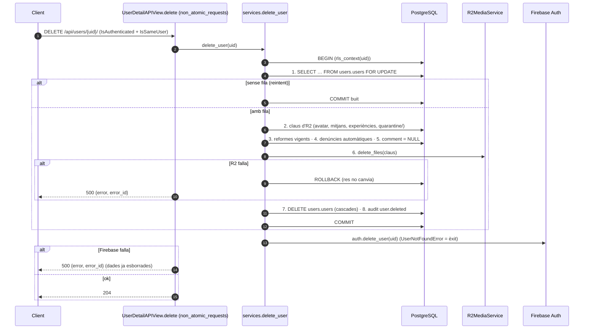

# Deep dive — Esborrat d'usuari: procediment únic, criteris i manteniment

> **[FET]** comprovat al codi · **[INFERÈNCIA]** deducció · **[NO VERIFICAT]** depèn de config externa.
> Document pare: [flux 1 — Perfil d'usuari](../flows/01-user-profile.md#esborrat-procediment-únic-d42) (contracte HTTP). Aquí: **per què** cada pas, què es conserva, què passa si falla i com mantenir-ho. Decisions: D21–D24 (provisional, chunk 3) substituïdes per **D42** (chunk 10); disseny: [postgres-schema §8.4](../design/postgres-schema.md).

## Procediment únic (chunk 10, D42)
Punt d'entrada: `apps.accounts.services.delete_user(uid)`, cridat per `DELETE /api/users/{uid}/` (`UserDetailAPIView`, vista `non_atomic_requests`; permisos `IsAuthenticated` + `IsSameUser`, **sense** `HasProfile`: així és idempotent i es pot acabar un esborrat que va deixar el compte de Firebase viu). Un usuari **bloquejat** també pot esborrar-se **[FET]**.

`delete_user` obre **una transacció pròpia** (`_delete_user_data`, dins `rls_context(uid)`) i, **després del `COMMIT`**, crida Firebase Auth. Passos de la transacció, en aquest ordre:

1. **Bloqueig de la fila**: `SELECT … FROM users.users WHERE uid = … FOR UPDATE`. Les FK (`creator_uid`, `user_uid`…) prenen `KEY SHARE` sobre aquesta fila en inserir contingut, així que un `POST` concurrent (experiència, dubte, pujada…) **espera** i, quan l'esborrat comprometi, falla per FK: cap fitxer orfe a R2. Sense fila: `_delete_user_data` retorna `False` i es salta directament a Firebase (camí idempotent: sense R2 ni auditoria).
2. **Recollida de les claus d'R2** (`_collect_r2_keys`, nombre constant de consultes): avatar i miniatura, mitjans propis (`refuge_media.creator_uid`), mitjans de les seves experiències encara que els hagi pujat un altre (D38) i, **[RGPD]**, els objectes de `quarantine/` dels seus intents de pujada **no confirmats** (`pending` i `failed`). **Mai** `moderation-hold/`.
3. **Reformes vigents** creades per l'usuari fora (`renovation_services.delete_current_by_creator`; cascada a participants, expulsats i enllaç).
4. **Pas 2 de §8.4 — denúncies automàtiques** (`_AUTO_REPORTS_SQL`, `system_context()`): cada mitjà `hidden_pending_review` que és ocult **només** per denúncies pendents d'aquest usuari (i que no és seu ni de les seves experiències) torna a la cua com a denúncia `automatic`/`high` amb `details = 'reporter_account_deleted'` i `reporter_uid` NULL. Si alguna de les denúncies pendents sobre aquell mitjà és d'un altre denunciant **o és `legal_hold`** (es conserva anonimitzada), el mitjà ja continua a la cua i no s'afegeix res. `ON CONFLICT DO NOTHING` (tanca R23).
5. **`comment` de les propostes a NULL** (`system_context()`): és text lliure i pot dur dades personals; la resta de la proposta s'anonimitza per la FK `SET NULL`.
6. **R2**: `delete_files(keys)` **dins la transacció** i després del bloqueig. Qualsevol excepció o fitxer fallit → `UserDeletionError` i tot es desfà (no hi ha cua `media_deletion_queue`, D40/D42).
7. **`DELETE FROM users.users`**: la BD fa la resta (cascades, `SET NULL` i triggers `legal_hold`, vegeu la taula de criteris).
8. **Auditoria** `user.deleted` (`audit.audit_log_service.log(None, ACTION_USER_DELETED)`), **sense cap identificador** (ni UID a `target_id` ni a `metadata`).

Després del `COMMIT`: **Firebase Auth** `auth.delete_user(uid)`; `UserNotFoundError` es dona per èxit. Si falla → `UserDeletionError` → 500 `{error, error_id}`.

### Fallades i reintents
| Fallada | Estat després | Resposta | Reintent |
|---|---|---|---|
| Insercions concurrents de contingut de l'usuari | l'esborrat espera que acabin (o elles esperen a l'esborrat i fallen per FK) | — | — |
| **R2 falla** (excepció o `failed`) | `ROLLBACK`: tot intacte, Firebase no es crida | 500 `{error, error_id}` | El `DELETE` ho torna a fer tot; R2 és idempotent (clau inexistent = èxit) |
| **Firebase falla** (≠ `UserNotFoundError`) | dades **ja esborrades** (COMMIT fet), compte viu | 500 `{error, error_id}` | El token encara és vàlid: el segon `DELETE` no troba fila (sense `HasProfile`), salta a Firebase i dóna **204** |
| **`COMMIT` falla** | `ROLLBACK`: tot intacte a la BD (R2 ja pot haver esborrat fitxers: les files de `refuge_media` continuen existint) | 500 | Reintent complet; els fitxers ja absents compten com a èxit. Finestra rara **[INFERÈNCIA]** |
| El procés mor entre `COMMIT` i Firebase | igual que «Firebase falla» | (connexió tallada) | El client reintenta el `DELETE` |
| Dos `DELETE` alhora del mateix usuari | el segon espera el `FOR UPDATE`, troba que no hi ha fila i salta a Firebase | 204 els dos | — |
| Usuari ja esborrat del tot (token encara vàlid) | res | 204 (idempotent, sense auditoria) | — |

La finestra que deixava el procediment provisional (Firebase dins el *savepoint*: si el `COMMIT` fallava amb el compte ja esborrat, quedaven dades sense compte) **ja no existeix**: el compte només s'esborra quan les dades ja són compromeses.

## Què es conserva
- **`moderation-hold/`** (R2): evidència retinguda per obligació legal; la clau no du l'UID.
- **Denúncies i auditoria `legal_hold`** (CSAM): es desvinculen (`reporter_uid`/`actor_uid`/`subject_uid` NULL + `anonymized_at`) pels triggers `SECURITY DEFINER` abans de la cascada i **conserven `details`** (decisió del PO, RGPD). No és retroactiu: `app` no té `UPDATE` sobre l'auditoria.
- **Propostes de refugi**: anonimitzades (`creator_uid`/`reviewer_uid` NULL, API `'unknown'`) amb el `comment` a NULL.
- **Reformes passades** creades per l'usuari: anonimitzades (`creator_uid` NULL; el trigger esborra el `group_link`).
- **Mitjana de condició dels refugis**: no es toca (no és dada personal; el vot es queda).
- Cap email, hash ni identificador per impedir un compte nou (decisió del PO, 26/10).

## Criteri per tipus de dada
| Dada | Tractament | Motiu |
|---|---|---|
| Experiències, dubtes, respostes | **Esborrar** (SQL: cascada de `DELETE users.users`) | Contingut personal sense valor si desapareix l'autor. La mitjana de condició del refugi **no** es toca (el vot es queda: no és dada personal) |
| Propostes de refugi (chunk 8) | **Anonimitzar** (FK `creator_uid`/`reviewer_uid` `ON DELETE SET NULL`; l'API emet `'unknown'`) i **anul·lar el `comment`** (`UPDATE … SET comment = NULL` amb `system_context()`, dins la transacció de `delete_user`) | Formen part de l'historial del refugi; el comentari és text lliure i pot dur dades personals (RGPD, decisió del PO 28/10) |
| Renovations vigents creades per l'usuari (`fin_date >= avui` de Madrid) | **Esborrar** (`delete_current_by_creator`; cascada a participants, expulsats i enllaç) | Ningú les podria gestionar |
| Renovations passades creades per l'usuari | **Anonimitzar**: la FK `creator_uid` `ON DELETE SET NULL` la deixa a `NULL` (l'API emet `'unknown'`) i el trigger `renovations_anonymize` n'esborra el `group_link` | Historial de manteniment; el `group_link` apunta a un grup privat i s'elimina per privacitat |
| Participacions i expulsions en renovations | **Cascada** de les FK `user_uid` `ON DELETE CASCADE` | No deixar UIDs penjats |
| Fotos pujades (R2 + fila de `refuge_media`) i mitjans de les experiències de l'usuari pujats per altri (un admin) | **Esborrar** (fitxers: `_collect_r2_keys` + `_delete_r2_keys`; files: cascada per `creator_uid` i per `experience_id`) | Dades personals; els fitxers no han de quedar orfes (D38) |
| Avatar | **Esborrar** | Dada personal |
| Miniatures (`{uuid}_thumb.webp`) de les fotos i de l'avatar | **Esborrar** (via `thumb_key` de les metadades) | Dades personals; si falla l'esborrat queda orfe i es registra un warning |
| `moderation.media_reports` (chunk 9) | **Denunciant esborrat**: les denúncies no `legal_hold` cauen en **cascada**; les `legal_hold` (CSAM) es **desvinculen** (`reporter_uid` NULL + `anonymized_at`, per `users.fn_users_detach_legal_hold`, `SECURITY DEFINER`, abans de la cascada) i **conserven `details`** (decisió del PO, 28/10, RGPD: forma part de l'evidència). L'API emet `reporter_uid = 'unknown'`. **Autor del mitjà o moderador** esborrat: `media_creator_uid`/`resolved_by` → `SET NULL` | Obligacions DSA i evidència CSAM; la resta no cal conservar-la |
| `moderation.moderation_notices` (chunk 9) | **Cascada** per `user_uid` (són avisos de l'usuari esborrat); si es borra el refugi o la denúncia, `SET NULL` | Dada personal de l'usuari |
| `moderation-hold/` (R2) | **Es conserva** (clau `moderation-hold/<upload_id>` o `<clau original>`, sense l'UID) | Evidència retinguda per obligació legal |
| `audit.audit_logs` (chunk 9) | **Cascada** per `actor_uid`/`subject_uid` (FK `DEFERRABLE`), excepte les files `legal_hold` (accions CSAM): el trigger les deixa amb `actor_uid`/`subject_uid` NULL i es conserven fins a `expire_at` (5 anys). No és retroactiu (`app` no té `UPDATE`). Les altres caduquen als 365 dies (`purge_audit_logs`, sense planificar, R18) | Registre art. 32 RGPD; l'UID afectat mai és a `target_id`/`metadata` |
| `visitors` dels refugis visitats | **Cascada** (`user_visited_refuges`; ja no hi ha array `visitors`) | No deixar referències |
| Participacions en visites (`activity.refuge_visit_participants`, PostgreSQL) | **Cascada** de `DELETE users.users`; el total (vista `refuge_visit_totals`) es recalcula sol | No deixar referències |
| Preferits i visitats (`user_*_refuges`), perfil públic i avatar (PostgreSQL) | **Cascada** de `DELETE users.users` | — |
| Intents de pujada no confirmats (`quarantine/` a R2) | **Esborrar** l'objecte (`pending` i `failed`) i la fila (cascada) | **[RGPD]** Pot dur una imatge de l'usuari |
| `users.users` | **Esborrar** | — |
| Compte de Firebase Auth | **Esborrar** (últim, **després del `COMMIT`**; U7, D42) | Sense compte no es pot tornar amb el mateix UID per saltar-se un bloqueig |
| Email o identificadors per impedir un compte nou | **No es desa res** (decisió del PO, 26/10) | Un hash d'email continua sent dada personal (pseudonimitzada) i, per a un esborrat demanat, caldria justificar-ne la retenció; un email nou costa segons, així que el benefici no ho compensa |

Per permetre l'anonimització, `renovations.creator_uid` és *nullable* i el `group_link` viu en una taula a part (que esborra el trigger); el *constraint trigger* de «cal enllaç» només s'aplica a reformes amb creador (D33) **[FET]**. Des del chunk 10 no queda cap pas de Firestore a l'esborrat.

## Abast
| Col·lecció / sistema | Operació |
|---|---|
| ~~`experiences`~~ (migrades, chunk 7) | Ara són `activity.experiences`: cascada del `DELETE users.users` (FK `creator_uid ON DELETE CASCADE`); els seus mitjans (`refuge_media.experience_id`) cauen per la FK `ON DELETE CASCADE` **[FET]** |
| PostgreSQL `moderation.upload_intents` (chunk 7) | cascada per `user_uid` |
| ~~`doubts` i `doubts/{id}/answers`~~ (migrats, chunk 6) | Ara són `activity.doubts`/`activity.answers`: cascada del `DELETE users.users` (FK `creator_uid ON DELETE CASCADE`). Les respostes d'un usuari a dubtes aliens també s'esborren, amb el seu subarbre de rèpliques, **també les d'altres usuaris** que hi penjaven (decisió del PO, 26/10: es manté l'esborrat del subarbre, coherent amb l'esborrat manual d'una resposta; no s'anonimitza) **[FET]** |
| PostgreSQL `moderation.media_reports`/`moderation_notices` i `audit.audit_logs` (chunk 9) | cascada, excepte les files `legal_hold` (trigger `fn_users_detach_legal_hold`: anonimitza i conserva `details`) |
| PostgreSQL `proposals.refuge_proposals` (chunk 8) | `SET NULL` de `creator_uid`/`reviewer_uid` + `comment = NULL` explícit |
| PostgreSQL `activity.renovations` (+ `renovation_group_links`, `renovation_participants`, `renovation_expelled`) | DELETE explícit (vigents del creador) / `SET NULL` + trigger (passades) / cascada (participacions i expulsions) |
| ~~`experiences` d'altres usuaris: UPDATE `media_keys`~~ | Ja no cal: les fotes d'un usuari a experiències d'altres són files de `refuge_media` (`creator_uid`) i cauen per cascada |
| PostgreSQL `users.users` | DELETE (cascada: perfil, avatar, preferits, visitats, participacions en visites, `refuge_media`) |
| R2 | `delete_files` d'avatar + miniatura + fotos pujades + mitjans de les seves experiències (+ miniatures) + `quarantine/` dels intents no confirmats, en un sol lot **dins la transacció**; les claus es llegeixen amb `system_context()` (un mitjà amagat d'un altre no és visible sota RLS) |
| Firebase Auth | `auth.delete_user(uid)` **després del `COMMIT`** (idempotent: `UserNotFoundError` es dona per fet) |
| PostgreSQL `moderation.media_reports` (pas 4) | `INSERT` de denúncies automàtiques per als mitjans que només eren ocults per denúncies de l'usuari |

## Privacitat (dret a l'oblit)
- S'eliminen totes les dades identificables de l'usuari al backend, a R2 i a Firebase Auth. El compte de Firebase l'esborra el **backend** després del `COMMIT`; el client només reautentica, crida l'endpoint i tanca la sessió local **[FET]**.
- Allò que cal conservar per integritat o per obligació legal s'anonimitza (vegeu «Què es conserva»).
- L'entrada d'auditoria `user.deleted` no porta cap identificador.

## Manteniment
Si s'afegeix una taula o relació amb `creator_uid` o UIDs d'usuari:
1. Decideix el criteri (esborrar vs anonimitzar) segons la taula de dalt.
2. Usa una FK `ON DELETE CASCADE`/`SET NULL` al DDL (no de Django) o, per anonimitzar un camp lliure (com el `comment`), un pas explícit a `_delete_user_data` dins la transacció.
3. Si la taula referencia fitxers d'R2, afegeix-ne les claus a `_collect_r2_keys` (nombre constant de consultes, amb `system_context()` si la RLS les amaga). Mai `moderation-hold/`.
4. Els passos nous van **abans** de l'R2 i del `DELETE`; dins la transacció només R2 com a crida externa (idempotent). Firebase sempre després del `COMMIT`.
5. Actualitza aquesta taula, el [flux 1](../flows/01-user-profile.md) i els tests d'`apps/accounts` (`test_user_deletion_procedure.py`, `test_user_deletion_commit.py`). Vegeu també [recipes/add-model.md §6](../recipes/add-model.md).
