# Disseny físic de la BD PostgreSQL (Neon)

> **[FET]** comprovat al codi, a les dades (`apps/refuges/data/final_data_refuges.json`) o a la documentació del projecte · **[INFERÈNCIA]** deducció raonada, no executada · **[NO VERIFICAT]** depèn de Neon, del pooler o d'una decisió pendent. Vegeu la [llegenda del README](../README.md).
>
> Revisat amb les decisions del product owner (`PLAN.md`, secció «Decisions sobre els dubtes del disseny», 24/10). Document **normatiu** per als agents que implementen la migració Firestore → PostgreSQL (chunks 1–11 de [`../migration/PLAN.md`](../migration/PLAN.md)). Les decisions de l'usuari del PLAN són vinculants; aquí s'hi afegeixen les decisions de disseny que el PLAN deixava obertes i la llista de [decisions preses i dubtes oberts](#11-decisions-preses-tot-decidit) per al product owner.
> Entrades: [`PLAN.md`](../migration/PLAN.md), [`arquitectura-neon-cloudrun-upstash.md`](../migration/arquitectura-neon-cloudrun-upstash.md) (§4.1, 4.4, 4.6, 5.1, 5.2), [`uml-conceptual.md`](../migration/uml-conceptual.md) (completat des del codi), [`integrations/neon.md`](../integrations/neon.md).
> Cap secret ni valor de variable d'entorn apareix aquí; només noms de rols i d'objectes.
>
> **Revisió del PO (24/10, tarda)**: catàlegs `users.languages` i `refuges.refuge_types` amb FK (en lloc de `CHECK`), idioma per defecte `'en'`, avatar a una taula pròpia `users.user_avatars` (PK `key`), `refuge_links` amb PK `url`, `refuges.remarque` nullable, fora la vista `refuge_map` i la columna `participants_count`. Les PK compostes (preferits, visitats, participants, expulsats, visites) **no** s'apliquen amb Django 5.1: es mantenen `id uuid` + `UNIQUE` fins a pujar a Django 5.2 (`TECH_DEBT` R14; **superat** per la segona revisió).
>
> **Segona revisió del PO (24/10, vespre)**: pujada a **Django 5.2 LTS + Python 3.14 + Postgres 18** (projecte Neon nou) **abans del chunk 3**: `uuidv7()` de la BD com a default de totes les PK substitutes (§1.4) i **PK compostes allà on cap FK hi apunta** (preferits, visitats, participants i expulsats de reformes, participants de visites); `refuge_visits` conserva `id` perquè `refuge_visit_participants` hi apunta (Django 5.2 no admet FK cap a una PK composta). Fora la columna `remarque` (també de l'API). Escriptura del catàleg de refugis per a `app` només a partir del chunk 8. Propostes: `payload`/`refuge_snapshot` continuen en `jsonb` amb llista blanca (§2.18).

## Índex
0. [Resum de decisions](#0-resum-de-decisions)
1. [Visió general: schemas, convencions, IDs, mapatge a Django](#1-visió-general)
2. [Especificació per taula](#2-especificació-per-taula)
3. [Enumeracions](#3-enumeracions)
4. [Valors derivats i vistes](#4-valors-derivats-i-vistes)
5. [Mapatge Firestore → SQL, contracte de l'API i receptes de consulta](#5-mapatge-firestore--sql-contracte-de-lapi-i-receptes)
6. [Apps Django i models](#6-apps-django-i-models)
7. [Rols, grants i mecanisme de RLS](#7-rols-grants-i-mecanisme-de-rls)
8. [RGPD](#8-rgpd)
9. [Pla de càrrega de `final_data_refuges.json`](#9-pla-de-càrrega-de-final_data_refugesjson)
10. [UML físic (Mermaid)](#10-uml-físic-mermaid)
11. [Decisions preses (tot decidit)](#11-decisions-preses-tot-decidit)
12. [Canvis de contracte per al frontend](#12-canvis-de-contracte-per-al-frontend)

---

## 0. Resum de decisions

| # | Decisió | On |
|---|---|---|
| 1 | **27 taules + 1 vista** (`refuge_visit_totals`) en 6 schemas de domini (`users`, `refuges`, `activity`, `proposals`, `moderation`, `audit`) + schema `core` només de funcions (context RLS, `unaccent` immutable, arrodoniment). | §1.1 |
| 2 | **Totes les PK substitutes són `uuid` v7** (ordenat per temps, generat per la BD amb `uuidv7()` de Postgres 18 com a default; decisió del product owner); `users.uid` (text, UID de Firebase), `refuge_media.key` i `user_avatars.key` (claus R2), `refuge_links.url` i els codis dels catàlegs (`languages.code`, `refuge_types.code`) són PK naturals; les taules d'unió sense cap FK entrant tenen **PK composta** (Django 5.2). L'API continua exposant IDs com a *string* opac (UUID canònic en minúscules). | §1.4 |
| 3 | Mapatge de schema a Django amb **`db_table = 'schema"."taula'`** (no `search_path`): és independent de la connexió i funciona amb PgBouncer en mode transacció. | §1.5 |
| 4 | **Catàlegs oberts = taula + FK** (`users.languages`, `refuges.refuge_types`): afegir un idioma o un tipus és un `INSERT` (migració de dades), sense tocar el codi (decisió del PO, obert-tancat). Els estats interns (màquines d'estat lligades al codi) continuen sent `CHECK ... IN (...)` + `models.TextChoices`. | §3 |
| 5 | `refuge_amenities` 1–1 amb 12 `boolean NOT NULL DEFAULT false`; `info_couchage`/`info_eau` s'ignoren; l'API continua emetent **0/1 enters** a `info_comp` (el frontend espera `number`). | §2.6 |
| 6 | **Comptadors derivats, no desats**: `num_shared_experiences`, `num_renovated_refuges`, `answers_count`, `total_visitors`, `uploaded_photos_keys` i `visitors` (agregació; la vista `refuge_visit_totals` perquè la RLS amagaria files aliens a un `SUM` directe). **Única excepció desada** (decisió del PO): `refuges.condition` i `refuges.num_contributed_conditions`. | §4 |
| 7 | **`condition` és una mitjana desada al refugi** (`double precision`, 0–3, nullable) amb `num_contributed_conditions` (n) i `condition_reset_at`; **no hi ha entitat vot** (cap taula `refuge_condition_votes`, cap vista). L'alimenta l'atribut obligatori `experiences.condition` mitjançant un *trigger* `SECURITY DEFINER` (POST: `c=(c·n+v)/(n+1)`; PATCH: `c=c+(v'−v)/n`; esborrar no toca el refugi) i la proposta aprovada amb `condition` (`c=valor`, `n=1`). Arrodoniment **només en serialitzar** (half-to-even, `round()` de Python); el filtre usa `core.round_half_even(condition)`. | §2.5, §2.15, §4 |
| 8 | Reformes: `CHECK (ini_date <= fin_date)` (es permeten reformes d'un dia) + **`EXCLUDE USING gist (refuge_id WITH =, daterange(ini_date, fin_date, '[]') WITH &&)`** sobre **totes** les files (el predicat «només actives» no es pot expressar en un índex perquè `CURRENT_DATE` no és immutable, i no cal). `group_link` viu a una taula pròpia amb RLS (només creador i participants). | §2.12 |
| 9 | Aprovar/rebutjar propostes: `SELECT ... FOR UPDATE` amb `status='pending'` + `UPDATE ... WHERE status='pending'` → la doble aprovació (C2) és impossible a la BD. Regles `create/update/delete` del payload com a `CHECK` (inclosa la llista tancada de claus del JSONB). | §2.18 |
| 10 | **RLS activada a les 27 taules** (rol `app`, sense `FORCE`); context per **`set_config(..., true)`** (local a la transacció) dins una transacció per petició. Lectura pública (`USING (true)`) a refugis, perfils públics, experiències, dubtes i respostes; mitjans: `visible` per a tothom, la resta autor/admin. Les crides «de sistema» (jobs, efectes creuats de moderació) usen un `system_context()` explícit. **Perfil obligatori**: tot endpoint autenticat llevat de `POST /users/` retorna 403 `profile_required` si no hi ha fila a `users`. | §7 |
| 11 | Esborrat d'usuari en **una transacció** amb `ON DELETE` (CASCADE / SET NULL segons el PLAN) + una **cua d'esborrat de R2** alimentada per triggers (`moderation.media_deletion_queue`). **Excepció CSAM**: les denúncies i les entrades d'auditoria marcades `legal_hold` es **conserven anonimitzades** (un *trigger* `BEFORE DELETE` les desvincula de l'usuari abans de la cascada); `moderation-hold/` a R2 es conserva. | §2.20, §2.23, §2.24, §8 |
| 12 | `users` privada i minimitzada; dades públiques a `user_public_profiles`. Cap email ni data de naixement. `audit_logs` caduca a 365 dies, `upload_intents` a 1 dia (jobs de purga). | §2.1, §8 |
| 13 | Càrrega **d'un sol ús** del JSON (`load_refuges`, sense `--overwrite`; si ja hi ha refugis a la BD, `CommandError` sense escriure res); 1.542 refugis, 1.542 `refuge_amenities`, 2.075 enllaços; `condition` inicial = `puntua_refugi(info_comp)` amb `n = 0`; la comanda i `puntua_refugi` viuen a `apps/refuges/management/commands/load_refuges.py`. | §9 |
| 14 | Una **app Django per domini**, amb ordre de migracions explícit per evitar dependències circulars (`users` abans de `refuges`; les FK cap a `experiences` i `proposals` s'afegeixen en migracions posteriors de `refuges`). | §6 |

---

## 1. Visió general

### 1.1 Schemas, taules, apps i chunks

| Schema | Taules / vistes | App Django | Chunk |
|---|---|---|---|
| `core` | Només funcions: `uid()`, `is_admin()`, `is_system()`, `immutable_unaccent()`, `norm_name()`, `round_half_even()` | `core` | 1 |
| `users` | `languages` (catàleg), `users`, `user_public_profiles`, `user_avatars`, `user_favourite_refuges`, `user_visited_refuges` | `accounts` | 2 (`0001`: `users` + perfils, perquè `refuges` hi depèn) i 3 (`0002`: llistes) |
| `refuges` | `refuge_types` (catàleg), `refuges`, `refuge_amenities`, `refuge_links`, `refuge_media` | `refuges` | 2 (+7: FK `refuge_media.experience_id`) |
| `activity` | `refuge_visits`, `refuge_visit_participants` (+ vista `refuge_visit_totals`), `renovations`, `renovation_group_links`, `renovation_participants`, `renovation_expelled`, `experiences`, `doubts`, `answers` | `visits` (4), `renovations` (5), `doubts` (6), `experiences` (7) | 4–7 |
| `proposals` | `refuge_proposals` | `proposals` | 8 |
| `moderation` | `upload_intents` (app `uploads`, chunk 7); `media_reports`, `moderation_notices`, `moderation_hash_blocklist`, `media_deletion_queue` (app `moderation`, chunk 9) | `uploads`, `moderation` | 7, 9 |
| `audit` | `audit_logs` | `audit` | 9 |

`coords_refugis` **no té taula ni vista**: és una consulta directa a `refuges.refuges` (§5.3, recepta 5). El `visitors` del refugi i `visited_refuges` de l'usuari són **la mateixa** taula `users.user_visited_refuges` (decisió del PLAN).

### 1.2 Convencions

- Noms `snake_case`; taules en plural; PK `id` (excepte les taules d'unió amb PK composta, §1.4); FK cap a usuaris com a `<rol>_uid` (`creator_uid`, `reporter_uid`, `user_uid`…), la resta `<entitat>_id`.
- Tots els instants són **`timestamptz`** (UTC) i els posa el **rellotge de la BD** (`DEFAULT now()` / Django `db_default=Now()`, i `Now()` als `UPDATE`; l'aplicació no hi envia `timezone.now()`: decisió del PO, 26/10). Les dates de negoci (`ini_date`, `fin_date`, `visit_date`, `modified_at` del refugi) són **`date`** i les calcula l'aplicació amb `get_madrid_today()`. Django té `TIME_ZONE = 'Europe/Madrid'` (decisió del PO, 26/10): `timezone.localdate()`, `__date`/`Trunc*` i els `datetime` naïfs són hora de Madrid. L'API emet *strings* ISO amb el desplaçament de `Europe/Madrid` **[FET]** (`isoformat_madrid`).
- **Usuaris a zones diferents** (p. ex. un a Espanya i un altre a Frankfurt, o a Canàries): un `timestamptz` és un **instant absolut**, de manera que dos usuaris que fan una acció al mateix moment desen el mateix valor sigui on sigui; l'API l'emet amb desplaçament (`+01:00`/`+02:00`) i el client el pot mostrar en l'hora local del dispositiu. La **sessió de Postgres de Django és UTC** encara que `TIME_ZONE` sigui Madrid (Django la hi força amb `USE_TZ`; Neon és `GMT` per defecte i el Docker local/CI `Etc/UTC`): per això «avui» es calcula **sempre a l'aplicació** i es passa com a paràmetre, i cap consulta, funció ni política usa `CURRENT_DATE`/`now()::date`/`LOCALTIMESTAMP` (test de guarda `apps/core/tests/test_timezone.py`). Les **durades** (TTL d'auditoria, caducitat d'intents) es calculen a la BD (`now() + interval` / `TransactionNow() + RETENTION`; el helper `madrid_after` s'ha eliminat): sumar un `timedelta` a un `datetime` de Madrid és aritmètica de rellotge de paret i, si travessa un canvi d'hora, queda 1 h curt o llarg. Un EXIF sense desplaçament s'interpreta com a hora de Madrid; el `creation_time` dels vídeos és UTC. Conseqüència acceptada (ja passa avui): un usuari de Canàries a les 23:30 hora local ja és «demà» per a l'API.
- **Sentinelles fora de la BD**: `'unknown'` (creador anonimitzat) i `'system'` (actor/denunciant automàtic) es desen com a **`NULL`**; l'API els torna a emetre com a `'unknown'`/`'system'` per mantenir el contracte.
- Text lliure: `CHECK (btrim(col) <> '')` quan és obligatori i límit de longitud igual al del serializer (`char_length(col) <= N`).
- Tota FK té `ON DELETE` explícit **i un índex** que comença per la columna de la FK (necessari per a les cascades i per a la RLS).
- Noms d'objectes **explícits** (obligatori a Django amb `name=`; màxim 63 caràcters): `<taula>_<cols>_pk|fk|uq|ck|idx|gist|gin|excl`.
- Cap `default=` als serializers d'actualització (gotcha 4 de CLAUDE.md / M1): l'`UPDATE` només toca els camps enviats.
- `BEGIN … COMMIT` per petició (§7.3): totes les restriccions `DEFERRABLE` es comproven al `COMMIT`.

### 1.3 Extensions i *bootstrap* (una vegada per branca de Neon, pel propietari)

`migrator` **no** pot fer `CREATE EXTENSION` **[FET, `integrations/neon.md`]**; ho fa el propietari de la BD (`refugisdb_owner`) abans de la primera migració. `postgis`, `pg_trgm` i `unaccent` ja hi són (PostGIS 3.5, Postgres 17) al projecte actual. **El projecte nou de Postgres 18** (§1.4) ofereix PostGIS 3.6.4, `pg_trgm` 1.6, `unaccent` 1.1 i `btree_gist` 1.8 **[FET: taula d'extensions de Neon]**; s'hi ha de repetir tot el *bootstrap* d'aquesta secció i els rols de §7.1. **Falta `btree_gist`** (necessària per a `refuge_id WITH =` a l'`ExclusionConstraint` d'`uuid`):

```sql
-- Propietari (refugisdb_owner), un cop per branca (production i dev):
CREATE EXTENSION IF NOT EXISTS postgis;      -- ja existeix [FET]
CREATE EXTENSION IF NOT EXISTS pg_trgm;      -- ja existeix [FET]
CREATE EXTENSION IF NOT EXISTS unaccent;     -- ja existeix [FET]
CREATE EXTENSION IF NOT EXISTS btree_gist;   -- NOVA
GRANT CREATE ON DATABASE refugisdb TO migrator;   -- perquè core.0001 pugui fer CREATE SCHEMA (el migrator en serà el propietari)
GRANT CREATE ON SCHEMA public TO migrator;       -- PG15+ (vegeu la nota de sota): per a django_migrations i les taules de Django
ALTER ROLE app      NOSUPERUSER NOCREATEDB NOCREATEROLE NOREPLICATION NOBYPASSRLS;
ALTER ROLE migrator NOSUPERUSER NOCREATEDB NOCREATEROLE NOREPLICATION NOBYPASSRLS;
ALTER ROLE app SET statement_timeout = '20s';
ALTER ROLE app SET lock_timeout = '5s';
ALTER ROLE app SET idle_in_transaction_session_timeout = '30s';
```

**`GRANT CREATE ON SCHEMA public TO migrator` (PG15+).** PostgreSQL 15 va treure `CREATE` a `PUBLIC` sobre el schema `public`, i Django crea a `public` `django_migrations` i les taules de `auth`/`admin`/`sessions` (el rol `migrator` les ha de poder crear). **Decisió: mantenir-lo** (afegit al *bootstrap* local `scripts/dev/setup_local_postgres.sh` al chunk 1; a Neon `dev` **[FET: verificat pel PO amb `python manage.py check_neon`, que avisa si falta; repetit i verificat al projecte nou de PG18 (25/10/2026), `production` i `dev`]**). Alternativa descartada: moure les taules internes de Django a un schema `django` amb `search_path` (més configuració per a un benefici mínim, i `search_path` no és fiable amb el pooler, §1.5).

Les extensions viuen a `public` (on les espera `django.contrib.gis` i on resolen `similarity()`, `%`, `gin_trgm_ops`, `ST_*`). Les funcions pròpies viuen a `core` i es **qualifiquen sempre** (`core.norm_name(...)`). **Entorn local de proves**: contenidor Docker `rl-postgres` amb la imatge `postgis/postgis:17-3.5` **[FET]** (inclou `pg_trgm`, `unaccent` i `btree_gist`); amb la pujada passa a una imatge `postgis/postgis:18-3.6`. Cal reproduir el *bootstrap* d'aquesta secció (extensions pel superusuari local, rols `app` i `migrator` amb els mateixos atributs; feina del chunk 1). El disseny requereix **Postgres 18** pel `DEFAULT uuidv7()` (la resta funcionaria des de la 15: `UNIQUE NULLS NOT DISTINCT` és de la 15 i `bit_count` de la 14). Cal repetir els tests de RLS i les migracions també a Neon `dev` (e2e), perquè les diferències de planificador/pooler només s'hi veuen.

### 1.4 Identificadors: **UUID v7** (decisió vinculant del product owner)

Totes les **PK substitutes** són `uuid` **versió 7** (RFC 9562: 48 bits de timestamp en mil·lisegons + bits aleatoris), exposades a l'API com a *string* canònic en minúscules (36 car.; el frontend les tracta com a opaques i els serializers actuals accepten `max_length` 100/255). Excepcions (PK **natural**): `users.users.uid` (`varchar(128)`, UID de Firebase, `CHECK (char_length(uid) BETWEEN 1 AND 128 AND uid NOT IN ('system','unknown'))`), `refuge_media.key` i `user_avatars.key` (claus R2, ja úniques), `refuge_links.url` (decisió del PO) i els codis dels catàlegs `users.languages.code` i `refuges.refuge_types.code`. Això inclou les taules de registre (`audit_logs`, cua d'R2, `moderation_hash_blocklist`…), que per tant **no** usen `identity`.

**PK compostes (decisió del PO; `CompositePrimaryKey` de Django 5.2).** On cap FK hi apunta, la taula **no té `id`** i la PK és la clau natural:
- `user_favourite_refuges`, `user_visited_refuges`: `(user_uid, refuge_id)`;
- `renovation_participants`, `renovation_expelled`: `(renovation_id, user_uid)`;
- `refuge_visit_participants`: `(visit_id, user_uid)`.

**Restricció de Django 5.2**: cap `ForeignKey` de l'ORM pot apuntar a un model amb PK composta. Per això, seguint la indicació del PO, `refuge_visits` **conserva `id` uuid v7** + `UNIQUE (refuge_id, visit_date)` (hi apunta `refuge_visit_participants.visit_id`). La PK de participants de visites és `(visit_id, user_uid)`: equival a la `(refuge_id, visit_date, user_uid)` que demanava el PO perquè cada `visit_id` és un `(refuge_id, visit_date)` únic. Limitacions acceptades: `pk` és una tupla, l'admin de Django no gestiona aquests models (no se n'usa) i les migracions no poden canviar una PK a composta un cop creada (per això es fa abans del chunk 3, reescrivint les `0001`).

**Generació (Postgres 18, decisió del PO).** Postgres 18 té `uuidv7()` al nucli. Neon suporta Postgres 14–18, però **un projecte no pot canviar de versió major**: cal crear un projecte Neon nou amb PG18 i refer-hi el *bootstrap* (§1.3, §7.1) **[FET: documentació de Neon]**. Com que Neon `dev` encara no té dades reals, el cost és baix. Estratègia:
1. **Default de BD a totes les PK substitutes**: `id uuid NOT NULL DEFAULT uuidv7()`; a Django 5.2, `UUIDField(primary_key=True, db_default=Func(function='uuidv7'), editable=False)`. Django recupera el valor generat amb `RETURNING` a `objects.create()`, però **no a `bulk_create`** **[FET: provat amb Django 5.2.18]**: qui necessiti els PK d'una càrrega massiva els demana abans a la BD (`SELECT uuidv7() FROM generate_series(1, n)`, com `load_refuges`; DECISIONS_AUTONOMES D11). **Un sol generador**: cap `default=` de Python ni helper propi (`api/utils/ids.py` s'ha eliminat; l'`error_id` dels 500 usa `uuid.uuid7()` de Python, que no és cap PK). Les insercions de SQL pla (`psql`, scripts) també reben un v7 sense fer res. `uuidv7()` és monòton dins d'una mateixa sessió (fracció de mil·lisegon als 12 bits `rand_a`) **[INFERÈNCIA: notes de PostgreSQL 18]**.
2. **Python 3.14** a CI i a producció (Django ≥ 5.2.8, primera 5.2 compatible amb 3.14 **[FET: notes de Django 5.2.8]**): `uuid.uuid7()` de la biblioteca estàndard queda disponible si mai cal un ID abans d'inserir, però el valor de les PK el posa sempre la BD. Cal comprovar, en implementar-ho, que totes les dependències de `requirements.txt` tenen versió per a Django 5.2 i Python 3.14.
3. **Ids mal formats a la URL** han de donar **404**, no 500: convertidor `<uuid:...>` a `refugis_lliures/urls.py` o captura de `ValidationError`/`DataError`.

**Conseqüències**
- **Localitat de l'índex B-tree de la PK**: els v7 s'inserixen sempre «a la dreta» de l'índex (com un `bigserial`), sense la fragmentació i el mal ús de la *buffer cache* dels v4 aleatoris. A ~1,5 mil refugis és irrellevant, però escala bé per a `audit_logs` i participants.
- **Paginació per cursor (*keyset*)**: com que l'ordre de `id` és (aproximadament) l'ordre de creació, `ORDER BY id [DESC]` i `WHERE id < :cursor` poden **substituir** `(created_at, id)` a les llistes ordenades per creació (preferits, visitats, dubtes, propostes per creador, avisos, denúncies). **Es mantenen les columnes `created_at`** per a lectura humana, filtres per data i les llistes que ordenen per altra cosa (`experiences` per `modified_at`, `refuge_media` per `uploaded_at`). Els índexs `(…, created_at DESC, id DESC)` de §2 es poden simplificar a `(…, id DESC)` allà on l'ordre sigui per creació; es mantenen tal com estan fins que el chunk corresponent ho decideixi (no és un canvi de contracte). Cal tenir present que dues files del mateix mil·lisegon només queden ordenades gràcies a la monotonicitat de `uuidv7()` dins d'una mateixa sessió; entre sessions l'ordre és «aproximat»: per a ordre estricte de negoci, `created_at, id`.
- **El timestamp és dins de l'ID** (fuga de l'instant de creació): acceptat; ja s'exposa a l'API (`created_at`/`uploaded_at`…).
- **Mida**: 16 B per valor (vs ≥ 21 B del text de Firestore) a totes les FK i índexs.
- **Claus R2** `refugis-lliures/{refuge_id}/{uuid}.ext`: el nom de fitxer continua sent un UUID (v4 o v7, indiferent) generat al servei de mitjans.
- `media_reports`: **ja no cal l'id determinista SHA-256**; PK `uuid` v7 + `UNIQUE NULLS NOT DISTINCT (refuge_id, media_key, reporter_uid)`.
- Les migracions i el *loader* no depenen de cap UUID fix: la càrrega s'identifica per clau natural (§9).

### 1.5 Mapatge schema ↔ Django: `db_table` amb cometes (decisió) vs. `search_path`

| Opció | Avantatges | Inconvenients |
|---|---|---|
| **A. `Meta.db_table = 'refuges"."refuges'`** (Django ho cita com `"refuges"."refuges"`) | Explícit i **independent de la connexió**: funciona amb el pooler de Neon (PgBouncer, mode transacció), amb el rol `migrator` per l'endpoint directe i amb la BD de proves. Les FK entre schemas funcionen. Els noms d'índex/constraint es netegen sols (Django treu `"` i `.` en generar-los). | Cal posar `name=` a tot índex/constraint (els noms autogenerats serien llargs); el SQL pla ha de qualificar sempre; `inspectdb` no és usable. |
| B. `OPTIONS: {'options': '-c search_path=...'}` | Models nets | El pooler en mode transacció **no admet** el paràmetre d'arrencada `options` **[INFERÈNCIA: error «unsupported startup parameter»; el chunk 1 ho ha de comprovar]**. |
| C. `ALTER ROLE app SET search_path = ...` | Funciona amb el pooler | Amaga el schema, genera col·lisions de noms entre schemas i **no** serveix per al DDL del `migrator` (cada app crea taules a un schema diferent). |

**Decisió: A.** El `search_path` es deixa per defecte (inclou `public`, on són PostGIS/`pg_trgm`/`unaccent`). Les funcions `SECURITY DEFINER` fixen el seu propi `SET search_path = pg_catalog, <schema>`.

**Precaucions amb PgBouncer en mode transacció** (aplicables a tot el disseny):
1. Cap estat de sessió: `SET`/`set_config(..., false)` es perd o **es filtra** a un altre client. Tot context és `set_config(name, value, true)` (local a la transacció) dins una transacció oberta (§7.3).
2. `DISABLE_SERVER_SIDE_CURSORS = True` (ja a `settings.py`); psycopg 3: `prepare_threshold=None` a `OPTIONS` fins que es verifiqui el suport de sentències preparades del pooler de Neon **[NO VERIFICAT]**.
3. Cap `pg_advisory_lock` de sessió: usar `pg_advisory_xact_lock`. Cap `LISTEN/NOTIFY`, cap taula temporal fora de la transacció.
4. `SELECT … FOR UPDATE` i `INSERT … ON CONFLICT` són segurs (dins de la transacció).
5. Les **migracions** i la càrrega de dades van per l'endpoint **directe** (`neon_migrator`), on la sessió és real.
6. Després d'una transacció amb `set_config(..., true)`, `current_setting('app.uid', true)` pot retornar **`''`** (no `NULL`) a la mateixa connexió; per això `core.uid()` fa `NULLIF(..., '')`.

---

## 2. Especificació per taula

**Com llegir cada fitxa.** *Columnes* (tipus PostgreSQL → camp Django), *restriccions* (PK, FK + `on_delete`, `UNIQUE`, `CHECK`), *índexs* (cadascun amb la consulta real que el justifica), *RLS* (decisió + SQL exacte) i *grants*. Els índexs de les FK són obligatoris i s'hi indiquen quan no queden coberts per un altre.

**Macros de les polítiques de RLS** (s'expandeixen **literalment** al generar la migració; són text, no funcions):

| Macro | Expansió |
|---|---|
| `{U}` | `(SELECT core.uid())` — UID de Firebase de la petició o `NULL` si és anònima |
| `{ADM}` | `(SELECT core.is_admin())` — el token porta el claim `role == 'admin'` |
| `{SYS}` | `(SELECT core.is_system())` — només dins `system_context()` (jobs, efectes creuats de moderació; §7.4) |

El `(SELECT …)` fa que el planificador avaluï la funció **una sola vegada per sentència** (*InitPlan*). Totes les polítiques són `PERMISSIVE` i `TO app`; el propietari (`migrator`) no hi està subjecte i no es fa servir `FORCE`. **Sense política per a una ordre = ordre denegada per a `app`.** Recordatori: `INSERT … RETURNING`, `UPDATE/DELETE … WHERE` i `ON CONFLICT DO UPDATE` també exigeixen que la fila passi la política de `SELECT`; per això cada taula té un `SELECT` que cobreix els casos d'escriptura. Les accions referencials (`ON DELETE CASCADE/SET NULL`) s'executen amb els privilegis del propietari de la taula referenciant **[INFERÈNCIA, comportament de Postgres: `ri_triggers.c` canvia a l'owner amb `SECURITY_NOFORCE_RLS`; cal un test amb el rol `app`]**: les cascades **no** queden bloquejades per la RLS.

### 2.0 Schema `core`: funcions (app `core`, chunk 1)

```sql
CREATE SCHEMA core;

-- Context de la petició (valors que posa l'aplicació amb set_config(..., true), §7.3)
CREATE FUNCTION core.uid() RETURNS text LANGUAGE sql STABLE PARALLEL SAFE
  AS $$ SELECT NULLIF(current_setting('app.uid', true), '') $$;
CREATE FUNCTION core.is_admin() RETURNS boolean LANGUAGE sql STABLE PARALLEL SAFE
  AS $$ SELECT COALESCE(current_setting('app.is_admin', true), '') = 'true' $$;
CREATE FUNCTION core.is_system() RETURNS boolean LANGUAGE sql STABLE PARALLEL SAFE
  AS $$ SELECT COALESCE(current_setting('app.is_system', true), '') = 'true' $$;

-- unaccent NO és IMMUTABLE (depèn del diccionari). Embolcall IMMUTABLE amb el diccionari fixat per OID de nom:
-- permet índexs d'expressió. Risc acceptat: si es canvia el fitxer de regles d'unaccent cal REINDEX.
CREATE FUNCTION core.immutable_unaccent(text) RETURNS text
  LANGUAGE sql IMMUTABLE PARALLEL SAFE STRICT
  AS $$ SELECT public.unaccent('public.unaccent'::regdictionary, $1) $$;

-- Forma normalitzada per a la cerca per nom (sense accents, minúscules). Mateixa expressió a l'índex i a les consultes.
CREATE FUNCTION core.norm_name(text) RETURNS text
  LANGUAGE sql IMMUTABLE PARALLEL SAFE STRICT
  AS $$ SELECT core.immutable_unaccent(lower($1)) $$;

-- Arrodoniment half-to-even (== round() de Python 3, el que fa RefugiSerializer.to_representation).
-- round(numeric) de Postgres arrodoneix .5 cap a fora (2.5 -> 3); Python dóna 2. Per a double precision, el
-- comportament dels empats de round() depèn de la plataforma: es fixa explícitament.
CREATE FUNCTION core.round_half_even(double precision) RETURNS integer
  LANGUAGE sql IMMUTABLE PARALLEL SAFE STRICT
  AS $$ SELECT CASE WHEN $1 - floor($1) = 0.5 THEN (2 * round(($1 / 2)::numeric))::integer
                    ELSE round($1::numeric)::integer END $$;

GRANT USAGE ON SCHEMA core TO app;
GRANT EXECUTE ON FUNCTION core.uid(), core.is_admin(), core.is_system(),
  core.immutable_unaccent(text), core.norm_name(text), core.round_half_even(double precision) TO app;
```

`condition` es desa com a `double precision` i es calcula amb la mateixa aritmètica IEEE que Python (fórmula incremental a un `UPDATE`), de manera que `core.round_half_even(condition)` coincideix amb el `round()` que fa el serializer. Canviar a *half-up* és una línia (és la decisió del PO mantenir half-to-even).

---

### 2.1 `users.users` (app `accounts`; **RLS sí**)

Dades **privades i minimitzades** (decisió del PLAN): sense email ni data de naixement. Els camps públics són a [`user_public_profiles`](#22-usersuser_public_profiles-app-accounts-rls-sí).

| Columna | Tipus → Django | Null | Default | Notes |
|---|---|---|---|---|
| `uid` | `varchar(128)` → `CharField(max_length=128, primary_key=True)` | NO | — | UID de Firebase |
| `language` | `varchar(8)` → `ForeignKey(Language, to_field='code', db_column='language')` | NO | `'en'` | FK → `users.languages(code)` `ON DELETE RESTRICT`; valor per defecte anglès (decisió del PO) |
| `created_at` | `timestamptz` → `DateTimeField` | NO | `now()` | |
| `age_confirmed_at` | `timestamptz` | SÍ | — | només es desa si s'ha confirmat; mai la data de naixement |
| `age_threshold` | `smallint` | SÍ | — | llindar vigent en confirmar (avui 16) |
| `moderation_strikes` | `smallint` | NO | `0` | |
| `is_blocked` | `boolean` | NO | `false` | |
| `blocked_reason` | `varchar(32)` | SÍ | — | `csam_confirmed`/`strikes`/`moderation_hash_match` |
| `blocked_at` | `timestamptz` | SÍ | — | |

Restriccions:
- `users_uid_ck`: `char_length(uid) BETWEEN 1 AND 128 AND uid NOT IN ('system','unknown')`
- `users_language_fk`: `FOREIGN KEY (language) REFERENCES users.languages(code) ON DELETE RESTRICT` (substitueix el `CHECK`; índex `users_language_idx` per a l'esborrat d'un idioma)
- `users_age_pair_ck`: `(age_confirmed_at IS NULL) = (age_threshold IS NULL)`; `users_age_threshold_ck`: `age_threshold IS NULL OR age_threshold BETWEEN 13 AND 21`
- `users_strikes_ck`: `moderation_strikes >= 0`
- `users_blocked_ck`: `is_blocked OR (blocked_reason IS NULL AND blocked_at IS NULL)`; `users_blocked_reason_ck`: `blocked_reason IS NULL OR blocked_reason IN ('csam_confirmed','strikes','moderation_hash_match')`

Índexs: la PK (totes les consultes són per `uid`: `UserDAO.get_user_by_uid`, `user_exists`, `IsNotBlocked`, `IsAgeConfirmed`) i `users_language_idx` (`language`, només per a la FK).

RLS:
```sql
ALTER TABLE users.users ENABLE ROW LEVEL SECURITY;
CREATE POLICY users_select ON users.users FOR SELECT TO app
  USING (uid = {U} OR {ADM} OR {SYS});
CREATE POLICY users_insert ON users.users FOR INSERT TO app    -- POST /users/: només el propi compte i sense moderació prèvia
  WITH CHECK ((uid = {U} AND moderation_strikes = 0 AND NOT is_blocked
               AND blocked_reason IS NULL AND blocked_at IS NULL) OR {SYS});
CREATE POLICY users_update ON users.users FOR UPDATE TO app    -- PATCH propi; l'admin/sistema (strikes, bloqueig d'altres)
  USING (uid = {U} OR {ADM} OR {SYS})
  WITH CHECK (uid = {U} OR {ADM} OR {SYS});
CREATE POLICY users_delete ON users.users FOR DELETE TO app    -- IsSameUser (sense bypass d'admin, com ara)
  USING (uid = {U} OR {SYS});

-- Les columnes de moderació només les canvia un admin/sistema (la RLS no és per columna):
CREATE FUNCTION users.fn_users_guard() RETURNS trigger LANGUAGE plpgsql AS $$
BEGIN
  IF NOT (core.is_admin() OR core.is_system()) AND (
       NEW.uid IS DISTINCT FROM OLD.uid
    OR NEW.created_at IS DISTINCT FROM OLD.created_at
    OR NEW.moderation_strikes IS DISTINCT FROM OLD.moderation_strikes
    OR NEW.is_blocked IS DISTINCT FROM OLD.is_blocked
    OR NEW.blocked_reason IS DISTINCT FROM OLD.blocked_reason
    OR NEW.blocked_at IS DISTINCT FROM OLD.blocked_at) THEN
    RAISE EXCEPTION 'users: columna de moderació/immutable només modificable per admin/sistema'
      USING ERRCODE = 'insufficient_privilege';
  END IF;
  RETURN NEW;
END $$;
CREATE TRIGGER users_guard BEFORE UPDATE ON users.users
  FOR EACH ROW EXECUTE FUNCTION users.fn_users_guard();
```
Grants: `GRANT SELECT, INSERT, UPDATE, DELETE ON users.users TO app;`

**Esborrat i conservació CSAM (decisió del PO).** La cascada és general, però les denúncies i l'auditoria amb `legal_hold` es conserven anonimitzades. Les FK són `CASCADE` per columna i no poden ser condicionals; per això un *trigger* `BEFORE DELETE` desvincula aquestes files **abans** que la BD cascadegi (`SECURITY DEFINER`: salta la RLS):
```sql
CREATE FUNCTION users.fn_users_detach_legal_hold() RETURNS trigger
  LANGUAGE plpgsql SECURITY DEFINER SET search_path = pg_catalog, moderation, audit AS $$
BEGIN
  UPDATE moderation.media_reports SET reporter_uid = NULL, anonymized_at = now()
   WHERE reporter_uid = OLD.uid AND legal_hold;
  UPDATE audit.audit_logs SET actor_uid = NULL   WHERE actor_uid = OLD.uid   AND legal_hold;
  UPDATE audit.audit_logs SET subject_uid = NULL WHERE subject_uid = OLD.uid AND legal_hold;
  RETURN OLD;
END $$;
CREATE TRIGGER users_detach_legal_hold BEFORE DELETE ON users.users
  FOR EACH ROW EXECUTE FUNCTION users.fn_users_detach_legal_hold();
```
(`media_reports.media_creator_uid` ja és `SET NULL`.) Cap fila conservada porta l'UID: `metadata` d'auditoria no en pot dur. `moderation-hold/` (R2) es conserva (fora de la BD). El trigger es crea al chunk 9 (quan existeixen les taules `moderation` i `audit`); abans d'això l'esborrat d'usuari no té res a desvincular.

Nota: el bloqueig automàtic per coincidència de hash (`_handle_moderation_block`) bloqueja **el mateix usuari** dins la seva petició: s'ha de fer dins `system_context()` (el *trigger* ho impediria altrament).

#### 2.1.1 `users.languages` (app `accounts`; catàleg; **RLS sí**, lectura oberta)

Catàleg dels idiomes acceptats (decisió del PO: obert-tancat). Afegir-ne un és **un `INSERT` en una migració de dades**; el serializer valida contra aquesta taula (cap llista al codi).

| Columna | Tipus | Null | Notes |
|---|---|---|---|
| `code` | `varchar(8)` | NO | **PK**; codi ISO 639-1 en minúscules (o BCP 47 curt, p. ex. `pt-br`); `CHECK (code ~ '^[a-z]{2}(-[a-z0-9]{2,4})?$')` |

Files inicials (migració): `ca`, `es`, `en`, `fr`. RLS: `languages_select … FOR SELECT TO app USING (true)`; sense cap altra política (només el `migrator` hi escriu). Grants: `SELECT`.

### 2.2 `users.user_public_profiles` (app `accounts`; **RLS sí**, lectura oberta)

1–1 amb `users`; creada a la mateixa transacció que l'usuari. Substitueix `username` del document de Firestore; l'avatar (`media_metadata`) és a [`user_avatars`](#221-usersuser_avatars-app-accounts-rls-sí-lectura-oberta).

| Columna | Tipus | Null | Default | Notes |
|---|---|---|---|---|
| `uid` | `varchar(128)` | NO | — | **PK i FK** → `users.users(uid)` `ON DELETE CASCADE` (`OneToOneField(primary_key=True)`) |
| `username` | `varchar(255)` | NO | `''` | el serializer permet buit; si no és buit ≥2 car. |
| `updated_at` | `timestamptz` | NO | `now()` | |

Restriccions: `upp_username_ck`: `username = '' OR char_length(btrim(username)) >= 2`.
Índexs: PK. (Futur: `gin (core.norm_name(username) gin_trgm_ops)` per cercar usuaris; no hi ha cap consulta avui.)

RLS:
```sql
ALTER TABLE users.user_public_profiles ENABLE ROW LEVEL SECURITY;
CREATE POLICY upp_select ON users.user_public_profiles FOR SELECT TO app USING (true);      -- lectura oberta
CREATE POLICY upp_insert ON users.user_public_profiles FOR INSERT TO app
  WITH CHECK (uid = {U} OR {SYS});
CREATE POLICY upp_update ON users.user_public_profiles FOR UPDATE TO app
  USING (uid = {U} OR {SYS}) WITH CHECK (uid = {U} OR {SYS});
-- sense DELETE: només per cascada des de users
```
Grants: `SELECT, INSERT, UPDATE ON users.user_public_profiles TO app`.

#### 2.2.1 `users.user_avatars` (app `accounts`; **RLS sí**, lectura oberta)

Avatar de l'usuari (decisió del PO: taula pròpia, amb la clau R2 com a PK, com `refuge_media`). 0..1 per usuari. Substitueix `media_metadata` del document de Firestore i elimina el `CHECK` «tot o res» de les columnes `avatar_*` (no tenir avatar = no tenir fila).

| Columna | Tipus | Null | Default | Notes |
|---|---|---|---|---|
| `key` | `text` | NO | — | **PK**; clau R2 `users-avatars/{uid}/{uuid}.webp`; `CHECK (key <> '')` |
| `user_uid` | `varchar(128)` | NO | — | FK → `users.users(uid)` `CASCADE`; **`UNIQUE`** (`user_avatars_user_uq`: un avatar per usuari; també índex de la FK) |
| `thumb_key` | `text` | SÍ | — | `UNIQUE` parcial `WHERE thumb_key IS NOT NULL`; `thumb_key <> key` |
| `content_type` | `varchar(100)` | NO | — | |
| `width`, `height` | `integer` | SÍ | — | `> 0` |
| `size_bytes` | `bigint` | SÍ | — | `> 0` |
| `blurhash` | `varchar(100)` | SÍ | — | |
| `uploaded_at` | `timestamptz` | NO | `now()` | |

Canviar d'avatar = `DELETE` de la fila antiga + `INSERT` de la nova a la mateixa transacció (la PK és la clau R2, no s'actualitza).

RLS:
```sql
ALTER TABLE users.user_avatars ENABLE ROW LEVEL SECURITY;
CREATE POLICY avatars_select ON users.user_avatars FOR SELECT TO app USING (true);   -- lectura oberta (perfil públic)
CREATE POLICY avatars_insert ON users.user_avatars FOR INSERT TO app WITH CHECK (user_uid = {U} OR {SYS});
CREATE POLICY avatars_delete ON users.user_avatars FOR DELETE TO app USING (user_uid = {U} OR {ADM} OR {SYS});
-- sense UPDATE: es reemplaça amb DELETE + INSERT
```
Grants: `SELECT, INSERT, DELETE ON users.user_avatars TO app`.

Trigger de neteja d'R2: `AFTER DELETE` → insereix `OLD.key` i `OLD.thumb_key` a `moderation.media_deletion_queue` (§2.23) (`fn_avatar_enqueue_r2()`, `SECURITY DEFINER`, a partir del chunk 9; abans, el servei esborra a R2 dins la transacció com fa `delete_media` al chunk 2).

### 2.3 `users.user_favourite_refuges` (app `accounts`; **RLS sí**, privada)

Substitueix `users.favourite_refuges[]`.

| Columna | Tipus | Null | Default | Notes |
|---|---|---|---|---|
| `user_uid` | `varchar(128)` | NO | — | **PK** (1a) · FK → `users.users` `CASCADE` |
| `refuge_id` | `uuid` | NO | — | **PK** (2a) · FK → `refuges.refuges` `CASCADE` |
| `created_at` | `timestamptz` | NO | `now()` | conserva l'ordre d'inserció (Firestore `ArrayUnion`; decisió del PO) |

Restriccions: **PK `(user_uid, refuge_id)`** (`favourites_pk`; `pk = models.CompositePrimaryKey('user', 'refuge')`; sense `id`). Afegir dues vegades és un `ON CONFLICT DO NOTHING`, no una carrera.
Índexs:
| Índex | Consulta |
|---|---|
| PK `(user_uid, refuge_id)` | `GET /users/{uid}/favorite-refuges/`, `DELETE …/{refuge_id}/`, perfil (`favourite_refuges`), FK usuari |
| `(user_uid, created_at DESC, refuge_id)` | llista paginada per cursor (*keyset*) |
| `(refuge_id)` | FK/cascada en esborrar un refugi |

RLS:
```sql
ALTER TABLE users.user_favourite_refuges ENABLE ROW LEVEL SECURITY;
CREATE POLICY fav_select ON users.user_favourite_refuges FOR SELECT TO app USING (user_uid = {U} OR {SYS});
CREATE POLICY fav_insert ON users.user_favourite_refuges FOR INSERT TO app WITH CHECK (user_uid = {U} OR {SYS});
CREATE POLICY fav_delete ON users.user_favourite_refuges FOR DELETE TO app USING (user_uid = {U} OR {SYS});
```
Grants: `SELECT, INSERT, DELETE`.

### 2.4 `users.user_visited_refuges` (app `accounts`; **RLS sí**)

Única font de veritat de «refugis visitats d'un usuari» **i** de `refuge.visitors` (decisió del PLAN). S'omple per `POST /users/{uid}/visited-refuges/` i pel job diari (`process_yesterday_visits`).

Columnes: `user_uid` FK `users` `CASCADE`, `refuge_id` FK `refuges` `CASCADE`, `created_at timestamptz DEFAULT now()` (sense `id`).
Restriccions: **PK `(user_uid, refuge_id)`** (`visited_pk`; `CompositePrimaryKey('user', 'refuge')`).
Índexs: PK `(user_uid, refuge_id)` (perfil i llista); `(user_uid, created_at DESC, refuge_id)` (keyset); **`(refuge_id, user_uid)`** (llista `visitors` del refugi i FK/cascada).

RLS (privada; l'admin pot veure `visitors`, vegeu decisió 5):
```sql
ALTER TABLE users.user_visited_refuges ENABLE ROW LEVEL SECURITY;
CREATE POLICY visited_select ON users.user_visited_refuges FOR SELECT TO app
  USING (user_uid = {U} OR {ADM} OR {SYS});
CREATE POLICY visited_insert ON users.user_visited_refuges FOR INSERT TO app
  WITH CHECK (user_uid = {U} OR {SYS});                 -- el job diari insereix per a molts usuaris amb {SYS}
CREATE POLICY visited_delete ON users.user_visited_refuges FOR DELETE TO app
  USING (user_uid = {U} OR {SYS});
```
Grants: `SELECT, INSERT, DELETE`.

---

### 2.5 `refuges.refuges` (app `refuges`; **RLS sí**, lectura pública)

| Columna | Tipus → Django | Null | Default | Notes |
|---|---|---|---|---|
| `id` | `uuid` | NO | `uuidv7()` (BD) | PK |
| `name` | `varchar(255)` | NO | — | màx. real 61 |
| `surname` | `varchar(255)` | SÍ | — | àlies; 487 refugis en tenen. **Es desa i s'usa només per a la cerca; l'API no l'emet de moment** (decisió del PO) |
| `type` | `varchar(64)` → `ForeignKey(RefugeType, to_field='code', db_column='type')` | NO | `'non gardé'` | FK → `refuges.refuge_types(code)` `ON DELETE RESTRICT` (§2.5.1) |
| `coord` | `geography(Point,4326)` → `PointField(geography=True, srid=4326, spatial_index=False)` | NO | — | **x = long, y = lat** |
| `altitude` | `integer` | SÍ | — | m |
| `places` | `integer` | SÍ | — | 405 refugis sense dada → `NULL` (no 0) |
| `description` | `text` | NO | `''` | 39 buides al JSON |
| `region` | `varchar(255)` | SÍ | — | `''` → `NULL` |
| `departement` | `varchar(255)` | SÍ | — | `''` → `NULL` |
| `modified_at` | `date` | SÍ | — | data de negoci (per a refugis nous = data de la proposta aprovada); 885 refugis del JSON sense dada |
| `condition` | `double precision` | SÍ | — | mitjana de condició 0–3 (0 pobre · 1 correcte · 2 bé · 3 excel·lent); `NULL` = sense valoració. **Desada** (decisió del PO), sense arrodonir |
| `num_contributed_conditions` | `integer` | NO | `0` | n: nombre de valoracions comptades a la mitjana |
| `condition_reset_at` | `timestamptz` | SÍ | — | instant de l'últim *reset* de la mitjana per una proposta aprovada amb `condition` (§2.9) |
| `created_at` | `timestamptz` | NO | `now()` | tècnica |

Restriccions:
- `refuges_condition_ck`: `condition IS NULL OR condition BETWEEN 0 AND 3`; `refuges_condition_n_ck`: `num_contributed_conditions >= 0 AND (num_contributed_conditions = 0 OR condition IS NOT NULL)`
- `refuges_name_ck`: `btrim(name) <> ''`; `refuges_surname_ck`: `surname IS NULL OR btrim(surname) <> ''`. **Sense columna `remarque`** (decisió del PO: cap dels 1.542 refugis en té i el frontend no la llegeix ni l'envia; també surt de l'API i de la llista blanca de propostes)
- `refuges_type_fk`: `FOREIGN KEY (type) REFERENCES refuges.refuge_types(code) ON DELETE RESTRICT` (substitueix el `CHECK`; el filtre `type IN (...)` usa `refuges_type_idx`, que també serveix a la FK)
- `refuges_altitude_ck`: `altitude IS NULL OR altitude BETWEEN 0 AND 8848`
- `refuges_places_ck`: `places IS NULL OR places >= 0`
- `refuges_coord_ck`: `NOT (ST_X(coord::geometry) = 0 AND ST_Y(coord::geometry) = 0)` (el tipus `geography` ja limita els rangs; això evita el punt 0,0 per defecte)
- **Sense `UNIQUE(name)`**: el JSON té 8 noms repetits (p. ex. «Cabane de la Plagne» ×3) i una parella de coordenades compartida **[FET]**. El DAO antic (`_search_by_name`), que assumia «el nom és únic», era errònia (B2).

Índexs:
| Índex | Definició | Consulta que el justifica |
|---|---|---|
| `refuges_coord_gist` | `GIST (coord)` | proximitat: `ST_DWithin(coord, :p, 200)` en crear una proposta (duplicats); caixa del mapa `coord && ST_MakeEnvelope(...)::geography` |
| `refuges_name_trgm_gin` | `GIN (core.norm_name(name) gin_trgm_ops)` | cerca per nom: `core.norm_name(name) % core.norm_name(:q)` i `… LIKE '%'||core.norm_name(:q)||'%'` (B2) |
| `refuges_surname_trgm_gin` | `GIN (core.norm_name(surname) gin_trgm_ops) WHERE surname IS NOT NULL` | idem sobre l'àlies |
| `refuges_type_idx` | `(type)` | filtre `type IN (...)` (`TypeOnly*`, `Type*Strategy`) |
| `refuges_places_idx` | `(places) WHERE places IS NOT NULL` | filtre `places >= / <=` |
| `refuges_altitude_idx` | `(altitude) WHERE altitude IS NOT NULL` | filtre `altitude >= / <=` |
| *(cap)* | índex sobre `core.round_half_even(condition)` | filtre per condició: **no es crea** (1,5 mil files: l'avaluació de la funció és negligible). Si el catàleg superés ~50 mil refugis: `(core.round_half_even(condition)) WHERE condition IS NOT NULL` |

Les 15 estratègies de Firestore existien només per als índexs compostos de Firestore: a SQL és **una sola consulta dinàmica** (§5.3). Amb ~1,5 mil files el planificador farà `Seq Scan` als filtres numèrics (i és correcte); els tres índexs `btree` són barats i es mantenen pel creixement, però **el GIST i el GIN són els que importen**. `VACUUM (ANALYZE)` després de la càrrega (un `ANALYZE` sol no actualitza les estadístiques de la metapàgina dels GIN i el planificador no els usaria fins a l'autovacuum).

RLS:
```sql
ALTER TABLE refuges.refuges ENABLE ROW LEVEL SECURITY;
CREATE POLICY refuges_select ON refuges.refuges FOR SELECT TO app USING (true);   -- lectura pública (anònims inclosos)
-- chunk 8 (aprovació de propostes), a la seva migració, juntament amb el GRANT d'escriptura:
CREATE POLICY refuges_insert ON refuges.refuges FOR INSERT TO app WITH CHECK ({ADM} OR {SYS});   -- aprovar proposta create
CREATE POLICY refuges_update ON refuges.refuges FOR UPDATE TO app USING ({ADM} OR {SYS}) WITH CHECK ({ADM} OR {SYS});
CREATE POLICY refuges_delete ON refuges.refuges FOR DELETE TO app USING ({ADM} OR {SYS});
```
Grants: **chunk 2: només `SELECT`**; el chunk 8 hi afegeix `INSERT, UPDATE, DELETE` i les tres polítiques d'escriptura (mínim privilegi, decisió del PO: fins llavors cap endpoint escriu el catàleg). Punts del mapa: consulta directa (§5.3, recepta 5). L'`UPDATE` de `condition`/`num_contributed_conditions` dels usuaris **no** passa per aquesta política sinó pel *trigger* `SECURITY DEFINER` d'§2.9.

#### 2.5.1 `refuges.refuge_types` (app `refuges`; catàleg; **RLS sí**, lectura pública)

Catàleg dels tipus de refugi (decisió del PO: obert-tancat). **Com s'avaluava abans**: `CHECK (type IN (...6 valors...))`, comprovat a cada `INSERT`/`UPDATE` de la fila; afegir un tipus obligava a refer el `CHECK` amb una migració **i** a canviar `TextChoices` i el serializer. Ara afegir-ne un és **un `INSERT` en una migració de dades**; el serializer i els filtres de cerca validen contra aquesta taula.

| Columna | Tipus | Null | Notes |
|---|---|---|---|
| `code` | `varchar(64)` | NO | **PK**; el valor que viatja a l'API (el frontend en tradueix l'etiqueta); `CHECK (btrim(code) <> '')` |

Files inicials (migració): `('non gardé'),('fermée'),('cabane ouverte mais ocupee par le berger l ete'),('orri'),('emergence'),('key_needed')` **[FET: `VALID_TYPES`/`ALLOWED_REFUGE_TYPES`; el JSON només usa els 4 primers]**. RLS: `refuge_types_select … FOR SELECT TO app USING (true)`; cap altra política (només el `migrator` hi escriu). Grants: `SELECT`.

### 2.6 `refuges.refuge_amenities` (app `refuges`; **RLS sí**, lectura pública)

1–1 amb `refuges` (`info_comp`). `info_couchage` i `info_eau` **s'ignoren** (decisió del PLAN).

| Columna | Tipus | Null | Default |
|---|---|---|---|
| `refuge_id` | `uuid` | NO | PK i FK → `refuges.refuges` `CASCADE` (`OneToOneField(primary_key=True, related_name='amenities')`) |
| `manque_un_mur`, `cheminee`, `poele`, `couvertures`, `latrines`, `bois`, `eau`, `matelas`, `couchage`, `bas_flancs`, `lits`, `mezzanine_etage` | `boolean` | NO | `false` |

Índexs: PK (tot s'accedeix per `refuge_id`; cap filtre per serveis a l'API actual). Si algun dia es filtra per serveis: índexs parcials `WHERE eau` etc.
Invariant «tot refugi té fila d'amenities»: l'aplicació la crea a la mateixa transacció (el *loader* i l'aprovació de propostes `create`); les lectures fan `LEFT JOIN` i tracten l'absència com a tot `false`.
RLS: igual que `refuges` (`USING (true)` per a `SELECT`; `INSERT/UPDATE/DELETE` només `{ADM} OR {SYS}`), polítiques `amen_select` (chunk 2) i `amen_insert/update/delete` (chunk 8). Grants: `SELECT` al chunk 2; `INSERT, UPDATE, DELETE` al chunk 8.

### 2.7 `refuges.refuge_links` (app `refuges`; **RLS sí**, lectura pública)

| Columna | Tipus | Null | Notes |
|---|---|---|---|
| `url` | `text` | NO | **PK** (decisió del PO: un enllaç identifica un sol refugi); `CHECK (url ~* '^https?://' AND char_length(url) <= 2048)`; el JSON té màx. 171 car. i **cap URL repetida, ni dins d'un refugi ni entre refugis** (2.075 enllaços, 2.075 diferents) **[FET]** |
| `refuge_id` | `uuid` | NO | FK → `refuges.refuges` `CASCADE` |
| `position` | `smallint` | NO | ordre (0..n); `CHECK (position >= 0)` |

Restriccions: PK `(url)` (implica que **dos refugis no poden compartir el mateix enllaç**: un `INSERT` repetit dona `IntegrityError` → 409/400 al servei; vegeu `TECH_DEBT` R12) i `UNIQUE (refuge_id, position) DEFERRABLE INITIALLY DEFERRED` (permet reordenar a la mateixa transacció).
Índexs: la PK i el `UNIQUE (refuge_id, position)` (serveix també com a índex de la FK i per a `ORDER BY position`).
RLS: com `refuges` (`links_select` al chunk 2; `links_insert/update/delete` al chunk 8). Grants: `SELECT` al chunk 2; `INSERT, UPDATE, DELETE` al chunk 8.

### 2.8 `refuges.refuge_media` (app `refuges`; **RLS sí**)

Substitueix el *map* `media_metadata` del document del refugi. Un mitjà és una imatge o un vídeo d'un refugi, i opcionalment forma part d'una experiència (`experience_id`; substitueix `experiences.media_keys`).

| Columna | Tipus → Django | Null | Default | Notes |
|---|---|---|---|---|
| `key` | `text` | NO | — | **PK** (clau R2 `refugis-lliures/{refuge_id}/{uuid}.ext`) |
| `refuge_id` | `uuid` | NO | — | FK → `refuges.refuges` `CASCADE` |
| `creator_uid` | `varchar(128)` | NO | — | FK → `users.users` `CASCADE` (les fotos d'un usuari s'esborren amb ell) |
| `experience_id` | `uuid` | SÍ | — | FK → `activity.experiences` `CASCADE` (la columna i la FK s'afegeixen al chunk 7; **chunk 7 (implementat)**: `refuges.0002`, FK `refuge_media_experience_id_fk` i índex parcial `refuge_media_experience_idx`) |
| `media_type` | `varchar(5)` | NO | — | `image`/`video` |
| `content_type` | `varchar(100)` | NO | — | |
| `status` | `varchar(24)` | NO | `'visible'` | `visible`/`hidden_pending_review`/`removed` |
| `uploaded_at` | `timestamptz` | NO | `now()` | |
| `taken_at` | `timestamptz` | SÍ | — | data EXIF (no es treu; les coordenades EXIF sí que s'eliminen al processar) |
| `width`, `height` | `integer` | SÍ | — | `> 0` |
| `size_bytes` | `bigint` | SÍ | — | `> 0` |
| `thumb_key` | `text` | SÍ | — | `UNIQUE` parcial `WHERE thumb_key IS NOT NULL` |
| `blurhash` | `varchar(100)` | SÍ | — | |
| `rights_confirmed_at` | `timestamptz` | NO | — | la pujada exigeix `rights_confirmed = true` |

Restriccions: `refuge_media_status_ck`, `refuge_media_type_ck` (valors de §3); `key <> ''`; `thumb_key IS NULL OR thumb_key <> key`. **No hi ha FK cap a aquesta taula** (denúncies i avisos desen `media_key` com a text perquè han de sobreviure a la retenció de l'evidència, `moderation-hold/`).

Índexs:
| Índex | Consulta |
|---|---|
| `(refuge_id, uploaded_at, key)` | `GET /refuges/{id}/media/` (ordre determinista; el «primer» mitjà de la llista de preferits/visitats = el primer `visible` per `uploaded_at`), imatges del detall, FK/cascada del refugi. *Keyset*: `(uploaded_at, key) > (:t, :k)` |
| `(creator_uid, uploaded_at)` | `uploaded_photos_keys` del perfil; esborrat d'usuari; política RLS «propi»; FK |
| `(experience_id) WHERE experience_id IS NOT NULL` | imatges d'una experiència; FK/cascada |
| `(thumb_key) UNIQUE WHERE thumb_key IS NOT NULL` | integritat |

(Amb Firestore el «primer» mitjà era arbitrari: les claus del *map* són UUIDs. L'ordre `uploaded_at, key` fa el resultat determinista; és un canvi benigne.)

RLS:
```sql
ALTER TABLE refuges.refuge_media ENABLE ROW LEVEL SECURITY;
CREATE POLICY media_select ON refuges.refuge_media FOR SELECT TO app       -- visible per a tothom; la resta autor/admin
  USING (status = 'visible' OR creator_uid = {U} OR {ADM} OR {SYS});
CREATE POLICY media_insert ON refuges.refuge_media FOR INSERT TO app       -- upload-intents/confirm
  WITH CHECK (
    ( creator_uid = {U} AND status = 'visible'
      AND (experience_id IS NULL OR EXISTS (SELECT 1 FROM activity.experiences e
                                            WHERE e.id = experience_id AND e.creator_uid = {U})) )
    OR {ADM} OR {SYS});
CREATE POLICY media_update ON refuges.refuge_media FOR UPDATE TO app       -- canvi d'estat: només moderació
  USING ({ADM} OR {SYS}) WITH CHECK ({ADM} OR {SYS});
CREATE POLICY media_delete ON refuges.refuge_media FOR DELETE TO app       -- IsMediaUploader: autor o admin
  USING (creator_uid = {U} OR {ADM} OR {SYS});
```
Grants: `SELECT, INSERT, UPDATE, DELETE`.

**Chunk 2 (implementat)**: `refuges.0001` crea `refuge_media` **sense** `experience_id` ni la clàusula `EXISTS (… experiences …)` de `media_insert` (la taula `activity.experiences` encara no existeix): la política queda `(creator_uid = {U} AND status = 'visible') OR {ADM} OR {SYS}`. `refuges.0002` (chunk 7) afegeix la columna, la FK i reescriu la política. **Chunk 7 (implementat)**: `refuges.0002` afegeix la columna, la FK (`ON DELETE CASCADE DEFERRABLE INITIALLY DEFERRED`) i reescriu `media_insert` tal com preveu el disseny; la pujada (`apps/uploads`) ja escriu a aquesta taula. (Abans, la pujada escrivia a Firestore i `GET/DELETE /refuges/{id}/media/` operaven sobre una taula buida.)

**Chunk 2**: el trigger i `moderation.media_deletion_queue` encara no existeixen (són de `moderation.0001`, chunk 9); fins llavors `apps/refuges/services.py: delete_media` esborra el fitxer (i la miniatura) a R2 directament dins la mateixa transacció i, si R2 falla, desfà l'esborrat de la fila (500; decisió del PO).

Trigger de cua d'R2 (a partir del chunk 7/9): `AFTER DELETE ... FOR EACH ROW` → `moderation.media_deletion_queue (r2_key, reason)` amb `OLD.key` i `OLD.thumb_key` (`fn_media_enqueue_r2()`, `SECURITY DEFINER`, `ON CONFLICT DO NOTHING`). **Excepció** (retenció d'evidència, `_hold_media`): si `current_setting('app.skip_r2_queue', true) = 'true'` no encua (el flux de retenció mou els fitxers a `moderation-hold/` en comptes d'esborrar-los; només `system_context()` pot posar-ho). Això cobreix **totes** les vies d'esborrat (usuari, experiència, refugi, moderació) sense codi a cada controller.

### 2.9 Condició del refugi (columnes de `refuges.refuges` + *trigger*; **no hi ha taula de vots**)

Decisió del PO (substitueix el disseny amb `refuge_condition_votes` i la vista `refuge_condition`). El refugi desa la mitjana `c = condition` i el recompte `n = num_contributed_conditions`; l'**experiència** porta un atribut obligatori `condition` (smallint 0–3, §2.15). Regles:

| Esdeveniment | Efecte sobre el refugi | Qui ho fa |
|---|---|---|
| **POST d'experiència** amb valor `v` | `c = (c·n + v) / (n + 1)`, `n = n + 1` (si `c` és `NULL` i `n = 0`, `c = v`; el mateix passa amb una `c` llavor i `n = 0`) | *trigger* `BEFORE INSERT` d'`experiences` |
| **PATCH** d'experiència `v → v'` (valor diferent) | `c = c + (v' − v) / n`, `n` igual | *trigger* `BEFORE UPDATE OF condition` |
| PATCH d'una experiència **creada abans del darrer reset** (vegeu a baix) | compta com a **vot nou**: `c = (c·n + v') / (n + 1)`, `n = n + 1` | el mateix *trigger* |
| **Esborrar** una experiència o un compte | **no toca** el refugi (el valor no és dada personal) | — |
| Proposta **aprovada amb `condition`** (create o update) | `c = valor`, `n = 1`, `condition_reset_at = now()` | codi d'aprovació (context `{ADM}`) |
| Càrrega inicial del JSON | `c = puntua_refugi(info_comp)` (0–3), `n = 0`, `condition_reset_at = NULL` (§9) | *loader* |

**Reset i «vot antic» [INFERÈNCIA del PO, precisada].** El PO diu que una experiència creada abans del reset (`created_at < condition_reset_at`) que després canviï la condició compta com a vot nou. Perquè això no es repeteixi a cada PATCH posterior, l'experiència porta `condition_counted_at` (inicialment `= created_at`; el *trigger* el posa a `now()` quan el seu valor es torna a comptar): un valor és «antic» si `condition_counted_at < refuges.condition_reset_at`. És una precisió de la regla del PO (equival a ella la primera vegada) **que cal confirmar** (dubte nou N1). Un PATCH que no canvia el valor no té cap efecte.

**Qui pot escriure `condition`.** La política d'`UPDATE` de `refuges` és només `{ADM}`/`{SYS}` i `app` és un únic rol, de manera que un `GRANT UPDATE (condition, …)` per columna **no** distingiria admin d'usuari. Opcions: (a) permís per columna + política laxa (rebutjada: obre les columnes a qualsevol autenticat); (b) funció `core.apply_condition_vote(refuge, old, new)` cridada per l'app (rebutjada: l'app pot mentir amb `old`/`new` i corrompre la mitjana); (c) **recomanada: *trigger* `SECURITY DEFINER` a `activity.experiences`**, que usa els valors reals de la fila (`OLD/NEW.condition`), que ja han passat per la RLS d'`experiences` (propietat), i bloqueja la fila del refugi (`FOR UPDATE`) perquè dos vots concurrents no es trepitgin:
```sql
CREATE FUNCTION activity.fn_experience_condition() RETURNS trigger
  LANGUAGE plpgsql SECURITY DEFINER SET search_path = pg_catalog, refuges AS $$
DECLARE r refuges.refuges%ROWTYPE; new_vote boolean := false;
BEGIN
  SELECT * INTO r FROM refuges.refuges WHERE id = NEW.refuge_id FOR UPDATE;   -- serialitza els vots
  IF TG_OP = 'INSERT' THEN
    new_vote := true;
  ELSIF r.num_contributed_conditions = 0
     OR (r.condition_reset_at IS NOT NULL AND OLD.condition_counted_at < r.condition_reset_at) THEN
    new_vote := true;                                   -- valor antic (abans del reset) o cap vot comptat
  END IF;
  IF new_vote THEN
    UPDATE refuges.refuges
       SET condition = (COALESCE(condition, 0) * num_contributed_conditions + NEW.condition) / (num_contributed_conditions + 1),
           num_contributed_conditions = num_contributed_conditions + 1
     WHERE id = NEW.refuge_id;
    NEW.condition_counted_at := now();
  ELSE
    UPDATE refuges.refuges
       SET condition = LEAST(3, GREATEST(0, condition + (NEW.condition - OLD.condition)::double precision / num_contributed_conditions))
     WHERE id = NEW.refuge_id;                          -- n no canvia
  END IF;
  RETURN NEW;
END $$;
CREATE TRIGGER experiences_condition_ins BEFORE INSERT ON activity.experiences
  FOR EACH ROW EXECUTE FUNCTION activity.fn_experience_condition();
CREATE TRIGGER experiences_condition_upd BEFORE UPDATE OF condition ON activity.experiences
  FOR EACH ROW WHEN (OLD.condition IS DISTINCT FROM NEW.condition) EXECUTE FUNCTION activity.fn_experience_condition();
REVOKE ALL ON FUNCTION activity.fn_experience_condition() FROM PUBLIC;
```
(L'`UPDATE` de l'interior fa servir els valors de la fila ja bloquejada: és atòmic; no cal `select_for_update` a l'aplicació. Si es preferís no usar *triggers*, l'alternativa és un `UPDATE refuges SET condition = …, num_contributed_conditions = … WHERE id = :id` amb `F()` des d'`{SYS}`/`system_context()`, però deixa la fórmula a l'app.) La fila del refugi és un **punt calent d'escriptura només amb escriptures d'experiències**; amb el volum previst és acceptable (cap lectura es bloqueja: MVCC).

**Lectura i filtre.** L'API retorna `round(condition)` (Python, half-to-even) o `null`; el filtre de cerca accepta **0–3** i es resol amb `core.round_half_even(condition) IN (...)` (§5.3); els refugis sense `condition` no coincideixen amb cap filtre. La resta de la fila (nom, coordenades…) no es veu afectada pels vots.

---

### 2.10 `activity.refuge_visits` (app `visits`; **RLS sí**)

Una fila per (refugi, dia). Els visitants són a `refuge_visit_participants`; **`total_visitors` no es desa** (M3 desapareix). **Conserva `id` uuid v7** (no PK composta `(refuge_id, visit_date)`): hi apunta `refuge_visit_participants.visit_id` i Django 5.2 no admet cap FK cap a un model amb PK composta (indicació del PO per a aquest cas, §1.4).

| Columna | Tipus | Null | Default | Notes |
|---|---|---|---|---|
| `id` | `uuid` | NO | `uuidv7()` (BD) | PK |
| `refuge_id` | `uuid` | NO | — | FK → `refuges.refuges` `CASCADE` |
| `visit_date` | `date` | NO | — | API: camp `date` |
| `created_at` | `timestamptz` | NO | `now()` | |

Restriccions: **`UNIQUE (refuge_id, visit_date)`** (`visits_refuge_date_uq`; fixa M4: «comprova i crea» passa a `INSERT … ON CONFLICT (refuge_id, visit_date) DO NOTHING` + `SELECT`; a Django `bulk_create([...], ignore_conflicts=True)` o `get_or_create`). La regla «la data ha de ser ≥ avui» **no** és un `CHECK` (`CURRENT_DATE` no és immutable i cal una data relativa al moment de la creació): es manté al serializer/controller.
Índexs:
| Índex | Consulta |
|---|---|
| `(refuge_id, visit_date)` UNIQUE | `get_visit_by_refuge_and_date`; `GET /refuges/{id}/visits/` (`visit_date >= avui ORDER BY visit_date`); FK |
| `(visit_date)` | `get_visits_by_date(ahir)` del job diari |

RLS (qualsevol usuari autenticat veu les visites d'un refugi; els participants són privats, §2.11):
```sql
ALTER TABLE activity.refuge_visits ENABLE ROW LEVEL SECURITY;
CREATE POLICY visits_select ON activity.refuge_visits FOR SELECT TO app USING ({U} IS NOT NULL OR {SYS});
CREATE POLICY visits_insert ON activity.refuge_visits FOR INSERT TO app WITH CHECK ({U} IS NOT NULL OR {SYS});
CREATE POLICY visits_delete ON activity.refuge_visits FOR DELETE TO app USING ({SYS});   -- només el job (visites buides d'ahir)
```
Grants: `SELECT, INSERT, DELETE`.

### 2.11 `activity.refuge_visit_participants` (app `visits`; **RLS sí**)

Substitueix `visitors[{uid, num_visitors}]`.

| Columna | Tipus | Null | Default | Notes |
|---|---|---|---|---|
| `visit_id` | `uuid` | NO | — | **PK** (1a) · FK → `activity.refuge_visits` `CASCADE` |
| `user_uid` | `varchar(128)` | NO | — | **PK** (2a) · FK → `users.users` `CASCADE` |
| `num_visitors` | `integer` | NO | — | `CHECK (num_visitors >= 1)` (el serializer ja té `min_value=1`; **afegir `max_value`** al serializer per evitar valors absurds) |
| `created_at` | `timestamptz` | NO | `now()` | |

Restriccions: **PK `(visit_id, user_uid)`** (`participants_pk`; `CompositePrimaryKey('visit', 'user')`; sense `id`): com que una visita és un `(refuge_id, visit_date)` únic, equival a la PK `(refuge_id, visit_date, user_uid)` que demanava el PO, «una fila per participant, refugi i data». `num_visitors` **no** forma part de la clau (abans hi era només com a columna `INCLUDE` de l'índex, que no participa en la unicitat; es treu per claredat).
Índexs:
| Índex | Consulta |
|---|---|
| PK `(visit_id, user_uid)` | `total_visitors = SUM(num_visitors)` de la vista; «ja estàs registrat»; `is_visitor`/`num_visitors` de l'usuari; PATCH/DELETE de la seva fila |
| `(user_uid) INCLUDE (visit_id, num_visitors)` | `GET /users/{uid}/visits/` (B5: ja no cal recórrer tota la col·lecció); esborrat d'usuari; FK |

RLS (privada: només l'usuari veu **la seva** fila; els totals passen per la vista `activity.refuge_visit_totals`, §4):
```sql
ALTER TABLE activity.refuge_visit_participants ENABLE ROW LEVEL SECURITY;
CREATE POLICY vparts_select ON activity.refuge_visit_participants FOR SELECT TO app
  USING (user_uid = {U} OR {ADM} OR {SYS});
CREATE POLICY vparts_insert ON activity.refuge_visit_participants FOR INSERT TO app
  WITH CHECK (user_uid = {U} OR {SYS});
CREATE POLICY vparts_update ON activity.refuge_visit_participants FOR UPDATE TO app
  USING (user_uid = {U} OR {SYS}) WITH CHECK (user_uid = {U} OR {SYS});
CREATE POLICY vparts_delete ON activity.refuge_visit_participants FOR DELETE TO app
  USING (user_uid = {U} OR {SYS});
```
Grants: `SELECT, INSERT, UPDATE, DELETE`.
⚠ **Un `Sum('participants__num_visitors')` directe sota RLS només comptaria la fila de l'usuari.** Tots els totals han d'usar el model no gestionat de la vista `refuge_visit_totals` (§5.3).

### 2.12 `activity.renovations` (app `renovations`; **RLS sí**)

| Columna | Tipus | Null | Default | Notes |
|---|---|---|---|---|
| `id` | `uuid` | NO | `uuidv7()` (BD) | PK |
| `refuge_id` | `uuid` | NO | — | FK → `refuges.refuges` `CASCADE` |
| `creator_uid` | `varchar(128)` | SÍ | — | FK → `users.users` **`SET NULL`** (reformes passades queden anònimes; API: `'unknown'`) |
| `ini_date`, `fin_date` | `date` | NO | — | rang **inclusiu** per als dos extrems |
| `description` | `text` | NO | — | |
| `materials_needed` | `text` | SÍ | — | |
| *(`group_link`)* | — | — | — | **no és aquí**: viu a `renovation_group_links` (§2.12.1) perquè només el creador i els participants el puguin llegir |
| `created_at` | `timestamptz` | NO | `now()` | |

Restriccions:
- `renovations_dates_ck`: **`ini_date <= fin_date`** (decisió del PO: es permeten reformes d'un sol dia; **la mateixa regla** al serializer (`validate_dates` ja rebutja només `ini > fin`) i al `__post_init__` del model, que avui exigeix `<` → es tanca A1)
- `renovations_description_ck`: `btrim(description) <> ''`


- **`renovations_no_overlap`**: `EXCLUDE USING gist (refuge_id WITH =, daterange(ini_date, fin_date, '[]') WITH &&)` — **`btree_gist`** (§1.3).

**Per què una restricció d'exclusió sobre totes les files i no només les «actives».** El codi actual (`check_overlapping_renovations`) només compara amb reformes del refugi amb `fin_date >= avui` i amb límits inclusius: `[a,b]` i `[c,d]` se solapen sii `a <= d AND c <= b`, que és exactament `daterange(…,'[]') &&`. Una condició «activa» depèn de la data d'avui (`CURRENT_DATE` no és immutable, no es pot usar al predicat d'una restricció ni d'un índex). No cal: la creació exigeix `ini_date >= avui`, de manera que una reforma nova mai pot solapar-se amb una de passada (`fin_date < avui`); l'única diferència amb el comportament actual és el cas marginal d'editar les dates d'una reforma **en curs** perquè solapin amb una d'ja acabada, que ara es rebutja (més correcte). Les reformes anònimes (creador `NULL`) continuen comptant. Mapatge d'errors: un `IntegrityError` amb `constraint_name == 'renovations_no_overlap'` → 409 (el text que conté `'solapa'`, gotcha 7 de CLAUDE.md). La comprovació prèvia del controller (per retornar la reforma en conflicte) s'ha de fer **a la mateixa transacció**, però ja no és l'únic mecanisme: la carrera entre dues creacions concurrents la resol la BD. Django: `ExclusionConstraint(name='renovations_no_overlap', expressions=[('refuge', RangeOperators.EQUAL), (Func(F('ini_date'), F('fin_date'), Value('[]'), function='daterange', output_field=DateRangeField()), RangeOperators.OVERLAPS)])` (cal `django.contrib.postgres` a `INSTALLED_APPS`).

#### 2.12.1 `activity.renovation_group_links` (privat: creador i participants)

L'enllaç al grup de coordinació (WhatsApp/Telegram) és una dada privada que només han de veure el creador i els participants (decisió del PO). Una política de RLS és per **fila**, no per columna; per fer-ho complir **a la BD** es separa en una taula 1–1:

| Columna | Tipus | Null | Notes |
|---|---|---|---|
| `renovation_id` | `uuid` | NO | **PK i FK** → `activity.renovations` `CASCADE` (`OneToOneField(primary_key=True, related_name='group_link_row')`) |
| `group_link` | `text` | NO | `CHECK (group_link ~* '^https?://' AND char_length(group_link) <= 2048)` |

- Reforma anonimitzada (creador esborrat) ⇒ la fila **s'esborra** (privacitat; abans `group_link = NULL`):
```sql
CREATE FUNCTION activity.fn_renovation_anonymize() RETURNS trigger
  LANGUAGE plpgsql SECURITY DEFINER SET search_path = pg_catalog, activity AS $$
BEGIN
  IF OLD.creator_uid IS NOT NULL AND NEW.creator_uid IS NULL THEN
    DELETE FROM activity.renovation_group_links WHERE renovation_id = NEW.id;
  END IF;
  RETURN NULL;
END $$;
CREATE TRIGGER renovations_anonymize AFTER UPDATE OF creator_uid ON activity.renovations
  FOR EACH ROW EXECUTE FUNCTION activity.fn_renovation_anonymize();
```
- Tota reforma amb creador **ha de tenir** enllaç (el que abans era `renovations_anonymized_ck`): *constraint trigger* diferit, comprovat al `COMMIT` (el `INSERT` de la reforma i el de l'enllaç van a la mateixa transacció):
```sql
CREATE FUNCTION activity.fn_renovation_requires_link() RETURNS trigger
  LANGUAGE plpgsql SECURITY DEFINER SET search_path = pg_catalog, activity AS $$
BEGIN
  IF NEW.creator_uid IS NOT NULL AND NOT EXISTS (SELECT 1 FROM activity.renovation_group_links WHERE renovation_id = NEW.id) THEN
    RAISE EXCEPTION 'renovation requires group_link' USING ERRCODE = 'check_violation', CONSTRAINT = 'renovations_requires_group_link_ck';
  END IF;
  RETURN NULL;
END $$;
CREATE CONSTRAINT TRIGGER renovations_requires_link AFTER INSERT ON activity.renovations
  DEFERRABLE INITIALLY DEFERRED FOR EACH ROW EXECUTE FUNCTION activity.fn_renovation_requires_link();
```
- RLS:
```sql
ALTER TABLE activity.renovation_group_links ENABLE ROW LEVEL SECURITY;
CREATE POLICY rlinks_select ON activity.renovation_group_links FOR SELECT TO app
  USING ({ADM} OR {SYS}
         OR EXISTS (SELECT 1 FROM activity.renovations r WHERE r.id = renovation_id AND r.creator_uid = {U})
         OR EXISTS (SELECT 1 FROM activity.renovation_participants p WHERE p.renovation_id = renovation_id AND p.user_uid = {U}));
CREATE POLICY rlinks_insert ON activity.renovation_group_links FOR INSERT TO app
  WITH CHECK ({SYS} OR EXISTS (SELECT 1 FROM activity.renovations r WHERE r.id = renovation_id AND r.creator_uid = {U}));
CREATE POLICY rlinks_update ON activity.renovation_group_links FOR UPDATE TO app
  USING ({SYS} OR EXISTS (SELECT 1 FROM activity.renovations r WHERE r.id = renovation_id AND r.creator_uid = {U}))
  WITH CHECK ({SYS} OR EXISTS (SELECT 1 FROM activity.renovations r WHERE r.id = renovation_id AND r.creator_uid = {U}));
-- sense DELETE per a app (l'esborra el trigger SECURITY DEFINER o la cascada)
```
Grants: `SELECT, INSERT, UPDATE`. Les consultes de llista fan `LEFT JOIN` a aquesta taula: la RLS retorna `NULL` a qui no hi té dret i el serializer **omet** la clau `group_link` (§5.2). Índex: només la PK.

Índexs:
| Índex | Consulta |
|---|---|
| `renovations_no_overlap` (GIST `refuge_id, daterange`) | solapaments; FK `refuge_id` |
| `(refuge_id, fin_date, ini_date)` | `get_renovations_by_refuge` (`refuge_id = ? [AND fin_date >= avui] ORDER BY ini_date`) |
| `(fin_date, ini_date)` | `get_all_renovations` (`fin_date >= avui ORDER BY ini_date`) |
| `(creator_uid, fin_date) WHERE creator_uid IS NOT NULL` | `delete_current_renovations_by_creator` (`creator_uid = ? AND fin_date >= avui`); `num_renovated_refuges`; FK |

RLS (el detall i les llistes són per a qualsevol usuari autenticat; només el creador edita/esborra; el `group_link` és a part, §2.12.1):
```sql
ALTER TABLE activity.renovations ENABLE ROW LEVEL SECURITY;
CREATE POLICY renov_select ON activity.renovations FOR SELECT TO app USING ({U} IS NOT NULL OR {SYS});
CREATE POLICY renov_insert ON activity.renovations FOR INSERT TO app WITH CHECK (creator_uid = {U} OR {SYS});
CREATE POLICY renov_update ON activity.renovations FOR UPDATE TO app
  USING (creator_uid = {U} OR {SYS}) WITH CHECK (creator_uid = {U} OR {SYS});
CREATE POLICY renov_delete ON activity.renovations FOR DELETE TO app USING (creator_uid = {U} OR {SYS});
```
Grants: `SELECT, INSERT, UPDATE, DELETE`.

### 2.13 `activity.renovation_participants` i 2.14 `activity.renovation_expelled` (app `renovations`; **RLS sí**)

Substitueixen `participants_uids[]` i `expelled_uids[]`.

| Columna | `renovation_participants` | `renovation_expelled` |
|---|---|---|
| `renovation_id` | `uuid` NOT NULL, **PK** (1a), FK → `activity.renovations` `CASCADE` | idem |
| `user_uid` | `varchar(128)` NOT NULL, **PK** (2a), FK → `users.users` `CASCADE` | idem |
| `created_at` / `expelled_at` | `timestamptz NOT NULL DEFAULT now()` | `timestamptz NOT NULL DEFAULT now()` |

Restriccions: **PK `(renovation_id, user_uid)`** a les dues (`renovation_participants_pk`, `renovation_expelled_pk`; `CompositePrimaryKey('renovation', 'user')`; sense `id`). Afegir-se dues vegades = `ON CONFLICT DO NOTHING` o 409, ja no una carrera A3.
Invariants entre taules (trigger `BEFORE INSERT`, `SECURITY DEFINER` perquè llegeix l'altra taula saltant la RLS):
```sql
CREATE FUNCTION activity.fn_renovation_member_guard() RETURNS trigger
  LANGUAGE plpgsql SECURITY DEFINER SET search_path = pg_catalog, activity AS $$
BEGIN
  IF TG_TABLE_NAME = 'renovation_participants' THEN
    IF EXISTS (SELECT 1 FROM activity.renovation_expelled e
               WHERE e.renovation_id = NEW.renovation_id AND e.user_uid = NEW.user_uid) THEN
      RAISE EXCEPTION 'user expelled' USING ERRCODE = 'check_violation', CONSTRAINT = 'renovation_participants_not_expelled_ck';
    END IF;
    IF EXISTS (SELECT 1 FROM activity.renovations r
               WHERE r.id = NEW.renovation_id AND r.creator_uid = NEW.user_uid) THEN
      RAISE EXCEPTION 'creator cannot join' USING ERRCODE = 'check_violation', CONSTRAINT = 'renovation_participants_not_creator_ck';
    END IF;
  ELSE  -- renovation_expelled: cal haver sortit de participants abans (el DELETE i l'INSERT van a la mateixa transacció)
    IF EXISTS (SELECT 1 FROM activity.renovation_participants p
               WHERE p.renovation_id = NEW.renovation_id AND p.user_uid = NEW.user_uid) THEN
      RAISE EXCEPTION 'participant must be removed first' USING ERRCODE = 'check_violation', CONSTRAINT = 'renovation_expelled_not_participant_ck';
    END IF;
  END IF;
  RETURN NEW;
END $$;
CREATE TRIGGER renovation_participants_guard BEFORE INSERT ON activity.renovation_participants
  FOR EACH ROW EXECUTE FUNCTION activity.fn_renovation_member_guard();
CREATE TRIGGER renovation_expelled_guard BEFORE INSERT ON activity.renovation_expelled
  FOR EACH ROW EXECUTE FUNCTION activity.fn_renovation_member_guard();
```
(Els tres errors s'han de mapar als missatges actuals: «expulsat», «el creador no pot unir-se», 409.)

Índexs: PK `(renovation_id, user_uid)` (detall de la reforma); `(user_uid, renovation_id)` a cada taula (`num_renovated_refuges`, esborrat d'usuari — substitueix les consultes `array_contains` —, FK).

RLS:
```sql
ALTER TABLE activity.renovation_participants ENABLE ROW LEVEL SECURITY;
CREATE POLICY rparts_select ON activity.renovation_participants FOR SELECT TO app USING ({U} IS NOT NULL OR {SYS});
CREATE POLICY rparts_insert ON activity.renovation_participants FOR INSERT TO app WITH CHECK (user_uid = {U} OR {SYS});
CREATE POLICY rparts_delete ON activity.renovation_participants FOR DELETE TO app   -- sortir un mateix o expulsar el creador
  USING (user_uid = {U} OR {SYS}
         OR EXISTS (SELECT 1 FROM activity.renovations r WHERE r.id = renovation_id AND r.creator_uid = {U}));

ALTER TABLE activity.renovation_expelled ENABLE ROW LEVEL SECURITY;
CREATE POLICY rexp_select ON activity.renovation_expelled FOR SELECT TO app           -- l'expulsat només veu la seva fila; el creador, les de la seva reforma; l'admin, totes
  USING (user_uid = {U} OR {ADM} OR {SYS}
         OR EXISTS (SELECT 1 FROM activity.renovations r WHERE r.id = renovation_id AND r.creator_uid = {U}));
CREATE POLICY rexp_insert ON activity.renovation_expelled FOR INSERT TO app
  WITH CHECK ({SYS} OR EXISTS (SELECT 1 FROM activity.renovations r WHERE r.id = renovation_id AND r.creator_uid = {U}));
-- sense DELETE: una expulsió és definitiva (només per cascada)
```
Grants: participants `SELECT, INSERT, DELETE`; expelled `SELECT, INSERT`. (`expelled_uids` **no s'exposa mai** a l'API (decisió del PO); el backend valida en unir-se i retorna error o èxit sense revelar res: el *trigger* de guarda llegeix `renovation_expelled` com a propietari.)

### 2.15 `activity.experiences` (app `experiences`; **RLS sí**, lectura pública)

> **Chunk 7 (implementat)** a `apps/experiences/migrations/0001_initial.py`. Desviació menor respecte del disseny: el `CHECK` del comentari és `btrim(comment, ' 	

') <> ''` (tots els blancs ASCII, no només l'espai; D31/D34/D38) `AND char_length(comment) <= 2000`, el mateix que el serializer. Afegits: `CHECK experiences_condition_ck` (0–3) i índexs `experiences_refuge_idx (refuge_id, modified_at DESC, id DESC)` i `experiences_creator_idx (creator_uid, modified_at DESC)`. Les polítiques i el *trigger* de §2.9 són tal com estan escrits aquí (`exp_select/insert/update/delete`; `experiences_condition_ins` i `experiences_condition_upd`).

| Columna | Tipus | Null | Default | Notes |
|---|---|---|---|---|
| `id` | `uuid` | NO | `uuidv7()` (BD) | PK |
| `refuge_id` | `uuid` | NO | — | FK → `refuges.refuges` `CASCADE` |
| `creator_uid` | `varchar(128)` | NO | — | FK → `users.users` `CASCADE` |
| `comment` | `text` | NO | — | `CHECK (btrim(comment) <> '' AND char_length(comment) <= 2000)` |
| `created_at` | `timestamptz` | NO | `now()` | |
| `modified_at` | `timestamptz` | NO | `now()` | l'aplicació l'actualitza en editar (com ara) |
| `condition` | `smallint` | NO | — | **obligatòria** (decisió del PO), 0–3: valoració de l'estat del refugi. API: camp `condition` de l'experiència |
| `condition_counted_at` | `timestamptz` | NO | `now()` | instant en què el valor de `condition` es va comptar a la mitjana del refugi (§2.9); el posa el *trigger*, **no** l'aplicació |

Restriccions addicionals: `experiences_condition_ck`: `condition BETWEEN 0 AND 3`. *Triggers* `experiences_condition_ins` / `experiences_condition_upd` (§2.9) mantenen `refuges.condition`/`num_contributed_conditions`; **esborrar** l'experiència (o el compte) no els toca. Contracte: `POST` exigeix `condition`; `PATCH` l'accepta opcionalment (el frontend l'envia sempre).

Els mitjans de l'experiència són `refuge_media.experience_id = id` (substitueix `media_keys`); en esborrar l'experiència es **cascaden** els mitjans i el trigger d'§2.8 encua els fitxers d'R2.
Índexs:
| Índex | Consulta |
|---|---|
| `(refuge_id, modified_at DESC, id DESC)` | `get_experiences_by_refuge_id` (`modified_at DESC`); *keyset* `(modified_at, id) < (:t, :i)`; FK |
| `(creator_uid, modified_at DESC)` | `num_shared_experiences`; `delete_experiences_by_creator`; FK |

RLS (lectura pública per decisió; l'API segueix exigint autenticació; l'admin pot editar/esborrar, com al controller; la propietat de la fila és el que autoritza el *trigger* de condició d'§2.9):
```sql
ALTER TABLE activity.experiences ENABLE ROW LEVEL SECURITY;
CREATE POLICY exp_select ON activity.experiences FOR SELECT TO app USING (true);
CREATE POLICY exp_insert ON activity.experiences FOR INSERT TO app WITH CHECK (creator_uid = {U} OR {SYS});
CREATE POLICY exp_update ON activity.experiences FOR UPDATE TO app
  USING (creator_uid = {U} OR {ADM} OR {SYS}) WITH CHECK (creator_uid = {U} OR {ADM} OR {SYS});
CREATE POLICY exp_delete ON activity.experiences FOR DELETE TO app USING (creator_uid = {U} OR {ADM} OR {SYS});
```
Grants: `SELECT, INSERT, UPDATE, DELETE`.

### 2.16 `activity.doubts` (app `doubts`; **RLS sí**, lectura pública)

| Columna | Tipus | Null | Default | Notes |
|---|---|---|---|---|
| `id` | `uuid` | NO | `uuidv7()` (BD) | PK |
| `refuge_id` | `uuid` | NO | — | FK → `refuges.refuges` `CASCADE` |
| `creator_uid` | `varchar(128)` | NO | — | FK → `users.users` `CASCADE` |
| `message` | `text` | NO | — | `CHECK (btrim(message) <> '' AND char_length(message) <= 2000)` |
| `created_at` | `timestamptz` | NO | `now()` | |

`answers_count` **no es desa** (§4). Índexs: `(refuge_id, created_at DESC, id DESC)` (`get_doubts_by_refuge_id`, *keyset*, FK), `(creator_uid)` (`delete_doubts_by_creator`, FK).

RLS (corregeix C1 també a la BD: només el creador o un admin poden esborrar):
```sql
ALTER TABLE activity.doubts ENABLE ROW LEVEL SECURITY;
CREATE POLICY doubts_select ON activity.doubts FOR SELECT TO app USING (true);
CREATE POLICY doubts_insert ON activity.doubts FOR INSERT TO app WITH CHECK (creator_uid = {U} OR {SYS});
CREATE POLICY doubts_delete ON activity.doubts FOR DELETE TO app USING (creator_uid = {U} OR {ADM} OR {SYS});
```
Grants: `SELECT, INSERT, DELETE` (no hi ha endpoint d'edició).

### 2.17 `activity.answers` (app `doubts`; **RLS sí**, lectura pública)

Subcol·lecció `doubts/{id}/answers` → taula plana amb arbre per `parent_answer_id`.

| Columna | Tipus | Null | Default | Notes |
|---|---|---|---|---|
| `id` | `uuid` | NO | `uuidv7()` (BD) | PK |
| `doubt_id` | `uuid` | NO | — | FK → `activity.doubts` `CASCADE` |
| `creator_uid` | `varchar(128)` | NO | — | FK → `users.users` `CASCADE` |
| `parent_answer_id` | `uuid` | SÍ | — | `NULL` = resposta directa al dubte |
| `message` | `text` | NO | — | `CHECK (btrim(message) <> '' AND char_length(message) <= 2000)` |
| `created_at` | `timestamptz` | NO | `now()` | |

Restriccions:
- `answers_doubt_id_uq`: `UNIQUE (doubt_id, id)` (objectiu de la FK composta).
- **`answers_parent_same_doubt_fk`**: `FOREIGN KEY (doubt_id, parent_answer_id) REFERENCES activity.answers (doubt_id, id) ON DELETE CASCADE` (`MATCH SIMPLE`: si `parent_answer_id IS NULL` no es comprova). Garanteix que el pare **existeix i és del mateix dubte** (avui es comprova al controller i una resposta esborrada deixa fills orfes). Django 5.2 no té FK compostes: el model declara `parent_answer = ForeignKey('self', null=True, on_delete=CASCADE, db_constraint=False, related_name='replies')` i la restricció real es crea amb `RunSQL`.
- `answers_not_self_parent_ck`: `parent_answer_id IS NULL OR parent_answer_id <> id` (un cicle és impossible: el pare ha d'existir en inserir i `parent_answer_id` no s'actualitza).
- En esborrar una resposta s'esborra **tot el seu subarbre** (decisió 7).

Índexs:
| Índex | Consulta |
|---|---|
| `(doubt_id, created_at, id)` | `_get_answers_by_doubt_id` (`created_at ASC`); `answers_count`; FK `doubt_id` |
| `(doubt_id, parent_answer_id)` | cascada de la FK composta |
| `(creator_uid)` | `delete_answers_by_creator` (substitueix la *collection group query*); FK |

RLS:
```sql
ALTER TABLE activity.answers ENABLE ROW LEVEL SECURITY;
CREATE POLICY answers_select ON activity.answers FOR SELECT TO app USING (true);
CREATE POLICY answers_insert ON activity.answers FOR INSERT TO app WITH CHECK (creator_uid = {U} OR {SYS});
CREATE POLICY answers_delete ON activity.answers FOR DELETE TO app USING (creator_uid = {U} OR {ADM} OR {SYS});
```
Grants: `SELECT, INSERT, DELETE`.

---

### 2.18 `proposals.refuge_proposals` (app `proposals`; **RLS sí**)

| Columna | Tipus → Django | Null | Default | Notes |
|---|---|---|---|---|
| `id` | `uuid` | NO | `uuidv7()` (BD) | PK |
| `refuge_id` | `uuid` | SÍ | — | FK → `refuges.refuges` **`SET NULL`** (decisió del PLAN). `NULL` en `create` pendent; s'omple en aprovar (`UPDATE … SET refuge_id = <nou>`); torna a `NULL` si el refugi s'esborra |
| `action` | `varchar(6)` | NO | — | `create`/`update`/`delete` |
| `status` | `varchar(8)` | NO | `'pending'` | `pending`/`approved`/`rejected` |
| `payload` | `jsonb` → `JSONField` | SÍ | — | camps del refugi tal com els valida `RefugeProposalPayloadSerializer` (`info_comp` en 0/1). **`jsonb` i no una taula de «refugi temporal»** (decisió del PO): en un `update` el frontend envia **només els camps canviats** i `null` vol dir «buida'l» (`RefugeForm.buildPayload`); el `jsonb` distingeix «absent» de `null` sense cap màscara addicional |
| `refuge_snapshot` | `jsonb` | SÍ | — | còpia del refugi en forma d'API (sense `visitors` ni mitjans) en crear `update`/`delete`; és una foto històrica immutable (`jsonb` per decisió del PO: una taula tipada hauria de seguir cada canvi de `refuges`) |
| `comment` | `text` | SÍ | — | `CHECK (char_length(comment) <= 4000)` (**afegir `max_length=4000` al serializer**) |
| `creator_uid` | `varchar(128)` | SÍ | — | FK → `users.users` **`SET NULL`** (API: `'unknown'`) |
| `created_at` | `timestamptz` | NO | `now()` | |
| `reviewer_uid` | `varchar(128)` | SÍ | — | FK → `users.users` **`SET NULL`** (admin; `NULL` també en el rebuig automàtic per esborrat del refugi) |
| `reviewed_at` | `timestamptz` | SÍ | — | |
| `rejection_reason` | `text` | SÍ | — | `CHECK (char_length(rejection_reason) <= 2000)` |

`CHECK`s (**`RunSQL`**: l'ORM no sap expressar `jsonb - text[]` ni `?`; `Meta.constraints` només n'ha de portar els simples):
```sql
ALTER TABLE proposals.refuge_proposals
  ADD CONSTRAINT refuge_proposals_action_ck CHECK (action IN ('create','update','delete')),
  ADD CONSTRAINT refuge_proposals_status_ck CHECK (status IN ('pending','approved','rejected')),
  -- regles de forma per acció (deep-dive refuge-proposals-payload §1)
  ADD CONSTRAINT refuge_proposals_shape_ck CHECK (
        (action = 'create' AND payload IS NOT NULL AND refuge_snapshot IS NULL
           AND jsonb_typeof(payload) = 'object' AND payload ? 'name' AND payload ? 'coord'
           AND jsonb_typeof(payload->'name') = 'string' AND btrim(payload->>'name') <> '')
     OR (action = 'update' AND payload IS NOT NULL AND refuge_snapshot IS NOT NULL
           AND jsonb_typeof(payload) = 'object' AND payload <> '{}'::jsonb)
     OR (action = 'delete' AND payload IS NULL AND refuge_snapshot IS NOT NULL)),
  -- refuge_id: create sense id fins que s'aprova; update/delete amb id mentre estan pendents
  ADD CONSTRAINT refuge_proposals_refuge_ref_ck CHECK (
        (action = 'create' AND (refuge_id IS NULL OR status = 'approved'))
     OR (action IN ('update','delete') AND (refuge_id IS NOT NULL OR status <> 'pending'))),
  -- estat de revisió coherent
  ADD CONSTRAINT refuge_proposals_review_ck CHECK (
        (status = 'pending'  AND reviewer_uid IS NULL AND reviewed_at IS NULL AND rejection_reason IS NULL)
     OR (status = 'approved' AND reviewed_at IS NOT NULL AND rejection_reason IS NULL)
     OR (status = 'rejected' AND reviewed_at IS NOT NULL)),
  -- llista tancada de claus (ALLOWED_REFUGE_FIELDS) i valors estructurals
  ADD CONSTRAINT refuge_proposals_payload_keys_ck CHECK (payload IS NULL OR
        (payload - ARRAY['name','coord','altitude','places','info_comp','description',
                         'links','type','region','departement','condition']) = '{}'::jsonb),
  ADD CONSTRAINT refuge_proposals_payload_coord_ck CHECK (payload IS NULL OR NOT (payload ? 'coord') OR
        (jsonb_typeof(payload->'coord') = 'object' AND payload->'coord' ?& ARRAY['lat','long'])),
  ADD CONSTRAINT refuge_proposals_size_ck CHECK (pg_column_size(payload) < 65536 AND pg_column_size(refuge_snapshot) < 65536);
```
**Llista blanca (la mateixa que Firestore, sense `remarque`)** **[FET: `api/serializers/refuge_proposal_serializer.py`]**: camps `name`, `coord`, `altitude`, `places`, `info_comp`, `description`, `links`, `type`, `region`, `departement`, `condition` (`ALLOWED_REFUGE_FIELDS`; qualsevol altre → 400 «Camps no permesos al payload»); dins d'`info_comp`, només les 12 claus d'`ALLOWED_INFO_COMP_FIELDS`; prohibits explícitament `images_metadata`, `visitors`, `id`, `modified_at` (s'assignen en aprovar). La resposta de l'API reconstrueix el mateix JSON que avui (`payload` i `refuge_snapshot` tal com es van desar). Les validacions de valor (rang d'`altitude`/`places`/`condition`, URLs, 0/1 d'`info_comp`, `type` contra el catàleg `refuges.refuge_types`: un `CHECK` no pot consultar una taula, i en aprovar la FK de `refuges.type` ho garanteix) continuen al serializer: el `CHECK` cobreix l'**estructura** (acció, forma, claus, tipus) i evita que una escriptura que salti el serializer deixi una proposta que després no es pugui aprovar (M9). Aquesta restricció (`refuge_proposals_refuge_ref_ck`) implica un **ordre obligatori** en esborrar un refugi: primer es **rebutgen** les propostes pendents d'aquell refugi (`UPDATE … SET status='rejected', reviewed_at=now(), rejection_reason='refuge has been deleted', reviewer_uid=NULL WHERE refuge_id=:id AND status='pending' AND id<>:esta`) i després s'esborra el refugi; altrament el `SET NULL` violaria el `CHECK` i la transacció falla (és el comportament desitjat: cap proposta pendent apunta a un refugi inexistent).

Índexs:
| Índex | Consulta |
|---|---|
| `(created_at DESC, id DESC) WHERE status = 'pending'` | cua de l'admin: `GET /refuges-proposals/?status=pending` |
| `(status, created_at DESC, id DESC)` | `list_all` amb `status` (aprovades/rebutjades) |
| `(creator_uid, created_at DESC, id DESC)` | `GET /my-refuges-proposals/`; esborrat d'usuari (`SET NULL`); FK |
| `(refuge_id, status)` | propostes d'un refugi (`filters={'status':'pending','refuge_id':…}` en esborrar-lo); FK |
| `(reviewer_uid) WHERE reviewer_uid IS NOT NULL` | FK |

**Aprovació bloquejable (C2)**:
```sql
BEGIN;                                                       -- transaction.atomic()
SELECT * FROM proposals.refuge_proposals
 WHERE id = :id AND status = 'pending' FOR UPDATE;           -- select_for_update(of=('self',)); 0 files => 404 o «already approved/rejected» (2n SELECT sense bloqueig per distingir-ho)
-- … aplicar l'acció (INSERT/UPDATE/DELETE de refuges, amenities, links; cascades). Si el payload porta `condition`:
--   UPDATE refuges.refuges SET condition = :cond, num_contributed_conditions = 1, condition_reset_at = now() WHERE id = :rid;
UPDATE proposals.refuge_proposals
   SET status = 'approved', reviewer_uid = :admin, reviewed_at = now(), refuge_id = COALESCE(:new_refuge_id, refuge_id)
 WHERE id = :id AND status = 'pending';                      -- rowcount = 1 o es desfà tot
COMMIT;
```
Semàntica **idèntica a l'actual** (`UpdateRefugeStrategy`): `modified_at` del refugi = data de **creació** de la proposta; `info_comp` en un `update` **substitueix** els 12 indicadors (els absents passen a `false`, com `InfoComplementaria.from_dict`); `links` es substitueixen sencers; `coord` → `Point(long, lat)`; `condition` **reinicia** la mitjana (`condition = valor`, `n = 1`, `condition_reset_at = now()`; §2.9): la proposta ja no és un vot més de la mitjana (decisió del PO), i la doble aprovació segueix sent impossible pel bloqueig + `WHERE status='pending'`.

RLS:
```sql
ALTER TABLE proposals.refuge_proposals ENABLE ROW LEVEL SECURITY;
CREATE POLICY proposals_select ON proposals.refuge_proposals FOR SELECT TO app     -- pròpies o admin
  USING (creator_uid = {U} OR {ADM} OR {SYS});
CREATE POLICY proposals_insert ON proposals.refuge_proposals FOR INSERT TO app
  WITH CHECK ((creator_uid = {U} AND status = 'pending') OR {SYS});
CREATE POLICY proposals_update ON proposals.refuge_proposals FOR UPDATE TO app     -- aprovar/rebutjar (+ rebuig automàtic)
  USING ({ADM} OR {SYS}) WITH CHECK ({ADM} OR {SYS});
-- sense DELETE: l'historial de propostes no s'esborra
```
Grants: `SELECT, INSERT, UPDATE`.

> **Chunk 8 (implementat)** a `apps/proposals/migrations/0001_initial.py` i `apps/proposals/services.py`. Fidel al disseny, amb aquests detalls: l'escriptura del catàleg (`INSERT/UPDATE/DELETE` a `refuges`, `refuge_amenities` i `refuge_links`, amb polítiques `{ADM} OR {SYS}`) és a la mateixa migració; el payload es desa amb només les claus enviades i els tipus coercits (M9); `comment` ≤ 4000 i `rejection_reason` ≤ 2000 (`CHECK`); duplicats en crear = 409 `possible_duplicates` a ≤ 500 m **i** nom semblant (`ST_DWithin` a 501 m + `ST_Distance ≤ 500`, màxim 20 candidats); l'esborrat d'usuari anul·la el `comment` (desviació de §8, RGPD, PO 28/10); aprovar un `delete` llegeix les claus d'R2 amb `system_context()`, fa un sol `DELETE` i esborra d'R2 dins la transacció (les miniatures, després del `COMMIT`). Errors de domini: `ProposalNotFound` (404), `ProposalAlreadyReviewed` i `LinkAlreadyUsed` (409), `RefugeNotFound` (400), `PossibleDuplicates` (409), `MediaStorageError` (500).

---

### 2.19 `moderation.upload_intents` (app `uploads`; **RLS sí**, privada)

> **Chunk 7 (implementat)** a `apps/uploads/migrations/0001_initial.py`: FK reals `ON DELETE CASCADE DEFERRABLE INITIALLY DEFERRED`; `CHECK`s d'enumeracions, `size > 0`, `upload_intents_shape_ck`, `upload_intents_state_ck` i `expire_at > created_at`; polítiques `intents_select/insert/update/delete` (la d'`INSERT` també exigeix `status = 'pending'` i experiència pròpia, llevat d'admin/sistema); purga: `manage.py purge_upload_intents` (lots de 1.000, `system_context()`), sense planificar encara ([TECH_DEBT R18](../TECH_DEBT.md)).

Intents de pujada directa (URL PUT prefirmada a `quarantine/{id}`). TTL funcional d'1 dia (job de purga).

| Columna | Tipus | Null | Default | Notes |
|---|---|---|---|---|
| `id` | `uuid` | NO | `uuidv7()` (BD) | PK (`upload_id`) |
| `user_uid` | `varchar(128)` | NO | — | FK → `users.users` `CASCADE` (API/Firestore: `uid`) |
| `target` | `varchar(10)` | NO | — | `refuge`/`experience`/`avatar` |
| `content_type` | `varchar(100)` | NO | — | |
| `size` | `bigint` | NO | — | `CHECK (size > 0)` |
| `quarantine_key` | `text` | NO | — | `UNIQUE` |
| `refuge_id` | `uuid` | SÍ | — | FK → `refuges.refuges` `CASCADE` |
| `experience_id` | `uuid` | SÍ | — | FK → `activity.experiences` `CASCADE` |
| `status` | `varchar(9)` | NO | `'pending'` | `pending`/`confirmed`/`failed` |
| `rights_confirmed_at` | `timestamptz` | NO | — | |
| `created_at` | `timestamptz` | NO | `now()` | |
| `expire_at` | `timestamptz` | NO | `now() + interval '1 day'` | |
| `result_key` | `text` | SÍ | — | clau final publicada |
| `failure_reason` | `varchar(24)` | SÍ | — | §3 |

Restriccions: `upload_intents_target_ck`, `_status_ck`, `_failure_reason_ck` (§3);
`upload_intents_shape_ck`: `(target='avatar' AND refuge_id IS NULL AND experience_id IS NULL) OR (target='refuge' AND refuge_id IS NOT NULL AND experience_id IS NULL) OR (target='experience' AND refuge_id IS NOT NULL AND experience_id IS NOT NULL)` (és `UploadIntent.__post_init__`);
`upload_intents_state_ck`: `(status = 'confirmed') = (result_key IS NOT NULL) AND (status = 'failed') = (failure_reason IS NOT NULL)`; `upload_intents_expire_ck`: `expire_at > created_at`.
Índexs: `(expire_at)` (purga: `DELETE … WHERE expire_at < now()`); `(user_uid, created_at DESC)` (FK; intents de l'usuari); `(refuge_id) WHERE refuge_id IS NOT NULL` i `(experience_id) WHERE experience_id IS NOT NULL` (FK/cascada); `quarantine_key` UNIQUE.

RLS:
```sql
ALTER TABLE moderation.upload_intents ENABLE ROW LEVEL SECURITY;
CREATE POLICY intents_select ON moderation.upload_intents FOR SELECT TO app USING (user_uid = {U} OR {SYS});
CREATE POLICY intents_insert ON moderation.upload_intents FOR INSERT TO app
  WITH CHECK (( user_uid = {U} AND status = 'pending'
                AND (experience_id IS NULL OR {ADM}
                     OR EXISTS (SELECT 1 FROM activity.experiences e WHERE e.id = experience_id AND e.creator_uid = {U})) )
              OR {SYS});
CREATE POLICY intents_update ON moderation.upload_intents FOR UPDATE TO app          -- mark_confirmed / mark_failed
  USING (user_uid = {U} OR {SYS}) WITH CHECK (user_uid = {U} OR {SYS});
CREATE POLICY intents_delete ON moderation.upload_intents FOR DELETE TO app USING ({SYS});   -- job de purga
```
Grants: `SELECT, INSERT, UPDATE, DELETE`. Retenció: purga diària `DELETE … WHERE expire_at < now()` en lots de 1.000 (`system_context()`).

### 2.20 `moderation.media_reports` (app `moderation`; **RLS sí**, privada: denunciant + admin)

Denúncies de mitjans (DSA art. 16). L'id determinista SHA-256 desapareix: la unicitat és una restricció (`UNIQUE`); l'`id` passa a ser `uuid` opac (l'admin l'usa a `PATCH /admin/media-reports/{id}/`).

| Columna | Tipus | Null | Default | Notes |
|---|---|---|---|---|
| `id` | `uuid` | NO | `uuidv7()` (BD) | PK |
| `refuge_id` | `uuid` | SÍ | — | FK → `refuges.refuges` `CASCADE`. `NULL` a les denúncies **automàtiques** d'un avatar (el codi hi posava el `target` com a pseudo-refugi) |
| `media_key` | `varchar(500)` | NO | — | **sense FK** (pot ser `moderation-hold/...` o un mitjà ja esborrat) |
| `reporter_uid` | `varchar(128)` | SÍ | — | FK → `users.users` **`CASCADE`**. `NULL` ⇔ `source='automatic'` (abans `'system'`) **o** denúncia amb `legal_hold` anonimitzada en esborrar el denunciant (`anonymized_at`) |
| `reason` | `varchar(32)` | NO | — | 16 motius (§3) |
| `details` | `text` | SÍ | — | ≤ 1000 |
| `media_creator_uid` | `varchar(128)` | SÍ | — | FK → `users.users` **`SET NULL`**: la denúncia es conserva anonimitzada |
| `status` | `varchar(8)` | NO | `'pending'` | `pending`/`resolved` |
| `priority` | `varchar(6)` | NO | `'normal'` | `high`/`normal` |
| `created_at` | `timestamptz` | NO | `now()` | |
| `resolved_at` | `timestamptz` | SÍ | — | |
| `resolved_by` | `varchar(128)` | SÍ | — | FK → `users.users` `SET NULL` |
| `action` | `varchar(20)` | SÍ | — | `dismiss`/`remove`/`remove_and_strike` |
| `statement` | `text` | SÍ | — | ≤ 2000 |
| `source` | `varchar(9)` | NO | `'user'` | `user`/`automatic` |
| `legal_hold` | `boolean` | NO | `false` | `true` en denúncies **CSAM** (`reason = 'child_sexual_abuse'` o coincidència de hash): **es conserven anonimitzades** si l'usuari esborra el compte (decisió del PO) |
| `anonymized_at` | `timestamptz` | SÍ | — | instant en què el *trigger* ha desvinculat el denunciant (`reporter_uid → NULL`) |

Restriccions (nom `media_reports_*`):
- **Unicitat**: `media_reports_unique_reporter_uq` — `UNIQUE (refuge_id, media_key, reporter_uid) WHERE reporter_uid IS NOT NULL` (**una denúncia per (refugi, mitjà, denunciant)**; el 409 «already_reported» és un `IntegrityError` d'aquesta restricció) i `media_reports_unique_auto_uq` — `UNIQUE NULLS NOT DISTINCT (refuge_id, media_key) WHERE source = 'automatic'` (una automàtica per mitjà; `UniqueConstraint(..., condition=Q(...), nulls_distinct=False)`, PG ≥ 15). Les denúncies desvinculades (`reporter_uid IS NULL`, `source='user'`) queden **fora** d'ambdues perquè dues d'anonimitzades sobre el mateix mitjà no col·lisionin.
- `reason IN (…16…)`; `status`, `priority`, `action`, `source` amb els seus `IN`.
- `media_reports_other_details_ck`: `reason <> 'other' OR (details IS NOT NULL AND btrim(details) <> '')`; `details IS NULL OR char_length(details) <= 1000`.
- `media_reports_source_ck`: `(source = 'user' AND (reporter_uid IS NOT NULL OR anonymized_at IS NOT NULL)) OR (source = 'automatic' AND reporter_uid IS NULL)`; `media_reports_hold_ck`: `anonymized_at IS NULL OR legal_hold`.
- `media_reports_resolution_ck`: `(status = 'pending' AND resolved_at IS NULL AND resolved_by IS NULL AND action IS NULL AND statement IS NULL) OR (status = 'resolved' AND resolved_at IS NOT NULL AND action IS NOT NULL AND statement IS NOT NULL)`.
- `media_reports_not_own_ck`: `reporter_uid IS NULL OR media_creator_uid IS NULL OR reporter_uid <> media_creator_uid` (`own_media`).

Índexs:
| Índex | Consulta |
|---|---|
| `(refuge_id, media_key, reporter_uid)` UNIQUE parcial | `list_reports_for_media`, `count_distinct_pending_reporters` (`COUNT(DISTINCT reporter_uid) … status='pending'`), FK `refuge_id` |
| `(status, priority, created_at, id)` | `list_reports(status)`: `ORDER BY priority, created_at, id` (`'high' < 'normal'` alfabèticament: high primer; cal un test que ho fixi). Cobreix també `resolved` |
| `(reporter_uid)` | FK/cascada en esborrar el denunciant |
| `(media_creator_uid) WHERE media_creator_uid IS NOT NULL`; `(resolved_by) WHERE resolved_by IS NOT NULL` | FK `SET NULL` |

Una sola consulta per a la llista d'admin (sense N+1 de `get_raw_media_metadata` per refugi): `SELECT r.*, m.* FROM moderation.media_reports r LEFT JOIN refuges.refuge_media m ON m.key = r.media_key WHERE r.status = %s ORDER BY r.priority, r.created_at, r.id`.

RLS:
```sql
ALTER TABLE moderation.media_reports ENABLE ROW LEVEL SECURITY;
CREATE POLICY reports_select ON moderation.media_reports FOR SELECT TO app USING (reporter_uid = {U} OR {ADM} OR {SYS});
CREATE POLICY reports_insert ON moderation.media_reports FOR INSERT TO app
  WITH CHECK ((reporter_uid = {U} AND source = 'user' AND status = 'pending') OR {SYS});   -- automàtiques: {SYS}
CREATE POLICY reports_update ON moderation.media_reports FOR UPDATE TO app               -- resolució
  USING ({ADM} OR {SYS}) WITH CHECK ({ADM} OR {SYS});
CREATE POLICY reports_delete ON moderation.media_reports FOR DELETE TO app USING ({SYS}); -- purga de retenció
```
Grants: `SELECT, INSERT, UPDATE, DELETE`.
**Esborrat d'un refugi (decisió N3).** Les denúncies `legal_hold` **no** cauen en cascada amb el refugi: un *trigger* `BEFORE DELETE` sobre `refuges.refuges` (`SECURITY DEFINER`) posa `refuge_id := NULL` (es conserva `media_key`); les no `legal_hold` continuen amb `ON DELETE CASCADE`. Les entrades d'`audit_logs` no tenen FK al refugi i no es veuen afectades.
```sql
CREATE FUNCTION refuges.fn_refuges_detach_legal_hold() RETURNS trigger
  LANGUAGE plpgsql SECURITY DEFINER SET search_path = pg_catalog, moderation AS $$
BEGIN
  UPDATE moderation.media_reports SET refuge_id = NULL WHERE refuge_id = OLD.id AND legal_hold;
  RETURN OLD;
END $$;
CREATE TRIGGER refuges_detach_legal_hold BEFORE DELETE ON refuges.refuges
  FOR EACH ROW EXECUTE FUNCTION refuges.fn_refuges_detach_legal_hold();
```
(Es crea a `moderation.0001`.) Això requereix que `refuge_id` sigui nul·lable (ja ho és).

**Conservació CSAM (`legal_hold`)**: en esborrar un usuari, un *trigger* `BEFORE DELETE` (§2.1) desvincula les denúncies `legal_hold` on és denunciant (`reporter_uid := NULL, anonymized_at := now()`) abans que la cascada esborri la resta; les on és `media_creator_uid` ja són `SET NULL`. La purga de retenció (§8.3) no esborra files `legal_hold`.

⚠ **Efectes creuats de moderació** (la petició del denunciant ha de tocar files d'altres usuaris): auto-ocultar el mitjà (`refuge_media.status`), comptar denunciants **diferents** (la RLS només deixaria veure les pròpies), inserir l'avís (`moderation_notices`) a l'autor. Han d'executar-se dins un únic bloc `system_context()` curt i acotat (§7.4); l'admin que resol (`{ADM}`) ja ho veu tot.

> **Chunk 9 (implementat)** a `apps/moderation/migrations/0001_initial.py` i `apps/moderation/services.py`. Fidel al disseny, amb aquests detalls: l'`id` és un UUID opac (`uuidv7()`) i el 409 `already_reported` surt de la `UNIQUE` parcial `media_reports_unique_reporter_uq` (D40); les FK `refuge_id`/`reporter_uid` són `CASCADE` i les files `legal_hold` es desvinculen **abans** amb els triggers `SECURITY DEFINER` `refuges.fn_refuges_detach_legal_hold` i `users.fn_users_detach_legal_hold` (`details` es conserva, PO 28/10); es poden denunciar mitjans d'experiència (són a `refuge_media`); un mitjà `removed` o una clau `moderation-hold/` no es pot denunciar (D41); la clau de retenció d'una pujada bloquejada és `moderation-hold/<upload_id>`, sense l'UID.

### 2.21 `moderation.moderation_notices` (app `moderation`; **RLS sí**, privada)

Declaració de motius (art. 17 DSA) adreçada a un usuari.

| Columna | Tipus | Null | Default | Notes |
|---|---|---|---|---|
| `id` | `uuid` | NO | `uuidv7()` (BD) | PK |
| `user_uid` | `varchar(128)` | NO | — | FK → `users.users` **`CASCADE`** (API: `uid`) |
| `type` | `varchar(20)` | NO | — | 6 tipus (§3) |
| `statement` | `text` | NO | — | |
| `created_at` | `timestamptz` | NO | `now()` | |
| `refuge_id` | `uuid` | SÍ | — | FK → `refuges.refuges` **`SET NULL`** (l'avís s'ha de poder consultar encara que el refugi desaparegui) |
| `media_key` | `varchar(500)` | SÍ | — | sense FK |
| `reason` | `varchar(32)` | SÍ | — | motius de §3 |
| `action` | `varchar(20)` | SÍ | — | `dismiss`/`remove`/`remove_and_strike`/`auto_hide`/`upload_blocked` |
| `report_id` | `uuid` | SÍ | — | FK → `moderation.media_reports` `SET NULL` |
| `automated` | `boolean` | NO | `false` | |
| `strikes` | `smallint` | SÍ | — | `>= 0` |

`redress` de l'API és un text constant (no es desa). Índexs: `(user_uid, created_at DESC, id DESC)` (`list_by_uid`, FK); `(report_id) WHERE report_id IS NOT NULL` i `(refuge_id) WHERE refuge_id IS NOT NULL` (FK).
RLS:
```sql
ALTER TABLE moderation.moderation_notices ENABLE ROW LEVEL SECURITY;
CREATE POLICY notices_select ON moderation.moderation_notices FOR SELECT TO app USING (user_uid = {U} OR {ADM} OR {SYS});
CREATE POLICY notices_insert ON moderation.moderation_notices FOR INSERT TO app WITH CHECK ({ADM} OR {SYS});
CREATE POLICY notices_delete ON moderation.moderation_notices FOR DELETE TO app USING ({SYS});    -- purga de retenció
```
Grants: `SELECT, INSERT, DELETE`.

### 2.22 `moderation.moderation_hash_blocklist` (app `moderation`; **RLS sí, sense cap política per a `app`**)

Llista de hashes prohibits (CSAM). Substitueix la col·lecció carregada sencera a memòria (I5).

| Columna | Tipus | Null | Default | Notes |
|---|---|---|---|---|
| `id` | `uuid` | NO | `uuidv7()` (BD) | PK |
| `sha256` | `char(64)` | SÍ | — | `CHECK (sha256 ~ '^[0-9a-f]{64}$')`; `UNIQUE` parcial `WHERE sha256 IS NOT NULL` |
| `phash` | `bigint` | SÍ | — | pHash de 64 bits (ImageHash) desat com a enter amb signe (`n - 2^64` si `n >= 2^63`) |
| `category` | `varchar(16)` | NO | `'csam'` | `CHECK (category IN ('csam','other'))` |
| `source` | `varchar(100)` | NO | — | |
| `added_at` | `timestamptz` | NO | `now()` | |

`CHECK (sha256 IS NOT NULL OR phash IS NOT NULL)`. La coincidència aproximada és a la BD: `bit_count((phash # :q)::bit(64)) <= 6` (`PHASH_MAX_DISTANCE`). Cost: *seq scan* amb distància de Hamming; correcte fins a desenes de milers d'entrades; per a milions caldria *multi-index hashing* (8 blocs de 8 bits; amb distància ≤ 6 el principi del colomar garanteix un bloc idèntic) o un servei extern **[INFERÈNCIA]**.

**La taula és il·legible per a `app`** (ni `SELECT`): només hi ha una funció `SECURITY DEFINER` que respon sí/no, de manera que ni una fuita de credencials de l'aplicació ni una injecció SQL poden bolcar la llista:
```sql
ALTER TABLE moderation.moderation_hash_blocklist ENABLE ROW LEVEL SECURITY;   -- sense polítiques = denegat per a app
CREATE FUNCTION moderation.fn_hash_match(p_sha256 text, p_phash bigint, p_max_distance integer DEFAULT 6)
  RETURNS TABLE (entry_id uuid, category text, match_type text)
  LANGUAGE sql STABLE SECURITY DEFINER SET search_path = pg_catalog, moderation AS $$
    SELECT id, category, 'sha256'::text FROM moderation.moderation_hash_blocklist WHERE sha256 = p_sha256
    UNION ALL
    SELECT id, category, 'phash'::text  FROM moderation.moderation_hash_blocklist
     WHERE p_phash IS NOT NULL AND phash IS NOT NULL AND bit_count((phash # p_phash)::bit(64)) <= p_max_distance
    LIMIT 1 $$;
REVOKE ALL ON FUNCTION moderation.fn_hash_match(text, bigint, integer) FROM PUBLIC;
GRANT EXECUTE ON FUNCTION moderation.fn_hash_match(text, bigint, integer) TO app;
```
Grants a taula: **cap**. L'alta d'entrades es fa amb una comanda d'administració per l'alias `neon_migrator` (propietari).
Índexs: `UNIQUE (sha256) WHERE sha256 IS NOT NULL` (consulta exacta).

> **Chunk 9 (implementat)**: `moderation_notices` és immutable per a `app` (`SELECT, INSERT, DELETE`, cap `UPDATE`). La llista de hashes té RLS **sense polítiques ni grants** per a `app`; l'única porta és `moderation.fn_hash_match(sha256, phash, distància)` (`SECURITY DEFINER`, `EXECUTE` només per a `app`), i la taula s'omple amb `python manage.py load_hash_blocklist <csv>` amb el rol `migrator` ([guia](../guides/hash-blocklist.md)); el pHash es desa com a `bigint` amb signe i es passa com a text a la consulta (GOTCHAS #86). Cap importació de Firestore (només hi havia dades de prova).

### 2.23 `moderation.media_deletion_queue` (app `moderation`; **RLS sí**; taula afegida pel disseny, decisió 19)

Cua *outbox* d'objectes d'R2 pendents d'esborrar. **Només la poblen triggers** (`SECURITY DEFINER`, propietari `migrator`) a `refuge_media` (§2.8) i `user_public_profiles` (§2.2); un worker/job la buida amb `system_context()`. Fa que l'esborrat d'usuari/experiència/refugi sigui **transaccional a la BD i reintentable a R2** (arquitectura §4.2) sense orfes.

| Columna | Tipus | Null | Default | Notes |
|---|---|---|---|---|
| `id` | `uuid` | NO | `uuidv7()` (BD) | PK |
| `r2_key` | `text` | NO | — | `UNIQUE` (idempotent: `ON CONFLICT DO NOTHING`) |
| `source` | `varchar(32)` | NO | — | `TG_TABLE_NAME` d'origen (`refuge_media`, `user_public_profiles`) |
| `enqueued_at` | `timestamptz` | NO | `now()` | |
| `attempts` | `smallint` | NO | `0` | |
| `next_attempt_at` | `timestamptz` | NO | `now()` | *backoff* |
| `last_error` | `text` | SÍ | — | sense dades personals |

Procés: `SELECT … FROM moderation.media_deletion_queue WHERE next_attempt_at <= now() ORDER BY id LIMIT 50 FOR UPDATE SKIP LOCKED` → `R2MediaService.delete_file` (esborrar una clau inexistent és èxit) → `DELETE` de la fila, o `attempts+1` i *backoff*; a partir de 20 intents es deixa per a revisió humana.
Índexs: `(next_attempt_at, id)`; `UNIQUE (r2_key)`.
RLS i grants (l'aplicació no insereix: només els triggers):
```sql
ALTER TABLE moderation.media_deletion_queue ENABLE ROW LEVEL SECURITY;
CREATE POLICY mdq_select ON moderation.media_deletion_queue FOR SELECT TO app USING ({SYS});
CREATE POLICY mdq_update ON moderation.media_deletion_queue FOR UPDATE TO app USING ({SYS}) WITH CHECK ({SYS});
CREATE POLICY mdq_delete ON moderation.media_deletion_queue FOR DELETE TO app USING ({SYS});
```
Grants: `SELECT, UPDATE, DELETE` (cap `INSERT`).

> **Chunk 9 — desviació (D40): `media_deletion_queue` NO s'ha implementat.** Els chunks 7 i 8 esborren a R2 de manera síncrona amb *rollback* i la cua obligaria a reescriure'ls; la retenció CSAM copia a `moderation-hold/` dins la mateixa resolució. Queda com a deute ([TECH_DEBT R16](../TECH_DEBT.md), R9, R21).

### 2.24 `audit.audit_logs` (app `audit`; **RLS sí**)

Registre d'accés i accions (art. 32 RGPD / DSA). Només s'hi escriu (cap endpoint el llegeix avui).

| Columna | Tipus | Null | Default | Notes |
|---|---|---|---|---|
| `id` | `uuid` | NO | `uuidv7()` (BD) | PK |
| `actor_uid` | `varchar(128)` | SÍ | — | FK → `users.users` **`CASCADE`** (decisió del PLAN). `NULL` = sistema (abans `'system'`) |
| `subject_uid` | `varchar(128)` | SÍ | — | FK → `users.users` **`CASCADE`**: usuari **sobre el qual** es fa l'acció (p. ex. `moderation.user_blocked`, `user.age_confirmed`); permet esborrar-lo declarativament sense deixar UIDs a `target_id`/`metadata` |
| `action` | `varchar(48)` | NO | — | `CHECK (action ~ '^[a-z_]+\.[a-z_]+$')` (format, no llista: afegir una acció no ha de requerir migració) |
| `target_type` | `varchar(32)` | SÍ | — | |
| `target_id` | `varchar(500)` | SÍ | — | |
| `metadata` | `jsonb` | NO | `'{}'` | `CHECK (jsonb_typeof(metadata) = 'object' AND pg_column_size(metadata) < 16384)`; **sense dades personals** (ni `uid`, ni bytes, ni URLs, ni dates de naixement) |
| `created_at` | `timestamptz` | NO | `now()` | (Firestore: `timestamp`) |
| `expire_at` | `timestamptz` | NO | `now() + interval '365 days'` | `CHECK (expire_at > created_at)`; substitueix el TTL de Firestore. Les files `legal_hold` porten `expire_at = created_at + 5 anys` (decisió N2, pendent d'assessorament legal) |
| `legal_hold` | `boolean` | NO | `false` | `true` en entrades relacionades amb CSAM (`moderation.hash_block`, `moderation.user_blocked` amb motiu CSAM, `moderation.resolve`/`media.report` de CSAM): en esborrar l'usuari es **desvinculen** (`actor_uid`/`subject_uid := NULL`) en lloc de cascadar-se |

Índexs: `(expire_at) WHERE NOT legal_hold` (purga diària `DELETE … WHERE expire_at < now() AND NOT legal_hold` en lots, `system_context()`); `(actor_uid, created_at DESC)` (FK; consulta forense per actor); `(subject_uid) WHERE subject_uid IS NOT NULL` (FK). No hi ha índex per `target_*`: cap consulta de l'aplicació el necessita (si l'admin ho vol cercar, `BRIN (created_at)` o un índex en aquell moment).
RLS (`SELECT` propi perquè `INSERT … RETURNING` de Django també exigeix passar la política de lectura; evitable amb `bulk_create` sense `RETURNING`):
```sql
ALTER TABLE audit.audit_logs ENABLE ROW LEVEL SECURITY;
CREATE POLICY audit_select ON audit.audit_logs FOR SELECT TO app USING (actor_uid = {U} OR {ADM} OR {SYS});
CREATE POLICY audit_insert ON audit.audit_logs FOR INSERT TO app WITH CHECK (actor_uid = {U} OR {SYS});   -- no es pot falsificar un actor ni escriure com a «sistema» sense {SYS}
CREATE POLICY audit_delete ON audit.audit_logs FOR DELETE TO app USING ({SYS});                           -- purga
```
Grants: `SELECT, INSERT, DELETE` (**cap `UPDATE`**: registre immutable).
`AuditLogService.log` «mai ha de trencar el flux»: sota una transacció per petició, una excepció SQL **avorta la transacció**; l'`INSERT` s'ha d'embolicar en un `transaction.atomic()` niuat (*savepoint*) que s'empassa l'error.

> **Chunk 9 (implementat)** a `apps/audit/migrations/0001_initial.py` i `apps/audit/services.py`. Fidel al disseny, amb aquests detalls: `AuditLogService.log` fa l'`INSERT` en un *savepoint* i **mai llança**; actor `'system'`/`None` → `actor_uid` NULL amb `system_context()` acotat; quan `target_type = 'user'` l'UID afectat va a `subject_uid` (cap UID a `target_id`/`metadata`); `legal_hold` es deriva de l'acció (CSAM) i **no és retroactiu** (`app` no té `UPDATE`); `expire_at` = `now() + 365 d` (5 anys si `legal_hold`); CHECK de `metadata` (objecte, < 16 KiB). Les FK són `CASCADE DEFERRABLE INITIALLY DEFERRED` i `AuditLogService` fa `SET CONSTRAINTS … IMMEDIATE` per detectar un actor inexistent. Purga: `purge_audit_logs` (lots de 5.000, sense planificar, R18).

---

## 3. Enumeracions

Els **catàlegs oberts** (idiomes i tipus de refugi) són **taules amb FK** (§2.1.1, §2.5.1; decisió del PO): un valor nou és un `INSERT`, sense canvi de codi. La resta d'enums són estats interns lligats al codi i queden com a **`varchar` + `CHECK ... IN (...)`** amb el seu `models.TextChoices` (un `ENUM` natiu de Postgres obliga a `ALTER TYPE … ADD VALUE` i no es pot treure un valor; el `CHECK` es canvia amb una migració normal). Els valors són els del codi **[FET]**.

| Enum (`TextChoices`) | Columna(es) | Valors | Origen |
|---|---|---|---|
| *(catàleg `users.languages`)* | `users.language` (FK) | `ca`, `es`, `en`, `fr` (files inicials) | `UserValidatorMixin.VALID_LANGUAGES` |
| *(catàleg `refuges.refuge_types`)* | `refuges.type` (FK), `payload.type` (validat pel serializer contra la taula) | `non gardé`, `fermée`, `cabane ouverte mais ocupee par le berger l ete`, `orri`, `emergence`, `key_needed` | `VALID_TYPES` / `ALLOWED_REFUGE_TYPES` (el JSON només porta els 4 primers). Equivalència amb l'UML: `non gardé` = *No guardat*, `fermée` = *Tancat*, `cabane ouverte…` = *Ocupat als estius per pastor*, `orri` = *Orri*, `emergence` = *Emergència*; `key_needed` (refugi amb clau) **no és a l'UML** |
| (smallint) `condition` | `experiences.condition`; `refuges.condition` (double) | `0` pobre, `1` correcte, `2` bé, `3` excel·lent | `ConditionService.validate_condition_value` |
| `MediaStatus` | `refuge_media.status` | `visible`, `hidden_pending_review`, `removed` | `media_metadata.MEDIA_STATUSES` (eliminat; ara només el `CHECK` de la BD) |
| `MediaType` | `refuge_media.media_type` | `image`, `video` | `MEDIA_TYPE_*` |
| `ProposalAction` | `refuge_proposals.action` | `create`, `update`, `delete` | `RefugeProposalCreateSerializer` |
| `ProposalStatus` | `refuge_proposals.status` | `pending`, `approved`, `rejected` | `RefugeProposalController.list_proposals` |
| `UploadTarget` | `upload_intents.target` | `refuge`, `experience`, `avatar` | `UPLOAD_TARGETS` |
| `UploadStatus` | `upload_intents.status` | `pending`, `confirmed`, `failed` | `INTENT_STATUSES` |
| `UploadFailureReason` | `upload_intents.failure_reason` | `missing_object`, `too_large`, `invalid_type`, `processing_error`, `moderation_blocked` | `FAILURE_REASONS` |
| `ReportReason` | `media_reports.reason`, `moderation_notices.reason` | `child_sexual_abuse`, `child_endangerment`, `sexual_nonconsensual`, `violence_gore`, `terrorism_extremism`, `hate_speech`, `harassment_bullying`, `animal_cruelty`, `self_harm`, `illegal_goods`, `my_image`, `privacy_personal_data`, `intellectual_property`, `fraud_scam_spam`, `misleading_irrelevant`, `other` | `REPORT_REASONS` (alta prioritat/auto-ocultació: `child_sexual_abuse`, `child_endangerment`, `sexual_nonconsensual`, `terrorism_extremism`, `my_image`) |
| `ReportStatus` | `media_reports.status` | `pending`, `resolved` | `REPORT_STATUSES` |
| `ReportPriority` | `media_reports.priority` | `high`, `normal` | |
| `ReportAction` | `media_reports.action` | `dismiss`, `remove`, `remove_and_strike` | `REPORT_ACTIONS` |
| `ReportSource` | `media_reports.source` | `user`, `automatic` | |
| `NoticeType` | `moderation_notices.type` | `content_hidden`, `content_restored`, `content_removed`, `strike`, `account_blocked`, `upload_blocked` | `NOTICE_TYPES` |
| `NoticeAction` | `moderation_notices.action` | `dismiss`, `remove`, `remove_and_strike`, `auto_hide`, `upload_blocked` | valors usats al codi |
| `BlockedReason` | `users.blocked_reason` | `csam_confirmed`, `strikes`, `moderation_hash_match` | `MediaReportController`, `apps.uploads.services` |
| `HashCategory` | `moderation_hash_blocklist.category` | `csam`, `other` | `ModerationService` (docstring) |
| `AuditAction` (no es força) | `audit_logs.action` | `media.upload_intent`, `media.upload_confirm`, `media.delete`, `media.list`, `media.report`, `moderation.resolve`, `moderation.auto_hide`, `moderation.hash_block`, `moderation.user_blocked`, `moderation.reports_list`, `avatar.upload`, `user.age_confirmed` | `audit_log_service.py`; la BD només comprova el format `^[a-z_]+\.[a-z_]+$` |

---

## 4. Valors derivats i vistes

Aquests valors no es desen (l'única excepció és `condition`/`num_contributed_conditions`, §2.9). Cada fila indica **com es calcula** i **quin índex el sosté**. En tots els casos és una agregació sobre files d'un sol usuari/refugi/visita, de manera que cost = O(files d'aquell propietari).

| Valor (camp API) | Càlcul SQL | Índex de suport |
|---|---|---|
| `condition` (refugi; enter 0–3 o `null`) | **no derivada**: columna `refuges.condition` (mitjana desada, §2.9); l'API fa `round()` en serialitzar | — (filtre: `core.round_half_even(condition)`, sense índex, §2.5) |
| `num_shared_experiences` (usuari) | `SELECT count(*) FROM activity.experiences WHERE creator_uid = :uid` | `experiences (creator_uid, modified_at DESC)` |
| `num_renovated_refuges` (usuari) | `(SELECT count(*) FROM activity.renovations WHERE creator_uid = :uid) + (SELECT count(*) FROM activity.renovation_participants WHERE user_uid = :uid)` — **compta reformes (creades + unides), com el comptador actual** (`increment` en crear i en unir-se; decisió 14) | `renovations (creator_uid, fin_date)`, `renovation_participants (user_uid, renovation_id)` |
| `uploaded_photos_keys` (usuari, només el propi) | `SELECT array_agg(key ORDER BY uploaded_at, key) FROM refuges.refuge_media WHERE creator_uid = :uid` (**tots els estats**, com l'array actual) | `refuge_media (creator_uid, uploaded_at)` |
| `favourite_refuges` / `visited_refuges` (usuari, només el propi) | `array_agg(refuge_id ORDER BY created_at, refuge_id)` | PK `(user_uid, refuge_id)` + `(user_uid, created_at DESC, refuge_id)` |
| `visitors` (refugi; només admins, decisió 5) | `array_agg(user_uid) FROM users.user_visited_refuges WHERE refuge_id = :id` | `user_visited_refuges (refuge_id, user_uid)` |
| `answers_count` (dubte) | `count(*)` d'`answers` del dubte | `answers (doubt_id, created_at, id)` |
| `total_visitors` (visita) | vista `activity.refuge_visit_totals` (a baix) | `UNIQUE (visit_id, user_uid)` |
| `is_visitor`, `num_visitors` (visita, de l'usuari actual) | `EXISTS`/`SELECT num_visitors` a `refuge_visit_participants` amb `user_uid = :me` (la RLS ja filtra) | `UNIQUE (visit_id, user_uid)` |
| `geohash` (llista de coordenades) | `ST_GeoHash(coord::geometry, 5)` com a anotació de la consulta directa a `refuges` (recepta 5) (mateixa base32 i precisió 5 que `generate_simple_geohash`) **[INFERÈNCIA: comprovar amb els 1.542 punts]** | — |
| `age_confirmed` (usuari) | `age_confirmed_at IS NOT NULL` | — |
| `images_metadata` (refugi/experiència/preferits) | `refuge_media` filtrat per estat visible (o autor/admin) + URLs prefirmades generades a l'aplicació | `refuge_media (refuge_id, uploaded_at, key)`, `(experience_id)` |

### 4.1 Vistes

Hi ha **una** vista (`refuge_visit_totals`). La vista `refuge_map` del primer disseny **s'ha eliminat** (decisió del PO): el mapa és una consulta directa a `refuges.refuges` (recepta 5 de §5.3), sense model `managed=False` ni el risc d'una vista que salta la RLS. Les vistes s'executen amb els privilegis del **propietari** (`migrator`, no subjecte a la RLS; sense `security_invoker`). Això és **intencionat**: exposen només agregats o dades ja públiques. Qualsevol vista nova s'ha de revisar amb aquest criteri. Cada una es mapeja a Django com un model **`managed = False`** amb `db_table = 'schema"."vista'` i `OneToOneField(primary_key=True)` cap a l'entitat.

```sql
-- Totals de visitants sense exposar qui hi va (els participants són privats per RLS)
CREATE VIEW activity.refuge_visit_totals AS
SELECT p.visit_id,
       sum(p.num_visitors)::integer AS total_visitors   -- l'únic total que usa el frontend (participants_count eliminat, decisió del PO)
  FROM activity.refuge_visit_participants p
 GROUP BY p.visit_id;
GRANT SELECT ON activity.refuge_visit_totals TO app;
```

**`condition` no és una vista.** Per decisió del PO la mitjana es desa al refugi i la mantenen els *triggers* d'§2.9 (no hi ha cap agregació sobre vots, ni cap taula de vots). Distribució inicial i regla de càrrega: §9.

---

## 5. Mapatge Firestore → SQL, contracte de l'API i receptes

### 5.1 Camp a camp

**`users/{uid}`** → `users.users` + `users.user_public_profiles` (+ taules d'unió)
| Firestore | SQL | Nota |
|---|---|---|
| id del document = `uid` | `users.users.uid` (PK) | |
| `username` | `user_public_profiles.username` | `''` permès |
| `language` | `users.language` | |
| `created_at` (ISO) | `users.created_at` | |
| `media_metadata` `{key, uploaded_at, width, height, blurhash, size, content_type, thumb_key}` (avatar) | fila de `users.user_avatars` (`key`, `uploaded_at`, `width`, `height`, `blurhash`, `size_bytes`, `content_type`, `thumb_key`) | sense avatar = sense fila |
| `favourite_refuges[]` | `user_favourite_refuges` (una fila per refugi) | |
| `visited_refuges[]` | `user_visited_refuges` | també cobreix `data_refugis_lliures.visitors[]` |
| `uploaded_photos_keys[]` | **derivat** de `refuge_media` (`creator_uid`) | |
| `num_shared_experiences`, `num_renovated_refuges` | **derivats** (§4) | |
| `age_confirmed_at`, `age_threshold` | `users.age_confirmed_at`, `users.age_threshold` | |
| `moderation_strikes`, `is_blocked`, `blocked_reason`, `blocked_at` | mateix nom a `users.users` | |
| *(`email`, `birth_date`)* | **mai es desen** | la data de naixement només serveix per validar l'edat |

**`data_refugis_lliures/{id}`** → `refuges.*`
| Firestore | SQL | Nota |
|---|---|---|
| `id` (auto-ID) | `refuges.id` (`uuid`) | UUIDv7 (`uuidv7()`) |
| `name`, `surname`, `type`, `altitude`, `places`, `description`, `region`, `departement` | columnes homònimes de `refuges.refuges` | `region`/`departement`/`surname` blancs → `NULL`; `description` `NULL` → `''`; `remarque` **no es migra** (columna eliminada) |
| `coord {lat, long}` | `refuges.coord` `geography(Point,4326)` | `Point(long, lat)` |
| `modified_at` (string `YYYY-MM-DD`) | `refuges.modified_at` (`date`) | |
| `info_comp {12 claus 0/1}` | `refuge_amenities` (12 `boolean`) | `0/1` → `false/true`; clau absent → `false` |
| `info_couchage`, `info_eau` | — | **s'ignoren** |
| `links[]` | `refuge_links` (`url` PK, `position`) | |
| `condition` (float), `num_contributed_conditions` | `refuges.condition`, `refuges.num_contributed_conditions` (columnes directes; **nou** `condition_reset_at`) | el valor inicial de la càrrega el calcula `puntua_refugi` (§9) amb `n = 0` |
| `visitors[]` | `user_visited_refuges` | |
| `media_metadata{<key>: {creator_uid, uploaded_at, taken_at, experience_id, media_type, content_type, width, height, size, thumb_key, blurhash, status, rights_confirmed_at}}` | `refuge_media` (`key` = clau del map; la resta de camps, columnes) | `size` → `size_bytes` |
| `images_metadata` (només sortida) | derivat de `refuge_media` + URL prefirmada | |

**`coords_refugis/all_refugis_coords`** → consulta directa a `refuges.refuges` (cap taula ni vista, cap sincronització; desapareixen `add/update/delete_refuge_from/to_coords_refugis`, A3 per a aquesta col·lecció i el límit d'1 MiB).

**`refuge_visits/{id}`** → `activity.refuge_visits` + `refuge_visit_participants`
| Firestore | SQL |
|---|---|
| `id` | `refuge_visits.id` |
| `date` (`YYYY-MM-DD`) | `refuge_visits.visit_date` (`date`) |
| `refuge_id` | `refuge_visits.refuge_id` |
| `visitors[{uid, num_visitors}]` | `refuge_visit_participants (user_uid, num_visitors)` |
| `total_visitors` | **derivat** (`refuge_visit_totals`) |

**`renovations/{id}`** → `activity.renovations` + `renovation_participants` + `renovation_expelled`
| Firestore | SQL | Nota |
|---|---|---|
| `id`, `refuge_id`, `description`, `materials_needed` | homònims | |
| `creator_uid` (`'unknown'` si anonimitzat) | `creator_uid` (`NULL` si anonimitzat) | l'API torna a emetre `'unknown'` |
| `ini_date`, `fin_date` (ISO, a l'API només data) | `date` | |
| `group_link` (`None` si anonimitzat) | `renovation_group_links.group_link` (taula pròpia; sense fila = anonimitzat) | només visible per a creador i participants (RLS) |
| `participants_uids[]`, `expelled_uids[]` | `renovation_participants`, `renovation_expelled` | `expelled_uids` **no s'exposa** |

**`experiences/{id}`** → `activity.experiences`
| Firestore | SQL |
|---|---|
| `id`, `refuge_id`, `creator_uid`, `comment` | homònims |
| `modified_at` (ISO) | `modified_at` (`timestamptz`) (+ `created_at` nou) |
| *(nou)* `condition` | `experiences.condition` (obligatori), `experiences.condition_counted_at` | sense equivalent a Firestore |
| `media_keys[]` | `refuge_media.experience_id = experiences.id` |
| `images_metadata` (només sortida) | derivat |

**`doubts/{id}` i `doubts/{id}/answers/{id}`** → `activity.doubts`, `activity.answers`
| Firestore | SQL |
|---|---|
| `doubts.id/refuge_id/creator_uid/message/created_at` | homònims |
| `doubts.answers_count` | **derivat** |
| `answers.id/creator_uid/message/created_at/parent_answer_id` | homònims; `doubt_id` = id del document pare |

**`refuges_proposals/{id}`** → `proposals.refuge_proposals`
| Firestore | SQL | Nota |
|---|---|---|
| `id`, `action`, `status`, `comment`, `rejection_reason` | homònims | |
| `refuge_id` | `refuge_id` | `SET NULL` en esborrar el refugi |
| `payload`, `refuge_snapshot` (maps) | `payload`, `refuge_snapshot` (`jsonb`) | |
| `creator_uid` (`'unknown'`), `reviewer_uid` | `NULL` si anonimitzat/automàtic | |
| `created_at`, `reviewed_at` (ISO) | `timestamptz` | |

**`media_reports/{sha}`** → `moderation.media_reports`: `id` (SHA-256 truncat) → `uuid` nou; `refuge_id` (a vegades el `target` com a pseudo-refugi) → `refuge_id` o `NULL`; `media_key`, `reason`, `details`, `status`, `priority`, `created_at`, `resolved_at`, `action`, `statement`, `source` → homònims; `reporter_uid` (`'system'`) → `NULL` amb `source='automatic'`; `media_creator_uid`, `resolved_by` → FK `SET NULL`.
**`moderation_notices/{id}`** → `moderation.moderation_notices`: `uid` → `user_uid`; la resta homònima; `report_id` → FK a `media_reports.id`; `redress` constant (no es desa).
**`upload_intents/{id}`** → `moderation.upload_intents`: `uid` → `user_uid`; la resta homònima; `expire_at` (Timestamp amb TTL de Firestore) → columna + job de purga.
**`moderation_hash_blocklist/{id}`** → `moderation.moderation_hash_blocklist`: `sha256`, `phash` (hex → `bigint`), `category`, `source`, `added_at`.
**`audit_logs/{id}`** → `audit.audit_logs`: `actor_uid` (`'system'`) → `NULL`; `action`, `target_type`, `target_id`, `metadata` → homònims; `timestamp` → `created_at`; `expire_at` (Timestamp) → `expire_at`; **nou** `subject_uid`.

### 5.2 Reconstrucció del contracte JSON (el frontend no ha de canviar)

| Resposta | Com es reconstrueix | Diferències respecte a avui |
|---|---|---|
| **Refugi** (detall/cerca) `{id, name, coord:{lat,long}, altitude, places, info_comp, description, links, type, modified_at, region, departement, condition, visitors, images_metadata}` | `coord` ← `refuge.coord.y/x`; **`info_comp` ← les 12 columnes de `refuge_amenities` com a enters `0/1`** (`int(bool)`: el DTO del frontend és `number`); `links` ← `refuge_links` ordenats per `position`; `condition` ← `round(refuges.condition)` en serialitzar (Python, half-to-even; `null` si és `NULL`); `modified_at` ← `date.isoformat()`; `visitors` (només admins) ← `user_visited_refuges`; `images_metadata` (només autenticats) ← `refuge_media` visibles (+ propis/admin) amb URL prefirmada | `surname` **no s'emet** (decisió del PO). `visitors`: només admins (decisió 5 acceptat). `remarque` **ja no s'emet** (decisió del PO); `description` mai `null` |
| **Llista sense filtres** `{count, results:[{id, name, coord, geohash}]}` | consulta directa a `refuges` (recepta 5) | **ja no porta `surname`** (avui l'emetia si existia) |
| **Llista amb filtres** `{count, results:[Refugi]}` | consulta única de §5.3 | el filtre `condition` accepta `0–3` sobre el valor arrodonit; la cerca per nom és parcial i sense accents (B2) |
| **Usuari** `{uid, username, avatar_metadata, language, favourite_refuges[], visited_refuges[], uploaded_photos_keys[], num_shared_experiences, num_renovated_refuges, created_at, age_confirmed}` | `users` + `user_public_profiles` + `user_avatars` (avatar → `MediaItem` amb URL prefirmada) + subconsultes de §4. NOTA: el serializer declara `num_uploaded_photos` però `to_representation` torna `uploaded_photos_keys` **[FET]** | **Perfil d'un altre usuari**: només `{uid, username, avatar_metadata}` (decisió del PO); el propi, sense canvis |
| **Refugis d'una llista d'usuari** `{count, results:[{id, name, region, places, coord, images_metadata:[1a foto visible]\|null}]}` | `user_favourite_refuges`/`user_visited_refuges` JOIN `refuges` + 1a imatge visible per `LATERAL`/`Prefetch` | `places` `null` si no hi ha dada (avui el mapper posava `0`) |
| **Visita** `{date, refuge_id?, total_visitors, is_visitor, num_visitors}` | `refuge_visits` + `refuge_visit_totals` + fila de l'usuari | idèntic |
| **Reforma** `{id, creator_uid, refuge_id, ini_date, fin_date, description, materials_needed, group_link?, participants_uids[]}` | `renovations` + `ArraySubquery` de participants; `creator_uid` `NULL` → `'unknown'`; `group_link` ← `LEFT JOIN renovation_group_links` (només creador/participants; **clau absent** per als altres); **`expelled_uids` no s'emet mai** | `group_link` opcional, `expelled_uids` absent |
| **Experiència** `{id, refuge_id, creator_uid, modified_at, comment, condition, images_metadata[]}` | `experiences` + `refuge_media` per `experience_id` visibles per a l'espectador | **nou `condition`** (0–3; obligatori en crear) |
| **Dubte** `{id, refuge_id, creator_uid, message, created_at, answers_count, answers[{id, creator_uid, message, created_at, parent_answer_id}]}` | `doubts` + `Count('answers')` + `Prefetch('answers')` ordenat `created_at, id`; l'arbre el munta el client amb `parent_answer_id` com ara | idèntic |
| **Proposta** `{id, refuge_id, refuge_snapshot, action, payload, comment, status, creator_uid, created_at, reviewer_uid, reviewed_at, rejection_reason}` | columnes directes; `creator_uid` `NULL` → `'unknown'` | `created_at`/`reviewed_at` amb offset `Europe/Madrid` |
| **MediaItem** `{key, url, thumb_url, media_type, width, height, blurhash, creator_uid, uploaded_at, taken_at, experience_id}` | `refuge_media` + `R2MediaService.generate_presigned_url(key)`; `thumb_url = presign(thumb_key) or url` | idèntic |
| **Denúncia / avís** | columnes homònimes; `uid` ← `user_uid`; `reporter_uid` `NULL` → `'system'`; `media` de la llista d'admin ← `LEFT JOIN refuge_media` | l'`id` de denúncia passa a UUID |

Camps de text `region`/`departement` que avui poden ser `''` (38 refugis) passaran a `null` (decisió 15). Tot endpoint autenticat llevat de `POST /users/` retorna **403 `profile_required`** si l'UID no té fila a `users` (una sola classe de permís, §7.3).

### 5.3 Receptes de consulta (esbós ORM; objectiu: cap N+1)

Convencions: `VisitTotal` és el model `managed=False` de la vista; `VisitTotal.visit = OneToOneField(RefugeVisit, primary_key=True, db_column='visit_id', related_name='totals', on_delete=DO_NOTHING)`. **La RLS filtra les files abans d'agregar**: mai usar `Sum/Count` sobre taules privades (`participants`) per obtenir un total global; es fa servir la vista.

**1. Detall de refugi (2 consultes; 3 per a admin)**
```python
links = ArraySubquery(RefugeLink.objects.filter(refuge=OuterRef('pk')).order_by('position').values('url'))
refuge = (Refuge.objects.select_related('amenities')   # LEFT JOIN a refuge_amenities; condition és una columna del refugi
          .annotate(links_list=links).get(pk=refuge_id))                # Q1 (404 si no existeix)
media = list(RefugeMedia.objects.filter(refuge_id=refuge_id).order_by('uploaded_at', 'key'))   # Q2, només autenticats
# filtre explícit a més de la RLS: Q(status='visible') | Q(creator_id=uid) (tots si admin)
visitors = list(VisitedRefuge.objects.filter(refuge_id=refuge_id).values_list('user_id', flat=True))  # Q3, només admin
```

**2. Perfil d'usuari amb comptadors (1 consulta)**
```python
def sub_count(model, **flt):   # subconsulta escalar sense GROUP BY exterior
    return Coalesce(Subquery(model.objects.filter(**flt).order_by().values(next(iter(flt)))
                             .annotate(c=Count('pk')).values('c')), 0)
user = (UserAccount.objects.select_related('public_profile').annotate(
          favourite_ids=ArraySubquery(FavouriteRefuge.objects.filter(user=OuterRef('pk')).order_by('created_at', 'id').values('refuge_id')),
          visited_ids=ArraySubquery(VisitedRefuge.objects.filter(user=OuterRef('pk')).order_by('created_at', 'id').values('refuge_id')),
          photo_keys=ArraySubquery(RefugeMedia.objects.filter(creator=OuterRef('pk')).order_by('uploaded_at', 'key').values('key')),
          n_experiences=sub_count(Experience, creator=OuterRef('pk')),
          n_renovations=sub_count(Renovation, creator=OuterRef('pk')) + sub_count(RenovationParticipant, user=OuterRef('pk')),
        ).get(pk=uid))
```
Per a un perfil **aliè**: només `UserPublicProfile` (`uid`, `username`) + `UserAvatar`; cap comptador ni llista (decisió del PO).

**3. Dubtes d'un refugi amb respostes (2 consultes)**
```python
doubts = (Doubt.objects.filter(refuge_id=rid).annotate(answers_count=Count('answers'))
          .order_by('-created_at', '-id')
          .prefetch_related(Prefetch('answers', queryset=Answer.objects.order_by('created_at', 'id'))))  # Q1 + Q2
# keyset: .filter(Q(created_at__lt=t) | Q(created_at=t, id__lt=i))[:limit]
```

**4. Cerca amb filtres + similitud de nom (1 consulta + 1 `Prefetch` si autenticat)**
```python
def norm(e): return Func(e, function='core.norm_name', output_field=TextField())
qs = Refuge.objects.select_related('amenities')
if name:
    n = norm(Value(name))
    qs = (qs.annotate(name_n=norm(F('name')), sim=TrigramSimilarity(norm(F('name')), n))
            .filter(Q(name_n__trigram_similar=n) | Q(name_n__contains=n)).order_by('-sim', 'name', 'id'))
if types:      qs = qs.filter(type__in=types)
if places_min is not None: qs = qs.filter(places__gte=places_min)        # idem places_max, altitude_*
if conditions:   # 0-3 sobre el valor arrodonit; IN exclou els NULL (sense valoració)
    qs = qs.annotate(cond_r=Func(F('condition'), function='core.round_half_even', output_field=IntegerField())).filter(cond_r__in=conditions)
if authenticated:
    qs = qs.prefetch_related(Prefetch('media', RefugeMedia.objects.order_by('uploaded_at', 'key'), to_attr='media_list'))
```
SQL equivalent de la part de nom (usa `refuges_name_trgm_gin`; `similarity_threshold` per defecte 0,3, es pot baixar amb `SET LOCAL pg_trgm.similarity_threshold = 0.25`):
`WHERE core.norm_name(name) % core.norm_name(:q) OR core.norm_name(name) LIKE '%' || core.norm_name(:q) || '%'`. Els `%…%` només usen el GIN per a patrons ≥ 3 caràcters. **El chunk 2 ha de verificar amb `EXPLAIN` que s'usa l'índex.**

**5. Llista de coordenades per al mapa (1 consulta, sense joins)**
```python
def geom(f): return Cast(F(f), GeometryField(srid=4326))
Refuge.objects.annotate(lat=Func(geom('coord'), function='ST_Y', output_field=FloatField()),
                        lng=Func(geom('coord'), function='ST_X', output_field=FloatField()),
                        geohash=Func(geom('coord'), Value(5), function='ST_GeoHash', output_field=CharField())
                        ).order_by('name', 'id').values('id', 'name', 'lat', 'lng', 'geohash')
# per vista de mapa: .filter(coord__intersects=Polygon.from_bbox((w, s, e, n)))  (usa refuges_coord_gist)
```

**6. Visites d'un refugi i de l'usuari (1 consulta cada una)**
```python
mine = VisitParticipant.objects.filter(visit=OuterRef('pk'), user_id=uid)
visits = (RefugeVisit.objects.filter(refuge_id=rid, visit_date__gte=get_madrid_today())
          .annotate(total=Coalesce(F('totals__total_visitors'), 0), is_visitor=Exists(mine),
                    my_num=Coalesce(Subquery(mine.values('num_visitors')[:1]), 0)).order_by('visit_date'))
my_visits = (VisitParticipant.objects.filter(user_id=uid).select_related('visit', 'visit__totals')
             .order_by('-visit__visit_date'))
```
Alta idempotent: `RefugeVisit.objects.bulk_create([RefugeVisit(refuge_id=rid, visit_date=d)], ignore_conflicts=True)` + `get(refuge_id=rid, visit_date=d)`; després `VisitParticipant.objects.create(...)` (el `UNIQUE` dóna «ja estàs registrat»).

**7. Reformes actives amb participants (1 consulta)**
```python
Renovation.objects.filter(fin_date__gte=today).order_by('ini_date').annotate(
    participants=ArraySubquery(RenovationParticipant.objects.filter(renovation=OuterRef('pk')).order_by('created_at').values('user_id')),
    group_link=F('group_link_row__group_link'))   # LEFT JOIN; la RLS el deixa NULL per a qui no és creador/participant
```

**8. Detecció de refugis propers/duplicats en crear una proposta**
```python
Refuge.objects.filter(Q(coord__dwithin=(Point(lng, lat, srid=4326), D(m=200))) | Q(name_n__trigram_similar=norm(Value(name))))
```
(`ST_DWithin` + `similarity`, arquitectura §5.1; avís, no bloqueig, decisió 16.)

**9. Procés diari d'ahir (set-based, `system_context()`)**
```sql
INSERT INTO users.user_visited_refuges (user_uid, refuge_id)
SELECT p.user_uid, v.refuge_id FROM activity.refuge_visits v
  JOIN activity.refuge_visit_participants p ON p.visit_id = v.id
 WHERE v.visit_date = :ahir
ON CONFLICT (user_uid, refuge_id) DO NOTHING;
DELETE FROM activity.refuge_visits v WHERE v.visit_date = :ahir
   AND NOT EXISTS (SELECT 1 FROM activity.refuge_visit_participants p WHERE p.visit_id = v.id);   -- visites buides
```
Dues sentències en lloc d'un bucle de crides per visita/usuari. (Les visites processades **no** s'esborren; vegeu decisió 13 sobre retenció.)

**Pressupost de consultes per endpoint** (per a `django_assert_num_queries`; **no compten** la sentència `set_config` de context, §7.3):
| Endpoint | Consultes |
|---|---|
| `GET /refuges/` sense filtres | 1 |
| `GET /refuges/` amb filtres | 1 (+1 mitjans si autenticat) |
| `GET /refuges/{id}/` | 1 (+1 mitjans autenticat, +1 visitors admin) |
| `GET /users/{uid}/` | 1 |
| `GET /users/{uid}/favorite-refuges/` (o visited) | 1 (+1 primera imatge per refugi amb `Prefetch` limitat) |
| `GET /refuges/{id}/visits/`, `GET /users/{uid}/visits/` | 1 |
| `GET /renovations/`, `GET /refuges/{id}/renovations/` | 1 |
| `GET /experiences/?refuge_id=` | 2 (experiències + mitjans amb `Prefetch`) |
| `GET /doubts/?refuge_id=` | 2 |
| `GET /admin/media-reports/` | 1 |
| `POST /refuges-proposals/{id}/approve/` | transacció única (bloqueig + escriptures) |

---

## 6. Apps Django i models

### 6.1 Una app per domini (cap conflicte de migracions entre chunks paral·lels)

Paquet **`apps/`** a l'arrel del repo (germà d'`api/` i `refugis_lliures/`): **una app Django per feature** (estil HackSoft Django Styleguide), que substitueix el `domain/` previst al principi. Cada app porta el seu `models.py`, `selectors.py` (lectures: substitueixen el DAO), `services.py` (escriptures: substitueixen el controller), `serializers.py`, `views.py`, `urls.py`, `migrations/`, `management/commands/` i `tests/`. Es migra **feature a feature**: cada chunk mou la seva feature a `apps/<feature>/` mentre la migra; el que encara no s'ha migrat continua a `api/` (el chunk 11 neteja la resta). La infra compartida (autenticació, middleware, R2, `rls_hook`) es queda a `api/`; `apps/core` és el nucli de la BD. Estructura de `apps/refuges` (la primera feature migrada, chunk 2):
```
apps/refuges/{apps.py, models.py, selectors.py, services.py, serializers.py, views.py, urls.py,
              management/commands/load_refuges.py, migrations/, tests/}
```
Les rutes d'una feature migrada s'inclouen des d'`refugis_lliures/urls.py` (`path('refuges/', include('apps.refuges.urls'))`) amb els mateixos paths i `name=`; les rutes niades d'altres features (visits, renovations…) es queden a `refugis_lliures/urls.py` fins que aquestes es migrin. Els tests de cada app viuen a `apps/<feature>/tests/` (`pytest.ini: testpaths = apps`); les fixtures compartides (`django_db_setup`, bloqueig de Firestore, mocks d'audit i permisos) són al `conftest.py` de l'arrel. Les classes `@dataclass` d'`api/models/` es van mantenir fins al chunk 11 (la carpeta `api/` ja no existeix) (no hi ha col·lisió: mòduls diferents).

| App (`INSTALLED_APPS`) | Models → taula | Schema | Chunk |
|---|---|---|---|
| `apps.core` | — (funcions, rols, grants, helpers de migració) | `core` | 1 |
| `apps.accounts` | `Language` → `users.languages`; `UserAccount` → `users.users`; `UserPublicProfile` → `users.user_public_profiles`; `UserAvatar` → `users.user_avatars` (`0001`); `FavouriteRefuge`, `VisitedRefuge` (`0002`) | `users` | 2 / 3 |
| `apps.refuges` | `RefugeType`, `Refuge`, `RefugeAmenities`, `RefugeLink`, `RefugeMedia` | `refuges` | 2 (+7) |
| `apps.visits` | `RefugeVisit`, `VisitParticipant`; no gestionat `VisitTotal` | `activity` | 4 |
| `apps.renovations` | `Renovation`, `RenovationGroupLink`, `RenovationParticipant`, `RenovationExpelled` | `activity` | 5 |
| `apps.doubts` | `Doubt`, `Answer` | `activity` | 6 |
| `apps.experiences` | `Experience` | `activity` | 7 |
| `apps.uploads` | `UploadIntent` | `moderation` | 7 |
| `apps.proposals` | `RefugeProposal` | `proposals` | 8 |
| `apps.moderation` | `MediaReport`, `ModerationNotice`, `HashBlocklistEntry`, `MediaDeletionQueueItem` | `moderation` | 9 |
| `apps.audit` | `AuditLog` | `audit` | 9 |

També cal a `INSTALLED_APPS`: `django.contrib.gis` i `django.contrib.postgres` (`ExclusionConstraint`, `ArraySubquery`, `TrigramSimilarity`), i `DATABASES` amb el motor `django.contrib.gis.db.backends.postgis`. **Implementat (chunk 1)**: l'àlies `default` és el rol `app` (`ATOMIC_REQUESTS`) i `migrator` el del DDL; el toggle `NEON_USE_POSTGIS_ENGINE` s'ha eliminat; tests amb GDAL/GEOS en contenidor Linux. **Implementat (chunk 2)**: `INSTALLED_APPS` té `apps.core`, `apps.accounts` i `apps.refuges`; `accounts.0002` (favorits/visitats) encara no existeix (chunk 3).

### 6.2 Ordre de migracions (graf aciclic; evita dependències circulars entre apps)

```
core.0001  (schemas, funcions, grants base, helpers)
  └─ accounts.0001  (languages + users + user_public_profiles + user_avatars)   ← abans de refuges: refuge_media.creator_uid → users
       └─ refuges.0001  (refuge_types, refuges amb `condition`, amenities, links, media SENSE experience_id, RLS)
            ├─ accounts.0002   (favourites, visited)           ← chunk 3
            ├─ visits.0001 · renovations.0001 · doubts.0001    ← chunks 4/5/6 (paral·lels)
            └─ experiences.0001                                ← chunk 7
                 ├─ refuges.0002  (refuge_media.experience_id → experiences + trigger de la cua d'R2; el trigger de condició és a experiences.0001)
                 └─ uploads.0001  (upload_intents)
            proposals.0001                                      ← chunk 8
            moderation.0001 (media_reports, notices, blocklist, deletion queue) · audit.0001   ← chunk 9
```
`accounts.0001` s'ha de crear al **començament del chunk 2** (o al final del 1): és l'únic tros del chunk 3 que el 2 necessita. Els chunks 4, 5 i 6 no toquen cap migració d'una altra app. El chunk 7 afegeix una migració a `refuges` (`experience_id`); el chunk 8 no n'afegeix cap (ja no hi ha FK `source_proposal_id`). El *trigger* `users_detach_legal_hold` es crea a `moderation.0001`.

### 6.3 Els `ON DELETE` són del DDL, **no** de Django 5.2 (decisió crítica)

**En resum**: les cascades **sí que les fa Neon** (la BD), i aquest és justament l'objectiu. El problema és que, si es deixa fer a Django, Django **no** crea `ON DELETE CASCADE` a la BD: ho simula ell. Per això se li diu que no faci res (`DO_NOTHING`, `db_constraint=False`) i la FK real, amb el seu `ON DELETE`, la crea la migració amb SQL.

A Django 5.2 `on_delete=CASCADE/SET_NULL` s'**emula en Python** (el *collector* fa `DELETE`/`UPDATE` des de l'aplicació, amb el rol `app`, **subjecte a RLS i a molts viatges**) i la FK que crea Django **no té `ON DELETE`** (`DEFERRABLE INITIALLY DEFERRED` simple). Aquest disseny necessita les cascades **a la BD** (atòmiques, amb els privilegis del propietari, reintentables, vàlides també per a un `DELETE` de SQL pla). Per tant, **a tots els models**:

```python
creator = models.ForeignKey(UserAccount, on_delete=models.DO_NOTHING, db_constraint=False,
                            db_index=False, db_column='creator_uid', related_name='+')
```
i la restricció real es crea a la migració amb `RunSQL` (amb `reverse_sql`), p. ex.:
`ALTER TABLE activity.experiences ADD CONSTRAINT experiences_creator_uid_fk FOREIGN KEY (creator_uid) REFERENCES users.users (uid) ON DELETE CASCADE DEFERRABLE INITIALLY DEFERRED;` (les **accions** referencials no són diferibles: `CASCADE`/`SET NULL` s'executen immediatament; només el control d'integritat es difereix al `COMMIT`). Els índexs de FK es declaren a `Meta.indexes` amb nom explícit (§2). Amb `DO_NOTHING`, `UserAccount.objects.filter(pk=uid).delete()` emet **un sol `DELETE`** i la BD fa la resta; no es fan `pre/post_delete` signals ni es depèn d'`Collector`. Versions posteriors de Django afegeixen accions de BD (`DB_CASCADE`/`DB_SET_NULL`) **[NO VERIFICAT]**; la 5.2 LTS no les té.

**Conseqüències** (totes acceptades):
- Esborrar un usuari o un refugi és **un sol `DELETE`** i la BD esborra o anonimitza la resta a la mateixa sentència, amb els privilegis del propietari (la RLS no talla la cascada) i també si l'esborrat es fa amb `psql`.
- Django **no sap** què s'ha esborrat en cascada: no s'emeten `pre_delete`/`post_delete` per a les files filles, `delete()` només compta la fila principal i els objectes Python ja carregats poden quedar obsolets. Cap codi pot dependre de *signals* d'esborrat (els efectes laterals, com la cua d'R2, són *triggers*, §2.23).
- L'admin de Django no mostraria la llista d'objectes relacionats en confirmar un esborrat (no s'usa).
- Els tests que comproven cascades s'han de fer contra Postgres real (SQLite no té aquestes FK).
- La integritat continua garantida: la FK existeix a la BD, només que la crea la migració i no Django.

**Matriu completa de FK** (cada fila és una `RunSQL` `ADD CONSTRAINT`; nom `<taula>_<columna>_fk`; totes `DEFERRABLE INITIALLY DEFERRED`):

| Taula · columna | → Destí | `ON DELETE` |
|---|---|---|
| `user_public_profiles.uid` | `users.users.uid` | CASCADE |
| `user_favourite_refuges.user_uid` / `.refuge_id` | `users.users` / `refuges.refuges` | CASCADE / CASCADE |
| `user_visited_refuges.user_uid` / `.refuge_id` | `users.users` / `refuges.refuges` | CASCADE / CASCADE |
| `refuge_amenities.refuge_id`, `refuge_links.refuge_id` | `refuges.refuges` | CASCADE |
| `user_avatars.user_uid` | `users.users` | CASCADE |
| `users.language`, `refuges.type` | catàlegs `users.languages`, `refuges.refuge_types` | RESTRICT (no es pot treure un valor en ús) |
| `refuge_media.refuge_id` / `.creator_uid` / `.experience_id` | `refuges.refuges` / `users.users` / `activity.experiences` | CASCADE / CASCADE / CASCADE |
| `refuge_visits.refuge_id` | `refuges.refuges` | CASCADE |
| `refuge_visit_participants.visit_id` / `.user_uid` | `activity.refuge_visits` / `users.users` | CASCADE / CASCADE |
| `renovations.refuge_id` / `.creator_uid` | `refuges.refuges` / `users.users` | CASCADE / **SET NULL** (reformes passades; les vigents s'esborren abans, §8.4). En passar a `NULL`, el *trigger* `renovations_anonymize` **esborra la fila de `renovation_group_links`** (l'enllaç és una dada personal, §2.12.1) |
| `renovation_participants.renovation_id` / `.user_uid`; `renovation_expelled.…` | `activity.renovations` / `users.users` | CASCADE / CASCADE |
| `renovation_group_links.renovation_id` | `activity.renovations` | CASCADE |
| `experiences.refuge_id` / `.creator_uid` | `refuges.refuges` / `users.users` | CASCADE / CASCADE |
| `doubts.refuge_id` / `.creator_uid` | `refuges.refuges` / `users.users` | CASCADE / CASCADE |
| `answers.doubt_id` / `.creator_uid` | `activity.doubts` / `users.users` | CASCADE / CASCADE |
| `answers (doubt_id, parent_answer_id)` | `activity.answers (doubt_id, id)` | CASCADE |
| `refuge_proposals.refuge_id` / `.creator_uid` / `.reviewer_uid` | `refuges.refuges` / `users.users` / `users.users` | **SET NULL** ×3 |
| `upload_intents.user_uid` / `.refuge_id` / `.experience_id` | `users.users` / `refuges.refuges` / `activity.experiences` | CASCADE ×3 |
| `media_reports.refuge_id` (CASCADE, llevat de `legal_hold`: *trigger* → NULL) / `.reporter_uid` / `.media_creator_uid` / `.resolved_by` | `refuges.refuges` / `users.users` ×3 | CASCADE / CASCADE / **SET NULL** / **SET NULL** |
| `moderation_notices.user_uid` / `.refuge_id` / `.report_id` | `users.users` / `refuges.refuges` / `moderation.media_reports` | CASCADE / **SET NULL** / **SET NULL** |
| `audit_logs.actor_uid`, `subject_uid`, `metadata` | qui va fer/rebre una acció | art. 32 RGPD | propi/admin | cascada; **purga a 365 dies**; **`legal_hold` (CSAM): desvinculat i conservat** (5 anys, decisió N2); `metadata` sense dades personals |

### 6.4 Tipus de camp i constraints a Django 5.2

| Necessitat | Django |
|---|---|
| `geography(Point,4326)` | `gis_models.PointField(geography=True, srid=4326, spatial_index=False)` + `GistIndex(fields=['coord'], name='refuges_coord_gist')` |
| `uuid` PK amb default de BD | `UUIDField(primary_key=True, db_default=Func(function='uuidv7'), editable=False)` (Postgres 18, §1.4) |
| PK composta | `pk = models.CompositePrimaryKey('user', 'refuge')` (sense `id`; cap FK hi pot apuntar, §1.4) |
| `timestamptz` / `date` | `DateTimeField(db_default=Now())` (amb `USE_TZ=True`, `TIME_ZONE='UTC'`: instant absolut, vegeu §1.2 per a usuaris a zones diferents) / `DateField` (data civil; «avui» = `get_madrid_today()`) |
| `boolean NOT NULL DEFAULT false` | `BooleanField(db_default=False)` |
| enum | `CharField(max_length=n, choices=XChoices.choices)` + `CheckConstraint(condition=Q(col__in=XChoices.values), name=...)` (**des de Django 5.1 és `condition=`; `check=` és obsolet**) |
| jsonb | `JSONField` (CHECKs complexos per `RunSQL`, §2.18) |
| `UNIQUE` parcial / amb `INCLUDE` / `NULLS NOT DISTINCT` | `UniqueConstraint(fields=…, condition=Q(...), include=[...], nulls_distinct=False, name=...)` |
| `EXCLUDE USING gist` | `ExclusionConstraint` (+ `django.contrib.postgres`; la `btree_gist` la crea el propietari, §1.3, **no** `BtreeGistExtension()` perquè `migrator` no pot) |
| GIN trigram sobre expressió | `GinIndex(OpClass(Func(F('name'), function='core.norm_name', output_field=TextField()), name='gin_trgm_ops'), name='refuges_name_trgm_gin')` |
| Índex `INCLUDE` | `Index(fields=['refuge'], include=['value'], name=...)` |
| FK composta (`answers`) | no suportada: `RunSQL` (§2.17), camp amb `db_constraint=False` |
| Vistes | `managed = False`, `db_table = 'activity"."refuge_visit_totals'`, `on_delete=DO_NOTHING` |
| Funcions, triggers, polítiques, grants, vistes | `migrations.RunSQL(sql, reverse_sql)`; les polítiques passen per un helper de `apps.core` que **expandeix les macros** `{U}/{ADM}/{SYS}` |

Esbós de `Meta` (no és codi final; fixa noms i tipus):
```python
class Renovation(models.Model):
    class Meta:
        db_table = 'activity"."renovations'
        constraints = [
            models.CheckConstraint(condition=Q(ini_date__lte=F('fin_date')), name='renovations_dates_ck'),
            ExclusionConstraint(name='renovations_no_overlap',
                expressions=[('refuge', RangeOperators.EQUAL),
                             (Func(F('ini_date'), F('fin_date'), Value('[]'), function='daterange',
                                   output_field=DateRangeField()), RangeOperators.OVERLAPS)]),
        ]
        indexes = [models.Index(fields=['refuge', 'fin_date', 'ini_date'], name='renovations_refuge_fin_idx'), ...]

class MediaReport(models.Model):
    class Meta:
        db_table = 'moderation"."media_reports'
        constraints = [
            models.UniqueConstraint(fields=['refuge', 'media_key', 'reporter'], condition=Q(reporter__isnull=False),
                                    name='media_reports_unique_reporter_uq'),
            models.UniqueConstraint(fields=['refuge', 'media_key'], condition=Q(source='automatic'), nulls_distinct=False,
                                    name='media_reports_unique_auto_uq'), ...]
```

### 6.5 Convencions de migració i de transaccions

- Cada migració que crea una taula inclou, **a la mateixa migració**, les `FK` (§6.3), els `GRANT` (matriu §7.2), la RLS (`ENABLE ROW LEVEL SECURITY` + polítiques) i els triggers; amb `reverse_sql` per a tot.
- Si la taula té una PK o un camp únic de **text**, Django hi crea un índex extra `*_like` (`varchar/text_pattern_ops`, només útil per a `LIKE 'x%'`). Cap consulta en fa ús: la mateixa migració l'esborra amb `DropDjangoLikeIndexes` (`apps.core.migration_utils`) i un test de l'esquema comprova que no n'hi ha cap fora de `public` (decisió del PO, chunk 2).
- Un test d'arquitectura compara `information_schema.role_table_grants`, `pg_policies` i `pg_class.relrowsecurity` del rol `app` amb aquest document (falla si hi ha una taula sense RLS, un grant de més o de menys).
- Les migracions s'apliquen amb `neon_migrator` (endpoint directe); l'aplicació s'executa amb `neon` (rol `app`, pooler). Les proves d'integració **han de** córrer com a `app` (si no, el propietari ignora la RLS).
- `bulk_create(ignore_conflicts=True)` no retorna PK (no fa `RETURNING`): és el que es vol per a «ja existeix → ignora» sota RLS.
- `select_for_update(of=('self',))` només dins `transaction.atomic()` (a PgBouncer de transacció, sempre és així).

---

## 7. Rols, grants i mecanisme de RLS

### 7.1 Rols **[FET: ja creats a Neon, `integrations/neon.md`; aquí s'hi afegeixen els schemas nous]**

| Rol | Atributs | Pot | No pot |
|---|---|---|---|
| `refugisdb_owner` | propietari de la BD (membre de `neon_superuser`) | `CREATE EXTENSION`, *bootstrap* (§1.3) | s'usa només per administrar |
| `migrator` | `LOGIN`; sense `SUPERUSER`/`BYPASSRLS`; **propietari** de tots els objectes de domini | DDL, `ALTER TABLE … ENABLE RLS`, `CREATE POLICY/TRIGGER/FUNCTION/VIEW`, `GRANT` | `CREATE EXTENSION`; connectar pel pooler (només endpoint directe) |
| `app` | `LOGIN`, `NOSUPERUSER NOCREATEDB NOCREATEROLE NOBYPASSRLS`, **no propietari de res** | DML segons la matriu §7.2; `EXECUTE` de les funcions de §2.0 i `fn_hash_match` | DDL, `TRUNCATE`, `REFERENCES`, `TRIGGER`, llegir `moderation_hash_blocklist`; saltar la RLS |

Com `app` no és propietari, **la RLS s'aplica sense `FORCE`**; i com `migrator` és propietari, les migracions, el *loader* i les accions referencials (cascades) **no** hi estan subjectes. Proves/CI que usin `migrator` **no** exerciten la RLS.

Grants comuns (a `core.0001`, executats pel `migrator`):
```sql
GRANT USAGE ON SCHEMA core, refuges, users, activity, proposals, moderation, audit TO app;
GRANT USAGE ON SCHEMA public TO app;                        -- ja concedit [FET]: PostGIS, pg_trgm, unaccent
ALTER DEFAULT PRIVILEGES FOR ROLE migrator REVOKE EXECUTE ON FUNCTIONS FROM PUBLIC;   -- les SECURITY DEFINER no han de ser cridables per PUBLIC
-- No hi ha ALTER DEFAULT PRIVILEGES per a TAULES als schemas nous: cada migració concedeix explícitament el que toca (matriu).
```
(Els `ALTER DEFAULT PRIVILEGES` de `public` ja existents no afecten els schemas nous.)

### 7.2 Matriu de grants per a `app` (mínim privilegi; coherent amb §2)

| Taula / objecte | `SELECT` | `INSERT` | `UPDATE` | `DELETE` | Nota |
|---|---|---|---|---|---|
| `users.users` | ✔ | ✔ | ✔ | ✔ | |
| `users.user_public_profiles` | ✔ | ✔ | ✔ | — | esborrat només per cascada |
| `users.user_avatars` | ✔ | ✔ | — | ✔ | canvi = `DELETE` + `INSERT` |
| catàlegs `users.languages`, `refuges.refuge_types` | ✔ | — | — | — | només el `migrator` hi escriu |
| `users.user_favourite_refuges`, `users.user_visited_refuges` | ✔ | ✔ | — | ✔ | |
| `refuges.refuges`, `refuge_amenities`, `refuge_links` | ✔ | ch. 8 | ch. 8 | ch. 8 | chunk 2: només `SELECT`; el chunk 8 concedeix l'escriptura, limitada a `{ADM}/{SYS}` per RLS |
| `refuges.refuge_media` | ✔ | ✔ | ✔ | ✔ | |
| vista `refuge_visit_totals` | ✔ | — | — | — | |
| `activity.refuge_visits` | ✔ | ✔ | — | ✔ | |
| `activity.refuge_visit_participants` | ✔ | ✔ | ✔ | ✔ | |
| `activity.renovations`, `experiences` | ✔ | ✔ | ✔ | ✔ | |
| `activity.renovation_group_links` | ✔ | ✔ | ✔ | — | esborrat per trigger/cascada |
| `activity.renovation_participants` | ✔ | ✔ | — | ✔ | |
| `activity.renovation_expelled` | ✔ | ✔ | — | — | SELECT per fila: l'expulsat només la seva; el creador, les de la seva reforma; l'admin, totes |
| `activity.doubts`, `activity.answers` | ✔ | ✔ | — | ✔ | |
| `proposals.refuge_proposals` | ✔ | ✔ | ✔ | — | |
| `moderation.upload_intents`, `moderation.media_reports` | ✔ | ✔ | ✔ | ✔ | |
| `moderation.moderation_notices` | ✔ | ✔ | — | ✔ | |
| `moderation.moderation_hash_blocklist` | — | — | — | — | només `EXECUTE moderation.fn_hash_match(...)` |
| `moderation.media_deletion_queue` | ✔ | — | ✔ | ✔ | només `{SYS}`; l'omplen els triggers |
| `audit.audit_logs` | ✔ | ✔ | — | ✔ | **sense `UPDATE`**: registre immutable (el *trigger* de `legal_hold` actua com a propietari) |
| funcions `core.*` | — | — | — | — | `EXECUTE` (§2.0) |

Ja no hi ha columnes *identity* (totes les PK són `uuid`): els `ALTER DEFAULT PRIVILEGES … ON SEQUENCES` de §7.1 són innecessaris i es poden ometre. Cap `TRUNCATE`: els tests fan servir `DELETE`/transaccions amb *rollback*.

### 7.3 Context de la petició (per transacció, compatible amb PgBouncer en mode transacció)

1. `ATOMIC_REQUESTS = True` a l'alias de l'aplicació (cada petició és **una transacció**; DRF també marca *rollback* amb el seu `set_rollback`, que només actua amb aquest paràmetre).
2. A `APIView.initial()` (**després** de `perform_authentication`, ja dins de la transacció d'`ATOMIC_REQUESTS`) s'executa **una** sentència:
   ```sql
   SELECT set_config('app.uid',       %s, true),   -- request.user_uid o '' si anònima
          set_config('app.is_admin',  %s, true),   -- 'true' si el token verificat té role == 'admin'
          set_config('app.is_system', 'false', true);
   ```
   `is_local = true` ⇒ el valor mor al `COMMIT/ROLLBACK`: **mai** es filtra a una altra petició que reutilitzi la connexió del pooler. Les rutes anònimes (`/api/refuges/`, `/health/`) fixen `uid=''`; les polítiques de lectura pública `USING (true)` continuen funcionant.
3. **Fail-closed**: sense context, `core.uid()` és `NULL` ⇒ tot el que no és `USING (true)` es denega (una vista que oblidi fixar el context falla en lloc de filtrar dades).
4. Fora de peticions HTTP (comandes, tasques de Cloud Run, tests) s'usa el *context manager* `rls_context(uid=None, is_admin=False, system=False)` de `apps.core`, que obre `transaction.atomic()` i executa la mateixa sentència.
5. Els instruments de comptatge de consultes (`django_assert_num_queries`) han d'excloure aquesta sentència (§5.3).
6. **Perfil obligatori (decisió del PO)**: una única classe de permís DRF (`HasProfile`, afegida a **tots** els endpoints autenticats llevat de `POST /users/`) comprova que existeix la fila `users.users` de l'UID (la RLS ja deixa llegir la pròpia) i, si no, retorna **403 `{error: 'profile_required'}`**; el frontend fa *logout* i el flux de login crea el perfil. S'ha d'integrar amb `IsNotBlocked`/`IsAgeConfirmed` perquè facin **una sola** lectura de `users` per petició (cache d'objecte a `request`, no a Redis). Les lectures públiques no canvien. `scripts/manage_admins.py add` ha d'assegurar la fila de l'admin.
7. `app.is_admin` es deriva **sempre** del token ja verificat pel middleware (`request.user_claims['role'] == 'admin'`), mai d'un camp de la petició.

### 7.4 Context de sistema (`app.is_system`): quan i com

`system_context()` posa `set_config('app.is_system','true', true)` dins la transacció en curs i el restableix a `'false'` en sortir (si la transacció es desfà, el valor local també). **Només s'usa en blocs curts, acotats i revisats** per a:

| Cas | Per què no és «de l'usuari» |
|---|---|
| Jobs programats: `process_yesterday_visits`, purga d'`audit_logs` (`expire_at`), d'`upload_intents` (`expire_at`), de visites/denúncies/avisos caducats, cua d'R2 | No hi ha usuari |
| Efectes creuats de moderació **en una petició d'un usuari**: auto-ocultar el mitjà d'un altre, comptar denunciants diferents, crear l'avís per a l'autor, `set_blocked` de l'usuari que puja contingut CSAM | Toquen files d'altres usuaris |
| Entrades d'auditoria amb actor «sistema» | `actor_uid = NULL` només amb `{SYS}` |
| Esborrat d'usuari reintentat per una tasca (Cloud Tasks) sense la petició de l'usuari | |

Mai per llegir dades per a un usuari «per comoditat». Cada ús ha de tenir un test que n'acoti l'abast.

**Alternatives per als jobs** (recomanació: usar `app` + `system_context()`): (a) executar-los amb l'alias `neon_migrator` (propietari ⇒ saltaria la RLS, però dóna credencials de DDL a un procés periòdic: **no recomanat**); (b) un tercer rol `app_jobs` amb `BYPASSRLS` i grants mínims **[NO VERIFICAT: cal comprovar que Neon permet crear rols amb `BYPASSRLS`]**. La càrrega inicial del JSON, les migracions i l'alta de hashes de la *blocklist* sí que van amb `neon_migrator` (són operacions d'administració puntuals).

**Model d'amenaça (honest)**: la RLS per GUC protegeix contra **errors de lògica** (una vista que oblida comprovar la propietat, un IDOR com C1) i dona defensa en profunditat; **no** protegeix davant d'execució arbitrària de SQL amb el rol `app` (qui pot executar SQL pot fer `set_config('app.is_system','true',false)`). La defensa contra injecció és l'ORM/consultes parametritzades; la de la *blocklist* és que `app` ni la pot llegir (§2.22).

### 7.5 Pla de proves de la RLS (rol `app`, Postgres Docker efímer)
1. Per a cada taula: anònim, usuari propi, usuari aliè, admin, sistema × `SELECT/INSERT/UPDATE/DELETE` (taula de veritat generada des de §2).
2. Cascades i `SET NULL` amb el rol `app`: `DELETE FROM users.users WHERE uid = …` esborra/anonimitza tot el previst **sense** que la RLS ho bloquegi (verifica la inferència de §2).
3. Sense context (`app.uid` no fixat, o `''` després d'una transacció anterior) tot el que no és públic és invisible.
4. `UPDATE users.users SET is_blocked = true` com a usuari normal falla (`fn_users_guard`).
5. `moderation_hash_blocklist`: `SELECT` denegat, `fn_hash_match` funciona; `audit_logs`: `UPDATE` denegat.
6. Reformes: dos `INSERT` que se solapen → `renovations_no_overlap`; `ini_date > fin_date` → `renovations_dates_ck` (un sol dia és vàlid); proposta `delete` amb `payload` → `refuge_proposals_shape_ck`.
7. Condició: POST/PATCH d'experiència com a usuari normal actualitza `refuges.condition`/`n` amb les fórmules d'§2.9 (inclosos reset, valor antic i PATCH sense canvi); `UPDATE refuges` directe com a usuari normal falla; `group_link` invisible per a no creador/participant; `expelled` invisible per a tercers.
8. `ON CONFLICT`/`RETURNING` sota RLS per a cada flux d'escriptura (favorits, visites, denúncies, auditoria).

---

## 8. RGPD

### 8.1 Principis aplicats
- **Minimització** (art. 5.1.c): `users` només porta el que cal per al servei i la moderació; **cap email ni data de naixement** (l'edat es valida en el moment i només es desa `age_confirmed_at` + `age_threshold`). El correu viu només a Firebase Auth.
- **Ubicació** (arquitectura §4.6): Neon `aws-eu-central-1` (Frankfurt) **[FET, `integrations/neon.md`]**; R2 amb *jurisdiction* UE i la resta de proveïdors a la UE **[NO VERIFICAT]**.
- **Limitació de la conservació** (art. 5.1.e): purges programades (§8.3) i esborrat per cascada.
- **Dret de supressió** (art. 17): esborrat d'usuari en **una transacció** (§8.4) + cua d'R2 reintentable; el compte de Firebase Auth s'esborra després (M10).
- **Integritat i confidencialitat** (art. 5.1.f / 32): RLS, mínim privilegi, `audit_logs` immutables, llista de hashes il·legible per a l'aplicació.
- **DSA** (art. 16, 17, 20): denúncies i avisos conservats mentre sigui necessari per al recurs; les denúncies/auditoria CSAM es conserven anonimitzades (`legal_hold`, decisió 9).

### 8.2 Inventari de columnes amb dades personals

| Taula · columna | Dada | Justificació / base | Visibilitat (RLS) | Supressió |
|---|---|---|---|---|
| `users.uid` (i totes les `*_uid`) | UID de Firebase (pseudònim) | identificador del compte (contracte) | propi/admin | cascada o `SET NULL` |
| `users.language` | preferència | prestació del servei | propi | cascada |
| `users.created_at` | data d'alta | prestació/auditoria | propi/admin | cascada |
| `users.age_confirmed_at`, `age_threshold` | prova d'haver superat l'edat mínima (16) | obligació legal (art. 8 RGPD / LOPDGDD 7); **sense data de naixement** | propi/admin | cascada |
| `users.moderation_strikes`, `is_blocked`, `blocked_reason`, `blocked_at` | estat de moderació | interès legítim / DSA (seguretat de la comunitat) | propi/admin | cascada |
| `user_public_profiles.username`, `user_avatars.*` | nom d'usuari lliure (pot ser nom real) i imatge | consentiment/contracte; **lectura oberta per disseny** | públic | cascada + R2 via cua |
| `user_favourite_refuges`, `user_visited_refuges` | preferències i historial de llocs visitats (comportament/ubicació aproximada) | servei | només propi (visitats: + admin) | cascada |
| `refuge_visit_participants` | dia previst i refugi on serà (dada de ubicació futura) | servei (ocupació) | només propi; totals anònims via vista | cascada; purga a 12 mesos (decisió 13) |
| `renovations.creator_uid`; `renovation_group_links.group_link`; `renovation_participants`, `renovation_expelled` | autoria, enllaç a un grup privat (WhatsApp/Telegram), qui participa/ha estat expulsat | servei | `group_link`: només creador i participants (RLS); `expelled`: creador, expulsat, admin; autoria/participants: autenticats | vigents: **esborrar**; passades: `SET NULL` i el *trigger* **esborra** la fila de `renovation_group_links` |
| `experiences.comment`, `doubts.message`, `answers.message` | contingut de l'usuari | servei | públic | cascada |
| `refuge_media.*` (+ R2) | fotos/vídeos (poden mostrar persones), `taken_at` (data EXIF) | consentiment/drets declarats (`rights_confirmed_at`); EXIF GPS ja eliminat en processar | visible per a tothom, la resta autor/admin | cascada + cua d'R2 (inclou miniatura) |
| `upload_intents.*` | id d'usuari, mida, clau de quarantena | operatiu | propi | cascada; purga a 1 dia |
| `refuge_proposals.creator_uid`, `comment` | autoria i text lliure (pot contenir dades personals) | historial de refugis (interès legítim) | propi/admin | `SET NULL`; el `comment` es conserva (dubte) |
| `experiences.condition`, `refuges.condition`/`num_contributed_conditions` | valoració de l'estat d'un refugi | estadístic; **no és dada personal** (decisió del PO): esborrar l'experiència o el compte **no** modifica la mitjana | públic (agregat) | — |
| `media_reports.reporter_uid`, `details` | identitat del denunciant i text lliure | DSA art. 16 | denunciant/admin | cascada; **si `legal_hold` (CSAM): desvinculat** (`reporter_uid := NULL`) i conservat |
| `media_reports.media_creator_uid`, `moderation_notices.*` | persona afectada per la moderació | DSA art. 17 | autor/admin | `SET NULL` / cascada |
| `audit_logs.actor_uid`, `subject_uid`, `metadata` | qui va fer/rebre una acció | art. 32 RGPD | propi/admin | cascada; **purga a 365 dies**; `metadata` sense dades personals |
| `media_deletion_queue.r2_key` | claus (les d'avatar contenen l'UID) | operatiu | només sistema | s'esborra en completar-se |

### 8.3 Retenció i purgues (jobs amb `system_context()`; Cloud Scheduler → Cloud Run Job, o GitHub Actions mentre no hi hagi Cloud Run)

| Taula | Regla | Freqüència |
|---|---|---|
| `audit.audit_logs` | `DELETE … WHERE expire_at < now()` (lots de 5.000): 365 dies (decisió del PLAN); les `legal_hold` tenen `expire_at = created_at + 5 anys` i s'esborren llavors (**pendent d'assessorament legal**) | diària |
| `moderation.upload_intents` | `DELETE … WHERE expire_at < now()` — **1 dia** | cada hora |
| `moderation.media_deletion_queue` | buidar (R2) amb *backoff*; alerta si `attempts >= 20` | cada 5 min |
| `activity.refuge_visits` | processar ahir (§5.3 recepta 9) i esborrar les **visites de data concreta** amb `visit_date < avui − 12 mesos` (decisió 13; els participants cauen en cascada). **`user_visited_refuges` no es purga mai** | diària |
| `moderation.media_reports` i `moderation_notices` | no `legal_hold`: 24 mesos després de la resolució (decisió 9); **`legal_hold`: 5 anys després de la resolució** (o de la creació si no s'han resolt), llavors es purguen (**pendent d'assessorament legal**, decisió N2) | mensual |
| `refuge_proposals` | es conserven (historial); creador anonimitzat en esborrar el compte | — |

### 8.4 Procediment d'esborrat d'usuari (substitueix els 11 passos de `UserController.delete_user`)

Una única transacció (`rls_context(uid)` de l'usuari, o `system` si la reintenta una tasca) i després els passos externs, **idempotents** (si l'usuari ja no existeix es salta al pas 4):

```sql
BEGIN;
-- 1. Reformes vigents del creador: s'esborren (ningú les podria gestionar) → cascada als seus participants/expulsats
DELETE FROM activity.renovations WHERE creator_uid = :uid AND fin_date >= :avui_madrid;
-- 2. (system_context) Mitjans ocults només per denúncies d'aquest usuari: tornen a la cua de moderació com a denúncia automàtica
INSERT INTO moderation.media_reports (refuge_id, media_key, reporter_uid, reason, details, media_creator_uid, priority, source)
SELECT m.refuge_id, m.key, NULL, 'other', 'reporter_account_deleted', m.creator_uid, 'high', 'automatic'
  FROM refuges.refuge_media m
 WHERE m.status = 'hidden_pending_review' AND m.creator_uid <> :uid
   AND EXISTS     (SELECT 1 FROM moderation.media_reports r WHERE r.refuge_id = m.refuge_id AND r.media_key = m.key
                   AND r.status = 'pending' AND r.reporter_uid = :uid)
   AND NOT EXISTS (SELECT 1 FROM moderation.media_reports r WHERE r.refuge_id = m.refuge_id AND r.media_key = m.key
                   AND r.status = 'pending' AND r.reporter_uid IS DISTINCT FROM :uid)
ON CONFLICT DO NOTHING;
-- 3. L'usuari: la BD fa la resta (el trigger BEFORE DELETE desvincula primer les denúncies/auditoria `legal_hold`, §2.1)
DELETE FROM users.users WHERE uid = :uid;
INSERT INTO audit.audit_logs (actor_uid, action, metadata) VALUES (NULL, 'user.deleted', '{}');   -- {SYS}; sense cap identificador
COMMIT;
-- 4. Fora de la transacció (reintentable): worker de media_deletion_queue (fotos, miniatures, avatar) → R2;
--    després auth.delete_user(uid) a Firebase Auth (M10).
```

> **Chunk 10 — implementat (D42, `apps/accounts/services.py: delete_user`)**, amb aquestes diferències respecte del disseny: (a) **no hi ha `media_deletion_queue`** (D40): l'R2 s'esborra *dins* la transacció, després del bloqueig `SELECT … FOR UPDATE` de la fila d'usuari (pas 0, que impedeix contingut nou: les FK prenen `KEY SHARE`); si R2 falla, `UserDeletionError` i `ROLLBACK`. (b) Les claus d'R2 inclouen també els objectes `quarantine/` dels intents no confirmats (`pending`/`failed`); mai `moderation-hold/`. (c) El pas 2 no afegeix denúncia automàtica si alguna denúncia pendent sobre el mitjà és d'un altre denunciant **o `legal_hold`**, i exclou els mitjans de les experiències de l'usuari (cauen per cascada). (d) El `comment` de les propostes s'anul·la dins la transacció. (e) l'ordre és `DELETE` → auditoria → `SET CONSTRAINTS ALL IMMEDIATE` → R2 (l'últim), perquè un error de BD surti abans de perdre fitxers; un deadlock amb moderació es reintenta fins a 2 cops; (f) Firebase Auth va **després del `COMMIT`** (`UserNotFoundError` = èxit); sense fila a `users.users` es salta a Firebase (204 idempotent, sense auditoria). Vegeu [deep-dive](../deep-dives/user-deletion.md).

### 8.5 Mapa d'impacte

**En esborrar un usuari** (`DELETE FROM users.users`):
| Efecte | Taules |
|---|---|
| **Cascada (s'esborra)** | `user_public_profiles`, `user_favourite_refuges`, `user_visited_refuges`, `refuge_visit_participants`, `renovation_participants`, `renovation_expelled`, `experiences` (→ els seus `refuge_media`), `doubts` (→ `answers`), `answers` (→ respostes filles), `refuge_media` pujats (→ cua d'R2), `upload_intents`, `renovation_group_links` (de les seves reformes), `media_reports` com a denunciant, `moderation_notices`, `audit_logs` (actor i subjecte) — **excepte** les files `legal_hold` (CSAM), que es **desvinculen** (`reporter_uid`/`actor_uid`/`subject_uid := NULL`) i es conserven |
| **`SET NULL` (s'anonimitza)** | `refuge_proposals.creator_uid`/`reviewer_uid`, `renovations.creator_uid` (reformes passades; el *trigger* esborra `renovation_group_links`), `media_reports.media_creator_uid`/`resolved_by` |
| **Es conserva** | `moderation-hold/` a R2 (evidència retinguda; fora de la BD); denúncies i auditoria `legal_hold` anonimitzades; **la mitjana de condició dels refugis** (no és dada personal: esborrar experiències o el compte no la toca) |

**En esborrar un refugi** (aprovar una proposta `delete`; dins la mateixa transacció que el bloqueig de la proposta, després de **rebutjar** les altres propostes pendents d'aquell refugi):
| Efecte | Taules |
|---|---|
| **Cascada** | `user_avatars` (→ cua d'R2), `refuge_amenities`, `refuge_links`, `refuge_media` (→ cua d'R2), `refuge_visits` (→ participants), `renovations` (→ participants/expulsats), `experiences`, `doubts` (→ `answers`), `user_favourite_refuges`, `user_visited_refuges`, `upload_intents`, `media_reports` |
| **`SET NULL`** | `refuge_proposals.refuge_id`, `moderation_notices.refuge_id` |

Això resol A5 (esborrar un refugi amb fotos d'experiències) i A6 (no atòmic).

### 8.6 Punts d'atenció
- `GET /users/{uid}/` amb dades privades per a qualsevol usuari autenticat és B3: un altre usuari només rep `uid`, `username` i `avatar_metadata` (decisió 4).
- `refuge.visitors` exposa UIDs de visitants a tot usuari autenticat; el frontend no l'usa: es limita a admins (decisió 5).
- Els camps de text lliure (`comment`, `details`, `statement`, `username`, `message`) poden contenir dades personals: no es copien a logs ni a `audit_logs.metadata`.
- CSAM: la conservació anonimitzada (`legal_hold`) resol el conflicte amb la cascada d'usuari i de refugi; període de 5 anys (decisió N2, **pendent d'assessorament legal**).

---

## 9. Pla de càrrega de `final_data_refuges.json`

Comanda de gestió **`load_refuges`** (`apps/refuges/management/commands/load_refuges.py`; substitueix `upload_refugis_to_firestore` i `assign_conditions`), **d'un sol ús**: s'executa un cop per omplir la BD buida, pel rol propietari: `python manage.py load_refuges [--json apps/refuges/data/final_data_refuges.json] [--dry-run] [--database migrator]` (l'àlies per defecte és `migrator`; sense credencials als arguments: l'àlias les llegeix de l'entorn). **No hi ha `--overwrite`**: si la BD ja té refugis, acaba amb `CommandError` sense escriure res (no es poden trepitjar les edicions fetes via propostes). Primer a la branca `dev` de Neon.

### 9.1 Algorisme
1. **Precondicions**: `migrate` aplicat; `btree_gist`/`postgis`/`pg_trgm`/`unaccent` instal·lades; el JSON és una llista.
2. **Parse + validació** (tot el JSON en memòria, 1.542 registres): cada registre ha de complir les regles de la BD (nom no buit; `lat∈[-90,90]`, `long∈[-180,180]`; `altitude` 0–8848 o `null`; `places ≥ 0` o `null`; `type` ∈ enum; links `http(s)://`; `info_comp` amb claus conegudes). Si hi ha registres invàlids, **s'informa de tots** i l'execució s'atura amb codi ≠ 0 (cap escriptura).
3. **Càrrega d'un sol ús**: si `refuges.refuges` ja té alguna fila, `CommandError` i no s'escriu res (ni amb `--dry-run`). Ja no s'identifiquen refugis per clau natural; els IDs són UUIDv7 nous (`uuidv7()`).
4. **Una transacció** (`transaction.atomic(using=db)`): 
   - `Refuge.objects.bulk_create(refugis, batch_size=500)`;
   - `RefugeAmenities.bulk_create(...)` i `RefugeLink.bulk_create(...)` (`UNIQUE (refuge_id, position)` i `UNIQUE (refuge_id, url)`; un enllaç repetit dins d'una fitxa avorta tota la càrrega);
   - **valor inicial de la condició** per a tots els refugis: `condition = puntua_refugi(info_comp)` (la nota 0–3 enters, guardada com a `double precision`), `num_contributed_conditions = 0`, `condition_reset_at = NULL` (decisió del PO; **substitueix** la lògica d'`assign_conditions` i el seu `determine_condition`). Com que `n = 0`, la primera experiència sobreescriu aquest valor llavor (`c = (c·0 + v)/1 = v`). Funció (és la del PO, tal qual; la comanda només desa `nota`; viu a `load_refuges.py`):
```python
def puntua_refugi(info):
    g = lambda k: info.get(k, 0)
    # Escalfor (0-2)
    font = max(g("poele") * 1.5, g("cheminee") * 1)
    escalfor = min(2, font + (0.5 if g("bois") and font > 0 else 0))
    # Dormir (0-4)
    base = max(g("lits") * 3, g("bas_flancs") * 2, g("couchage") * 1.5)
    dormir = min(4, base + g("matelas") * 1 + g("couvertures") * 1 + g("mezzanine_etage") * 0.5)
    # Aigua i higiene (0-3.5)
    aigua = g("eau") * 2.5 + g("latrines") * 1
    total = escalfor + dormir + aigua
    total -= g("manque_un_mur") * 3
    total = max(0, total)
    nota = round(total / 9.5 * 3)       # normalitzar a 0-3 (round() de Python: half-to-even)
    if g("manque_un_mur"):
        nota = min(nota, 1)
    return nota, total
```
   - si `--dry-run`: `transaction.set_rollback(True)` al final.
5. **Verificació** dins la transacció (si falla, *rollback*): `count(refuges) = n_nous`, `count(refuge_amenities)` igual, `count(refuge_links)` = enllaços carregats, `count(refuges WHERE condition IS NOT NULL AND num_contributed_conditions = 0)` = nous, i tots els valors de `condition` ∈ {0,1,2,3}.
6. **Postcàrrega**: `VACUUM (ANALYZE)` de les 4 taules (fora de la transacció de càrrega); informe final (llegits, nous, amenities, enllaços i distribució de la condició inicial). Una segona execució és rebutjada (`CommandError`: càrrega d'un sol ús). Segona execució ⇒ `0 nous` (idempotent).

### 9.2 Mapatge del JSON (1.542 registres) **[FET: inspeccionat amb Python]**

| Clau JSON | Presència / forma | Columna | Transformació |
|---|---|---|---|
| *(id)* | **absent** | `refuges.id` | UUIDv7 (`uuidv7()`) |
| `name` | 1.542; màx. 61 car.; 8 noms repetits | `name` | `strip()`; no és únic |
| `surname` | 487 | `surname` | `NULLIF(btrim(x), '')`; absent → `NULL`; **es desa però l'API no l'emet** |
| `coord.long`, `coord.lat` | 1.542 `float`; lat 42,21–43,35, long −1,88–3,22 | `coord` | `Point(long, lat, srid=4326)` (**x = long**) |
| `altitude` | 1.542 enters (30–3250) | `altitude` | directe (`CHECK 0–8848`) |
| `places` | 1.137 enters (0–30), **405 `null`** | `places` | `null` → `NULL` (no 0) |
| `type` | `non gardé` 1.143 · `fermée` 201 · `cabane ouverte mais ocupee par le berger l ete` 102 · `orri` 96 | `type` | directe (FK al catàleg `refuges.refuge_types`) |
| `description` | 1.542 `str` (39 buides) | `description` | `''` es manté; `null` → `''` |
| `remarque` | **absent** als 1.542 | — | no es carrega (columna eliminada, decisió del PO) |
| `region`, `departement` | 1.369 `str` (38 `''`), 173 `null` | `region`, `departement` | `NULLIF(btrim(x), '')` ⇒ 211 `NULL` |
| `modified_at` | 657 `'YYYY-MM-DD'`, **885 `null`** | `modified_at` | `date.fromisoformat`; `null` → `NULL` |
| `info_comp` | 658 amb 12 claus, **884 amb només 8** (falten `couvertures`, `latrines`, `manque_un_mur`, `poele`); valors enters `0`/`1` | `refuge_amenities` (12 `boolean`) | `bool(v)`; clau absent → `false`; valor fora de {0,1} → registre invàlid |
| `links` | 1.051×1, 449×2, 42×3 = **2.075** URLs (màx. 171 car., cap URL repetida enlloc) | `refuge_links` | `url` PK, `position = índex` |
| `info_couchage` (485), `info_eau` (139) | text lliure | — | **s'ignoren** (decisió del PLAN) |
| *(condició)* | no és al JSON | `refuges.condition`, `num_contributed_conditions = 0` | `puntua_refugi(info_comp)` → **0 → 605 · 1 → 565 · 2 → 332 · 3 → 40** refugis (recalculat sobre el JSON; total màxim possible 9,5) |

**Resultat esperat**: `refuges` = 1.542 (tots amb `condition` 0–3 i `n = 0`); `refuge_amenities` = 1.542; `refuge_links` = 2.075. Cap dada d'usuari, visita, etc.: la BD queda buida de la resta de dominis.

### 9.3 Altres càrregues
- `load_hash_blocklist` (opcional, `neon_migrator`): importa `sha256`/`phash` (hex → `bigint` amb signe) a `moderation_hash_blocklist`.
- Cap migració de dades des de Firestore: l'app encara no és a producció (arquitectura, capçalera); les dades de prova es descarten.

---

## 10. UML físic (Mermaid)

Totes les taules i vistes, amb PK, FK, `UQ` (UNIQUE), `NN` (NOT NULL), `CHECK` i multiplicitats. Les etiquetes de les relacions porten la columna FK i l'acció `ON DELETE` (DDL, §6.3). Els noms de classe són els de la taula (el schema és el *namespace*). Totes les PK `uuid` són UUID v7 (§1.4).

```mermaid
classDiagram
    direction LR

    namespace users_schema {
        class users {
            <<table RLS>>
            varchar128 uid PK
            varchar8 language FK NN default en
            timestamptz created_at NN
            timestamptz age_confirmed_at
            smallint age_threshold
            smallint moderation_strikes NN default 0
            boolean is_blocked NN default false
            varchar blocked_reason
            timestamptz blocked_at
            CHECK age_confirmed_at and age_threshold both null or both set
            CHECK strikes gte 0
            CHECK blocked reason and at only if is_blocked
        }
        class user_public_profiles {
            <<table RLS public read>>
            varchar128 uid PK FK
            varchar255 username NN default empty
            timestamptz updated_at NN
        }
        class languages {
            <<catalog RLS public read>>
            varchar8 code PK
        }
        class user_avatars {
            <<table RLS public read>>
            text key PK
            varchar128 user_uid FK NN UQ
            text thumb_key UQ
            varchar content_type NN
            int width
            int height
            bigint size_bytes
            varchar blurhash
            timestamptz uploaded_at NN
        }
        class user_favourite_refuges {
            <<table RLS>>
            varchar128 user_uid PK FK
            uuid refuge_id PK FK
            timestamptz created_at NN
        }
        class user_visited_refuges {
            <<table RLS>>
            varchar128 user_uid PK FK
            uuid refuge_id PK FK
            timestamptz created_at NN
        }
    }

    namespace refuges_schema {
        class refuges {
            <<table RLS public read>>
            uuid id PK
            varchar255 name NN
            varchar255 surname
            varchar64 type FK NN default non gardé
            geography_Point_4326 coord NN GIST
            int altitude
            int places
            text description NN
            varchar255 region
            varchar255 departement
            date modified_at
            double condition
            int num_contributed_conditions NN default 0
            timestamptz condition_reset_at
            timestamptz created_at NN
            CHECK condition 0 to 3
            CHECK n gte 0 and n gt 0 implies condition set
            CHECK altitude 0 to 8848
            CHECK places gte 0
            GIN trgm core.norm_name name
        }
        class refuge_amenities {
            <<table RLS public read>>
            uuid refuge_id PK FK
            boolean manque_un_mur NN default false
            boolean cheminee NN default false
            boolean poele NN default false
            boolean couvertures NN default false
            boolean latrines NN default false
            boolean bois NN default false
            boolean eau NN default false
            boolean matelas NN default false
            boolean couchage NN default false
            boolean bas_flancs NN default false
            boolean lits NN default false
            boolean mezzanine_etage NN default false
        }
        class refuge_types {
            <<catalog RLS public read>>
            varchar64 code PK
        }
        class refuge_links {
            <<table RLS public read>>
            text url PK
            uuid refuge_id FK NN
            smallint position NN
            UQ refuge_id position deferred
            CHECK url http or https
        }
        class refuge_media {
            <<table RLS>>
            text key PK
            uuid refuge_id FK NN
            varchar128 creator_uid FK NN
            uuid experience_id FK
            varchar5 media_type NN
            varchar content_type NN
            varchar24 status NN default visible
            timestamptz uploaded_at NN
            timestamptz taken_at
            int width
            int height
            bigint size_bytes
            text thumb_key UQ
            varchar blurhash
            timestamptz rights_confirmed_at NN
            CHECK status in visible hidden_pending_review removed
            CHECK media_type in image video
        }
    }

    namespace activity_schema {
        class refuge_visits {
            <<table RLS>>
            uuid id PK
            uuid refuge_id FK NN
            date visit_date NN
            timestamptz created_at NN
            UQ refuge_id visit_date
        }
        class refuge_visit_participants {
            <<table RLS private>>
            uuid visit_id PK FK
            varchar128 user_uid PK FK
            int num_visitors NN
            timestamptz created_at NN
            CHECK num_visitors gte 1
        }
        class refuge_visit_totals {
            <<view>>
            uuid visit_id
            int total_visitors
        }
        class renovations {
            <<table RLS>>
            uuid id PK
            uuid refuge_id FK NN
            varchar128 creator_uid FK
            date ini_date NN
            date fin_date NN
            text description NN
            text materials_needed
            timestamptz created_at NN
            CHECK ini_date lte fin_date
            EXCLUDE refuge_id equal and daterange ini fin overlaps
        }
        class renovation_group_links {
            <<table RLS creator and participants only>>
            uuid renovation_id PK FK
            text group_link NN
            CHECK group_link http or https
        }
        class renovation_participants {
            <<table RLS>>
            uuid renovation_id PK FK
            varchar128 user_uid PK FK
            timestamptz created_at NN
        }
        class renovation_expelled {
            <<table RLS>>
            uuid renovation_id PK FK
            varchar128 user_uid PK FK
            timestamptz expelled_at NN
        }
        class experiences {
            <<table RLS public read>>
            uuid id PK
            uuid refuge_id FK NN
            varchar128 creator_uid FK NN
            text comment NN
            timestamptz created_at NN
            timestamptz modified_at NN
            smallint condition NN
            timestamptz condition_counted_at NN
            CHECK comment length 1 to 2000
            CHECK condition 0 to 3
            TRIGGER updates refuges condition and n
        }
        class doubts {
            <<table RLS public read>>
            uuid id PK
            uuid refuge_id FK NN
            varchar128 creator_uid FK NN
            text message NN
            timestamptz created_at NN
        }
        class answers {
            <<table RLS public read>>
            uuid id PK
            uuid doubt_id FK NN
            varchar128 creator_uid FK NN
            uuid parent_answer_id FK
            text message NN
            timestamptz created_at NN
            UQ doubt_id id
            CHECK parent not self
        }
    }

    namespace proposals_schema {
        class refuge_proposals {
            <<table RLS>>
            uuid id PK
            uuid refuge_id FK
            varchar6 action NN
            varchar8 status NN default pending
            jsonb payload
            jsonb refuge_snapshot
            text comment
            varchar128 creator_uid FK
            timestamptz created_at NN
            varchar128 reviewer_uid FK
            timestamptz reviewed_at
            text rejection_reason
            CHECK action in create update delete
            CHECK status in pending approved rejected
            CHECK payload and snapshot shape by action
            CHECK payload keys whitelist
            CHECK review state coherent
        }
    }

    namespace moderation_schema {
        class upload_intents {
            <<table RLS private>>
            uuid id PK
            varchar128 user_uid FK NN
            varchar10 target NN
            varchar100 content_type NN
            bigint size NN
            text quarantine_key UQ NN
            uuid refuge_id FK
            uuid experience_id FK
            varchar9 status NN default pending
            timestamptz rights_confirmed_at NN
            timestamptz created_at NN
            timestamptz expire_at NN
            text result_key
            varchar24 failure_reason
            CHECK shape by target
            CHECK size gt 0
        }
        class media_reports {
            <<table RLS private>>
            uuid id PK
            uuid refuge_id FK
            varchar500 media_key NN
            varchar128 reporter_uid FK
            varchar32 reason NN
            text details
            varchar128 media_creator_uid FK
            varchar8 status NN default pending
            varchar6 priority NN default normal
            timestamptz created_at NN
            timestamptz resolved_at
            varchar128 resolved_by FK
            varchar20 action
            text statement
            varchar9 source NN default user
            boolean legal_hold NN default false
            timestamptz anonymized_at
            UQ refuge_id media_key reporter_uid where reporter set
            UQ nulls not distinct refuge_id media_key where automatic
            CHECK reason other requires details
            CHECK source user iff reporter set
            CHECK resolution fields iff resolved
            CHECK reporter differs from media creator
        }
        class moderation_notices {
            <<table RLS private>>
            uuid id PK
            varchar128 user_uid FK NN
            varchar20 type NN
            text statement NN
            timestamptz created_at NN
            uuid refuge_id FK
            varchar500 media_key
            varchar32 reason
            varchar20 action
            uuid report_id FK
            boolean automated NN default false
            smallint strikes
        }
        class moderation_hash_blocklist {
            <<table RLS deny all>>
            uuid id PK
            char64 sha256 UQ
            bigint phash
            varchar16 category NN default csam
            varchar100 source NN
            timestamptz added_at NN
            CHECK sha256 or phash present
        }
        class media_deletion_queue {
            <<table RLS system only>>
            uuid id PK
            text r2_key UQ NN
            varchar32 source NN
            timestamptz enqueued_at NN
            smallint attempts NN default 0
            timestamptz next_attempt_at NN
            text last_error
        }
    }

    namespace audit_schema {
        class audit_logs {
            <<table RLS>>
            uuid id PK
            varchar128 actor_uid FK
            varchar128 subject_uid FK
            varchar48 action NN
            varchar32 target_type
            varchar500 target_id
            jsonb metadata NN default empty object
            timestamptz created_at NN
            timestamptz expire_at NN
            boolean legal_hold NN default false
            CHECK action format a_b
            CHECK expire_at gt created_at
        }
    }

    users "1" --> "1" user_public_profiles : uid CASCADE
    users "1" --> "0..1" user_avatars : user_uid CASCADE
    languages "1" --> "0..*" users : language RESTRICT
    refuge_types "1" --> "0..*" refuges : type RESTRICT
    users "1" --> "0..*" user_favourite_refuges : user_uid CASCADE
    users "1" --> "0..*" user_visited_refuges : user_uid CASCADE
    refuges "1" --> "0..*" user_favourite_refuges : refuge_id CASCADE
    refuges "1" --> "0..*" user_visited_refuges : refuge_id CASCADE

    refuges "1" --> "1" refuge_amenities : refuge_id CASCADE
    refuges "1" --> "0..*" refuge_links : refuge_id CASCADE
    refuges "1" --> "0..*" refuge_media : refuge_id CASCADE
    users "1" --> "0..*" refuge_media : creator_uid CASCADE
    experiences "0..1" --> "0..*" refuge_media : experience_id CASCADE
    refuge_visit_participants ..> refuge_visit_totals : aggregated by

    refuges "1" --> "0..*" refuge_visits : refuge_id CASCADE
    refuge_visits "1" --> "1..*" refuge_visit_participants : visit_id CASCADE
    users "1" --> "0..*" refuge_visit_participants : user_uid CASCADE

    refuges "1" --> "0..*" renovations : refuge_id CASCADE
    users "0..1" --> "0..*" renovations : creator_uid SET NULL
    renovations "1" --> "0..1" renovation_group_links : renovation_id CASCADE
    renovations "1" --> "0..*" renovation_participants : renovation_id CASCADE
    users "1" --> "0..*" renovation_participants : user_uid CASCADE
    renovations "1" --> "0..*" renovation_expelled : renovation_id CASCADE
    users "1" --> "0..*" renovation_expelled : user_uid CASCADE

    refuges "1" --> "0..*" experiences : refuge_id CASCADE
    experiences ..> refuges : trigger updates condition and n
    users "1" --> "0..*" experiences : creator_uid CASCADE
    refuges "1" --> "0..*" doubts : refuge_id CASCADE
    users "1" --> "0..*" doubts : creator_uid CASCADE
    doubts "1" --> "0..*" answers : doubt_id CASCADE
    users "1" --> "0..*" answers : creator_uid CASCADE
    answers "0..1" --> "0..*" answers : doubt_id parent_answer_id CASCADE

    refuges "0..1" --> "0..*" refuge_proposals : refuge_id SET NULL
    users "0..1" --> "0..*" refuge_proposals : creator_uid SET NULL
    users "0..1" --> "0..*" refuge_proposals : reviewer_uid SET NULL

    users "1" --> "0..*" upload_intents : user_uid CASCADE
    refuges "0..1" --> "0..*" upload_intents : refuge_id CASCADE
    experiences "0..1" --> "0..*" upload_intents : experience_id CASCADE
    refuges "0..1" --> "0..*" media_reports : refuge_id CASCADE except legal_hold set null by trigger
    users "0..1" --> "0..*" media_reports : reporter_uid CASCADE except legal_hold detached by trigger
    users "0..1" --> "0..*" media_reports : media_creator_uid SET NULL
    users "0..1" --> "0..*" media_reports : resolved_by SET NULL
    users "1" --> "0..*" moderation_notices : user_uid CASCADE
    refuges "0..1" --> "0..*" moderation_notices : refuge_id SET NULL
    media_reports "0..1" --> "0..*" moderation_notices : report_id SET NULL
    refuge_media ..> media_deletion_queue : trigger on delete enqueues R2 keys
    user_public_profiles ..> media_deletion_queue : trigger enqueues avatar keys

    users "0..1" --> "0..*" audit_logs : actor_uid CASCADE except legal_hold detached by trigger
    users "0..1" --> "0..*" audit_logs : subject_uid CASCADE
```



---

## 11. Decisions preses (tot decidit)

Resposta del product owner a la primera versió d'aquesta secció (`PLAN.md`, «Decisions sobre els dubtes del disseny», 24/10). **Les decisions són vinculants** i ja estan aplicades a tot el document; els números són els de la llista original (de la qual els textos de §2–§9 diuen «decisió N»).

| # | Tema | Decisió |
|---|---|---|
| 1 | Reformes d'un dia | **Permeses**: `CHECK (ini_date <= fin_date)`; la mateixa regla al serializer i al `__post_init__` (tanca A1). L'exclusió continua inclusiva `'[]'`. |
| 2 | Arrodoniment de `condition` | half-to-even (`round()` de Python), **només en serialitzar**; `core.round_half_even(double precision)` per al filtre. |
| 3 | Filtre `condition` | accepta **0–3** sobre el valor arrodonit. |
| 4 | Perfil d'un altre usuari | `GET /users/{uid}/` retorna només `uid`, `username`, `avatar_metadata`; el propi, sense canvis. |
| 5 | `visitors` | clau mantinguda, només omplerta per a admins; `user_visited_refuges` privada. |
| 6 | Perfil obligatori | 403 `profile_required` a tot endpoint autenticat llevat de `POST /users/` (una classe de permís); lectures públiques sense canvis; `manage_admins.py add` crea la fila de l'admin. |
| 7 | Esborrar una resposta amb fills | `CASCADE` del subarbre. |
| 8 | Esborrar un usuari amb respostes que tenen fills d'altres | cascada. |
| 9 | CSAM / retenció | cascada general, **excepte** denúncies i auditoria `legal_hold` (CSAM), que es **desvinculen** (`SET NULL` via *trigger* `BEFORE DELETE`) i es conserven; `moderation-hold/` es manté; la resta de denúncies resoltes i avisos es purguen 24 mesos després de resoldre. |
| 10 | Mitjà ocult sense denunciant | denúncia automàtica pendent (§8.4). |
| 11 | Lectura anònima a la BD | RLS pública; l'API continua autenticada. |
| 12 | Visites buides | es mantenen fins que les esborra el job. |
| 13 | Retenció de visites | es purguen **només** les visites de data concreta (`visits` + participants) de més de 12 mesos; `user_visited_refuges` no es purga mai. |
| 14 | `num_renovated_refuges` | compta reformes (creades + unides). |
| 15 | Cadenes buides | `''` → `NULL` a `region`, `departement`, `surname`. |
| 16 | Noms repetits | permesos; avís (no bloqueig) en proposar un refugi a ≤ 200 m o de nom semblant. |
| 17 | Serializers alineats amb els `CHECK` | `info_comp` 0/1, `num_visitors` ≤ 500, `comment` ≤ 4000, `rejection_reason` ≤ 2000. |
| 18 | `surname` | es desa; **no s'emet** a l'API (ni al detall ni a la llista de coordenades). |
| 19 | `media_deletion_queue` + triggers | acceptada. |
| 20 | `expelled_uids` i `group_link` | `expelled_uids` mai exposat (el *join* retorna error o èxit); `group_link` només per a creador i participants, **també a la BD** (taula `renovation_group_links` amb RLS, §2.12.1). |
| 21 | Vots de condició | **no hi ha entitat vot**: mitjana desada al refugi, alimentada per l'atribut obligatori `experiences.condition` (§2.9). |
| 22 | Jobs i RLS | rol `app` + `system_context()`. |
| 23 | `uuidv7()` a la BD | **superada (segona revisió)**: `DEFAULT uuidv7()` de Postgres 18 a totes les PK substitutes; projecte Neon nou amb PG18. |

### Dubtes nous: **tots decidits** (no en queda cap d'obert)
- **N1 (confirmat pel PO).** Una experiència és «antiga» si `condition_counted_at < condition_reset_at`: aleshores un PATCH amb valor nou compta com a vot nou i el *trigger* actualitza `condition_counted_at`; un PATCH amb el mateix valor no fa res; `condition` és obligatòria al `POST` i opcional al `PATCH` (§2.9).
- **N2.** Les files `legal_hold` (denúncies i auditoria) es conserven **5 anys** després de la resolució/creació i després es purguen (§8.3); **pendent d'assessorament legal**.
- **N3.** Les denúncies `legal_hold` **no** cauen en cascada en esborrar un refugi: *trigger* `BEFORE DELETE` a `refuges` (`refuge_id := NULL`, es conserva `media_key`); la resta continuen en cascada (§2.20).

### Revisió de les taules pel PO (24/10, tarda)
| # | Tema | Decisió |
|---|---|---|
| R-1 | Idioma | catàleg `users.languages` + FK (obert-tancat); valor per defecte `'en'` (§2.1, §2.1.1). |
| R-2 | Tipus de refugi | catàleg `refuges.refuge_types` + FK, en lloc del `CHECK` (§2.5.1). Els estats interns continuen amb `CHECK`. |
| R-3 | Avatar | taula pròpia `users.user_avatars`, PK `key`, `UNIQUE (user_uid)` (§2.2.1). |
| R-4 | Enllaços | `refuge_links` amb PK `url`, sense `id` (§2.7). |
| R-5 | `remarque` | nullable (**superat per S-6**: columna eliminada). |
| R-6 | Vista `refuge_map` | eliminada: consulta directa a `refuges` (§4.1, §5.3). |
| R-7 | `participants_count` | eliminat de `refuge_visit_totals` (el frontend només usa `total_visitors`). |
| R-8 | Participants de visites | `UNIQUE (visit_id, user_uid)` sense `INCLUDE (num_visitors)`. |
| R-9 | PK compostes | ajornades fins a Django 5.2 (**superat per S-1**). Preferits i visitats **conserven `created_at`** (ordre d'afegit). |

### Segona revisió del PO (24/10, vespre)
| # | Tema | Decisió |
|---|---|---|
| S-1 | Versions | **Django 5.2 LTS + Python 3.14 + Postgres 18** abans del chunk 3. Projecte Neon nou amb PG18 (Neon no puja de versió major un projecte existent); CI i Docker local a PG18. |
| S-2 | Generació d'IDs | `DEFAULT uuidv7()` de la BD (`db_default`); fora l'helper `api/utils/ids.py` (§1.4). |
| S-3 | PK compostes | on cap FK hi apunta: preferits i visitats `(user_uid, refuge_id)`, participants i expulsats de reformes `(renovation_id, user_uid)`, participants de visites `(visit_id, user_uid)`. `refuge_visits` conserva `id` uuid v7 + `UNIQUE (refuge_id, visit_date)` perquè hi apunta una FK (restricció de Django 5.2). |
| S-4 | Propostes | `payload` i `refuge_snapshot` continuen en `jsonb`; llista blanca idèntica a Firestore (menys `remarque`) al serializer i `CHECK` de claus a la BD (§2.18). |
| S-5 | Grants del catàleg | `app` només té `SELECT` sobre `refuges`, `refuge_amenities` i `refuge_links` fins al chunk 8, que hi afegeix l'escriptura i les polítiques `{ADM}/{SYS}`. |
| S-6 | `remarque` | columna eliminada; tampoc s'emet a l'API ni s'accepta a les propostes (el frontend no la usa) (§2.5, §12). |
| S-7 | `group_link` en esborrar l'usuari | ja cobert: les reformes vigents s'esborren (cascada a l'enllaç) i a les passades el *trigger* `renovations_anonymize` esborra la fila de `renovation_group_links` (§2.12.1, §6.3). |
| S-8 | `renovation_expelled` | confirmat: l'expulsat només veu la seva fila; creador i admin veuen totes les de la reforma (§2.14). |

---

## 12. Canvis de contracte per al frontend

> **Estat (chunk 3, 25/10)**: implementats els punts 1 (`profile_required`), 2 (perfil d'un altre reduït, també per a un admin: D23) i 11 (idioma per defecte `en` i catàleg `users.languages`). A més, per a usuaris: `PATCH /users/{uid}/` ja no reseteja `language` (només `{}` o camps desconeguts → 400; `username=''` és vàlid); `POST /users/` rep `birth_date` futura o < 1900 → 400; els preferits/visitats retornen 404 per a un `refuge_id` que no és un UUID de PostgreSQL (IDs antics de Firestore) i el DELETE d'un element absent és 204; `uploaded_photos_keys` només inclou fotos de `refuges.refuge_media`; `num_shared_experiences`/`num_renovated_refuges` són provisionals (`count()` de Firestore, D19) i el perfil propi falla amb 500 si Firestore no respon. Els errors 500 porten `error_id`.

Resum dels canvis de l'API respecte a l'actual (els que no hi són, es mantenen):
1. **`profile_required`**: qualsevol endpoint autenticat llevat de `POST /users/` pot retornar `403 {error: 'profile_required'}` si l'UID no té fila a `users`; el client ha de fer *logout* i el login crea el perfil (chunk 3).
2. **`GET /users/{uid}/` d'un altre usuari**: només `uid`, `username`, `avatar_metadata` (chunk 3).
3. **Experiències**: `condition` (enter 0–3) **obligatòria** al `POST` (opcional al `PATCH`, el client l'envia sempre) i present a les respostes (chunk 7).
4. **Reformes**: `group_link` només present per a creador i participants (clau absent per als altres); **`expelled_uids` no es retorna mai**; unir-se a una reforma on s'ha estat expulsat retorna error sense revelar la llista; es permeten reformes d'un sol dia (chunk 5).
5. **Refugis**: `surname` **no s'emet** (tampoc a la llista de coordenades); `condition` continua sent un enter arrodonit o `null`; el filtre `condition` accepta 0–3; `visitors` només per a admins (`[]` per als altres); **`remarque` ja no s'emet** al detall ni s'accepta al `payload` de les propostes (el frontend no la llegeix ni l'envia); `description` mai `null`; `region`/`departement` buits passen a `null`; `places` pot ser `null` a les llistes de preferits/visitats; la cerca per nom és parcial i sense accents.
6. **Identificadors**: tots els IDs són UUID v7 en forma de *string* opac (inclosos els de denúncies); un id mal format dona 404.
7. **Límits nous**: `info_comp` només 0/1; `num_visitors` ≤ 500; `comment` de proposta ≤ 4000; `rejection_reason` ≤ 2000.
8. **Propostes aprovades amb `condition`** reinicien la mitjana (`c = valor`); esborrar una experiència o un compte no la modifica; esborrar una resposta esborra les seves filles.
9. **Visites**: les de més de 12 mesos desapareixen de `GET /users/{uid}/visits/`.
10. Format de dates i resta de formes JSON sense canvis (`Europe/Madrid`).
11. **Usuaris**: si `POST /users/` no porta `language`, el valor per defecte passa de `'ca'` a `'en'` (el frontend ja l'envia sempre en registrar-se); els idiomes vàlids són els del catàleg `users.languages` (chunk 3).
