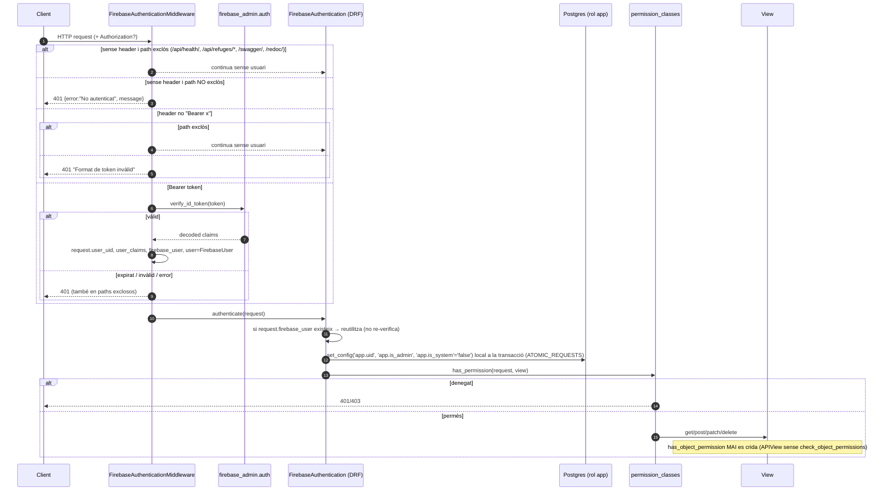

# Flux 0 — Pipeline d'autenticació d'una petició

> **[FET]** comprovat al codi · **[INFERÈNCIA]** deducció · **[NO VERIFICAT]** depèn de config externa.

Aplica a **totes** les peticions. El client obté un ID token de Firebase Auth i l'envia com `Authorization: Bearer <idToken>`.

## Peces
| Peça | Fitxer |
|---|---|
| Middleware Django | `api/middleware/firebase_auth_middleware.py` (registrat a `refugis_lliures/settings.py:74`) |
| Autenticació DRF | `api/authentication.py` (`REST_FRAMEWORK.DEFAULT_AUTHENTICATION_CLASSES`, `refugis_lliures/settings.py:158-160`) |
| Permisos | `api/permissions.py` + `rest_framework.permissions.IsAuthenticated` |
| Hook de RLS (context per transacció) | `api/rls_hook.py` (instal·lat a `ApiConfig.ready`, `api/apps.py`) → `domain/core/rls.py: apply_context` |
| Middleware d'errors del health | `api/middleware/health_database_middleware.py` (`HealthDatabaseErrorMiddleware`, registrat després del d'auth) |
| Inicialització Firebase Admin | `api/apps.py` → `api/firebase_config.py` (inclou el mode Firebase Auth Emulator) |

## Diagrama

## Passos
1. **Exclusió per prefix** — `EXCLUDED_PATHS` (`api/middleware/firebase_auth_middleware.py:20-25`) es compara amb `path.startswith` (`:98-103`). `/api/refuges/` inclou media, visits i renovations d'un refugi **[FET]**.
2. **Verificació** — `auth.verify_id_token(token)` (`:60`), sense `check_revoked` → `RevokedIdTokenError` (`:86`) no es pot donar **[INFERÈNCIA sobre l'SDK]**.
3. **Atributs a la request** (`:63-77`): `request.firebase_user` (claims), `request.user_uid`, `request.user_claims` (= tot el token decodificat, inclosos custom claims), `request.user` (objecte `FirebaseUser` amb `uid`, `claims`, `is_authenticated=True`).
4. **DRF** — `FirebaseAuthentication.authenticate` (`api/authentication.py:18-35`) reaprofita aquests atributs; si no hi són i hi ha header, verifica el token (`:38-70`).
5. **Permisos** — el default és `AllowAny` (`refugis_lliures/settings.py:161-163`). Els que realment actuen:
   - `IsAuthenticated` (DRF)
   - `IsSameUser` — `kwargs['uid'] == request.user.uid` (`api/permissions.py:50-72`)
   - `IsFirebaseAdmin` — `user_claims['role'] == 'admin'` (`:86-101`, helper `:10-21`)
   - `IsMediaUploader` — llegeix Firestore directament (`:192-276`)
6. **Context de RLS (hook)** **[FET]** — `ApiConfig.ready()` crida `rls_hook.install()`, que embolcalla `APIView.perform_authentication`: just **després** d'autenticar i **abans** de `check_permissions` (DRF crida `perform_authentication` → `check_permissions` a `initial()`), executa **una sola** sentència `SELECT set_config('app.uid', …, true), set_config('app.is_admin', …, true), set_config('app.is_system', 'false', true)` a la connexió `default`. Aplica a **totes** les vistes DRF (`APIView` i `@api_view`, incloses les de cache i les públiques; en una petició anònima `app.uid=''`).
   - `app.uid` = UID de l'usuari autenticat pel token verificat (`request.user.uid`; si la vista no autentica per DRF, `request.user_uid` del middleware). **Mai** d'una capçalera, query o cos.
   - `app.is_admin` = `true` només si els claims verificats tenen exactament `role == 'admin'` (`is_admin_claims`); qualsevol altre valor és `false`.
   - `app.is_system` es reinicia sempre a `false`; només `system_context()` el posa a `true` en blocs revisats.
   - El `true` de `set_config` el fa **local a la transacció** d'`ATOMIC_REQUESTS`: mor al `COMMIT`/`ROLLBACK` i no es filtra a una altra petició quan el pooler de Neon (PgBouncer, mode transacció) reutilitza la connexió. Les polítiques RLS (chunks següents) llegeixen aquest context amb `core.uid()`, `core.is_admin()` i `core.is_system()`.
   - Si el hook s'executa **fora d'una transacció** (`@transaction.non_atomic_requests` o `ATOMIC_REQUESTS` desactivat), el `set_config(..., true)` moriria en la mateixa sentència: la vista queda sense context (la RLS ho denega tot, *fail-closed*) i el hook fa un `logger.warning` (`Hook de RLS: la petició <path> no s'executa dins d'una transacció...`) perquè no sigui un error silenciós **[FET]**.
   - Una vista que sobreescrigui `perform_authentication` sense cridar el pare **se saltaria el hook** (cap vista ho fa avui) **[INFERÈNCIA]**.
7. **`HealthDatabaseErrorMiddleware`** **[FET]** — amb `ATOMIC_REQUESTS`, si Postgres és inabastable la petició falla en obrir la transacció, abans d'arribar a la vista. El middleware (`process_exception`) converteix això en un 503 `{status:'unhealthy', database:false, …}` **només a `/api/health/`**; a la resta de rutes l'error de BD segueix el camí normal (500). Vegeu [flux 11](11-admin-cache-health.md).
8. **Inicialització de Firebase** — a `ApiConfig.ready()`; en tests (`pytest` importat o `TESTING=true`) no s'inicialitza (`api/firebase_config.py:15-17,92-94`). Amb `FIREBASE_AUTH_EMULATOR_HOST` s'inicialitza sense credencials contra el Firebase Auth Emulator (mai en producció): [integrations/firebase-auth.md](../integrations/firebase-auth.md).

## Errors
| Cas | Resposta |
|---|---|
| Sense token en ruta privada | 401 `{"error":"No autenticat","message":"Token d'autenticació no proporcionat"}` (`:45-46,105-110`) |
| Token expirat | 401 `"Token expirat"` (`:82-84`) |
| Token invàlid | 401 `"Token invàlid"` (`:90-92`) |
| Altre error | 401 `"Error verificant el token"` **sense** el text de l'excepció (el detall — configuració, certificats, xarxa — no es retorna al client); al log només el tipus d'excepció **[FET]** |
| Permís denegat | 403 (DRF) |

## Guies
Com obtenir i enviar el token des del client, cURL o Swagger: [guides/client-auth-usage.md](../guides/client-auth-usage.md).

## Gotchas
- Un token caducat a `GET /api/refuges/` (públic) retorna **401** en lloc de servir la resposta anònima **[FET]**.
- `has_object_permission` no s'executa mai → vegeu [GOTCHAS.md](../GOTCHAS.md) #1.
- El middleware ja **no registra l'UID** en verificar un token (log `debug` sense identificadors personals) ni retorna `str(e)` en el 401 d'error inesperat; `api/authentication.py` (DRF) retorna també un missatge genèric però encara registra `str(e)` al log ([TECH_DEBT.md](../TECH_DEBT.md) P11) **[FET]**.
- `request.user_uid` és la font de veritat de l'identitat a vistes i controllers; mai s'agafa l'UID del body. El mateix val per a la RLS: l'UID i el flag d'admin del context de Postgres surten només del token verificat.
- Fora de les peticions HTTP (comandes com `process_yesterday_visits`, jobs, shell) **no hi ha hook**: el context s'ha de fixar amb `rls_context()` / `system_context()` (`domain/core/rls.py`); sense context `core.uid()` és `NULL` i `is_admin`/`is_system` són `false` **[FET sobre les funcions; INFERÈNCIA sobre l'efecte a les polítiques futures]**.

## Permisos de moderació (feature images) [FET]
Després de l'autenticació, alguns endpoints afegeixen `IsNotBlocked` (403 `{error:'user_blocked'}`) i `IsAgeConfirmed` (403 `{error:'age_not_confirmed'}`), que llegeixen `users/{uid}` (cache-first). Vegeu [flux 12](12-media-moderation.md).
