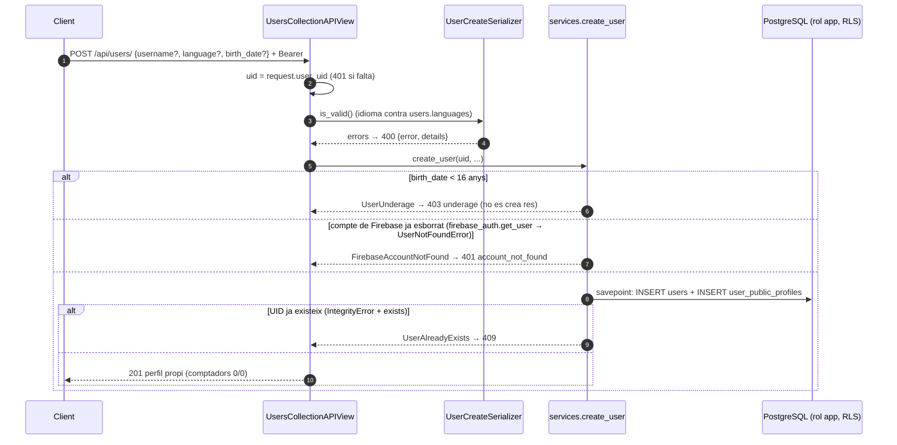

# Flux 1 — Perfil d'usuari (alta, consulta, edició, esborrat)

> **[FET]** comprovat al codi · **[INFERÈNCIA]** deducció · **[NO VERIFICAT]** depèn de config externa.

> **Migrat a PostgreSQL (chunk 3).** L'usuari, el perfil públic, l'avatar, els preferits i els visitats viuen a PostgreSQL (`apps/accounts/`); ja no hi ha `UserController`, `UserDAO`, `UserMapper`, `User` (dataclass) ni cache Redis d'usuari (`user_detail`). Des del chunk 7 els dos comptadors són SQL i, des del chunk 10, l'esborrat és un procediment únic transaccional sense Firestore (D42). Decisions: [DECISIONS_AUTONOMES D19–D23, D42](../migration/DECISIONS_AUTONOMES.md); disseny: [postgres-schema §2.1–2.4, §5.2](../design/postgres-schema.md).

L'usuari es registra a **Firebase Auth des del client** (el backend no crea comptes d'Auth, però sí que els esborra a `DELETE /users/{uid}/`). Després el client crida `POST /api/users/` per crear la fila de `users.users` + `users.user_public_profiles`. **Fins que no ho fa, tot endpoint autenticat (excepte `POST /users/`) respon 403 `profile_required`** (vegeu [flux 12](12-media-moderation.md#permisos-apipermissionspy)).

## Endpoints (`apps/accounts/views.py`, rutes a `apps/accounts/urls.py`, incloses des d'`refugis_lliures/urls.py` sota `users/`)
| Mètode | URL | Vista | Permisos |
|---|---|---|---|
| POST | `/api/users/` | `UsersCollectionAPIView.post` | `IsAuthenticated` (**sense** `HasProfile`: és l'única via per crear-lo) |
| GET | `/api/users/{uid}/` | `UserDetailAPIView.get` | `IsAuthenticated` + `HasProfile` |
| PATCH | `/api/users/{uid}/` | `.patch` | `IsAuthenticated` + `HasProfile` + `IsSameUser` |
| DELETE | `/api/users/{uid}/` | `.delete` | `IsAuthenticated` + `IsSameUser` (sense `HasProfile`, D42; vista `non_atomic_requests`) |

Taules (schema `users`, [postgres-schema §2.1–2.4](../design/postgres-schema.md)): `users` (`uid` = UID de Firebase, `language`, `created_at`, `age_confirmed_at`, `age_threshold`, `moderation_strikes`, `is_blocked`, `blocked_reason`, `blocked_at`), `user_public_profiles` (`username`, `updated_at`), `user_avatars`, `user_favourite_refuges`, `user_visited_refuges`, i el catàleg `languages`. **No es desa mai la data de naixement ni l'email** **[FET]**.

## Forma de la resposta
- **Perfil propi** (`uid == token`): `{uid, username, avatar_metadata, language, favourite_refuges[], visited_refuges[], uploaded_photos_keys[], num_shared_experiences, num_renovated_refuges, created_at, age_confirmed}` (`own_profile_to_dict`). Una sola consulta (`selectors.get_own_profile`: JOIN al perfil + `ArraySubquery` per a llistes i claus de fotos + subconsulta JSON per a l'avatar) **[FET]**.
- **Perfil d'un altre usuari** (també si qui crida és admin, D23): només `{uid, username, avatar_metadata}` (`selectors.get_public_profile`, 1 consulta). Ja no exposa llistes, claus de fotos ni comptadors (abans: [TECH_DEBT B3](../TECH_DEBT.md), resolt) **[FET]**.
- `favourite_refuges`/`visited_refuges`: IDs (UUID com a string) ordenats per `(created_at, refuge_id)`; `uploaded_photos_keys`: claus de `refuges.refuge_media` amb `creator_uid = uid` (tots els estats), ordenades per `(uploaded_at, key)` (D19).
- `num_renovated_refuges` (chunk 5): **SQL**, `apps.renovations.selectors.count_renovated_refuges` (reformes creades + reformes on participa, passades incloses, expulsats no; 1 consulta), cridat des de `selectors.get_legacy_counts`. Pressupost del perfil propi: ≤ 3 consultes (D35).
- `num_shared_experiences` (chunk 7): `count(*)` d'`activity.experiences` del creador (totes, de qualsevol refugi). `selectors.get_legacy_counts` (nom històric) calcula els **dos comptadors en una sola consulta SQL** (subconsulta d'experiències + `RENOVATED_REFUGES_SQL`); el perfil propi (GET, PATCH) ja no toca Firestore. Si la BD falla → 500 «Error de base de dades en obtenir els comptadors de l'usuari» (no es mostren zeros falsos). El `POST` retorna 0/0 sense consultar-los (usuari nou). Resol [TECH_DEBT U1](../TECH_DEBT.md) **[FET]**.
- `avatar_metadata`: `MediaItem` amb URL presignada (1 h) o `null`; sense miniatura, `thumb_url = url`.

## Alta — diagrama



## Passos clau
- **Alta** (`services.create_user`): només `uid`, `language` (per defecte, `en`, el posa la BD) i, si hi ha `birth_date` ≥ 16, `age_confirmed_at` + `age_threshold=16`. `username` buit per defecte (la BD permet `''`). Usuari + perfil públic en un `transaction.atomic()` (savepoint). L'idioma es valida contra el catàleg `users.languages` (no una llista fixa) **[FET]**. Un duplicat concurrent el resol la PK: `IntegrityError` → 409 (ja no hi ha *check-then-set*).
- **Consulta**: vegeu «Forma de la resposta». Un UID inexistent: 404.
- **Edició** (`services.update_user`): `UserUpdateSerializer` accepta `username` i/o `language` **sense cap `default=`** i exigeix almenys un camp (un cos buit o camps desconeguts → 400; `username=''` és vàlid, D23). Resol [TECH_DEBT M1](../TECH_DEBT.md). Respon 200 amb el perfil propi.
- **`ensure_user`** (`services.ensure_user`, `INSERT … ON CONFLICT DO NOTHING`): el fa servir `scripts/manage_admins.py add` per crear la fila d'un admin (vegeu [admin-management](../guides/admin-management.md)).

## Esborrat: procediment únic (D42)

`DELETE /api/users/{uid}/` → `services.delete_user(uid)`. Detall, fallades i què es conserva: [deep-dive](../deep-dives/user-deletion.md).

**Contracte HTTP** **[FET]**:
- Permisos: `IsAuthenticated` + `IsSameUser` (**sense** `HasProfile`: és idempotent; un usuari bloquejat també pot esborrar-se). El `uid` de la URL ha de ser el del token → si no, 403.
- **204** sense cos en èxit, **també si l'usuari ja no té fila** a `users.users` (reintent: es salta al pas de Firebase; sense auditoria). No hi ha 404 a aquest endpoint.
- 401 sense token vàlid; 403 si `uid` ≠ token; **500 `{error, error_id}`** si R2 o Firebase Auth fallen (`UserDeletionError`) o la BD falla.
- La vista és `non_atomic_requests` i el `DELETE` no passa pel hook de RLS (`skip_rls_hook`): `delete_user` obre la seva pròpia transacció i el context de RLS (`rls_context(uid)`).

**Procediment**: (1) *una* transacció amb `FOR UPDATE` de la fila d'usuari, claus d'R2, reformes vigents, denúncies automàtiques dels mitjans ocults només per denúncies seves (pas 2 de §8.4), `comment` de propostes a NULL, `DELETE users.users` (cascades/`SET NULL`), auditoria `user.deleted` sense identificadors, `SET CONSTRAINTS ALL IMMEDIATE` i, l'últim, **R2** (si falla, tot es desfà); un deadlock amb moderació es reintenta fins a 2 cops; (2) **després del `COMMIT`**, `firebase_auth.delete_user(uid)` (`UserNotFoundError` = èxit). El client **no** crida `user.delete()`: només reautentica, crida aquest endpoint i fa `signOut` local.

```mermaid
sequenceDiagram
    autonumber
    participant C as Client
    participant V as UserDetailAPIView.delete
    participant S as services.delete_user
    participant DB as PostgreSQL
    participant R2 as R2MediaService
    participant FA as Firebase Auth

    C->>V: DELETE /api/users/{uid}/
    V->>S: delete_user(uid)
    S->>DB: BEGIN; SELECT … FOR UPDATE (users.users)
    alt hi ha fila
        S->>DB: reformes · denúncies automàtiques · comment · DELETE users · audit · SET CONSTRAINTS IMMEDIATE
        S->>R2: delete_files(avatar, mitjans, experiències, quarantine/)
        S->>DB: COMMIT
    else sense fila (reintent)
        S->>DB: COMMIT buit
    end
    S->>FA: delete_user(uid)
    alt R2 o Firebase fallen (UserDeletionError)
        V-->>C: 500 {error, error_id} (R2: tot desfet · Firebase: dades ja esborrades, reintentable)
    else ok
        V-->>C: 204
    end
```

**Reintent del client**: davant un 500 el client ha de tornar a cridar el mateix `DELETE` (el token continua vàlid mentre el compte existeixi): si les dades ja eren fora, la resposta és 204 ([client-auth-usage](../guides/client-auth-usage.md)).

## Errors
| Cas | HTTP |
|---|---|
| Sense token | 401 (middleware) |
| Sense fila a `users.users` (qualsevol endpoint llevat de `POST /users/`) | **403 `profile_required`** |
| Cos invàlid (idioma fora del catàleg, `birth_date` futura o < 1900, cap camp a PATCH) | 400 `{error, details}` |
| `birth_date` de menor de 16 anys | 403 `underage` (`coded_error`) |
| Perfil ja existeix | 409 |
| `POST /users/` amb el token d'un compte de Firebase ja esborrat | 401 `account_not_found` (`coded_error`) |
| Usuari no trobat (GET/PATCH d'un uid inexistent; el DELETE és idempotent: 204) | 404 |
| `uid` URL ≠ token (PATCH/DELETE) | 403 (`IsSameUser`) |
| Fallada de BD, d'R2 o de Firebase Auth (esborrat) | 500 `{error, error_id}` |

## Gotchas
- El perfil propi **ja no depèn de Firestore** (chunk 7): els comptadors són SQL; el pressupost del perfil propi segueix sent ≤ 3 consultes i constant (D38).
- L'esborrat és atòmic a la BD i a R2 (R2 dins la transacció: si falla, tot es desfà); Firebase Auth va **després del `COMMIT`**: si falla, les dades ja són fora i el `DELETE` es reintenta i dóna 204 **[FET]**.
- El compte de Firebase Auth l'esborra el **backend** (últim pas, després del `COMMIT`; U7, D42): ja no hi ha la finestra «dades sense compte» **[FET]**.
- **Bloqueig i esborrat (U7)**: un bloqueig és del compte (UID). Esborrar-se i tornar amb el **mateix** UID no és possible: el compte de Firebase ja no existeix i `POST /users/` amb un token encara vigent (fins a 1 h) respon 401 `account_not_found` (`services.create_user` comprova `firebase_auth.get_user`). Un compte **nou** amb un altre email és un UID nou sense *strikes*: s'accepta (decisió del PO, 26/10); no es desa cap hash d'email ni identificador de dispositiu o telèfon. L'abús persistent es tracta bloquejant el compte nou quan reincideix.
- PostgreSQL comença de zero (decisió del PO): els usuaris de Firestore no es migren; cada usuari ha de fer `POST /users/` (403 `profile_required` fins llavors).
