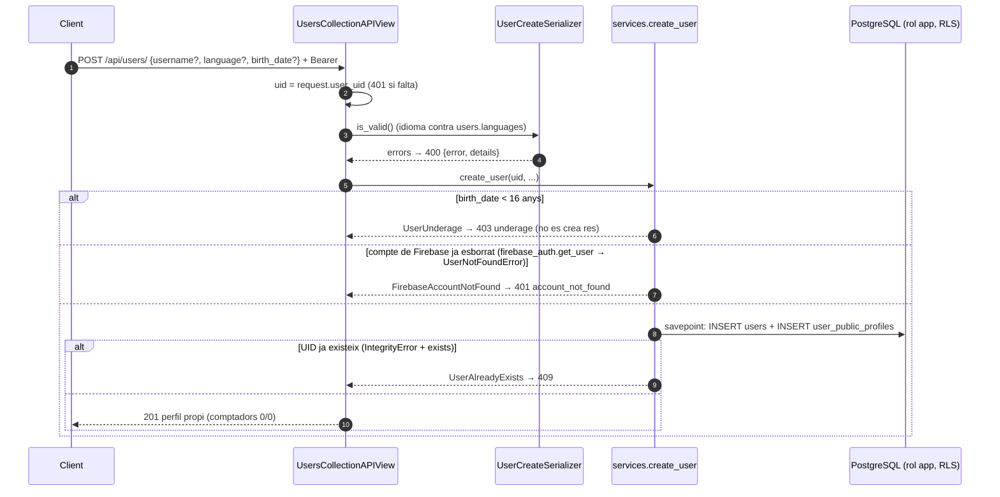

# Flux 1 — Perfil d'usuari (alta, consulta, edició, esborrat)

> **[FET]** comprovat al codi · **[INFERÈNCIA]** deducció · **[NO VERIFICAT]** depèn de config externa.

> **Migrat a PostgreSQL (chunk 3).** L'usuari, el perfil públic, l'avatar, els preferits i els visitats viuen a PostgreSQL (`apps/accounts/`); ja no hi ha `UserController`, `UserDAO`, `UserMapper`, `User` (dataclass) ni cache Redis d'usuari (`user_detail`). Firestore només es consulta per als dos comptadors provisionals i per als passos de l'esborrat dels dominis encara no migrats (D19, D21). Decisions: [DECISIONS_AUTONOMES D19–D23](../migration/DECISIONS_AUTONOMES.md); disseny: [postgres-schema §2.1–2.4, §5.2](../design/postgres-schema.md).

L'usuari es registra a **Firebase Auth des del client** (el backend no crea comptes d'Auth, però sí que els esborra a `DELETE /users/{uid}/`). Després el client crida `POST /api/users/` per crear la fila de `users.users` + `users.user_public_profiles`. **Fins que no ho fa, tot endpoint autenticat (excepte `POST /users/`) respon 403 `profile_required`** (vegeu [flux 12](12-media-moderation.md#permisos-apipermissionspy)).

## Endpoints (`apps/accounts/views.py`, rutes a `apps/accounts/urls.py`, incloses des d'`api/urls.py` sota `users/`)
| Mètode | URL | Vista | Permisos |
|---|---|---|---|
| POST | `/api/users/` | `UsersCollectionAPIView.post` | `IsAuthenticated` (**sense** `HasProfile`: és l'única via per crear-lo) |
| GET | `/api/users/{uid}/` | `UserDetailAPIView.get` | `IsAuthenticated` + `HasProfile` |
| PATCH | `/api/users/{uid}/` | `.patch` | `IsAuthenticated` + `HasProfile` + `IsSameUser` |
| DELETE | `/api/users/{uid}/` | `.delete` | `IsAuthenticated` + `HasProfile` + `IsSameUser` |

Taules (schema `users`, [postgres-schema §2.1–2.4](../design/postgres-schema.md)): `users` (`uid` = UID de Firebase, `language`, `created_at`, `age_confirmed_at`, `age_threshold`, `moderation_strikes`, `is_blocked`, `blocked_reason`, `blocked_at`), `user_public_profiles` (`username`, `updated_at`), `user_avatars`, `user_favourite_refuges`, `user_visited_refuges`, i el catàleg `languages`. **No es desa mai la data de naixement ni l'email** **[FET]**.

## Forma de la resposta
- **Perfil propi** (`uid == token`): `{uid, username, avatar_metadata, language, favourite_refuges[], visited_refuges[], uploaded_photos_keys[], num_shared_experiences, num_renovated_refuges, created_at, age_confirmed}` (`own_profile_to_dict`). Una sola consulta (`selectors.get_own_profile`: JOIN al perfil + `ArraySubquery` per a llistes i claus de fotos + subconsulta JSON per a l'avatar) **[FET]**.
- **Perfil d'un altre usuari** (també si qui crida és admin, D23): només `{uid, username, avatar_metadata}` (`selectors.get_public_profile`, 1 consulta). Ja no exposa llistes, claus de fotos ni comptadors (abans: [TECH_DEBT B3](../TECH_DEBT.md), resolt) **[FET]**.
- `favourite_refuges`/`visited_refuges`: IDs (UUID com a string) ordenats per `(created_at, refuge_id)`; `uploaded_photos_keys`: claus de `refuges.refuge_media` amb `creator_uid = uid` (tots els estats), ordenades per `(uploaded_at, key)` (D19).
- `num_shared_experiences` i `num_renovated_refuges` (D19, **provisional**): `count()` d'agregació a Firestore (`experiences.creator_uid`; `renovations.creator_uid` + `participants_uids array_contains`) a `selectors.get_legacy_counts`; el perfil propi (GET, PATCH) fa **3 consultes d'agregació a Firestore**. Si Firestore falla → 500 «Error en obtenir els comptadors de l'usuari a Firestore» (no es mostren zeros falsos). El `POST` retorna 0/0 sense consultar-lo (usuari nou). Es substitueix per SQL als chunks 5 i 7 ([TECH_DEBT U1](../TECH_DEBT.md)) **[FET]**.
- `avatar_metadata`: `MediaItem` amb URL presignada (1 h) o `null`; sense miniatura, `thumb_url = url`.

## Alta — diagrama



## Passos clau
- **Alta** (`services.create_user`): només `uid`, `language` (per defecte, `en`, el posa la BD) i, si hi ha `birth_date` ≥ 16, `age_confirmed_at` + `age_threshold=16`. `username` buit per defecte (la BD permet `''`). Usuari + perfil públic en un `transaction.atomic()` (savepoint). L'idioma es valida contra el catàleg `users.languages` (no una llista fixa) **[FET]**. Un duplicat concurrent el resol la PK: `IntegrityError` → 409 (ja no hi ha *check-then-set*).
- **Consulta**: vegeu «Forma de la resposta». Un UID inexistent: 404.
- **Edició** (`services.update_user`): `UserUpdateSerializer` accepta `username` i/o `language` **sense cap `default=`** i exigeix almenys un camp (un cos buit o camps desconeguts → 400; `username=''` és vàlid, D23). Resol [TECH_DEBT M1](../TECH_DEBT.md). Respon 200 amb el perfil propi.
- **`ensure_user`** (`services.ensure_user`, `INSERT … ON CONFLICT DO NOTHING`): el fa servir `scripts/manage_admins.py add` per crear la fila d'un admin (vegeu [admin-management](../guides/admin-management.md)).

## Esborrat — provisional (D21, D22)

`services.delete_user(uid)` fa, en aquest ordre, i **s'atura al primer pas que falla**:
1. **Passos de Firestore** (dominis encara no migrats), via els controllers de sempre ([deep-dive](../deep-dives/user-deletion.md)): experiències, dubtes, respostes, propostes (anonimitza) i reformes (esborra/anonimitza/treu de participants i expulsats).
2. **R2** (D22, RGPD): avatar i miniatura + fotos pujades per l'usuari (`refuges.refuge_media` amb `creator_uid = uid`, i miniatures), en un `delete_files`. Si hi ha fitxers que fallen → `UserDeletionError`.
3. **`DELETE FROM users.users`**: la BD cascadeja perfil, avatar, preferits, visitats i participacions en visites (chunk 4: el pas «visites» de Firestore ja no existeix) (FK reals `ON DELETE`, no de Django).
4. **Compte de Firebase Auth** (U7, D24): `firebase_auth.delete_user(uid)`, dins el mateix *savepoint* que el pas 3. Si Firebase falla, `UserDeletionError` desfà el `DELETE` (l'usuari es conserva i es pot reintentar); si el compte ja no existeix (`UserNotFoundError`), es dona per fet. El client **no** crida `user.delete()`: només reautentica, crida aquest endpoint i fa `signOut` local **[FET]**.

```mermaid
sequenceDiagram
    autonumber
    participant C as Client
    participant V as UserDetailAPIView.delete
    participant S as services.delete_user
    participant F as Firestore (controllers legacy)
    participant R2 as R2MediaService
    participant DB as PostgreSQL
    participant FA as Firebase Auth

    C->>V: DELETE /api/users/{uid}/
    V->>S: delete_user(uid)
    loop 8 passos (experiències … reformes)
        S->>F: pas del controller → (success, error)
    end
    S->>R2: delete_files(avatar + miniatura + fotos + miniatures)
    S->>DB: savepoint: DELETE users.users WHERE uid (cascada)
    S->>FA: delete_user(uid) (si falla, rollback del savepoint)
    alt un pas falla (UserDeletionError)
        V-->>C: 500 {error, error_id}; l'usuari es conserva i el DELETE és reintentable
    else usuari inexistent
        V-->>C: 404
    else ok
        V-->>C: 204
    end
```

Ja **no** hi ha els antics passos «esborrar fotos via `RefugiLliureController`» ni «treure `visitors` del refugi legacy»: els visitants surten de `user_visited_refuges` (cascada) **[FET]**. El 500 ara porta `error_id` (abans: sempre 404, [TECH_DEBT M10](../TECH_DEBT.md), resolt en la part del codi de resposta). El procediment únic i transaccional amb cua d'R2 és el chunk 10.

## Errors
| Cas | HTTP |
|---|---|
| Sense token | 401 (middleware) |
| Sense fila a `users.users` (qualsevol endpoint llevat de `POST /users/`) | **403 `profile_required`** |
| Cos invàlid (idioma fora del catàleg, `birth_date` futura o < 1900, cap camp a PATCH) | 400 `{error, details}` |
| `birth_date` de menor de 16 anys | 403 `underage` (`coded_error`) |
| Perfil ja existeix | 409 |
| `POST /users/` amb el token d'un compte de Firebase ja esborrat | 401 `account_not_found` (`coded_error`) |
| Usuari no trobat | 404 |
| `uid` URL ≠ token (PATCH/DELETE) | 403 (`IsSameUser`) |
| Fallada de BD, de Firestore (comptadors o passos d'esborrat) o d'R2 | 500 `{error, error_id}` |

## Gotchas
- El perfil propi **depèn de Firestore** (comptadors provisionals): una caiguda de Firestore fa caure `GET/PATCH /users/{uid}/` propi.
- L'esborrat no és atòmic entre Firestore, R2 i PostgreSQL: un pas que falla deixa els anteriors aplicats (reintentable) **[FET]**.
- El compte de Firebase Auth l'esborra el **backend** (últim pas de l'esborrat, U7) **[FET]**. Finestra residual: si el `COMMIT` falla després d'esborrar el compte, queden dades sense compte (rar; el chunk 10 ho tanca).
- **Bloqueig i esborrat (U7)**: un bloqueig és del compte (UID). Esborrar-se i tornar amb el **mateix** UID no és possible: el compte de Firebase ja no existeix i `POST /users/` amb un token encara vigent (fins a 1 h) respon 401 `account_not_found` (`services.create_user` comprova `firebase_auth.get_user`). Un compte **nou** amb un altre email és un UID nou sense *strikes*: s'accepta (decisió del PO, 26/10); no es desa cap hash d'email ni identificador de dispositiu o telèfon. L'abús persistent es tracta bloquejant el compte nou quan reincideix.
- PostgreSQL comença de zero (decisió del PO): els usuaris de Firestore no es migren; cada usuari ha de fer `POST /users/` (403 `profile_required` fins llavors).
