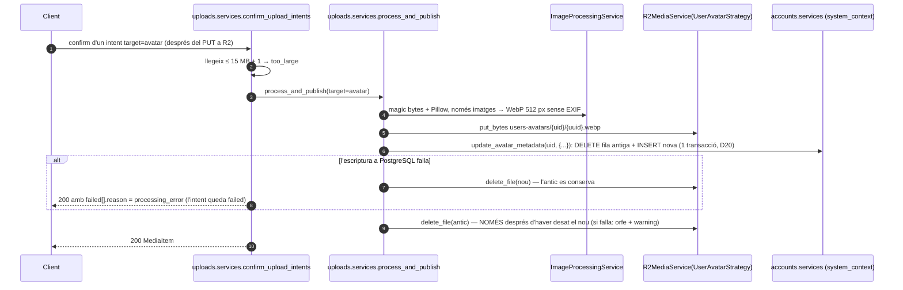

# Flux 2 — Avatar d'usuari

> **[FET]** comprovat al codi · **[INFERÈNCIA]** deducció · **[NO VERIFICAT]** depèn de config externa.

> **Migrat a PostgreSQL (chunk 3):** l'avatar és a `users.user_avatars` (PK = clau R2; 0..1 per usuari) i el gestiona `apps/accounts/services.py`.

## Endpoints
| Mètode | URL | Vista | Permisos | Body |
|---|---|---|---|---|
| POST | `/api/media/upload-intents/` + `/confirm/` | [flux 3](03-refuge-media-upload.md) amb `target=avatar` (**única via de pujada**) | IsAuthenticated + HasProfile + IsNotBlocked + IsAgeConfirmed | JSON, 1 sola imatge |
| DELETE | `/api/users/{uid}/avatar/` | `apps.accounts.views.UserAvatarAPIView.delete` | IsAuthenticated + HasProfile + IsSameUser | — |

Emmagatzematge [FET]: R2 `users-avatars/{uid}/{uuid}.webp` (WebP, màx. 512 px, sense metadades, sense miniatura → `thumb_url = url`). PostgreSQL `users.user_avatars(key PK, user_uid UNIQUE, thumb_key, content_type, width, height, size_bytes, blurhash, uploaded_at)`. L'API exposa `avatar_metadata` en forma **MediaItem** (`creator_uid` = uid, `media_type` = `image`, `taken_at`/`experience_id` = null), tant al perfil propi com al públic.

> Retirat: `PATCH /api/users/{uid}/avatar/` (multipart) s'ha eliminat; ara respon 405 **[FET]**.

## Diagrama — canviar l'avatar (`confirm` → `_publish_avatar`, `apps/uploads`)

## Passos
1. `apps.uploads.services.confirm_upload_intents` → `process_and_publish` → `_publish_avatar` (`apps/uploads/services.py`; l'intent és a `moderation.upload_intents` amb `target='avatar'`, sense refugi ni experiència, [flux 3](03-refuge-media-upload.md)). Reconfirmar un intent d'avatar ja confirmat retorna el mateix `MediaItem` només si l'avatar actual encara té la mateixa clau (si no, `missing_object`). L'avatar antic es llegeix amb `selectors.get_avatar`; l'escriptura és `services.update_avatar_metadata` dins `system_context()` (D20; el `DELETE` + `INSERT` van en una transacció).
2. `DELETE /users/{uid}/avatar/` → `services.delete_avatar`: dins `transaction.atomic()` esborra la fila i després crida `delete_file` d'R2; si retorna `False` (o llança) es **desfà** l'esborrat de la fila (`AvatarStorageError` → 500 amb `error_id`). La miniatura que no s'esborra queda orfe amb un warning.

## Errors
| Cas | HTTP |
|---|---|
| Tipus real no permès / massa gran / bloquejat per moderació / fallada en desar l'avatar en confirmar | 200 amb `failed[].reason` (`invalid_type` / `too_large` / `moderation_blocked` / `processing_error`), vegeu [flux 3](03-refuge-media-upload.md) |
| Sense perfil / usuari bloquejat / edat no confirmada (intents) | 403 `profile_required` / `user_blocked` / `age_not_confirmed` |
| `PATCH` a la ruta | 405 |
| Sense avatar (DELETE) | 404 |
| R2 no pot esborrar (DELETE) | 500 `{error, error_id}` (la fila es conserva) |
| Altres | 500 |
| DELETE OK | 204 |

## Gotchas
- Corregit: abans l'avatar antic s'esborrava **abans** de pujar el nou i el rollback del DELETE era codi mort ([TECH_DEBT A4](../TECH_DEBT.md)) **[FET]**.
- Els avatars antics poden tenir claus amb el nom original (`users-avatars/{uid}/avatar.jpg`); PostgreSQL comença de zero, així que només n'hi haurà si es tornen a pujar.
- L'escriptura de l'avatar des del flux de pujades va amb `system_context()` (D20): la propietat la garanteix l'intent (`user_uid` = l'usuari de la petició; un intent aliè és `missing_object`), no la RLS de l'avatar.
