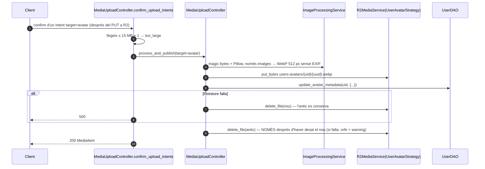

# Flux 2 — Avatar d'usuari

> **[FET]** comprovat al codi · **[INFERÈNCIA]** deducció · **[NO VERIFICAT]** depèn de config externa.

## Endpoints
| Mètode | URL | Vista | Permisos | Body |
|---|---|---|---|---|
| POST | `/api/media/upload-intents/` + `/confirm/` | [flux 3](03-refuge-media-upload.md) amb `target=avatar` (**única via de pujada**) | IsAuthenticated + IsNotBlocked + IsAgeConfirmed | JSON, 1 sola imatge |
| DELETE | `/api/users/{uid}/avatar/` | `.delete` | IsAuthenticated + IsSameUser | — |

Emmagatzematge [FET]: R2 `users-avatars/{uid}/{uuid}.webp` (WebP, màx. 512 px, sense metadades, sense miniatura → `thumb_url = url`). Firestore `users/{uid}.media_metadata = {key, uploaded_at, width, height, blurhash, size, content_type}`. L'API exposa `avatar_metadata` en forma **MediaItem** (`creator_uid` = uid, `media_type` = `image`, `taken_at`/`experience_id` = null).

> Retirat: `PATCH /api/users/{uid}/avatar/` (multipart) s'ha eliminat; ara respon 405 **[FET]**.

## Diagrama — canviar l'avatar (`confirm` → `_publish_avatar`)

## Passos
1. `MediaUploadController.confirm_upload_intents` (`api/controllers/media_upload_controller.py:159`) → `process_and_publish` (L273) → `_publish_avatar` (L376).
2. `delete_user_avatar` (`api/controllers/user_controller.py:485`): `UserDAO.delete_avatar_metadata` (posa `media_metadata: None`) i després `delete_file`; si `delete_file` retorna `False` (o llança) es **tornen a desar** les metadades i es retorna error.

## Errors
| Cas | HTTP |
|---|---|
| Tipus real no permès / massa gran / bloquejat per moderació en confirmar | 200 amb `failed[].reason` (`invalid_type` / `too_large` / `moderation_blocked`), vegeu [flux 3](03-refuge-media-upload.md) |
| Usuari bloquejat / edat no confirmada (intents) | 403 `user_blocked` / `age_not_confirmed` |
| `PATCH` a la ruta | 405 |
| Usuari no trobat / sense avatar (DELETE) | 404 |
| R2 no pot esborrar (DELETE) | 500 (metadades restaurades) |
| Altres | 500 |
| DELETE OK | 204 |

## Gotchas
- Corregit: abans l'avatar antic s'esborrava **abans** de pujar el nou i el rollback del DELETE era codi mort ([TECH_DEBT A4](../TECH_DEBT.md)) **[FET]**.
- Els avatars antics poden tenir claus amb el nom original (`users-avatars/{uid}/avatar.jpg`): es continuen servint i s'esborren en canviar d'avatar **[FET]**.
