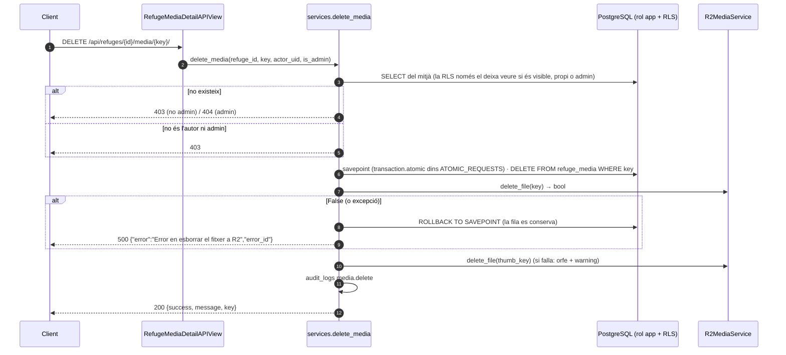

# Flux 3 — Pujar, llistar i esborrar fotos/vídeos d'un refugi

> **[FET]** comprovat al codi · **[INFERÈNCIA]** deducció · **[NO VERIFICAT]** depèn de config externa.

Des de la feature *images* l'única pujada és **directa a R2 amb URL PUT prefirmada** + **confirmació** al backend, que fa el processament autoritatiu (neteja de metadades, compressió, tipus real, moderació). **Des del chunk 7 viu a `apps/uploads` i els intents són a PostgreSQL** (`moderation.upload_intents`); el mitjà publicat va a `refuges.refuge_media` (refugi i experiència) o a `users.user_avatars` (avatar). És l'**única** via de pujada: els camins multipart antics s'han retirat (vegeu «Retirat»). Denúncies i moderació: [flux 12](12-media-moderation.md). Avatar: [flux 2](02-user-avatar.md). Experiències: [flux 8](08-experiences.md).

## Contracte d'API (compartit amb el frontend) [FET]

```
POST /api/media/upload-intents/                         IsAuthenticated + HasProfile + IsNotBlocked + IsAgeConfirmed
  {target: "refuge"|"experience"|"avatar", refuge_id?, experience_id?,
   rights_confirmed: true, files: [{content_type, size}]}            (màx. 10 fitxers)
  → 201 {uploads: [{upload_id, put_url, headers: {"Content-Type": ...}, expires_in: 600}]}
  Límits: imatge ≤ 15 MB (jpeg/png/webp/heic/heif), vídeo ≤ 50 MB (mp4/quicktime/webm), avatar només imatge (1 fitxer).
  Errors: 400 validació · 403 age_not_confirmed / user_blocked / not_owner (experiència) · 404 `Refugi not found` / `Experience not found`

POST /api/media/upload-intents/confirm/   {upload_ids: [...]}            (màx. 10)
  → 200 {uploaded: [MediaItem], failed: [{upload_id, reason}]}
  reason ∈ missing_object | too_large | invalid_type | processing_error | moderation_blocked

MediaItem = {key, url, thumb_url, media_type: "image"|"video", width, height, blurhash,
             creator_uid, uploaded_at, taken_at|null, experience_id|null}
```

- Els errors amb codi tenen la forma `{"error": "<codi>", "code": "<codi>", "message": "<text>"}` (`coded_error`, `api/permissions.py`). Els 400 de validació: `{"error": "Dades invàlides", "details": {...}}`.
- `image/jpg` s'accepta i es normalitza a `image/jpeg` (el header retornat a `headers` és el que s'ha signat i el client l'ha d'enviar tal qual).
- `target=experience` exigeix que l'usuari sigui el creador de l'experiència (o admin); el `refuge_id` es pren de l'experiència (si el cos en porta un i no és el de l'experiència → 400 «refuge_id no correspon a l'experiència»). Ordre: permisos → validació (400) → existència (404) → propietat (403).
- `confirm` és **idempotent**: tornar a confirmar un `upload_id` ja confirmat retorna el mateix MediaItem; un intent pendent sense objecte a R2 retorna `missing_object` i **es pot reintentar** (fins que caduqui).
- Un `upload_id` inexistent, aliè, caducat o que no és UUID és `failed: missing_object` amb 200 (D38); els ids repetits es processen una sola vegada.
- GET de refugi (`images_metadata`), `GET /api/refuges/{id}/media/` (`media`), experiències (`images_metadata`) i avatar (`avatar_metadata`) retornen MediaItems. Els items amb `status ≠ visible` només els veuen el seu autor i els admins.

## Endpoints
| Mètode | URL | Vista | Permisos | Body |
|---|---|---|---|---|
| POST | `/api/media/upload-intents/` | `apps.uploads.views.UploadIntentsAPIView` (`media_upload_intents`) | IsAuthenticated + HasProfile + IsNotBlocked + IsAgeConfirmed | JSON (contracte) |
| POST | `/api/media/upload-intents/confirm/` | `apps.uploads.views.UploadIntentsConfirmAPIView` (`media_upload_intents_confirm`) | idem | JSON `{upload_ids}` |
| GET | `/api/refuges/{id}/media/` | `RefugeMediaListAPIView.get` (`apps/refuges/views.py`; PostgreSQL) | IsAuthenticated | — |
| DELETE | `/api/refuges/{id}/media/{key}/` | `RefugeMediaDetailAPIView.delete` (`apps/refuges/views.py`; PostgreSQL) | IsAuthenticated; autor o admin (al service) | — (`key` és `path:`) |

Les rutes d'`upload-intents` són declarades a `api/urls.py` (no hi ha `apps/uploads/urls.py`) perquè comparteixen el prefix `media/` amb les denúncies (Firestore, chunk 9) **[FET]**.

## Model de dades [FET]
- **`moderation.upload_intents`** (`apps/uploads/models.py: UploadIntent`): `id` (uuid v7 de la BD = `upload_id` de l'API), `user_uid` → `users.users`, `target` (`refuge|experience|avatar`), `content_type`, `size` (> 0), `quarantine_key` (única, `quarantine/{id}`), `refuge_id` → `refuges.refuges`, `experience_id` → `activity.experiences`, `status` (`pending|confirmed|failed`), `rights_confirmed_at`, `created_at`, `expire_at` (= `created_at` + 1 dia), `result_key`, `failure_reason`. `CHECK`s: enumeracions, `upload_intents_shape_ck` (avatar sense refugi ni experiència · refuge: refugi · experience: refugi i experiència), `upload_intents_state_ck` (`confirmed` ⇔ `result_key`; `failed` ⇔ `failure_reason`), `expire_at > created_at`. Les tres FK són `ON DELETE CASCADE DEFERRABLE INITIALLY DEFERRED` (migració `RunSQL`).
- **RLS**: privada. `intents_select`/`intents_update`: el propietari o el sistema; `intents_insert`: a nom propi, `pending` i, si porta `experience_id`, a una experiència pròpia (l'admin, a qualsevol); `intents_delete`: només el sistema (job de purga).
- **Publicació** (`apps/uploads/services.py`): refugi i experiència → `INSERT` a **`refuges.refuge_media`** (`RefugeMedia`, amb `experience_id` si cal; PK = clau R2, `thumb_key`, `creator_uid`, `status`, mides, `blurhash`, `taken_at`, `rights_confirmed_at`); avatar → `users.user_avatars` via `accounts.services.update_avatar_metadata` ([flux 2](02-user-avatar.md)). RLS de `refuge_media`: tothom veu els `visible`; l'autor els seus; l'admin tot. **Ja no hi ha `media_metadata` a Firestore** ni `experiences.media_keys`: els mitjans nous surten a `GET /refuges/{id}/media/`, a `images_metadata` i al perfil (`uploaded_photos_keys`) (es tanquen el que eren GOTCHAS #42 i TECH_DEBT R3).
- R2: `refugis-lliures/{refuge_id}/{uuid}.webp` (imatge, 2048 px de costat llarg) + `{uuid}_thumb.webp` (400 px); vídeo `{uuid}.mp4|.mov|.webm` + `{uuid}_thumb.webp` (pòster). Les claus són **UUID** (no previsibles; el nom original no s'usa mai). Temporals: `quarantine/{upload_id}`. Evidència retinguda: `moderation-hold/...`. `status ∈ visible | hidden_pending_review | removed`; `taken_at` (DateTimeOriginal de l'EXIF) es desa només a la fila, al fitxer publicat no hi ha cap metadada.
- **Què continua a Firestore fins al chunk 9** **[FET]**: la hash-blocklist i `ModerationService`, les denúncies (`media_reports`, també les automàtiques d'un bloqueig), els avisos de moderació (`moderation_notices`) i l'auditoria (`audit_logs`). El bloqueig de l'usuari ja és SQL (`accounts.services.set_blocked`).

## Diagrama — pujada directa

```mermaid
sequenceDiagram
    autonumber
    participant C as App
    participant V as UploadIntents*APIView
    participant P as IsNotBlocked/IsAgeConfirmed
    participant SV as apps.uploads.services
    participant DB as PostgreSQL (rol app + RLS)
    participant R2 as R2 (bucket privat)
    participant IP as ImageProcessingService
    participant MS as ModerationService (Firestore)

    C->>V: POST upload-intents {target, refuge_id, rights_confirmed, files}
    V->>P: users.users (PostgreSQL): fila? is_blocked? age_confirmed_at?
    P-->>C: 403 profile_required / user_blocked / age_not_confirmed
    V->>SV: create_upload_intents
    SV->>DB: refugi / experiència existeix (404) · propietari (403) · refuge_id coherent (400)
    SV->>DB: SELECT uuidv7() × n (upload_id abans de signar)
    SV->>R2: presign PUT quarantine/{id} (Content-Type + Content-Length, 600 s)
    SV->>DB: bulk_create upload_intents (un sol INSERT, expire_at +1 dia)
    V-->>C: 201 {uploads:[{upload_id, put_url, headers, expires_in}]}
    C->>R2: PUT bytes (R2 rebutja un altre tipus o mida)
    C->>V: POST confirm {upload_ids}
    loop per cada upload_id (únic)
        SV->>DB: intent propi (UUID vàlid) → si no, missing_object
        SV->>R2: HEAD quarantine/{id} → missing_object / too_large
        SV->>R2: GET bytes (≤ límit + 1)
        SV->>IP: process: magic bytes + Pillow/pillow-heif o ffmpeg
        alt no és imatge/vídeo vàlid
            SV->>R2: DELETE quarantine · UPDATE failed invalid_type
        end
        SV->>MS: check(sha256, pHash)
        alt coincidència
            SV->>R2: moure a moderation-hold/ · bloquejar usuari (SQL) · denúncia CSAM i avís (Firestore) → moderation_blocked
        end
        SV->>R2: PUT {uuid}.webp + {uuid}_thumb.webp
        SV->>DB: savepoint · INSERT refuge_media (o avatar) · SET CONSTRAINTS ALL IMMEDIATE
        alt falla l'INSERT (FK, RLS, BD)
            SV->>R2: rollback dels fitxers (delete_file comprovat; orfes → log) → failed processing_error
        end
        SV->>R2: DELETE quarantine/{id}
        SV->>DB: UPDATE status=confirmed, result_key
    end
    V-->>C: 200 {uploaded:[MediaItem], failed:[{upload_id, reason}]}
```

## Processament (`api/services/image_processing_service.py`) [FET]
1. **Tipus real** per magic bytes (`detect_media_type`): JPEG `FFD8FF`, PNG, `RIFF…WEBP`, caixa `ftyp` (brands heic/heif/mif1 → imatge; isom/mp4x/avc1 → mp4; `qt  ` → quicktime), EBML amb `webm`. Qualsevol altra cosa (PDF, ZIP, EXE, GIF, AVIF, MKV…) → `invalid_type`. El tipus declarat ha de coincidir amb el detectat (imatge vs vídeo).
2. **Obertura real**: Pillow (`verify()` + `load()`, `pillow-heif` per a HEIC) o `ffmpeg -i` (imageio-ffmpeg; no porta `ffprobe`, així que `probe_video` parseja la sortida d'`ffmpeg -i`). Bomba de descompressió (> 80 MP) → `too_large`.
3. **Imatge**: `ImageOps.exif_transpose`, `DateTimeOriginal`(+`OffsetTimeOriginal`) → `taken_at`, còpia només amb píxels (`_strip_metadata`), WebP q80 màx. 2048 px + miniatura 400 px, blurhash (4×3), pHash i sha256 per a moderació.
4. **Vídeo**: remux sense recodificar `-map 0:v:0 -map 0:a? -c copy -map_metadata -1 -map_chapters -1 -fflags +bitexact (-movflags +faststart)`; `creation_time` → `taken_at`; pòster = primer fotograma → WebP 400 px. Timeout ffmpeg 120 s → `processing_error`.

## Retirat: multipart antic
Els camins multipart antics (`POST /api/refuges/{id}/media/`, `PATCH /api/users/{uid}/avatar/`, `files[]` a `POST`/`PATCH /api/experiences/`) s'han eliminat; ara responen **405** (les experiències només accepten JSON) **[FET]**. `apps.uploads.services.process_and_publish` només el crida `confirm_upload_intents`. El `MediaUploadController` i l'`UploadIntentDAO` de Firestore ja no existeixen.

## Purga d'intents caducats (job horari)
`python manage.py purge_upload_intents` (`apps/uploads/management/commands/purge_upload_intents.py`) crida `services.purge_expired_intents`: `DELETE` dels intents amb `expire_at < now()` (qualsevol estat) en **lots de 1.000** (`DELETE … WHERE id IN (SELECT … ORDER BY expire_at LIMIT n)`), cada lot en la seva transacció amb `system_context()` (no hi ha usuari: `intents_delete` només deixa el sistema), fins que no en queden; escriu «Intents de pujada purgats: N». Si falla, `CommandError` (sortida != 0, com D28). **No toca R2**: el lifecycle de `quarantine/` (1 dia) ja n'esborra els fitxers. **No hi ha cap workflow de GitHub Actions que la cridi** ([TECH_DEBT R18](../TECH_DEBT.md)); mentrestant els intents caducats només ocupen files, i un `confirm` d'un intent caducat ja respon `missing_object` **[FET]**.

## Diagrama — esborrar (PostgreSQL, `apps/refuges`)

> **Migrat (chunk 2; la pujada, al chunk 7).** L'esborrat d'un mitjà és `services.delete_media` (fila de `refuges.refuge_media` + fitxers a R2) i la llista és `selectors.get_refuge_media`. Com que la pujada també escriu a `refuge_media`, els mitjans nous (d'experiència inclosos) hi surten i s'hi poden esborrar; esborrar un mitjà d'una experiència no toca l'experiència.



## Passos
- Intents/confirm: `apps/uploads/services.py`: `create_upload_intents` → `confirm_upload_intents` → `_confirm_one` → `process_and_publish` → `_publish_refuge_media` / `_publish_avatar`; bloqueig per moderació `_handle_moderation_block`; purga `purge_expired_intents`. Vistes: `apps/uploads/views.py`; entrada: `apps/uploads/serializers.py`.
- Idempotència (`_confirm_one`): un intent `confirmed` reconstrueix el `MediaItem` des de `result_key` (`_existing_item`; `None` → `missing_object` si el mitjà s'ha esborrat o l'avatar s'ha substituït); un `failed` retorna el seu `failure_reason`; un `pending` caducat (`expire_at < now()`) és `missing_object`; un `pending` sense objecte a R2 és `missing_object` i es pot reintentar.
- Una fallada de la BD en publicar (`INSERT`) no és un 500: desfà els fitxers d'R2 i l'intent queda `failed: processing_error`. Els errors inesperats són 500 `{error, error_id}` amb «Error en crear els intents de pujada» / «Error en confirmar les pujades».
- R2: `generate_presigned_put_url`, `head_object`, `get_object_bytes`, `put_bytes`, `copy_object`, `move_object`, `build_media_key` (`api/services/r2_media_service.py`).
- Les rutes `GET/DELETE /refuges/{id}/media/…` són a `apps/refuges/urls.py` (UUID de refugi; un id que no és UUID → 404). No hi ha trigger de cua d'R2 (és de `moderation.0001`, chunk 9): els services esborren el fitxer directament.
- Llistat: `RefugeMediaListAPIView` (`apps/refuges/views.py`) — registra l'accés a `audit_logs` (`media.list`); esborrat: `audit_logs` `media.delete` des de `services.delete_media`. Auditoria de les pujades (Firestore): `media.upload_intent`, `media.upload_confirm`, `avatar.upload`.

## Errors
| Cas | HTTP |
|---|---|
| Validació de l'intent (tipus, mida, > 10 fitxers, `rights_confirmed` ≠ true, target sense id, avatar amb ≠ 1 fitxer o vídeo) | 400 `{error: 'Dades invàlides', details}` |
| `refuge_id` del cos ≠ el de l'experiència | 400 `{error}` |
| Sense perfil / usuari bloquejat / edat no confirmada / no és el creador de l'experiència | 403 `profile_required` / `user_blocked` / `age_not_confirmed` / `not_owner` |
| Refugi o experiència no trobats (o ids que no són UUID) | 404 `{error: 'Refugi not found'}` / `{error: 'Experience not found'}` |
| Fitxer rebutjat o inexistent en confirmar | 200 amb `failed[].reason` |
| Error inesperat (BD, signatura R2) | 500 `{error, error_id}` |
| `POST`/`PATCH` a `/api/refuges/{id}/media/` o `/api/users/{uid}/avatar/` | 405 |
| Media inexistent o d'un altre usuari (DELETE) | **403** (no 404) per a no-admins; **404** per a admins |
| R2 no pot esborrar (DELETE) | 500 `{error:'Error en esborrar el fitxer a R2', error_id}` i la fila es conserva (rollback del `savepoint`) |

## Gotchas i bugs
- Els textos d'error es mantenen tal com eren: `'Refugi not found'` a les pujades i `'Refuge not found'` a experiències (D38). El `upload_id` és un UUID v7 demanat a la BD abans de signar la URL (`SELECT uuidv7() FROM generate_series`), perquè `bulk_create` no recupera els PK de `db_default` (GOTCHAS #48) **[FET]**.
- Les FK de `refuge_media` i d'`upload_intents` són diferides: `_publish_refuge_media` fa `SET CONSTRAINTS ALL IMMEDIATE` dins del savepoint perquè un refugi o una experiència esborrats alhora siguin un error controlat i no un 500 al `COMMIT` **[FET]**.
- El processament és **síncron** dins la petició de `confirm` (1 worker a Render): 10 vídeos de 50 MB poden acostar-se al timeout de gunicorn **[INFERÈNCIA]** — vegeu [TECH_DEBT](../TECH_DEBT.md).
- Totes les pujades exigeixen `IsAgeConfirmed` (ja no hi ha camins que l'esquivin) **[FET]**.
- La clau del DELETE es decodifica **una sola vegada** (la decodifica Django; la vista ja no fa `unquote`): `%2561.webp` no és un àlies de `a.webp` **[FET]** (`apps/refuges/tests/test_security.py`).
- Swagger documenta 204 per al DELETE però retorna 200 **[FET]**.
- Configuració necessària al bucket (CORS per a PUT, lifecycle de `quarantine/`): [integrations/cloudflare-r2.md](../integrations/cloudflare-r2.md).
