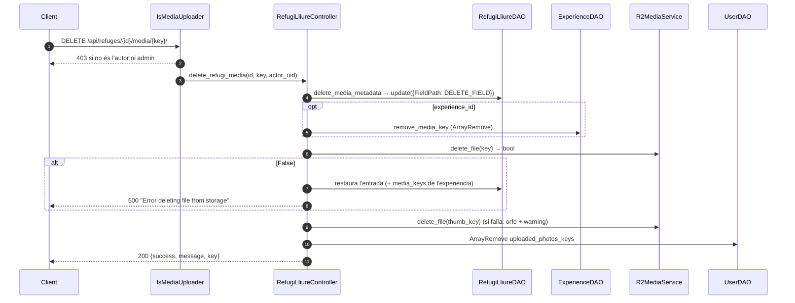

# Flux 3 — Pujar, llistar i esborrar fotos/vídeos d'un refugi

> **[FET]** comprovat al codi · **[INFERÈNCIA]** deducció · **[NO VERIFICAT]** depèn de config externa.

Des de la feature *images* la pujada recomanada és **directa a R2 amb URL PUT prefirmada** + **confirmació** al backend, que fa el processament autoritatiu (neteja de metadades, compressió, tipus real, moderació). El multipart antic es manté per compatibilitat, però passa pel **mateix** processament. Denúncies i moderació: [flux 12](12-media-moderation.md). Avatar: [flux 2](02-user-avatar.md). Experiències: [flux 8](08-experiences.md).

## Contracte d'API (compartit amb el frontend) [FET]

```
POST /api/media/upload-intents/                         IsAuthenticated + IsNotBlocked + IsAgeConfirmed
  {target: "refuge"|"experience"|"avatar", refuge_id?, experience_id?,
   rights_confirmed: true, files: [{content_type, size}]}            (màx. 10 fitxers)
  → 201 {uploads: [{upload_id, put_url, headers: {"Content-Type": ...}, expires_in: 600}]}
  Límits: imatge ≤ 15 MB (jpeg/png/webp/heic/heif), vídeo ≤ 50 MB (mp4/quicktime/webm), avatar només imatge (1 fitxer).
  Errors: 400 validació · 403 age_not_confirmed / user_blocked / not_owner (experiència) · 404 refugi/experiència

POST /api/media/upload-intents/confirm/   {upload_ids: [...]}            (màx. 10)
  → 200 {uploaded: [MediaItem], failed: [{upload_id, reason}]}
  reason ∈ missing_object | too_large | invalid_type | processing_error | moderation_blocked

MediaItem = {key, url, thumb_url, media_type: "image"|"video", width, height, blurhash,
             creator_uid, uploaded_at, taken_at|null, experience_id|null}
```

- Els errors amb codi tenen la forma `{"error": "<codi>", "code": "<codi>", "message": "<text>"}` (`coded_error`, `api/permissions.py:385`). Els 400 de validació: `{"error": "Dades invàlides", "details": {...}}`.
- `image/jpg` s'accepta i es normalitza a `image/jpeg` (el header retornat a `headers` és el que s'ha signat i el client l'ha d'enviar tal qual).
- `target=experience` exigeix que l'usuari sigui el creador de l'experiència (o admin); el `refuge_id` es pren de l'experiència.
- `confirm` és **idempotent**: tornar a confirmar un `upload_id` ja confirmat retorna el mateix MediaItem; un intent pendent sense objecte a R2 retorna `missing_object` i **es pot reintentar** (fins que caduqui).
- GET de refugi (`images_metadata`), `GET /api/refuges/{id}/media/` (`media`), experiències (`images_metadata`) i avatar (`avatar_metadata`) retornen MediaItems. Els items amb `status ≠ visible` només els veuen el seu autor i els admins.

## Endpoints
| Mètode | URL | Vista | Permisos | Body |
|---|---|---|---|---|
| POST | `/api/media/upload-intents/` | `UploadIntentsAPIView` (`api/views/media_views.py:62`) | IsAuthenticated + IsNotBlocked + IsAgeConfirmed | JSON (contracte) |
| POST | `/api/media/upload-intents/confirm/` | `UploadIntentsConfirmAPIView` (`:120`) | idem | JSON `{upload_ids}` |
| GET | `/api/refuges/{id}/media/` | `RefugiMediaAPIView.get` | IsAuthenticated | — |
| POST | `/api/refuges/{id}/media/` | `.post` (**legacy**) | IsAuthenticated + IsNotBlocked | multipart, llista `files` |
| DELETE | `/api/refuges/{id}/media/{key}/` | `RefugiMediaDeleteAPIView.delete` | IsAuthenticated + IsMediaUploader | — (`key` és `path:`) |

## Model de dades [FET]
- R2: `refugis-lliures/{refuge_id}/{uuid}.webp` (imatge, 2048 px de costat llarg) + `{uuid}_thumb.webp` (400 px); vídeo `{uuid}.mp4|.mov|.webm` + `{uuid}_thumb.webp` (pòster). Les claus són **UUID** (no previsibles; el nom original no s'usa mai). Temporals: `quarantine/{upload_id}`. Evidència retinguda: `moderation-hold/...`.
- Firestore `data_refugis_lliures/{id}.media_metadata["<clau>"]` = `{creator_uid, uploaded_at, taken_at, experience_id, media_type, content_type, width, height, size, thumb_key, blurhash, status, rights_confirmed_at}`. `status ∈ visible | hidden_pending_review | removed`. `taken_at` (DateTimeOriginal de l'EXIF) **només** es desa aquí; al fitxer publicat no hi ha cap metadada.
- Items antics (abans de la feature) només tenen `creator_uid`, `uploaded_at`, `experience_id`: es tracten com `status=visible`, `thumb_url = url`, `media_type` inferit de l'extensió i la resta `null` (`MediaMetadata.from_stored`, `api/models/media_metadata.py`).
- `users/{uid}.uploaded_photos_keys` (ArrayUnion/ArrayRemove) i `experiences/{id}.media_keys` (ArrayUnion).
- `upload_intents/{upload_id}` = `{uid, target, content_type, size, quarantine_key, refuge_id, experience_id, status: pending|confirmed|failed, rights_confirmed_at, created_at, expire_at (Timestamp, +1 dia), result_key, failure_reason}`.

## Diagrama — pujada directa (flux nou)

```mermaid
sequenceDiagram
    autonumber
    participant C as App
    participant V as UploadIntents*APIView
    participant P as IsNotBlocked/IsAgeConfirmed
    participant MC as MediaUploadController
    participant ID as UploadIntentDAO
    participant R2 as R2 (bucket privat)
    participant IP as ImageProcessingService
    participant MS as ModerationService
    participant RD as RefugiLliureDAO
    participant UD as UserDAO

    C->>V: POST upload-intents {target, refuge_id, rights_confirmed, files}
    V->>P: users/{uid}: is_blocked? age_confirmed_at?
    P-->>C: 403 user_blocked / age_not_confirmed
    V->>MC: create_upload_intents
    MC->>RD: refugi_exists (404) / experiència + propietari (404/403)
    MC->>R2: presign PUT quarantine/{id} (Content-Type + Content-Length, 600 s)
    MC->>ID: batch set upload_intents (expire_at +1 dia)
    V-->>C: 201 {uploads:[{upload_id, put_url, headers, expires_in}]}
    C->>R2: PUT bytes (R2 rebutja un altre tipus o mida)
    C->>V: POST confirm {upload_ids}
    loop per cada upload_id
        MC->>ID: get_intent (ha de ser de l'usuari)
        MC->>R2: HEAD quarantine/{id} → missing_object / too_large
        MC->>R2: GET bytes (≤ límit + 1)
        MC->>IP: process: magic bytes + Pillow/pillow-heif o ffmpeg
        alt no és imatge/vídeo vàlid
            MC->>R2: DELETE quarantine → failed invalid_type
        end
        MC->>MS: check(sha256, pHash)
        alt coincidència
            MC->>R2: moure a moderation-hold/ · bloquejar usuari · denúncia CSAM → moderation_blocked
        end
        MC->>R2: PUT {uuid}.webp + {uuid}_thumb.webp
        MC->>RD: update(FieldPath media_metadata.`clau`) (atòmic)
        MC->>UD: ArrayUnion uploaded_photos_keys
        alt qualsevol escriptura falla
            MC->>R2: rollback (delete_file comprovat; orfes → log)
        end
        MC->>R2: DELETE quarantine/{id}
        MC->>ID: status=confirmed, result_key
    end
    V-->>C: 200 {uploaded:[MediaItem], failed:[{upload_id, reason}]}
```

## Processament (`api/services/image_processing_service.py`) [FET]
1. **Tipus real** per magic bytes (`detect_media_type`, L139): JPEG `FFD8FF`, PNG, `RIFF…WEBP`, caixa `ftyp` (brands heic/heif/mif1 → imatge; isom/mp4x/avc1 → mp4; `qt  ` → quicktime), EBML amb `webm`. Qualsevol altra cosa (PDF, ZIP, EXE, GIF, AVIF, MKV…) → `invalid_type`. El tipus declarat ha de coincidir amb el detectat (imatge vs vídeo).
2. **Obertura real**: Pillow (`verify()` + `load()`, `pillow-heif` per a HEIC) o `ffmpeg -i` (imageio-ffmpeg; no porta `ffprobe`, així que `probe_video` parseja la sortida d'`ffmpeg -i`). Bomba de descompressió (> 80 MP) → `too_large`.
3. **Imatge**: `ImageOps.exif_transpose`, `DateTimeOriginal`(+`OffsetTimeOriginal`) → `taken_at`, còpia només amb píxels (`_strip_metadata`), WebP q80 màx. 2048 px + miniatura 400 px, blurhash (4×3), pHash i sha256 per a moderació.
4. **Vídeo**: remux sense recodificar `-map 0:v:0 -map 0:a? -c copy -map_metadata -1 -map_chapters -1 -fflags +bitexact (-movflags +faststart)`; `creation_time` → `taken_at`; pòster = primer fotograma → WebP 400 px. Timeout ffmpeg 120 s → `processing_error`.

## Diagrama — multipart antic (compatibilitat)
`RefugiMediaAPIView.post` → `RefugiLliureController.upload_refugi_media` (`api/controllers/refugi_lliure_controller.py:180`) llegeix cada fitxer (≤ límit + 1 bytes) i crida `MediaUploadController.process_and_publish` (`api/controllers/media_upload_controller.py:273`). Resposta `200 {uploaded: [MediaItem], failed: [{filename, error}]}` amb `error` ∈ els mateixos `reason` del contracte.

## Diagrama — esborrar



## Passos (amb línies)
- Intents/confirm: `MediaUploadController.create_upload_intents` (L76), `confirm_upload_intents` (L159) → `_confirm_one` (L183) → `process_and_publish` (L273) → `_publish_refuge_media` (L321) / `_publish_avatar` (L376); bloqueig per moderació `_handle_moderation_block` (L431).
- DAO: `RefugiLliureDAO.add_media_metadata` (`api/daos/refugi_lliure_dao.py:442`, FieldPath), `update_media_status` (L479), `delete_media_metadata` (L509, `DELETE_FIELD`), `delete_multiple_media_metadata` (L553), `get_media_metadata` (L402, filtra per status), `get_raw_media_metadata` (L368, cache-first), `get_media_entry` (L387, sense cache).
- R2: `generate_presigned_put_url`, `head_object`, `get_object_bytes`, `put_bytes`, `copy_object`, `move_object`, `build_media_key` (`api/services/r2_media_service.py:368-480`).
- Llistat: `RefugiLliureController.get_refugi_media` (L148) — registra l'accés a `audit_logs` (`media.list`).

## Errors
| Cas | HTTP |
|---|---|
| Validació de l'intent (tipus, mida, > 10 fitxers, `rights_confirmed` ≠ true, target sense id) | 400 |
| Usuari bloquejat / edat no confirmada / no és el creador de l'experiència | 403 `user_blocked` / `age_not_confirmed` / `not_owner` |
| Refugi o experiència no trobats | 404 |
| Fitxer rebutjat en confirmar | 200 amb `failed[].reason` |
| Sense fitxers (multipart) | 400 |
| Media inexistent o d'un altre usuari (DELETE) | **403** (no 404) |
| R2 no pot esborrar (DELETE) | 500 (amb rollback de Firestore) |

## Gotchas i bugs
- Les claus R2 contenen `/`, `.` i `-`: per escriure una entrada del map cal `FieldPath('media_metadata', key).to_api_repr()` (escapa amb backticks). **Mai** `update({'media_metadata.' + key: ...})` **[FET]**.
- El processament és **síncron** dins la petició de `confirm` (1 worker a Render): 10 vídeos de 50 MB poden acostar-se al timeout de gunicorn **[INFERÈNCIA]** — vegeu [TECH_DEBT](../TECH_DEBT.md).
- El multipart antic no exigeix `IsAgeConfirmed` (per no trencar versions antigues de l'app) **[FET]**; l'app nova té la pantalla d'edat bloquejant.
- `unquote` a la vista sobre un path que Django ja ha decodificat → doble decodificació de `%25` **[INFERÈNCIA]**.
- Swagger documenta 204 per al DELETE però retorna 200 **[FET]**.
- Configuració necessària al bucket (CORS per a PUT, lifecycle de `quarantine/`): [integrations/cloudflare-r2.md](../integrations/cloudflare-r2.md).
