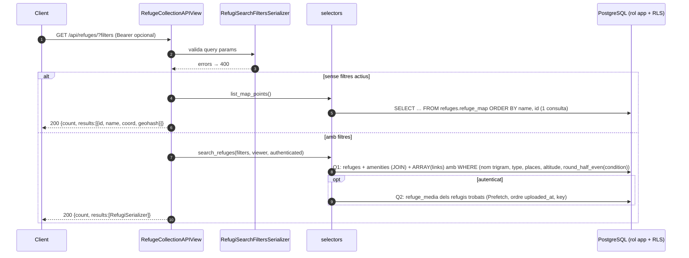

# Flux 4 — Cerca, coordenades i detall de refugis

> **[FET]** comprovat al codi · **[INFERÈNCIA]** deducció · **[NO VERIFICAT]** depèn de config externa.
>
> **Migrat a PostgreSQL (chunk 2).** Aquest flux viu a l'app `apps/refuges` (`views.py` → `selectors.py` → models/ORM amb RLS). Ja no hi ha Firestore, cache Redis, DAO, controller ni les 15 estratègies de cerca: la cerca amb filtres és **una sola consulta SQL**. Disseny: [postgres-schema.md](../design/postgres-schema.md) §2.5-2.9, §4.1, §5.2-5.3.

## Endpoints (`apps/refuges/views.py`, rutes a `apps/refuges/urls.py`)
| Mètode | URL | Vista | Permisos |
|---|---|---|---|
| GET | `/api/refuges/` (sense filtres → punts del mapa) | `RefugeCollectionAPIView.get` | públic; el token és opcional i desbloqueja `images_metadata` (i `visitors` per als admins) |
| GET | `/api/refuges/?name=&type=&condition=&places_min=&places_max=&altitude_min=&altitude_max=` | idem | idem |
| GET | `/api/refuges/{id}/` | `RefugeDetailAPIView.get` | públic; l'`id` és un UUID (qualsevol altre format → 404) |
| GET | `/api/refuges/{id}/renovations/` | `RefugeRenovationsAPIView.get` (`api/views/renovation_views.py`; ruta a `api/urls.py`) | IsAuthenticated |

Taules: `refuges.refuges` (+ `refuge_amenities` 1-1, `refuge_links`, `refuge_media`) i la vista `refuges.refuge_map` (llista sense filtres). Lectura pública per RLS (`USING (true)`); els mitjans només visibles per a tothom (la resta, autor i admin).

## Diagrama

## Passos
1. **Validació** — `RefugiSearchFiltersSerializer` (`apps/refuges/serializers.py`): `type` CSV contra `RefugeType`; `condition` CSV ∈ {0,1,2,3}; `places_*` ≥ 0; `altitude_*` 0–8848 i min ≤ max. Filtres buits (`?name=&type=`) = sense filtres.
2. **Sense filtres** — `selectors.list_map_points()` llegeix la vista `refuge_map` (`id, name, lat, lng, geohash = ST_GeoHash(coord, 5)`): 1 consulta, sense joins. La resposta ja **no** porta `surname`. Substitueix el document `coords_refugis` de Firestore.
3. **Amb filtres** — `selectors.search_refuges` (`search_queryset`):
   - `name`: parcial, sense accents ni majúscules i **també sobre `surname`** (àlies). Usa `core.norm_name` (unaccent + lower, `IMMUTABLE`) amb `pg_trgm`: `norm_name(name) % q` (similitud ≥ 0,3) **o** `LIKE '%q%'`, per als dos camps; ordena per similitud descendent, nom i id. S'usen els índexs `refuges_name_trgm_gin` i `refuges_surname_trgm_gin` (`BitmapOr`; cada braç de l'àlies porta `surname IS NOT NULL` perquè el planificador pugui usar l'índex parcial). Els comodins (`%`, `_`, `\`) de l'usuari s'escapen.
   - `type IN (…)`, `places >=/<=`, `altitude >=/<=` (els `NULL` no compleixen cap rang) — tot al `WHERE`.
   - `condition IN (…)` sobre `core.round_half_even(condition)` (0–3); els refugis sense valoració (`NULL`) no coincideixen amb cap filtre.
   - Els serveis (`info_comp`) venen del `JOIN` amb `refuge_amenities`; els enllaços, d'un `ARRAY(subconsulta)` ordenat per `position`: cap consulta addicional per refugi.
4. **Serialització** — `refuge_to_dict` + `RefugiSerializer` (`apps/refuges/serializers.py`): `coord` → `{lat, long}`; `info_comp` → 12 enters 0/1; `condition` → **enter arrodonit half-to-even** (`round()` de Python, el mateix que `core.round_half_even`) o `null`; `modified_at` ISO; `surname` no s'emet mai. Anònim: sense `images_metadata` ni `visitors`. Autenticat: `images_metadata` (mitjans visibles + propis; tots per a admins). **`visitors` només per als admins** (hi serà la llista de `user_visited_refuges` quan arribi el chunk 3; fins llavors és sempre `[]`).
5. **Detall** — `selectors.get_refuge(id)`: 1 consulta (refugi + amenities + enllaços); +1 de mitjans si és autenticat; els visitants d'admin seran +1 (chunk 3). Pressupost: llista sense filtres 1 · amb filtres 1 (+1 autenticat) · detall 1 (+1 autenticat). Els tests ho comproven (`apps/refuges/tests/test_query_counts.py`).

## Errors
| Cas | HTTP |
|---|---|
| Query params invàlids | 400 `{error:'Invalid query parameters', details}` |
| Refugi no trobat, o `id` que no és un UUID (p. ex. un ID antic de Firestore) | 404 `{error:'Refugi not found'}` |
| Error intern | 500 `{error:'<missatge específic>', error_id:'<uuid>'}` (p. ex. "Error de base de dades en cercar refugis", "Error en generar la URL de la imatge"); el mateix `error_id` és al log amb la traça; no s'exposa mai el text de l'excepció (`apps.core.errors.server_error`) |

## Canvis respecte al flux antic (decisions del PO, chunk 2)
- IDs: UUID v7 (string opac per al frontend).
- `condition`: s'hi desa la mitjana decimal; es mostra i es filtra arrodonida half-to-even; el filtre accepta 0–3 (abans 0–2 i només enters exactes).
- `visitors`: només admins. `surname`: només per cercar. La llista sense filtres ja no porta `surname` i cap resposta porta `has_filters` (el frontend no el llegeix: `{count, results}`).
- Cerca per nom parcial i sense accents (B2 resolt: el DAO antic assumia nom únic i la cerca era exacta).
- Cap cache Redis per a refugis: les llistes ja no cal invalidar-les quan una proposta modifica un refugi.

## Gotchas
- `GET /refuges/{id}/renovations/`: `active_only` no es llegeix de la query (`api/views/renovation_views.py`, `RefugeRenovationsAPIView.get`) **[FET]**; continua sent la ruta antiga de Firestore.
- Els dominis que encara no s'han migrat (experiències, dubtes, visites, propostes, usuaris) segueixen consultant els refugis al `RefugiLliureDAO` de Firestore, que ja no s'alimenta: fins als seus chunks, les seves comprovacions d'existència de refugi miren el catàleg antic de Firestore (en un entorn nou, buit; en producció, amb IDs diferents dels UUID de PostgreSQL) — [GOTCHAS #41](../GOTCHAS.md).
- `load_refuges` és d'un sol ús: vegeu [local-setup](../guides/local-setup.md).
