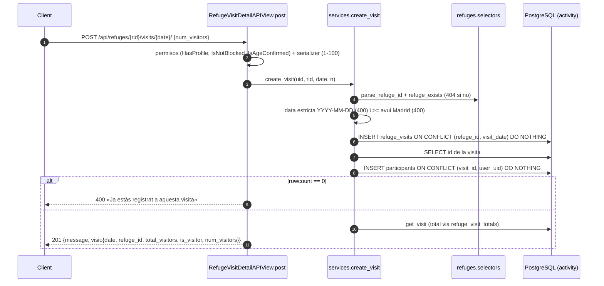
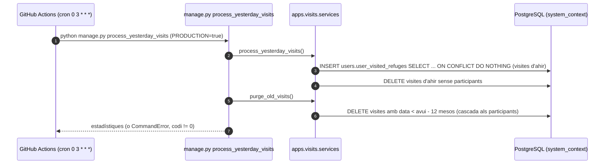

# Flux 6 — Visites planificades i procés diari

> **[FET]** comprovat al codi · **[INFERÈNCIA]** deducció · **[NO VERIFICAT]** depèn de config externa.

> **Migrat a PostgreSQL (chunk 4).** Les visites viuen a `apps/visits` (schema `activity`); ja no hi ha `RefugeVisitController`, `RefugeVisitDAO`, mapper, dataclass, serializer legacy ni cache Redis de visites. Els refugis es comproven amb `apps.refuges.selectors` (no amb el `RefugiLliureDAO` legacy): un `refuge_id` que no és un UUID existent (p. ex. un ID antic de Firestore) dona 404 **[FET]**.

Un usuari indica que anirà a un refugi en una data (amb `num_visitors`). Cada nit, un procés converteix les visites d'ahir en «refugis visitats» (`users.user_visited_refuges`) i purga les antigues.

## Endpoints (`apps/visits/urls.py`, `apps/visits/views.py`)
S'inclouen des d'`api/urls.py` a l'arrel de l'API (`path('', include('apps.visits.urls'))`), amb els mateixos paths i `name=` d'abans **[FET]**.

| Mètode | URL | Vista | Permisos | Body |
|---|---|---|---|---|
| GET | `/api/refuges/{refuge_id}/visits/` | `RefugeVisitsAPIView` | IsAuthenticated + HasProfile | — |
| POST | `/api/refuges/{refuge_id}/visits/{YYYY-MM-DD}/` | `RefugeVisitDetailAPIView.post` | IsAuthenticated + HasProfile + **IsNotBlocked + IsAgeConfirmed** | `{num_visitors: 1–100}` |
| PATCH | idem | `.patch` | idem POST | `{num_visitors: 1–100}` |
| DELETE | idem | `.delete` | IsAuthenticated + HasProfile (sense bloqueig ni edat: RGPD) | — |
| GET | `/api/users/{uid}/visits/` | `UserVisitsAPIView` | IsAuthenticated + HasProfile + IsSameUser | — |

- Decisió del PO (26/10): `ContentWritePermissionsMixin` afegeix `IsNotBlocked` i `IsAgeConfirmed` només a POST/PUT/PATCH, després de `HasProfile` (GOTCHAS #15). Un usuari bloquejat o sense edat confirmada pot llegir i esborrar la seva visita **[FET]**.
- L'UID sempre surt del token: només es pot actuar sobre la pròpia participació. A `/users/{uid}/visits/` `IsSameUser` dona 403 si l'`uid` de la URL no és el del token **[FET]**.
- El middleware exclou `/api/refuges/` per prefix: la protecció és només de `permission_classes` (GOTCHAS #2).

## Model de dades (`apps/visits/models.py`, migració `0001_initial`)
| Objecte | Contingut | Notes |
|---|---|---|
| `activity.refuge_visits` | `id` (uuidv7), `refuge_id`, `visit_date`, `created_at` | `UNIQUE (refuge_id, visit_date)` (`visits_refuge_date_uq`); índex `visits_date_idx` per al job |
| `activity.refuge_visit_participants` | PK composta `(visit_id, user_uid)`, `num_visitors` (`CHECK >= 1`), `created_at` | índex `(user_uid) INCLUDE (visit_id, num_visitors)` |
| vista `activity.refuge_visit_totals` | `visit_id`, `total_visitors = sum(num_visitors)` | model `VisitTotal` (`managed=False`) |

- FK reals per `RunSQL` amb `ON DELETE CASCADE` (refugi → visita, visita → participant, usuari → participant); els `ForeignKey` de Django són `DO_NOTHING` + `db_constraint=False` **[FET]**.
- **RLS**: `refuge_visits`: SELECT/INSERT per a qualsevol usuari autenticat o sistema; DELETE només sistema (`app` no pot esborrar visites, §2.10). `refuge_visit_participants`: cada usuari només veu, crea, canvia i esborra la seva fila; l'admin només llegeix; el sistema tot **[FET]**.
- **Total sota RLS**: el total **no es desa** ni es calcula amb un `Sum` sobre els participants (la RLS només deixa veure la fila pròpia i el total quedaria mutilat). Surt de la vista `refuge_visit_totals`, que corre amb els privilegis del propietari (sense `security_invoker`, intencionat: només exposa agregats) ([GOTCHAS #63](../GOTCHAS.md), [TECH_DEBT R13](../TECH_DEBT.md)) **[FET]**.

## Privacitat i forma JSON
Les respostes **mai** exposen participants ni UIDs d'altres usuaris. Cada visita és un `VisitSummary` serialitzat per `RefugeVisitListSerializer` com `{date: 'YYYY-MM-DD', refuge_id (UUID), total_visitors, is_visitor, num_visitors}`; `is_visitor`/`num_visitors` són els de l'usuari del token (`num_visitors = 0` si no hi és). `refuge_id` hi és a **tots** els elements (D27) **[FET]**.

- `GET /refuges/{id}/visits/` → `{result: [...]}`: visites amb `visit_date >= avui` (Madrid, `get_madrid_today()`), ordre ascendent; les visites sense participants (encara no esborrades pel job) hi surten amb `total_visitors = 0`.
- `GET /users/{uid}/visits/` → `{result: [...]}`: totes les visites on participa l'usuari (passades i futures), ordre `(visit_date DESC, refuge_id)`.
- POST → 201 `{message: 'Visita creada correctament', visit}`; PATCH → 200 `{message: 'Visita actualitzada correctament', visit}`; DELETE → 200 `{message: 'Visitant eliminat correctament'}` (no 204).
- Una consulta per cas d'ús (sense N+1, sense cache): `selectors.list_refuge_visits`, `list_user_visits`, `get_visit` (`apps/visits/selectors.py`) **[FET]**.

## Diagrama — registrar visita

## Diagrama — procés diari

## Passos
- **Crear** (`services.create_visit`): ordre de comprovacions: refugi (404) → format de data (400) → data passada (400; avui és vàlid) → ja registrat (400). Dins `transaction.atomic`: `INSERT ... ON CONFLICT (refuge_id, visit_date) DO NOTHING` + `SELECT` de la visita, i `INSERT` del participant `ON CONFLICT DO NOTHING`; `rowcount == 0` vol dir que ja hi era (M4 resolt: cap duplicat de visita ni `IntegrityError`) **[FET]**.
- **Editar** (`update_visit`): només canvia `num_visitors` de la fila pròpia; **no** comprova la data (comportament de sempre) **[FET]**.
- **Sortir** (`remove_visitor`): esborra la fila pròpia. La visita es conserva encara que quedi buida (l'`app` no pot esborrar `refuge_visits`): la neteja és del job diari **[FET]**.
- **Data estricta**: la URL ha de ser exactament `YYYY-MM-DD` (regex + `date.fromisoformat`); altres formats que Python podria acceptar (`20261026`, amb hora...) es rebutgen **[FET]**.
- **Procés diari** (`process_yesterday_visits`, `apps/visits/management/commands/`): «ahir» sempre amb `get_madrid_today()`, mai al SQL (GOTCHAS #60). Set-based i amb un nombre constant de consultes: una `INSERT ... SELECT ... ON CONFLICT (user_uid, refuge_id) DO NOTHING` a `users.user_visited_refuges` (idempotent, conserva el `created_at`) i un `DELETE` de les visites d'ahir sense participants. Les visites amb participants **no** s'esborren: les purga `purge_old_visits` quan tenen més de 12 mesos (§8.3, decisió 13; el dia es retalla a l'últim del mes, 29/02 → 28/02). Va tot dins `system_context()` **[FET]**.
- **Estadístiques impreses**: `Visites processades` (visites d'ahir), `Visites buides eliminades`, `Refugis actualitzats` (visites d'ahir amb participants), `Total visitants afegits` (participants d'aquestes visites) i `Visites antigues purgades` **[FET]**.
- **Errors del job (D28)**: si el procés o la purga fallen, la comanda fa `raise CommandError(...)` amb un missatge fix (la traça va al log) i surt amb **codi ≠ 0**; abans imprimia l'error i sortia amb 0, i el job de GitHub Actions quedava en verd **[FET]**.
- Com executar-lo (Actions, manual, crontab): [guides/daily-visits-process.md](../guides/daily-visits-process.md).
- Planificació real: `.github/workflows/process-visits.yml` (cron `0 3 * * *` UTC, `PRODUCTION='true'`; crida la comanda igual que abans, sense canvis al workflow, D29). Alternatives no actives: `CRONJOBS` a `refugis_lliures/settings.py` (django-crontab, mai instal·lat) i `run_process_visits.sh` / `run_process_visits.bat` (manual) **[FET]**.
- **Esborrat d'usuari**: el pas «visites» de Firestore ha desaparegut; `DELETE FROM users.users` cascadeja les files de `refuge_visit_participants` i el total (vista) es recalcula sol (M3 resolt) **[FET]**. Vegeu [user-deletion](../deep-dives/user-deletion.md).

## Errors
| Cas | HTTP | Missatge |
|---|---|---|
| Refugi no trobat o ID no UUID (GET llistat, POST) | 404 | `Refugi amb ID {id} no trobat` |
| Visita o refugi no trobats (PATCH; data invàlida inclosa) | 404 | `Visita o refugi no trobat` |
| Visita no trobada (DELETE; data invàlida inclosa) | 404 | `Visita no trobada` |
| Data amb format invàlid (POST) | 400 | `Format de data invàlid. Utilitza YYYY-MM-DD` |
| Data passada (POST) | 400 | `La data de la visita ha de ser igual o posterior a avui` |
| Ja registrat (POST) | 400 | `Ja estàs registrat a aquesta visita` |
| No registrat (PATCH, DELETE) | 400 | `No estàs registrat a aquesta visita` |
| `num_visitors` fora de 1–100 o absent | 400 | errors del serializer |
| Sense autenticar | 401 | — |
| Perfil inexistent, usuari bloquejat o edat no confirmada (POST/PATCH), `uid` URL ≠ token | 403 | — |
| Altres | 500 | `{error, error_id}` amb missatge fix (`server_error`, mai `str(e)`) |

## Gotchas i bugs
- Els bugs antics del flux (duplicats per carrera, lost updates de `visitors`, `total_visitors` decrementat en 1 en esborrar usuari, scan de la col·lecció per usuari, visites processades que no s'esborraven) estan resolts amb el disseny relacional ([TECH_DEBT M3, M4, B5](../TECH_DEBT.md)).
- El total només és correcte llegit de la vista; no el calculis mai amb un `Sum` sobre `VisitParticipant` des d'un usuari ([GOTCHAS #63](../GOTCHAS.md)).
- La data de la URL és estricta; PATCH/DELETE amb data invàlida donen 404 i POST 400 ([GOTCHAS #64](../GOTCHAS.md)).
- El workflow `process-visits.yml` declara `DATABASE_URL_APP`, però el secret de GitHub no es crea de moment (ajornat pel PO, D29): mentre no hi sigui, el job no pot escriure a Neon ([TECH_DEBT U3](../TECH_DEBT.md)) **[FET sobre el workflow; NO VERIFICAT l'estat del secret]**.
- El workflow no defineix `REDIS_URL`, però ja no importa: les visites no usen cache.
