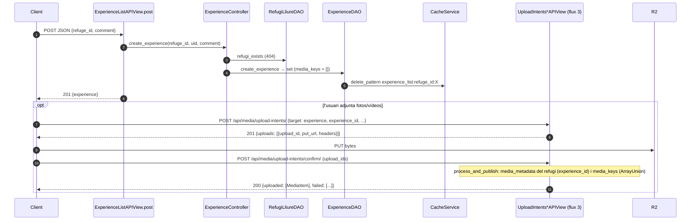

# Flux 8 — Experiències amb fotos

> **[FET]** comprovat al codi · **[INFERÈNCIA]** deducció · **[NO VERIFICAT]** depèn de config externa.

> **Estat intermedi (chunk 2 → chunk 7).** Els refugis ja viuen a PostgreSQL (IDs UUID v7), però aquest domini encara comprova i llegeix els refugis amb el `RefugiLliureDAO` legacy de Firestore, que ja no s'alimenta: les seves comprovacions d'existència de refugi miren el catàleg antic de Firestore (ids diferents dels UUID de PostgreSQL). Vegeu [GOTCHAS #41](../GOTCHAS.md) i [TECH_DEBT R1](../TECH_DEBT.md).

## Endpoints (`api/views/experience_views.py`)
| Mètode | URL | Vista | Permisos efectius | Body |
|---|---|---|---|---|
| GET | `/api/experiences/?refuge_id=X` | `ExperienceListAPIView.get` | IsAuthenticated | — |
| POST | `/api/experiences/` | `.post` | IsAuthenticated + HasProfile + IsNotBlocked | **JSON** `{refuge_id, comment}` (només JSON) → 201 `{experience}` |
| PATCH | `/api/experiences/{experience_id}/` | `ExperienceDetailAPIView.patch` | IsAuthenticated + HasProfile + IsNotBlocked; **propietat al controller** (403 `not_owner`, admins permesos) | JSON `{comment?}` → 200 `{experience}` |
| DELETE | `/api/experiences/{experience_id}/` | `.delete` | IsAuthenticated + HasProfile + IsNotBlocked; **propietat al controller** | — |

Flux de l'app [FET]: `POST /api/experiences/` en JSON → `POST /api/media/upload-intents/` amb `target=experience, experience_id` → PUT a R2 → `confirm` ([flux 3](03-refuge-media-upload.md)). El confirm afegeix la clau a `media_keys` (ArrayUnion) i a `media_metadata` del refugi amb `experience_id`. Les vistes només accepten JSON (`JSONParser`): `files[]` multipart s'ha retirat i les respostes ja no porten `uploaded_files`/`failed_files`.

Col·lecció `experiences/{autoId}` = `{id, refuge_id, creator_uid, comment, modified_at, media_keys[]}` (`api/models/experience.py:14-23`). Les metadades de les fotos viuen al refugi (`media_metadata[key].experience_id`), vegeu [flux 3](03-refuge-media-upload.md).

## Diagrama — crear l'experiència (JSON) i pujar les fotos per separat

## Passos
- Crear: `ExperienceController.create_experience(refuge_id, creator_uid, comment)` (`api/controllers/experience_controller.py:85-133`); `ExperienceDAO.create_experience` (`api/daos/experience_dao.py:25-54`); `add_media_keys_to_experience` (DAO L246, el crida el confirm). **`users.num_shared_experiences` ja no s'escriu** (chunk 3, D19): el perfil el calcula amb un `count()` a Firestore (`experiences.creator_uid`); el chunk 7 el substituirà per SQL.
- Llistar: `ExperienceDAO.get_experiences_by_refuge_id`, ID caching `experience_list:refuge_id:X`, `order_by modified_at desc`; després `ExperienceController._attach_media_items` (`api/controllers/experience_controller.py:33`) reconstrueix `images_metadata` com a **MediaItems** a partir de `media_metadata` del refugi (cache-first, `get_raw_media_metadata`) i amaga els mitjans amb `status ≠ visible` llevat de l'autor i dels admins. Les claus que ja no són al refugi s'ometen.
- Editar: `update_experience(experience_id, comment=None, requester_uid=None, is_admin=False)` (controller L135) → comprova propietat → `ExperienceDAO.update_experience` (només `comment` i `modified_at`; invalida només el detall). Les fotos noves es pugen per intents.
- Esborrar: `delete_experience(experience_id, requester_uid, is_admin)` (controller L187) → comprova propietat → `delete_multiple_refugi_media` (també esborra miniatures) → `ExperienceDAO.delete_experience` → `decrement_shared_experiences`. Retorna 200, no 204.

## Errors
| Cas | HTTP |
|---|---|
| Falta `refuge_id` al GET | 400 |
| Refugi / experiència no trobats | 404 (match de `"not found"`) |
| No ets el creador (PATCH/DELETE) | 403 `{error: 'not_owner', code: 'not_owner', message}` |
| Sense perfil | 403 `{error: 'profile_required'}` |
| Usuari bloquejat (POST/PATCH/DELETE) | 403 `{error: 'user_blocked'}` |
| Altres | 500 |

## Gotchas i bugs
- **Corregit**: abans no hi havia control de propietat (qualsevol usuari autenticat editava o esborrava experiències d'altres). Ara la vista passa `requester_uid` i `is_admin` i el controller retorna `not_owner` **[FET]**. Si un controller crida `update_experience`/`delete_experience` sense `requester_uid` (ús intern), no es comprova la propietat. Les fotos noves pujades per un admin s'atribueixen al creador original.
- La pujada de fotos és un pas independent: si falla, l'experiència queda creada sense fotos (el comptador ja s'ha incrementat) **[FET]**.
- Error path del PATCH: `result.to_dict()` amb `result=None` (`api/views/experience_views.py:310-312`) → 500 genèric **[FET]**.
- Experiències **no** porten condició ni valoració; `ConditionService` només s'usa a propostes i comandes **[FET]**.
- Cap transacció entre experiència, `media_metadata` i `media_keys` **[FET]**.
