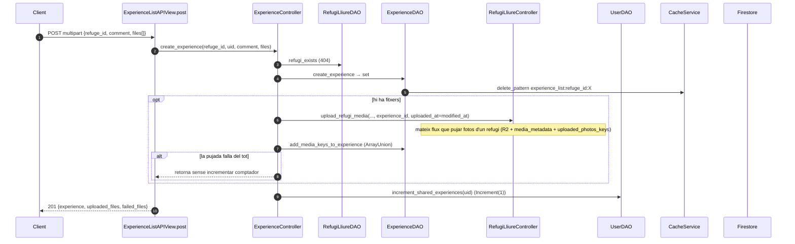

# Flux 8 — Experiències amb fotos

> **[FET]** comprovat al codi · **[INFERÈNCIA]** deducció · **[NO VERIFICAT]** depèn de config externa.

## Endpoints (`api/views/experience_views.py`)
| Mètode | URL | Vista | Permisos efectius | Body |
|---|---|---|---|---|
| GET | `/api/experiences/?refuge_id=X` | `ExperienceListAPIView.get` | IsAuthenticated | — |
| POST | `/api/experiences/` | `.post` | IsAuthenticated + IsNotBlocked | **JSON** `{refuge_id, comment}` (flux nou) o multipart `refuge_id`, `comment`, `files[]` (legacy) |
| PATCH | `/api/experiences/{experience_id}/` | `ExperienceDetailAPIView.patch` | IsAuthenticated + IsNotBlocked; **propietat al controller** (403 `not_owner`, admins permesos) | JSON `{comment?}` o multipart `comment?`, `files[]?` |
| DELETE | `/api/experiences/{experience_id}/` | `.delete` | IsAuthenticated + IsNotBlocked; **propietat al controller** | — |

Flux nou de l'app [FET]: `POST /api/experiences/` en JSON → `POST /api/media/upload-intents/` amb `target=experience, experience_id` → PUT a R2 → `confirm` ([flux 3](03-refuge-media-upload.md)). El confirm afegeix la clau a `media_keys` (ArrayUnion) i a `media_metadata` del refugi amb `experience_id`. Els fitxers del camí multipart passen pel mateix `ImageProcessingService`.

Col·lecció `experiences/{autoId}` = `{id, refuge_id, creator_uid, comment, modified_at, media_keys[]}` (`api/models/experience.py:14-23`). Les metadades de les fotos viuen al refugi (`media_metadata[key].experience_id`), vegeu [flux 3](03-refuge-media-upload.md).

## Diagrama — crear amb fotos

## Passos
- Crear: `ExperienceController.create_experience` (`api/controllers/experience_controller.py:54-130`); `ExperienceDAO.create_experience` (`api/daos/experience_dao.py:25-54`); `_upload_experience_media_to_refuge` (controller L245-286); `add_media_keys_to_experience` (DAO L246-282); `UserDAO.increment_shared_experiences` (`api/daos/user_dao.py:410-445`).
- Llistar: `ExperienceDAO.get_experiences_by_refuge_id`, ID caching `experience_list:refuge_id:X`, `order_by modified_at desc`; després `ExperienceController._attach_media_items` (`api/controllers/experience_controller.py:33`) reconstrueix `images_metadata` com a **MediaItems** a partir de `media_metadata` del refugi (cache-first, `get_raw_media_metadata`) i amaga els mitjans amb `status ≠ visible` llevat de l'autor i dels admins. Les claus que ja no són al refugi s'ometen.
- Editar: `update_experience(experience_id, comment, files, requester_uid, is_admin)` (controller L165) → comprova propietat → `ExperienceDAO.update_experience` (`ArrayUnion` per a `media_keys`, invalida només el detall).
- Esborrar: `delete_experience(experience_id, requester_uid, is_admin)` (controller L237) → comprova propietat → `delete_multiple_refugi_media` (també esborra miniatures) → `ExperienceDAO.delete_experience` → `decrement_shared_experiences`. Retorna 200, no 204.

## Errors
| Cas | HTTP |
|---|---|
| Falta `refuge_id` al GET | 400 |
| Refugi / experiència no trobats | 404 (match de `"not found"`) |
| No ets el creador (PATCH/DELETE) | 403 `{error: 'not_owner', code: 'not_owner', message}` |
| Usuari bloquejat (POST/PATCH/DELETE) | 403 `{error: 'user_blocked'}` |
| Altres | 500 |

## Gotchas i bugs
- **Corregit**: abans no hi havia control de propietat (qualsevol usuari autenticat editava o esborrava experiències d'altres). Ara la vista passa `requester_uid` i `is_admin` i el controller retorna `not_owner` **[FET]**. Si un controller crida `update_experience`/`delete_experience` sense `requester_uid` (ús intern), no es comprova la propietat. Les fotos noves pujades per un admin s'atribueixen al creador original.
- Si la pujada de media falla del tot, l'experiència existeix però el comptador no s'incrementa; després el DELETE el decrementa → desquadrament **[FET]**.
- Error path del PATCH: `result.to_dict()` amb `result=None` (`api/views/experience_views.py:310-312`) → 500 genèric **[FET]**.
- Experiències **no** porten condició ni valoració; `ConditionService` només s'usa a propostes i comandes **[FET]**.
- Cap transacció entre experiència, `media_metadata`, `uploaded_photos_keys` i comptador **[FET]**.
