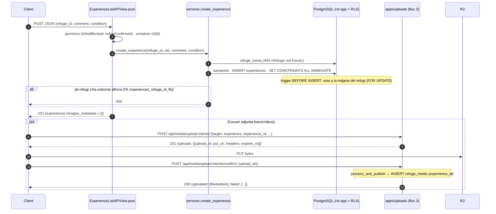

# Flux 8 — Experiències amb fotos

> **[FET]** comprovat al codi · **[INFERÈNCIA]** deducció · **[NO VERIFICAT]** depèn de config externa.

> **Migrat a PostgreSQL (chunk 7).** Les experiències són a `activity.experiences` i les gestiona `apps/experiences` (`views`, `serializers`, `selectors`, `services`, `models`, `urls`). Ja no hi ha `ExperienceController`, `ExperienceDAO`, model/mapper de dataclass, cache Redis (`experience_detail`/`experience_list`), `IsExperienceCreator` a les vistes ni `media_keys`. Les dades de Firestore no es migren (decisió del PO). Decisions: [DECISIONS_AUTONOMES D38](../migration/DECISIONS_AUTONOMES.md); disseny: [postgres-schema §2.15, §2.9, §5.3](../design/postgres-schema.md).

## Endpoints (`apps/experiences/views.py`, rutes a `apps/experiences/urls.py`, incloses des d'`refugis_lliures/urls.py` sota `experiences/`)
| Mètode | URL | Vista | Permisos efectius | Body |
|---|---|---|---|---|
| GET | `/api/experiences/?refuge_id=X` | `ExperienceListAPIView.get` | IsAuthenticated + HasProfile | — |
| POST | `/api/experiences/` | `.post` | IsAuthenticated + HasProfile + IsNotBlocked + IsAgeConfirmed | **JSON** `{refuge_id, comment, condition}` → 201 `{experience}` |
| PATCH | `/api/experiences/{experience_id}/` | `ExperienceDetailAPIView.patch` | IsAuthenticated + HasProfile + IsNotBlocked + IsAgeConfirmed; **propietat al service** (creador o admin; si no, 403 `not_owner`) | JSON `{comment?, condition?}` → 200 `{experience}` |
| DELETE | `/api/experiences/{experience_id}/` | `.delete` | IsAuthenticated + HasProfile (**sense** IsNotBlocked/IsAgeConfirmed, D38); propietat al service | — → 200 `{success, message}` |

Els permisos es trien per mètode a `get_permissions()` (`_ContentPermissionsMixin`: `POST`/`PATCH` → `WRITE_PERMISSIONS`, la resta → `PERMISSIONS`). Un usuari bloquejat pot llegir i esborrar el que és seu (RGPD), però no crear ni editar **[FET]**. Les vistes només accepten JSON (`parser_classes = [JSONParser]`).

## Model de dades [FET]
- `activity.experiences` (`apps/experiences/models.py: Experience`): `id` (uuid v7, `DEFAULT uuidv7()`), `refuge_id` → `refuges.refuges`, `creator_uid` → `users.users`, `comment`, `created_at`, `modified_at`, `condition` (smallint 0–3, **obligatòria**), `condition_counted_at` (el reescriu el trigger). Índexs `experiences_refuge_idx (refuge_id, modified_at DESC, id DESC)` i `experiences_creator_idx (creator_uid, modified_at DESC)`.
- FK reals (migració `RunSQL`): `experiences_refuge_id_fk` i `experiences_creator_uid_fk`, `ON DELETE CASCADE DEFERRABLE INITIALLY DEFERRED`.
- `CHECK`s (mateixes regles que el serializer): `experiences_comment_ck` = `btrim(comment, ' \t\n\r\f\v') <> '' AND char_length(comment) <= 2000` (D31/D34/D38) i `experiences_condition_ck` = `condition BETWEEN 0 AND 3`.
- RLS: `exp_select` pública (`true`); `exp_insert` només a nom propi (ni l'admin crea en nom d'un altre); `exp_update` i `exp_delete` pel creador, admin o sistema. Grants `SELECT, INSERT, UPDATE, DELETE` al rol `app`.
- **Mitjans**: ja no hi ha `media_keys`. Cada mitjà d'una experiència és una fila de `refuges.refuge_media` amb `experience_id` (migració `refuges.0002`: FK `refuge_media_experience_id_fk` `ON DELETE CASCADE`, índex parcial `refuge_media_experience_idx`). La política `media_insert` només deixa lligar un mitjà a una experiència **pròpia** (admin i sistema, a qualsevol). `MediaItem.experience_id` ja no és sempre `null`.
- **Mitjana de condició del refugi**: la manté el *trigger* `activity.fn_experience_condition()` (vegeu [condition-average](../deep-dives/condition-average.md)). L'aplicació no la calcula mai.

## JSON de l'experiència
`experience_to_dict` (`apps/experiences/serializers.py`): `{id, refuge_id, creator_uid, modified_at, comment, condition, images_metadata[]}`. `id`/`refuge_id` són strings UUID; `modified_at` ISO amb el desplaçament de Madrid; `images_metadata` són **MediaItems** (`apps.refuges.serializers.media_to_dict`, URLs prefirmades d'1 h). Respostes: `{"experience": {...}}` (POST 201, PATCH 200) o `{"experiences": [...]}` (GET). El POST retorna `images_metadata: []`.

Validació d'entrada (`ExperienceCreateSerializer`/`ExperienceUpdateSerializer`): `comment` retallat, no buit, ≤ 2000 caràcters, sense NUL; `condition` enter 0–3 (**obligatori a la creació**; a l'update, `0` és un valor vàlid i `None` vol dir «no tocar»); cap camp de l'update té `default=`. `refuge_id` del POST (`RefugeIdField`) no aplica la prohibició de NUL: un valor que no és UUID és un refugi inexistent (404), no una dada invàlida. Un PATCH `{}` és vàlid i només actualitza `modified_at` **[FET]**.

## Diagrama — crear l'experiència (JSON) i pujar les fotos per separat

## Passos
- **Llistar** (`selectors.list_experiences`): **2 consultes** amb qualsevol nombre de files (experiències + `Prefetch('media', to_attr='media_list')`). Ordre `(modified_at, id)` descendent; mitjans per `(uploaded_at, key)`. Els mitjans amb `status ≠ visible` només els veuen el seu autor i els admins (`refuges.selectors.media_visible_to` + la RLS de `refuge_media`). La vista comprova abans l'existència del refugi (`refuge_selectors.refuge_exists`; un id no UUID també és 404). Sense cache.
- **Crear** (`services.create_experience`): existència del refugi → `_insert_checked`: `INSERT` dins d'un *savepoint* amb `SET CONSTRAINTS ALL IMMEDIATE` perquè una FK diferida que falla (refugi esborrat entre la lectura i l'`INSERT`) surti com a `IntegrityError` d'aquí (`constraint_name == 'experiences_refuge_id_fk'` → `RefugeNotFound` → 404) i no al `COMMIT` com a 500. Qualsevol altra violació es propaga (500).
- **Editar** (`services.update_experience`): `get_experience` (404 si no existeix o id no UUID) → `_check_owner` (403 `not_owner`) → `UPDATE` de `comment`/`condition` i sempre `modified_at = TransactionNow()`. Si canvia la `condition`, el trigger `BEFORE UPDATE OF condition` ajusta la mitjana del refugi. La resposta recarrega `modified_at` i torna a llegir els mitjans visibles.
- **Esborrar** (`services.delete_experience`): `get_experience` → `_check_owner` → dins `transaction.atomic()`: bloqueja l'experiència (`SELECT … FOR UPDATE`; una confirmació concurrent que hi insereixi un mitjà necessita `KEY SHARE` de la fila i s'espera, així no pot colar-s'hi un mitjà que la cascada esborri sense esborrar-ne el fitxer) → llegeix `key`/`thumb_key` dels mitjans de l'experiència amb `system_context()` (un mitjà amagat d'un altre no és visible per al creador, però la cascada l'esborra igualment i el fitxer no pot quedar orfe) → `DELETE` de l'experiència (la BD cascadeja `refuge_media` i `moderation.upload_intents`) i `delete_files(keys)` a R2. Si R2 llança o informa de `failed` → `MediaStorageError` → es desfà el `DELETE` (500 `{error, error_id}`, es conserven fila i mitjans, D38). Les miniatures s'esborren després de la transacció: si fallen només queda un warning (`Miniatures òrfenes a R2`). **No toca la mitjana del refugi** (esborrar un vot no el retira). Retorna 200, no 204.

## Errors
Ordre de comprovacions: permisos → validació del cos (400) → existència (404) → propietat (403).

| Cas | HTTP |
|---|---|
| Falta `refuge_id` al GET | 400 `{error}` |
| Cos invàlid (comentari buit/blanc/> 2000/NUL, `condition` fora de 0–3 o absent al POST) | 400 `{error: 'Dades invàlides', details}` |
| Sense perfil | 403 `{error: 'profile_required'}` |
| Usuari bloquejat / edat no confirmada (POST, PATCH) | 403 `user_blocked` / `age_not_confirmed` |
| No ets el creador (PATCH/DELETE; admins permesos) | 403 `{error: 'not_owner', code: 'not_owner', message}` |
| Refugi inexistent o `refuge_id` no UUID (GET, POST) | 404 `{error: 'Refuge not found'}` |
| Experiència inexistent o id no UUID (PATCH, DELETE) | 404 `{error: 'Experience not found'}` |
| BD (llistar, crear, editar, esborrar) o presignat | 500 `{error, error_id}` amb missatge fix per punt (`ERR_LIST`, `ERR_CREATE`, `ERR_UPDATE`, `ERR_DELETE`, `ERR_PRESIGN`) |
| R2 no esborra els fitxers (DELETE) | 500 `{error: "Error en esborrar els fitxers de l'experiència a R2", error_id}`; la fila es conserva |

## Gotchas i notes
- **Corregit al chunk 7**: el PATCH d'error ja no fa `None.to_dict()` (M8); les experiències ja no depenen del `RefugiLliureDAO` legacy ni de cap catàleg de Firestore (R1 per a aquest domini); la propietat es comprova al service i la RLS ho reforça a la BD (`has_object_permission` segueix sense executar-se, GOTCHAS #1) **[FET]**.
- Les fotos noves pujades per un admin a l'experiència d'un altre s'atribueixen a l'admin (`creator_uid` del mitjà), però pengen de l'experiència: en esborrar l'experiència (o el seu creador, [user-deletion](../deep-dives/user-deletion.md)) també es perden, i també a R2 **[FET]**.
- La pujada és un pas independent: si falla, l'experiència queda creada sense fotos (la condició ja ha votat) **[FET]**. Per treure una foto concreta: `DELETE /api/refuges/{id}/media/{key}/` ([flux 3](03-refuge-media-upload.md)).
- La condició d'una experiència és un **vot** a la mitjana del refugi (el trigger `SECURITY DEFINER` fa l'`UPDATE refuges.refuges` que el rol `app` no pot fer): vegeu [condition-average](../deep-dives/condition-average.md). Editar-la ajusta el vot; esborrar l'experiència no el retira **[FET]**.
- `modified_at` surt del rellotge de la transacció (`TransactionNow`) i la llista s'ordena per aquest camp; un PATCH sense camps també el mou **[FET]**.
- Tests: `apps/experiences/tests/` (esquema, restriccions, RLS, trigger de condició, concurrència, permisos, contracte HTTP, recomptes de consultes, errors 500, esborrat d'usuari), vegeu [testing](../guides/testing.md).
