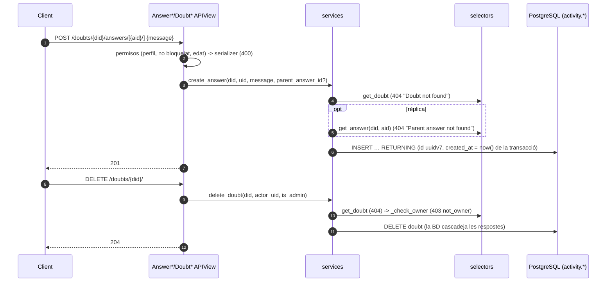

# Flux 9 — Dubtes i respostes

> **[FET]** comprovat al codi · **[INFERÈNCIA]** deducció · **[NO VERIFICAT]** depèn de config externa.

> **Migrat a PostgreSQL (chunk 6).** El domini viu a l'app `apps/doubts` (schema `activity`: `activity.doubts` i `activity.answers`; disseny [§2.16-2.17](../design/postgres-schema.md)). `doubt_views.py`, `doubt_serializer.py`, el model i el mapper de dubtes i `IsDoubtCreator`/`IsAnswerCreator` ja no existeixen o no es fan servir des de les vistes **[FET]**; `DoubtController` i `DoubtDAO` (Firestore) queden vius només perquè els importa `refuge_proposal_dao` en aprovar l'esborrat d'un refugi ([TECH_DEBT D1](../TECH_DEBT.md)). Les comprovacions d'existència de refugi usen `apps.refuges.selectors.refuge_exists` (PostgreSQL), així que aquest domini **ja no pateix** [TECH_DEBT R1](../TECH_DEBT.md) **[FET]**.

## Endpoints (`apps/doubts/views.py`, rutes a `apps/doubts/urls.py`, sota `doubts/`)
| Mètode | URL | Vista | Permisos | Resposta |
|---|---|---|---|---|
| GET | `/api/doubts/?refuge_id=X` | `DoubtListAPIView.get` | IsAuthenticated + HasProfile | 200 llista de dubtes amb `answers` |
| POST | `/api/doubts/` | `DoubtListAPIView.post` | + IsNotBlocked + IsAgeConfirmed | 201 dubte; cos `{refuge_id, message ≤ 2000}` |
| DELETE | `/api/doubts/{doubt_id}/` | `DoubtDetailAPIView.delete` | IsAuthenticated + HasProfile; propietat al service | 204 |
| POST | `/api/doubts/{doubt_id}/answers/` | `AnswerListAPIView.post` | + IsNotBlocked + IsAgeConfirmed | 201 resposta; cos `{message}` |
| POST | `/api/doubts/{doubt_id}/answers/{answer_id}/` (rèplica) | `AnswerReplyAPIView.post` | + IsNotBlocked + IsAgeConfirmed | 201 resposta amb `parent_answer_id = answer_id` |
| DELETE | `/api/doubts/{doubt_id}/answers/{answer_id}/` | `AnswerReplyAPIView.delete` | IsAuthenticated + HasProfile; propietat al service | 204 |

**Permisos [FET]** (`_ContentPermissionsMixin` i `WRITE_PERMISSIONS` a `apps/doubts/views.py`): els tres `POST` exigeixen `IsAuthenticated, HasProfile, IsNotBlocked, IsAgeConfirmed` (decisió del PO 26/10, [D30](../migration/DECISIONS_AUTONOMES.md)); `GET` i `DELETE` només `IsAuthenticated, HasProfile`, de manera que un usuari bloquejat o sense edat confirmada pot llegir i esborrar el que és seu (RGPD).

## Forma JSON [FET] (`apps/doubts/serializers.py`)
- **Dubte**: `{id, refuge_id, creator_uid, message, created_at, answers_count, answers: [...]}`. **`answers` surt sempre**, `[]` si no n'hi ha (D30: abans s'ometia la clau; el frontend té `answers?`, no es trenca). `answers_count` no es desa: és un `Count('answers')` anotat a la consulta (al `POST` surt `0`).
- **Resposta**: `{id, creator_uid, message, created_at, parent_answer_id}` (`parent_answer_id = null` per a les directes). IDs UUID v7; dates ISO 8601 amb el desplaçament de Madrid.
- **Arbre de respostes**: llista **plana** per dubte, ordenada per `(created_at, id)` ascendent; el client munta l'arbre amb `parent_answer_id`. Els dubtes surten per `(created_at, id)` descendent. Sense paginació.
- Entrada: `message` retallat (`strip`), no buit, ≤ 2000 caràcters, sense NUL (mateixes regles que el CHECK de la BD, [D31](../migration/DECISIONS_AUTONOMES.md)). Un `refuge_id` del cos que no és UUID dona 404 (no 400).

## Arbre de respostes i esborrat del subarbre [FET]
- La FK composta `answers_parent_same_doubt_fk (doubt_id, parent_answer_id) → answers (doubt_id, id)` (creada per `RunSQL` a `0001_initial`; Django 5.2 no té FK compostes) garanteix a la BD que el pare existeix **i és del mateix dubte**; el service també ho comprova (404 `Parent answer not found`). Un CHECK impedeix que una resposta sigui pare de si mateixa.
- Totes les FK són `ON DELETE CASCADE DEFERRABLE INITIALLY DEFERRED`. Esborrar un dubte esborra totes les respostes; **esborrar una resposta n'esborra tot el subarbre de rèpliques** amb **un sol `DELETE`**. Canvi de comportament: a Firestore les rèpliques filles quedaven penjant amb `parent_answer_id` orfe.
- `selectors.get_answer(doubt_id, answer_id)` filtra per les dues claus: una resposta d'un altre dubte dona 404 (cap IDOR per la URL).

## Propietat (C1) [FET]
`services._check_owner`: només el creador o un admin (`is_firebase_admin(request)`) poden esborrar; la resta, **403 amb `code: "not_owner"`** (`coded_error`). Per a una resposta, el creador és el de **la resposta** (el creador del dubte no pot esborrar respostes alienes). La RLS ho reforça a la BD: lectura pública; `INSERT` només si `creator_uid` és l'usuari de la sessió o el sistema (ni l'admin no insereix en nom d'un altre); `DELETE` si és el creador, admin o sistema; el rol `app` només té `SELECT, INSERT, DELETE` (no hi ha edició). Tanca el [TECH_DEBT C1](../TECH_DEBT.md) en aquest domini.

## Diagrama — respondre i esborrar

## Passos [FET]
- Crear dubte: `services.create_dubt` → `refuge_exists` (404 `Refuge not found`) + `INSERT`: 2 consultes.
- Crear resposta: `get_doubt` (+ `get_answer` si és rèplica) + `INSERT`; no hi ha cap comptador a actualitzar.
- Esborrar dubte o resposta: lectura + comprovació de propietat + 1 `DELETE`. Si un esborrat concurrent ja l'ha eliminat, 404.
- Llistar: `selectors.list_doubts` fa **2 consultes** amb qualsevol nombre de files (`annotate(Count('answers'))` + `Prefetch`), sense N+1. Sense cache.
- Esborrat d'usuari: `DELETE users.users` cascadeja els seus dubtes i respostes (FK `creator_uid`); ja no és un pas de Firestore ([deep-dive](../deep-dives/user-deletion.md)). Esborrar un refugi a PostgreSQL cascadeja també els seus dubtes.

## Errors [FET]
Ordre de comprovacions: permisos (401/403) → cos (400) → existència (404) → propietat (403).
| Cas | HTTP |
|---|---|
| Sense `refuge_id` al `GET`; cos invàlid (missatge buit, > 2000, NUL) | 400 (`Dades invàlides` + `details`, o missatge sobre `refuge_id`) |
| Sense perfil, usuari bloquejat o edat no confirmada (només POST) | 403 (permisos) |
| Refugi (`Refuge not found`), dubte (`Doubt not found`) o resposta (`Answer not found` / `Parent answer not found`) inexistents; IDs que no són UUID | 404 `{error}` |
| Esborrar el que no és teu (i no ets admin) | 403 `not_owner` |
| Error de BD | 500 `{error, error_id}` via `apps.core.errors.server_error` (missatge fix per punt, sense `str(e)`) |
| DELETE OK | 204 |

## Gotchas
- Els IDs de dubtes i respostes són UUID: un ID antic de Firestore no existeix (404 o llista buida, mai 500) **[FET]** (`selectors.parse_id`).
- El CHECK del missatge retalla tots els blancs ASCII, no només espais (D31) **[FET]**.
- Les dades de Firestore no es migren (decisió del PO): Postgres comença sense dubtes ni respostes **[FET]**.
