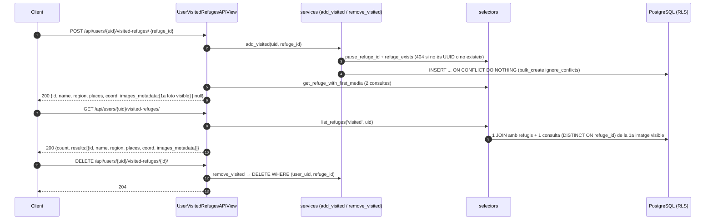

# Flux 10 — Refugis preferits i visitats

> **[FET]** comprovat al codi · **[INFERÈNCIA]** deducció · **[NO VERIFICAT]** depèn de config externa.

> **Migrat a PostgreSQL (chunk 3).** Taules `users.user_favourite_refuges` i `users.user_visited_refuges` ([postgres-schema §2.3–2.4](../design/postgres-schema.md)), **PK composta `(user_uid, refuge_id)`** (sense `id`) amb `created_at`, FK reals `ON DELETE CASCADE` a `users` i a `refuges.refuges`. Ja no hi ha `ArrayUnion`, cache `user_refugis_info` ni escriptura a `visitors` des dels endpoints d'usuari (només el job diari encara toca el `visitors` legacy de Firestore): **`refuge.visitors` (només admins) es llegeix de `user_visited_refuges`** (`apps/refuges/selectors.get_visitor_uids`). Els refugis són ja els de PostgreSQL: l'«estat intermedi» del chunk 2 per a aquest domini s'ha acabat (un ID antic de Firestore, que no és un UUID, dona 404).

## Endpoints (`apps/accounts/views.py`)
| Mètode | URL | Vista |
|---|---|---|
| GET / POST | `/api/users/{uid}/favorite-refuges/` | `UserFavouriteRefugesAPIView` |
| DELETE | `/api/users/{uid}/favorite-refuges/{refuge_id}/` | `UserFavouriteRefugesDetailAPIView` |
| GET / POST | `/api/users/{uid}/visited-refuges/` | `UserVisitedRefugesAPIView` |
| DELETE | `/api/users/{uid}/visited-refuges/{refuge_id}/` | `UserVisitedRefugesDetailAPIView` |

Permisos: `IsAuthenticated` + `HasProfile` + `IsSameUser`. Body del POST: `RefugeIdSerializer` → `{refuge_id}`.

## Diagrama

## Passos
- Afegir és **idempotent** (`INSERT … ON CONFLICT DO NOTHING`): repetir-ho no duplica ni canvia `created_at`; no hi ha carreres. Treure també és idempotent: 204 encara que l'element no hi fos (D23). Refugi inexistent o `refuge_id` invàlid: 404.
- Ordre de les llistes: de més recent a menys, `(created_at DESC, refuge_id DESC)` (decisió del PO) (les taules no tenen `id`). Pressupost de consultes constant (≤ 3 per llista) amb tests de recompte.
- RLS: preferits, només el propi usuari; visitats, el propi usuari **o admin** (per a `visitors`) o sistema.
- **Procés diari** (`process_yesterday_visits`): afegeix els visitants a `user_visited_refuges` amb `add_visited` dins `system_context()` (el job no té context d'usuari); un `refuge_id` d'una visita antiga de Firestore que no és UUID o no existeix es **salta amb warning** ([flux 6](06-refuge-visits.md)). L'array `visitors` del refugi legacy de Firestore encara s'hi actualitza, però ningú no el llegeix.
- **Cap cache**: `user_refugis_info` ha desaparegut.

## Errors
| Cas | HTTP |
|---|---|
| Sense perfil | 403 `profile_required` |
| Refugi no trobat / id no UUID | 404 |
| `uid` URL ≠ token | 403 (`IsSameUser`) |
| Fallada de BD o de presignat | 500 `{error, error_id}` |
| POST OK | **200** (no 201) |
| DELETE OK (també si no hi era) | 204 |

## Gotchas
- A `FavouriteRefuge`/`VisitedRefuge` el PK és compost: **`obj.pk` és una tupla `(user_id, refuge_id)`**, no hi ha `obj.id` ([GOTCHAS #52](../GOTCHAS.md)).
- `bulk_create(ignore_conflicts=True)` no diu si la fila ja existia: per això el POST retorna sempre el refugi.
- Un refugi esborrat desapareix de les llistes per la cascada de la FK (abans quedava i s'ignorava en llegir).
- `refuge.visitors` per a admins encara fa una consulta per refugi a la cerca ([TECH_DEBT R8](../TECH_DEBT.md)).
