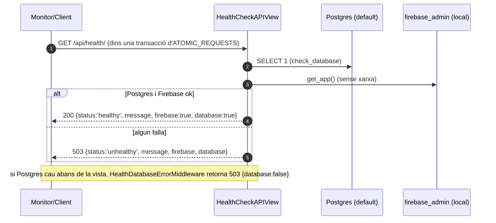

# Flux 11 — Health check

> **[FET]** comprovat al codi · **[INFERÈNCIA]** deducció · **[NO VERIFICAT]** depèn de config externa.
> El fitxer conserva el nom històric (`11-admin-cache-health`); des del chunk 11 (neteja, D43) els endpoints `/api/cache/*` i la cache de Redis han desaparegut i només queda el health check.

## Endpoint
| Mètode | URL | Vista | Permisos | Comportament |
|---|---|---|---|---|
| GET | `/api/health/` | `HealthCheckAPIView.get` (`api/views/health_check_views.py`) | públic (`AllowAny`, exclòs del middleware) | Comprova PostgreSQL (`check_database()`: consulta trivial amb el rol `app`) i que Firebase Admin estigui inicialitzat (`firebase_admin.get_app()`, sense crida de xarxa) |

Resposta (serializer `HealthCheckResponseSerializer`, `api/serializers/health_serializer.py`):
```json
{"status": "healthy", "message": "API operativa", "firebase": true, "database": true}
```
200 si tots dos van bé; si no, **503** amb `status:"unhealthy"`, `message:"Servei no disponible"` i el camp que falla a `false` **[FET]**.

## Diagrama



## Passos
- Fer-se admin, cURL i Swagger: [guides/admin-management.md](../guides/admin-management.md).
- Ping extern: `.github/workflows/ping-website.yml` fa `curl` a `/swagger/` cada 9 minuts (no a `/api/health/`) per mantenir despert el servei de Render **[FET]**; el motiu (evitar l'*spin-down* del pla gratuït) és **[INFERÈNCIA]**.

## Errors
| Cas | HTTP |
|---|---|
| Postgres o Firebase Admin no disponibles | 503 `{status:'unhealthy', firebase, database, …}` |

## Gotchas
- **Firestore i Redis ja no es comproven** (no existeixen): els camps `firestore` i `collections_count` han desaparegut de la resposta. Els clients que els llegien (cap conegut: ni el frontend ni els workflows criden el health) rebrien `undefined` **[FET]**.
- El camp `firebase` només diu que Firebase Admin està inicialitzat; no comprova que el servei de Firebase Auth respongui **[FET]**. Als tests, `_block_real_firebase` fa fallar `get_app`, de manera que per defecte el health és «unhealthy» (els tests que volen 200 el mocken).
- `check_database()` (`api/services/database_health.py`) retorna `False` en un `DatabaseError` (només es registra el tipus d'error, mai detalls ni credencials). La resposta mai exposa el text d'una excepció **[FET]**.
- `HealthDatabaseErrorMiddleware` cobreix el cas en què Postgres és inabastable **abans** de la vista: amb `ATOMIC_REQUESTS` la petició falla en obrir la transacció (i el hook de RLS també fa una consulta), de manera que la vista no arriba a informar `database:false`. El middleware retorna 503 només a `/api/health/` **[FET]**.
- `/api/health/` (i qualsevol monitor que l'usi) desperta Neon (scale-to-zero) i ocupa una connexió del pooler **[INFERÈNCIA]**. El ping de Render/Actions apunta a `/swagger/` ([render-deploy-ci.md](../integrations/render-deploy-ci.md)).
