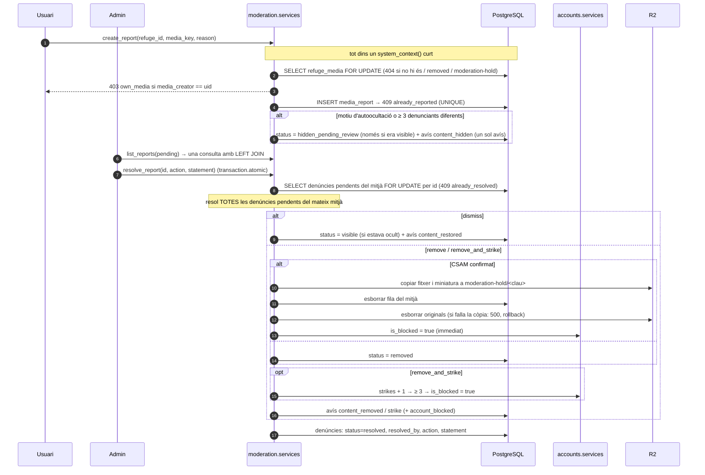

# Flux 12 — Denúncies, moderació de mitjans, edat i auditoria

> **[FET]** comprovat al codi · **[INFERÈNCIA]** deducció · **[NO VERIFICAT]** depèn de config externa.
>
> **Estat (chunk 9)**: denúncies, avisos, llista de hashes i auditoria són a **PostgreSQL** (`apps/moderation`, `apps/audit`; D40, D41). `MediaReportController`, els DAOs i les col·leccions de Firestore (`media_reports`, `moderation_notices`, `moderation_hash_blocklist`, `audit_logs`) han desaparegut.

Cobreix la part RGPD/DSA de la feature *images*: notificació i retirada (art. 16 DSA), declaració de motius (art. 17), recurs (art. 20), moderació automàtica per hash, strikes i bloqueig, edat mínima (16) i registre d'auditoria (art. 32 RGPD). La pujada en si és al [flux 3](03-refuge-media-upload.md).


## Endpoints
| Mètode | URL | Vista | Permisos |
|---|---|---|---|
| POST | `/api/media/reports/` | `apps.moderation.views.MediaReportsAPIView` | IsAuthenticated + HasProfile + IsNotBlocked + IsAgeConfirmed |
| GET | `/api/admin/media-reports/?status=pending\|resolved` | `AdminMediaReportsAPIView` | IsAuthenticated + HasProfile + IsFirebaseAdmin |
| PATCH | `/api/admin/media-reports/{id}/` | `AdminMediaReportDetailAPIView` | IsAuthenticated + HasProfile + IsFirebaseAdmin |
| GET | `/api/users/{uid}/moderation-notices/` | `UserModerationNoticesAPIView` | IsAuthenticated + HasProfile + IsSameUser (**només el mateix usuari; l'admin rep 403**, D41) |
| POST | `/api/users/` (+ `birth_date`) | `apps.accounts.views.UsersCollectionAPIView` | IsAuthenticated |
| PATCH | `/api/users/{uid}/age-confirmation/` | `apps.accounts.views.UserAgeConfirmationAPIView` | IsAuthenticated + HasProfile + IsSameUser |

Les rutes són a `apps/moderation/urls.py` (mateixos paths i `name=` que abans). Ordre de les comprovacions: permisos → validació (400) → existència (404) → estat (403/409).

## Contracte [FET]
```
POST /api/media/reports/  {refuge_id, media_key, reason, details?}   (details obligatori si reason=other, ≤1000)
  → 201 {id, refuge_id, media_key, reason, details, status, priority, created_at, media_hidden}
     · `id` és un UUID opac (ja no és el SHA-256 determinista, D40)
  · 400 dades invàlides (motiu desconegut, `details` absent amb `other`)
  · 403 own_media (l'autor denuncia el seu mitjà) · 403 age_not_confirmed / user_blocked / profile_required
  · 404 `Refugi not found` (inexistent o id no UUID) · 404 `Media not found` (clau inexistent, mitjà `removed` o clau `moderation-hold/`)
  · 409 already_reported (UNIQUE `media_reports_unique_reporter_uq`, traduïda per `constraint_name`)
GET   /api/admin/media-reports/?status=pending|resolved  → 200 {count, reports:[{...report, media: MediaItem+status | null}]}
        (una sola consulta amb LEFT JOIN a `refuges.refuge_media`; prioritat alta primer, després per data)
PATCH /api/admin/media-reports/{id}/  {action: dismiss|remove|remove_and_strike, statement}
  → 200 {report, resolved_report_ids, media_status, strikes, user_blocked}
  · 404 `Report not found` (inexistent o id no UUID) · 409 already_resolved · 500 si R2 falla en una retenció CSAM
GET   /api/users/{uid}/moderation-notices/  → 200 {notices:[{id, uid, type, statement, created_at, refuge_id,
        media_key, reason, action, report_id, automated, strikes, redress}]}   (més recents primer; 403 si uid ≠ propi)
POST  /api/users/  + birth_date (YYYY-MM-DD, opcional) → 403 underage si < 16
PATCH /api/users/{uid}/age-confirmation/ {birth_date} → 200 (usuari) / 403 underage
```
Errors amb codi: `{"error": "<codi>", "code": "<codi>", "message": "<text>"}`. Els 500 porten `{error, error_id}` (`server_error`).

**Camps d'una denúncia a l'admin**: `id, refuge_id, media_key, reporter_uid, reason, details, media_creator_uid, status, priority, created_at, resolved_at, resolved_by, action, statement, source, media`. `reporter_uid` és `'system'` si `source = automatic` i `'unknown'` si la denúncia s'ha anonimitzat (denunciant esborrat, `legal_hold`); `refuge_id` pot ser `null` si el refugi s'ha esborrat. `media` és el MediaItem (URL presignada d'1 h) amb `status`, o `null` si el mitjà ja no existeix; l'evidència a `moderation-hold/` no es previsualitza.

### Motius (`REPORT_REASONS`, `apps/moderation/models.py`)
`child_sexual_abuse`, `child_endangerment`, `sexual_nonconsensual`, `violence_gore`, `terrorism_extremism`, `hate_speech`, `harassment_bullying`, `animal_cruelty`, `self_harm`, `illegal_goods`, `my_image`, `privacy_personal_data`, `intellectual_property`, `fraud_scam_spam`, `misleading_irrelevant`, `other`.

**Autoocultació** (`AUTO_HIDE_REASONS`): `child_sexual_abuse`, `child_endangerment`, `sexual_nonconsensual`, `terrorism_extremism`, `my_image` → `hidden_pending_review` immediat i `priority=high`. La resta s'oculta quan hi ha **3 denunciants diferents** amb denúncies pendents.

## Model de dades [FET]
| Taula (PostgreSQL) | Columnes principals | Notes |
|---|---|---|
| `moderation.media_reports` | `id` (UUID), `refuge_id` (FK `SET NULL`), `media_key`, `reporter_uid` (FK `SET NULL`), `reason`, `details`, `media_creator_uid`, `status`, `priority`, `source`, `legal_hold`, `anonymized_at`, `resolved_*`, `action`, `statement` | RLS. `UNIQUE (refuge, media_key, reporter)` (parcial) → 409. Els `CHECK` de la BD i els serializers coincideixen (GOTCHAS #5) |
| `moderation.moderation_notices` | `user_id`, `type`, `statement`, `refuge_id`, `media_key`, `reason`, `action`, `report_id`, `automated`, `strikes` | RLS: cada usuari només veu els seus. `type ∈ content_hidden, content_restored, content_removed, strike, account_blocked, upload_blocked`. `redress` és un text constant de l'API (art. 20 DSA), no es desa |
| `moderation.moderation_hash_blocklist` | `sha256?`, `phash?` (bigint amb signe), `category`, `source`, `added_at` | **Il·legible per a `app`**: només s'hi accedeix amb `moderation.fn_hash_match(sha256, phash, distància)` (`SECURITY DEFINER`). S'alimenta amb `load_hash_blocklist` ([guia](../guides/hash-blocklist.md)). Comença buida (PO, 28/10) |
| `audit.audit_logs` | `actor_uid` (NULL = sistema), `action`, `target_type`, `target_id`, `subject_uid`, `metadata`, `legal_hold`, `expire_at` | Sense `UPDATE`/`DELETE` per a `app`. Ja no hi ha TTL de Firestore: el purga `purge_audit_logs` |
| `users.users` (chunk 3) | `age_confirmed_at`, `age_threshold` (16), `moderation_strikes`, `is_blocked`, `blocked_reason` (`csam_confirmed`/`strikes`/`moderation_hash_match`), `blocked_at` | **Mai** es desa la data de naixement |
| `refuges.refuge_media.status` | `visible \| hidden_pending_review \| removed` | L'estat del mitjà viu a la fila del mitjà (inclosos els d'experiència) |

## Diagrama — denúncia i resolució



## Retenció CSAM i esborrat d'usuari/refugi
- Una resolució CSAM copia **tots** els fitxers a `moderation-hold/<clau>` *abans* d'esborrar fila i originals; si R2 falla, `EvidenceHoldError` → 500 i tot es desfà (GOTCHAS #84). Un original que no s'ha pogut esborrar després de la còpia queda orfe a R2 (`warning`; TECH_DEBT R16).
- Les denúncies i l'auditoria de les accions CSAM porten `legal_hold = true` (retenció de 5 anys). En esborrar un usuari o un refugi, els triggers `SECURITY DEFINER` `users.fn_users_detach_legal_hold` / `refuges.fn_refuges_detach_legal_hold` desvinculen les files `legal_hold` (`reporter_uid`/`refuge_id` NULL, `anonymized_at`) **conservant `details`** (decisió del PO, 28/10); les no `legal_hold` cauen en cascada. Detall: [deep-dives/user-deletion.md](../deep-dives/user-deletion.md).

## Moderació automàtica (`apps/moderation/services.py`, `apps/uploads/services.py`)
- La comprovació s'executa a cada pujada (`confirm`) **abans** de publicar: sha256 exacte + pHash amb distància de Hamming ≤ 6, tot dins `moderation.fn_hash_match` (l'aplicació mai llegeix la taula). Els proveïdors externs (PhotoDNA, Google Content Safety) continuen desactivats. Si la comprovació falla → **fail-closed** (`processing_error`, no es publica).
- Coincidència (`apps.moderation.services.register_upload_block`, una transacció): el fitxer **no** es publica; l'original es mou a `moderation-hold/<upload_id>` (**sense l'UID**, D41: l'autor ja és a `media_creator_uid`), `is_blocked = true`, denúncia automàtica `child_sexual_abuse` `priority=high` `source=automatic` `legal_hold`, avís `account_blocked` i dues entrades d'auditoria `legal_hold`. L'admin no rep previsualització de l'evidència.
- Futur (domini propi a Cloudflare + CSAM Scanning Tool + PhotoDNA/NCMEC): [guides/cloudflare-domain-csam.md](../guides/cloudflare-domain-csam.md).

## Permisos (`apps/auth/permissions.py`)
- `HasProfile` (chunk 3): 403 `profile_required` si no hi ha fila a `users.users`. S'aplica a tot endpoint autenticat llevat de `POST /users/`; va **abans** d'`IsNotBlocked`/`IsAgeConfirmed`.
- `IsNotBlocked`: 403 `user_blocked` si `users.users.is_blocked`. S'aplica a intents/confirm, denúncies i POST/PATCH/DELETE d'experiències.
- `IsAgeConfirmed`: 403 `age_not_confirmed` si no hi ha `age_confirmed_at`. Com que `HasProfile` ja ha exigit la fila, el cas «usuari inexistent» només es veu aquí si algú crida el permís sense `HasProfile`.
- Els tres llegeixen `users.users` amb `get_user_for_permissions` → `selectors.get_user` (**1 consulta per petició**: cau a `request._account_cache`; **sense Redis**). Un bloqueig té efecte immediat (abans podia trigar fins a 10 min per la cache de `user_detail`; [TECH_DEBT I4](../TECH_DEBT.md) resolt) **[FET]**.
- Els tests mocken `get_user_for_permissions` (usuari confirmat i no bloquejat) llevat del marker `real_permissions`.

## Edat
- `POST /api/users/` amb `birth_date`: < 16 → 403 `underage` i **no** es crea l'usuari; ≥ 16 → `age_confirmed_at` + `age_threshold=16` (`services.create_user`); data futura o anterior a 1900 → 400. Sense `birth_date` (p. ex. Google) l'usuari es crea amb `age_confirmed=false` i l'app mostra la pantalla d'edat.
- `PATCH /api/users/{uid}/age-confirmation/` (`services.confirm_age`, respon 200 amb el perfil propi): mateixa regla. El càlcul (`apps/core/age_utils.py`) usa la data d'avui a Europe/Madrid. La data de naixement no es desa ni es registra a l'auditoria.

## Auditoria (`apps/audit/services.py`)
Accions: `media.upload_intent`, `media.upload_confirm`, `avatar.upload`, `media.delete`, `media.list`, `media.report`, `moderation.auto_hide`, `moderation.hash_block`, `moderation.user_blocked`, `moderation.resolve`, `moderation.reports_list`, `user.age_confirmed`.
- `AuditLogService.log(actor_uid, action, target_type, target_id, metadata)` **mai llança**: `INSERT` en un *savepoint*; un error només es registra al log (GOTCHAS #85).
- Actor `'system'`/`None` → `actor_uid` NULL (amb `system_context()` acotat). `target_type = 'user'` → l'UID afectat va a `subject_uid` (cap UID a `target_id`/`metadata`, perquè l'esborrat d'usuari l'anonimitzi).
- Retenció: `expire_at` = 365 dies, o 5 anys si l'acció és CSAM (`legal_hold`, derivat de l'acció; **no retroactiu**: `app` no té `UPDATE`). Purga: `python manage.py purge_audit_logs` (diària, lots de 5.000, **sense planificar**, TECH_DEBT R18).

## Gotchas
- `dismiss` no restaura un mitjà `removed` (només `hidden_pending_review`).
- La resolució actua sobre el **mitjà**, no sobre una denúncia aïllada: totes les pendents del mateix mitjà queden resoltes amb la mateixa acció i motivació.
- Denunciar i resoldre toquen files d'altres usuaris: el bloqueig `FOR UPDATE` de la fila del mitjà serialitza denunciants simultanis (un sol avís) i `resolve_report` bloqueja les denúncies per `id` (GOTCHAS #83, #84).
- `purge_moderation` (mensual: denúncies i avisos a 24 mesos de resoldre's, `legal_hold` 5 anys) tampoc no està planificada (R18). Quan s'esborra un denunciant, els mitjans ocults només per les seves denúncies **no** tornen a la cua (§8.4 pas 2, chunk 10; TECH_DEBT R23).
