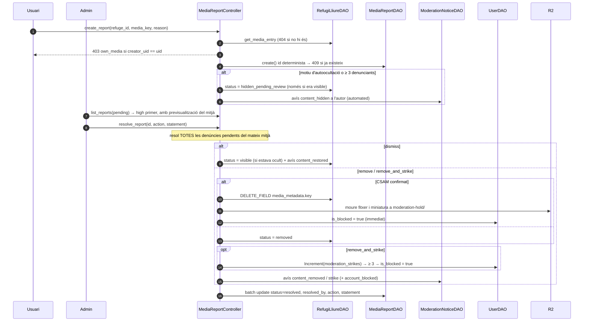

# Flux 12 — Denúncies, moderació de mitjans, edat i auditoria

> **[FET]** comprovat al codi · **[INFERÈNCIA]** deducció · **[NO VERIFICAT]** depèn de config externa.

Cobreix la part RGPD/DSA de la feature *images*: notificació i retirada (art. 16 DSA), declaració de motius (art. 17), recurs (art. 20), moderació automàtica per hash, strikes i bloqueig, edat mínima (16) i registre d'auditoria (art. 32 RGPD). La pujada en si és al [flux 3](03-refuge-media-upload.md).

## Endpoints
| Mètode | URL | Vista | Permisos |
|---|---|---|---|
| POST | `/api/media/reports/` | `MediaReportsAPIView` (`api/views/media_views.py:163`) | IsAuthenticated + IsNotBlocked + IsAgeConfirmed |
| GET | `/api/admin/media-reports/?status=pending\|resolved` | `AdminMediaReportsAPIView` (`:224`) | IsAuthenticated + IsFirebaseAdmin |
| PATCH | `/api/admin/media-reports/{id}/` | `AdminMediaReportDetailAPIView` (`:262`) | IsAuthenticated + IsFirebaseAdmin |
| GET | `/api/users/{uid}/moderation-notices/` | `UserModerationNoticesAPIView` (`api/views/user_views.py`) | IsAuthenticated + IsSameUser |
| POST | `/api/users/` (+ `birth_date`) | `UsersCollectionAPIView` | IsAuthenticated |
| PATCH | `/api/users/{uid}/age-confirmation/` | `UserAgeConfirmationAPIView` | IsAuthenticated + IsSameUser |

## Contracte [FET]
```
POST /api/media/reports/  {refuge_id, media_key, reason, details?}   (details obligatori si reason=other, ≤1000)
  → 201 {id, refuge_id, media_key, reason, details, status, priority, created_at, media_hidden}
  · 403 own_media (l'autor denuncia el seu mitjà) · 409 already_reported · 404 refugi/mitjà
  · 403 age_not_confirmed / user_blocked
GET   /api/admin/media-reports/?status=pending|resolved  → 200 {count, reports:[{...report, media: MediaItem+status | null}]}
PATCH /api/admin/media-reports/{id}/  {action: dismiss|remove|remove_and_strike, statement}
  → 200 {report, resolved_report_ids, media_status, strikes, user_blocked} · 404 · 409 already_resolved
GET   /api/users/{uid}/moderation-notices/  → 200 {notices:[{id, uid, type, statement, created_at, refuge_id,
        media_key, reason, action, report_id, automated, strikes, redress}]}
POST  /api/users/  + birth_date (YYYY-MM-DD, opcional) → 403 underage si < 16
PATCH /api/users/{uid}/age-confirmation/ {birth_date} → 200 (usuari) / 403 underage
```
Errors amb codi: `{"error": "<codi>", "code": "<codi>", "message": "<text>"}`.

### Motius (`REPORT_REASONS`, `api/models/media_report.py`)
`child_sexual_abuse`, `child_endangerment`, `sexual_nonconsensual`, `violence_gore`, `terrorism_extremism`, `hate_speech`, `harassment_bullying`, `animal_cruelty`, `self_harm`, `illegal_goods`, `my_image`, `privacy_personal_data`, `intellectual_property`, `fraud_scam_spam`, `misleading_irrelevant`, `other`.

**Autoocultació** (`AUTO_HIDE_REASONS`): `child_sexual_abuse`, `child_endangerment`, `sexual_nonconsensual`, `terrorism_extremism`, `my_image` → `hidden_pending_review` immediat i `priority=high`. La resta s'oculta quan hi ha **3 denunciants diferents** amb denúncies pendents.

## Model de dades [FET]
| Col·lecció | Document | Notes |
|---|---|---|
| `media_reports/{id}` | `{refuge_id, media_key, reporter_uid, reason, details, media_creator_uid, status: pending\|resolved, priority: high\|normal, created_at, resolved_at, resolved_by, action, statement, source: user\|automatic}` | `id = sha256(refuge_id\|media_key\|reporter_uid)[:40]` i es crea amb `create()` → la 2a denúncia del mateix usuari falla atòmicament (409) |
| `moderation_notices/{autoId}` | `{uid, type, statement, created_at, refuge_id, media_key, reason, action, report_id, automated, strikes}` | `type ∈ content_hidden, content_restored, content_removed, strike, account_blocked, upload_blocked`; l'API hi afegeix `redress` (via de recurs) |
| `moderation_hash_blocklist/{id}` | `{sha256?, phash?, category, source, added_at}` | Es manté a mà (consola/script); els pHash es cachegen 10 min |
| `audit_logs/{autoId}` | `{actor_uid, action, target_type, target_id, metadata, timestamp (ISO), expire_at (Timestamp +12 mesos)}` | TTL de Firestore sobre `expire_at` |
| `users/{uid}` | `age_confirmed_at`, `age_threshold` (16), `moderation_strikes`, `is_blocked`, `blocked_reason`, `blocked_at` | **Mai** es desa la data de naixement; l'API només exposa `age_confirmed` (bool) |
| `data_refugis_lliures/{id}.media_metadata[key].status` | `visible \| hidden_pending_review \| removed` | Escrit amb `FieldPath` |

## Diagrama — denúncia i resolució



## Moderació automàtica (`api/services/moderation_service.py`)
- `ModerationProvider` (interfície) → `HashBlocklistProvider` (actiu: sha256 exacte + pHash amb distància de Hamming ≤ 6), `PhotoDNAProvider` i `GoogleContentSafetyProvider` (stubs **desactivats** fins tenir accés).
- `ModerationService.check` s'executa a cada pujada (nova i legacy) **abans** de publicar. Si un proveïdor falla → **fail-closed** (`processing_error`, no es publica).
- Coincidència (`MediaUploadController._handle_moderation_block`): el fitxer **no** es publica, l'original es mou a `moderation-hold/{uid}/{upload_id}`, `is_blocked=true`, denúncia `child_sexual_abuse` `priority=high` `source=automatic` (reporter `system`), avís `account_blocked` i dues entrades d'auditoria. L'admin **no** rep previsualització de l'evidència retinguda.
- Futur (domini propi a Cloudflare + CSAM Scanning Tool + PhotoDNA/NCMEC): [guides/cloudflare-domain-csam.md](../guides/cloudflare-domain-csam.md).

## Permisos nous (`api/permissions.py`)
- `IsNotBlocked` (L409): 403 `user_blocked` si `users/{uid}.is_blocked`. S'aplica a intents/confirm, denúncies, POST/PATCH/DELETE d'experiències, POST multipart de media i PATCH d'avatar.
- `IsAgeConfirmed` (L429): 403 `age_not_confirmed` si no hi ha `age_confirmed_at` (o no existeix `users/{uid}`). S'aplica a intents/confirm i denúncies.
- Tots dos llegeixen l'usuari amb `get_user_for_permissions` (L397, `UserDAO.get_user_by_uid`, cache-first 10 min): un bloqueig pot trigar fins a 10 min a fer efecte si no s'invalida la cache **[INFERÈNCIA]** — `UserDAO.set_blocked` sí que invalida `user_detail`.

## Edat
- `POST /api/users/` amb `birth_date`: < 16 → 403 `underage` i **no** es crea l'usuari; ≥ 16 → `age_confirmed_at` + `age_threshold=16`. Sense `birth_date` (p. ex. Google) l'usuari es crea amb `age_confirmed=false` i l'app mostra la pantalla d'edat.
- `PATCH /api/users/{uid}/age-confirmation/`: mateixa regla. El càlcul (`api/utils/age_utils.py`) usa la data d'avui a Europe/Madrid. La data de naixement no es desa ni es registra a l'auditoria.

## Auditoria (`api/services/audit_log_service.py`)
Accions: `media.upload_intent`, `media.upload_confirm`, `media.upload_legacy`, `avatar.upload`, `media.delete`, `media.list` (accés a la llista de mitjans), `media.report`, `moderation.auto_hide`, `moderation.hash_block`, `moderation.user_blocked`, `moderation.resolve`, `moderation.reports_list`, `user.age_confirmed`. `log()` mai llança (un error de Firestore només es registra al log).

## Gotchas
- `expire_at` és un **datetime** (Timestamp), no un string ISO: és l'única excepció a la convenció de dates perquè la TTL de Firestore només funciona amb Timestamps.
- Les consultes de `media_reports` usen només igualtats i ordenen en Python per no necessitar índexs compostos; si s'hi afegeix `order_by`, Firestore demanarà un índex (l'error porta l'enllaç).
- `dismiss` no restaura un mitjà `removed` (només `hidden_pending_review`).
- La resolució actua sobre el **mitjà**, no sobre una denúncia aïllada: totes les pendents del mateix `media_key` queden resoltes amb la mateixa acció i motivació.
