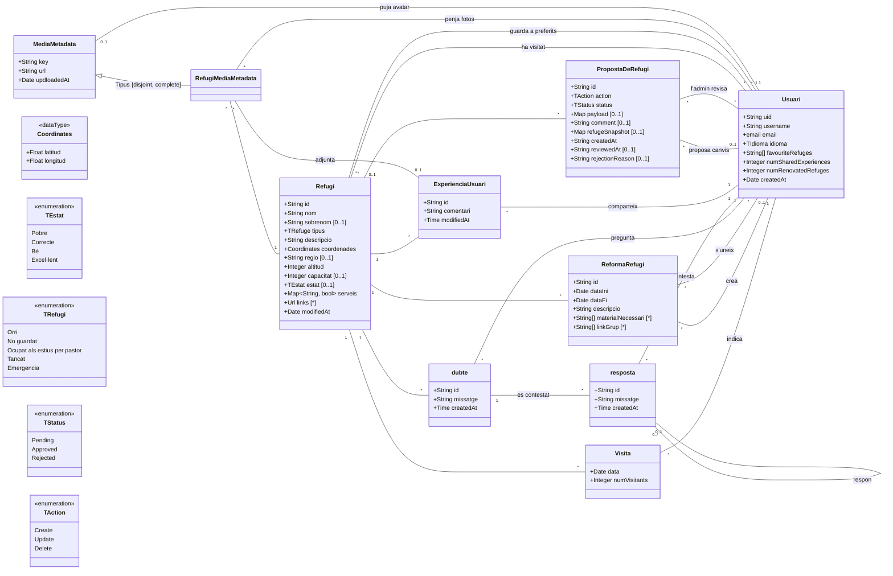

# Model de domini UML "Refus" (traducció per a LLM)

Font: diagrama draw.io `Refus_UML.drawio`. Aquest document descriu el model de classes en dos formats equivalents:
1. Un `classDiagram` de Mermaid (llegible per màquina).
2. Una descripció textual de classes, enumeracions i relacions.

Context: l'aplicació gestiona **refugis de muntanya** (`Refugi`), **usuaris** (`Usuari`) i el contingut que aporten (visites, reformes, dubtes i respostes, experiències, fotos i propostes de canvi).

---

## 1. Diagrama Mermaid

---

## 2. Descripció textual

### Classes
- **Refugi**: refugi de muntanya. Té `tipus` (enum `TRefugi`), `coordenades` (`Coordinates`), `estat` opcional (enum `TEstat`), `serveis` (mapa nom de servei → booleà), `links` (llista d'URLs) i `modifiedAt`. Opcionals: `sobrenom`, `regio`, `capacitat`, `estat`.
- **Usuari**: persona registrada. Té `uid`, `username`, `email`, `idioma` (`TIdioma`), llista de refugis preferits (`favouriteRefuges`) i comptadors `numSharedExperiences` i `numRenovatedRefuges`.
- **Visita**: registre d'una visita a un refugi (`data`, `numVisitants`).
- **ReformaRefugi**: reforma d'un refugi amb dates d'inici/fi, descripció, material necessari i enllaços del grup.
- **dubte** / **resposta**: pregunta d'un usuari sobre un refugi i les respostes que rep. Les respostes poden respondre a altres respostes (associació reflexiva).
- **ExperienciaUsuari**: comentari/experiència que un usuari comparteix sobre un refugi.
- **PropostaDeRefugi**: proposta de canvi (crear/actualitzar/eliminar) sobre un refugi; un administrador la revisa. `payload` conté els canvis, `refugeSnapshot` una còpia de l'estat del refugi, `status` el resultat (`Pending`/`Approved`/`Rejected`).
- **MediaMetadata**: metadades d'un fitxer (`key`, `url`, `updloadedAt`). Especialitzada per **RefugiMediaMetadata** (fotos associades a un refugi), restricció `{disjoint, complete}`.

### Enumeracions i tipus
- `TEstat`: Pobre, Correcte, Bé, Excel·lent
- `TRefugi`: Orri, No guardat, Ocupat als estius per pastor, Tancat, Emergencia
- `TStatus`: Pending, Approved, Rejected
- `TAction`: Create, Update, Delete
- `Coordinates` (dataType): latitud: Float, longitud: Float
- `TIdioma`: usat per `Usuari.idioma` però **no definit** al diagrama.

### Relacions (multiplicitat en cada extrem)

| Extrem A | Etiqueta | Extrem B |
|---|---|---|
| Usuari * | ha visitat | * Refugi |
| Usuari * | guarda a preferits | * Refugi |
| Refugi 1 | (sense etiqueta) | * Visita |
| Usuari 1 | indica | * Visita |
| Refugi 1 | (sense etiqueta) | * ReformaRefugi |
| Usuari 0..1 | crea | * ReformaRefugi |
| Usuari * | s'uneix | * ReformaRefugi |
| Refugi 1 | (sense etiqueta) | * dubte |
| Usuari 1 | pregunta | * dubte |
| dubte 1 | es contestat | * resposta |
| Usuari 1 | contesta | * resposta |
| resposta 0..* | respon | 0..1 resposta |
| Refugi 1 | (sense etiqueta) | * ExperienciaUsuari |
| Usuari 1 | comparteix | * ExperienciaUsuari |
| ExperienciaUsuari 0..1 | adjunta | * RefugiMediaMetadata |
| Refugi 1 | (sense etiqueta) | * RefugiMediaMetadata |
| Usuari 1 | penja fotos | * RefugiMediaMetadata |
| Usuari 1 | puja avatar | 0..1 MediaMetadata |
| Refugi 0..1 | (sense etiqueta) | * PropostaDeRefugi |
| Usuari 0..1 | proposa canvis | * PropostaDeRefugi |
| Usuari * | l'admin revisa | * PropostaDeRefugi |
| MediaMetadata | herència {disjoint, complete}, "Tipus" | RefugiMediaMetadata |

### Notes i possibles incoherències del diagrama original
- `TIdioma` no està definit; el tipus `email` s'usa com a tipus d'atribut.
- `Refugi.tipus` es declara com `TRefuge`, però l'enumeració es diu `TRefugi`.
- `MediaMetadata.updloadedAt` té una errada ortogràfica (`uploadedAt`); `<< enummeration>>` també (`enumeration`).
- `PropostaDeRefugi.createdAt`, `reviewedAt` són `String`, mentre la resta de dates són `Date`/`Time`.
- Les multiplicitats de les relacions de `PropostaDeRefugi` amb `Usuari` s'han llegit visualment (`0..1` per "proposa canvis" i `*`–`*` per "l'admin revisa") i convé confirmar-les.
